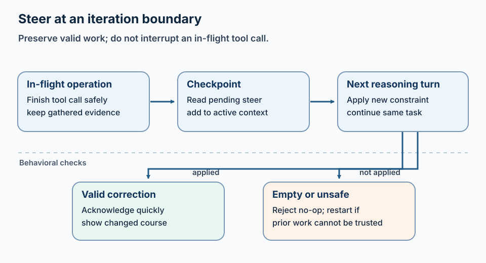

## How do I let users interrupt or redirect an artificial intelligence (AI) agent mid-response?

Deliver the correction at the next safe checkpoint between tool calls, keep trusted evidence when the task is still the same, and refuse to mark the run done until the final answer addresses that feedback. A stored comment that never reaches the loop is not mid-run steering.

**Key takeaways**

- Interrupt and redirect need a safe boundary, not end-of-run delivery.
- Cancel stops; steer changes direction under the same policy.
- Receipt alone is not enough; the final result must show the change.
{: .key-takeaways}

**Mid-run steering** means adding an operator correction to an active AI agent—a model-driven process that can call tools—before it finishes. How can that correction affect the next step without discarding valid investigation work?

An incident agent was investigating the wrong environment.

The operator noticed early and sent a short correction: "Use staging, not production." The feedback was accepted by the interface. The run continued. The agent delivered the original production-focused answer anyway.

Nothing crashed. The correction was stored. The audit trail even showed that it arrived.

It simply reached the agent too late to matter.

Receiving feedback is not enough. The runtime must deliver it at a safe execution boundary and check that the final response addresses it.

---

## How do I send cancel or steer signals mid-stream?

Cancel ends the active work. Steer injects additive (or explicit replace) constraints so the next reasoning turn uses them. Both signals should be visible in the audit trail. Only steer should keep prior tool results that still match the corrected goal.

## How do you contain an AI agent mid-incident?

**Containment limits further effects while preserving enough evidence to understand what happened.** It is not merely hiding the chat response, and it is not always safe to kill a process in the middle of a write.

Use this order when an active run targets the wrong environment, exceeds its scope, or proposes an unsafe action:

1. **Stop new side effects.** Cancel pending write tools or move the run to a read-only boundary. Let an in-flight operation reach its safest supported stopping point rather than assuming abrupt termination is harmless.
2. **Keep authorization unchanged.** A steer such as “switch to production” must still pass identity, policy, and approval checks. The operator’s message changes intent; it does not grant new privileges.
3. **Preserve the execution record.** Save the task, operator messages, model decisions, tool arguments, typed outcomes, and any mutation identifiers before restart or context compaction.
4. **Separate investigation from remediation.** Evidence gathering can continue only when its reads are known to be safe. Do not let a diagnostic loop automatically turn into a restart, rollback, or configuration change.
5. **Make the disposition explicit.** Report what was stopped, what completed, which evidence remains valid, and whether any action needs reconciliation.
6. **Resume with a narrow contract.** Require an explicit target, allowed tools, budget, and completion check. If the goal or trust boundary changed, start a new run instead of carrying forward stale context.

| Signal | Preferred response | Evidence to retain |
|--------|--------------------|--------------------|
| Wrong namespace or environment, no unsafe write in flight | Steer at the next boundary and narrow the target | Original scope, correction, and prior observations still valid for the corrected task |
| Unsafe write proposed but not started | Deny or pause the action; require the appropriate approval | Proposed arguments, policy decision, and operator disposition |
| Uncertain blast radius or conflicting operator instructions | Pause new effects and ask for clarification | Conflicting messages, active tool state, and pending actions |
| Tool write may have partially completed | Stop blind retries and reconcile its actual state | Idempotency or mutation identifier, result or error, and reconciliation outcome |

Containment composes with [defense in depth](/blog/defense-in-depth/), [human approval guardrails](/blog/ai-agent-guardrails-human-approval/), and [completion checks](/blog/is-the-task-actually-done/); a chat interrupt alone is not a safety boundary.

## Why Restarting Is the Wrong Default

One option is to cancel the run and start again with a corrected prompt.

That wastes:

- evidence already gathered,
- tool calls already paid for,
- context the operator still trusts,
- and time during an active incident.

It also forces the human to restate the task, copy useful findings, and explain which parts should survive.

For a correction within the same task, the aim is to **keep valid work and change direction from here**. If the earlier work is no longer trustworthy, restart instead.

That is different from both a new task and an approval decision. Approval asks whether a proposed action may proceed. Steering changes how the current task should proceed.

---

## The First Failure: Feedback Waiting at the Wrong Boundary

*Apply a correction at the next safe checkpoint, not after the run ends.*

Long-running agents have natural checkpoints: after a model turn, after a tool result, before the next planning step, and before completion.

If feedback is only checked when the task finishes or becomes stuck, a healthy-looking run can sail past the correction. The operator’s message sits in a queue while the model continues from stale assumptions.

The next iteration boundary is the useful handoff point:

1. Finish the in-flight operation safely.
2. Check for pending operator feedback.
3. Add the feedback to the active working context.
4. Let the next reasoning turn respond to it.

Interrupting arbitrary code in the middle of a tool call is risky. Waiting until the entire task ends is useless. Iteration boundaries provide a controlled middle.

This resembles [asynchronous human approval](/blog/hitl-paradox/): human input must join a live workflow without freezing unrelated work or corrupting state.

---

## The Second Failure: An Empty Interrupt

We fixed delivery timing and found another bug.

The runtime forced an extra turn for the feedback. The model produced little or nothing, then the task closed with the answer it had prepared before the correction. Technically, the feedback had been “processed.” Behaviorally, it had been ignored.

This is why acknowledgments are not proof.

The system needs a completion debt: once valid feedback arrives, the run is not complete until the next output addresses it or explains why it cannot.

That does not require the model to obey every request. The steer may conflict with policy, evidence, or the task’s scope. But the final answer must make the disposition visible:

- incorporated,
- rejected with a reason,
- or blocked pending clarification.

Silence is not a disposition.

---

## Steering Should Usually Be Additive

The most useful operator corrections are extensions:

- “Also check the staging cluster.”
- “Prioritize customer impact.”
- “Do not restart anything.”
- “Compare this with yesterday’s deployment.”

Replacing the whole task with the steer can erase the original objective. Ignoring the steer preserves the objective but misses the correction.

The default should be additive:

> Continue pursuing the original goal, with this new constraint or direction.

Replacement still has a place, but it should be explicit: stop investigating the original target and switch to a new one. Treating every short message as replacement makes terse operational feedback destructive.

This is especially important in chat and incident channels, where people communicate in fragments.

---

## Reject Empty No-Ops

Human interfaces generate noise: blank messages, accidental reactions, duplicated events, and whitespace-only inputs.

An empty steer should not:

- force another expensive model turn,
- mark feedback as handled,
- delay completion,
- or change the final answer.

Validate feedback at the boundary. If it contains no instruction, reject it visibly and leave the run alone.

This sounds minor until a no-op interrupt consumes a limited recovery opportunity available to a stalled task.

---

## Acknowledge Quickly, Apply Carefully

Operators need immediate confirmation that their correction was received. Otherwise they repeat it, creating conflicting or duplicate steers.

A short status message is enough:

> Direction received. Applying it on the next investigation step.

That acknowledgment should not claim the change is complete. It only confirms queueing.

The final response provides the second receipt:

- what changed,
- which earlier findings still apply,
- and what the new direction uncovered.

This **two-receipt model** — received, then applied — makes the workflow legible without flooding the channel.

---

## Steering Is a Governance Surface

Mid-run feedback can change tool choice, target environment, and the interpretation of evidence. It needs the same identity and policy discipline as the original request.

Questions to answer:

- Who is allowed to steer this run?
- Can one user redirect another user’s task?
- Does a steer inherit the original permissions?
- What happens when two corrections conflict?
- When does old feedback become stale?
- Can a steer expand the task into a higher-risk action?

Steering must not become a side door around approval. “Use production instead” should still encounter the production policy boundary. Human input changes intent; it does not grant authority.

---

## When Not to Use a Steer

Start a new task when:

- the new request has a different goal,
- the old evidence would bias the new investigation,
- permissions or ownership have changed,
- or the original run has already committed an irreversible action.

Use a steer when the operator is correcting scope, priority, constraints, or emphasis inside the same goal.

That distinction prevents one immortal conversation from accumulating unrelated work forever.

---

## Lessons Learned

1. **Check feedback between iterations.** End-of-run delivery is too late; mid-tool interruption is too risky.
2. **Feedback creates completion debt.** The run must address it before claiming done.
3. **Add by default, replace explicitly.** Most operational corrections refine the goal rather than erase it.
4. **Reject empty feedback.** A no-op should not consume time, budget, or recovery opportunities.
5. **Use two receipts.** Confirm receipt quickly, then show how the final result changed.
6. **Keep policy in force.** Steering changes direction, not authority.

Human-in-the-loop should mean more than approving a button at the end. A correction is useful only if the agent can apply it before completion and the policy checks still hold.

---

## Related reading

- [The human-in-the-loop (HITL) paradox](/blog/hitl-paradox/)
- [AI agent loop detection — don't throw away the answer](/blog/ai-agent-loop-detection-salvage/)
- [Is the task actually done?](/blog/is-the-task-actually-done/)
- [Defense in depth for tool-wielding agents](/blog/defense-in-depth/)

---

*Where should operators be able to redirect your agents without restarting the task? Find me on [GitHub](https://github.com/sks) or [LinkedIn](https://linkedin.com/in/sabithks).*

---

> StackGen develops AI tools for site reliability engineering (SRE), including incident triage and diagnostic workflows. Product details are at [ai.stackgen.com](https://ai.stackgen.com).
