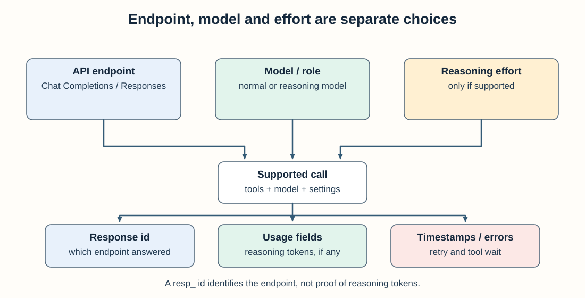

When an investigation takes seven minutes, the endpoint name alone does not explain the delay. A debug trace can separate endpoint selection from model choice, reasoning effort, tool latency, and retries.

Three decisions are often conflated:

1. **Which application programming interface (API)** the runtime called (Chat Completions or Responses)
2. **Which kind of model** ran (a normal chat model or a reasoning model)
3. **How hard** that model was told to think (reasoning effort)

This post separates those three with language you can reuse in a runbook, plus fields you can check in a debug export. Related reading: [reasoning effort](/blog/reasoning-effort-is-not-a-free-upgrade/), [reasoning vs normal models on tool-heavy jobs](/blog/reasoning-vs-generate-tool-heavy-agents/), [planner on a thinking model, workers on a fast model](/blog/hybrid-plan-smart-planner-generate-digs/).

## Quick decision guide

| Situation | What to do first | What not to assume |
|-----------|------------------|--------------------|
| An existing Chat Completions integration works with the selected model and tools | Keep it while you evaluate migration costs and needed features | Rewriting endpoints will automatically reduce latency |
| Chat Completions rejects a required reasoning-plus-tools configuration | Test Responses with that exact model, tools, and effort setting | Every model has the same endpoint compatibility |
| An agent run is slow | Compare model-call time, reasoning tokens, retries, and tool wait in the trace | The `resp_` or `chatcmpl_` prefix explains the delay |
| A Completions attempt fails before a Responses retry succeeds | Count the failed request and retry in latency and cost measurements | The visible successful call represents the whole run |
| A new integration supports several model classes | Check current provider documentation and run a small compatibility matrix | “Responses” and “reasoning model” are interchangeable terms |

The practical unit of comparison is **one complete agent turn**, including retries and tools—not the endpoint name in isolation.

---

## What the evidence supports

| What people say | What is usually going on |
|-----------------|--------------------------|
| “Responses is slow” | Check reasoning-token use, worker models, retries, and tool wait before assigning a cause |
| “We used reasoning because the response identifier (ID) says `resp_`” | `resp_` only means Responses API. Check whether usage reports **reasoning tokens** |
| “Turn thinking up on the newest model” | Check whether that model supports the requested tools and reasoning effort on the selected endpoint |
| “The trace says operation=`chat`, so this is Completions” | That label is often wrong or too coarse. Prefer the response id prefix |

---

## Two separate decisions

*A response ID identifies an endpoint, not how much reasoning the model performed.*

Think of a grid:

| | Normal chat model | Reasoning model |
|--|-------------------|-----------------|
| **Chat Completions** | Common agent loop | Compatibility with tools and reasoning effort varies by model |
| **Responses API** | Supported by compatible normal models | Supports the reasoning-and-tools configurations used in the examples here |

**API (rows):** which OpenAI endpoint (or compatible server) your runtime calls. Completions responses are often id’d `chatcmpl_…`. Responses API ids are often `resp_…`.

**Model class (columns):** a normal model that mostly writes the answer you see, vs a reasoning model that may also spend **hidden thinking tokens** before that answer. Reasoning tokens can add usage and latency; traces may expose them as `output_reasoning_tokens` or `reasoning_tokens`. Pricing and reporting vary by model and provider, so inspect the usage record rather than assuming a separate rate.

You can put a normal model on Responses. You can also fail a reasoning call on Completions and only succeed after a retry on Responses. Those are different problems.

---

## Why Chat Completions rejects some reasoning calls

In the model configuration used for our Go runtime, some tools-plus-reasoning calls were rejected on Chat Completions and succeeded on Responses. This is a compatibility observation for those calls, not a rule for every OpenAI-family model or future API version.

When our Go runtime was Completions-first, we saw:

- clear Hypertext Transfer Protocol (HTTP) 400 errors when someone put a high-thinking model on a tool-heavy worker
- temporary workarounds that used an older model that still accepted tools on Completions
- occasional extra wait and request overhead: Completions fails, then Responses succeeds; whether the failed request incurs model-token charges depends on the provider’s billing behavior

Today the OpenAI path can prefer Responses when the model catalog says thinking levels exist, and it can still fall back from Completions to Responses when the first call refuses tools + thinking. The effort dial still matters: [reasoning effort is not free](/blog/reasoning-effort-is-not-a-free-upgrade/).

**Takeaway.** Supporting Responses does not mean every worker should think hard. It means the call does not die with a 400 when a reasoning model needs tools. **Which model each role uses** still decides latency ([hybrid plan](/blog/hybrid-plan-smart-planner-generate-digs/)).

---

## Is Responses slower?

Not on the evidence here. We did not run a controlled same-model, same-input endpoint latency test. Diagnose the slow path from per-call timestamps and usage before assigning the cost to the API.

What actually slows a run:

1. **Hidden thinking tokens** — the model spends time before you see a tool call or a sentence  
2. **High thinking on every worker turn** — a long think before each metric or log query  
3. **Retry after a Completions error** — you pay for a failed call and then the real call  
4. **Huge prompts and one-at-a-time workers** — still the main cost of many investigate-alert sessions  

On a recent investigator export: almost every primary-model hop used Responses (`resp_…`), many hops reported reasoning tokens, and a few helper hops on another model reported none. The slow part was how the dig was shaped and how much thinking we asked for, not “we picked the wrong endpoint name.”

---

## How to read a debug export

Export one run ([how we debug multi-step agents](/blog/best-way-to-debug-multi-step-ai-agent/) · [one zip, one conversation](/blog/one-zip-one-conversation/)). In the large language model (LLM) call records inside `execution.json`:

| What to look at | Chat Completions | Responses / thinking |
|-----------------|------------------|----------------------|
| Response id | starts with `chatcmpl_` | starts with `resp_` |
| Reasoning token fields | missing or zero | often greater than zero |
| Reasoning effort setting | often absent | may be set; missing does not always mean “no thinking” if the model defaults to some thinking |

Also check **which model** each role received. A reasoning planner with lower-effort tool workers is one configuration to test, not a universal best mix. If every worker uses high effort, compare per-turn reasoning tokens and tool wait against a lower-effort worker on the same job.

Do not trust `gen_ai.operation.name: chat` alone. We still see that label on Responses calls.

---

## A five-minute latency triage

Start with one slow run and one comparable healthy run. Do not change the endpoint until you know which component owns the elapsed time.

| Observation in the trace | Likely area to investigate | Next controlled test |
|--------------------------|----------------------------|----------------------|
| Long gap before the first visible output; high reasoning-token usage | Model reasoning effort | Repeat the same task with a supported lower effort setting |
| HTTP 400 followed by a successful call on another endpoint | Compatibility retry | Select a compatible endpoint initially and measure the removed retry |
| Model calls finish quickly; most time sits between call and observation | Tool or network wait | Trace the tool server, query, queue, and downstream dependency |
| Many sequential worker calls with similar duration | Orchestration shape | Test bounded parallelism only where task dependencies allow it |
| Large prompt tokens on every turn | Context growth | Compare the same task with bounded observations or compaction |
| Similar per-call usage but different total calls | Looping or planning behavior | Compare tool-call counts, repeated queries, and completion gates |

Change one variable and keep the task, model, tools, and data window fixed. For the complete workflow, use the [trace-first debugging guide](/blog/best-way-to-debug-multi-step-ai-agent/) and [debugging checklist](/checklists/agent-debug/).

---

## Checklist for builders

- [ ] In docs, say **API** and **model class** as two sentences, not one buzzword  
- [ ] Use Responses (or Completions then Responses on refuse) when tools and thinking are both required  
- [ ] Log response id prefix and reasoning token counts on every model call  
- [ ] Default workers to a normal / low-thinking model; keep hard thinking for planning and final write-up  
- [ ] When a run is slow, ask “did it think?” before “is Responses broken?”  

---

## Where to go next

- [Reasoning effort is not a free upgrade](/blog/reasoning-effort-is-not-a-free-upgrade/) — where to spend thinking time  
- [Reasoning vs generate models for tool-heavy agents](/blog/reasoning-vs-generate-tool-heavy-agents/) — which model class fits a Grafana job  
- [Hybrid plan: smart planner, generate digs](/blog/hybrid-plan-smart-planner-generate-digs/) — different models for planner and workers  
- [Best way to debug a multi-step artificial intelligence (AI) agent](/blog/best-way-to-debug-multi-step-ai-agent/) — one golden prompt, one export, fix the host first

If the trace shows high reasoning-token use, reduce or relocate that effort and rerun. If most elapsed time is tool wait, changing endpoints or models may do little.

---

*Routing Completions vs Responses in a production agent runtime? Find me on [GitHub](https://github.com/sks) or [LinkedIn](https://linkedin.com/in/sabithks).*

---

> **StackGen** works on AI-assisted incident triage and diagnostic workflows. See [ai.stackgen.com](https://ai.stackgen.com) for the offering.
