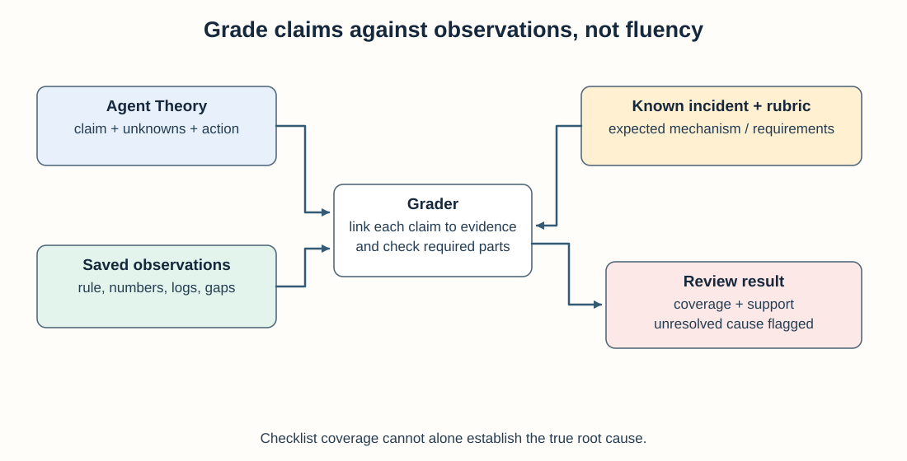

## How do you know if an artificial intelligence (AI) agent's root cause analysis (RCA) is trustworthy or hallucinating?

Score the close against an explicit checklist before you look at latency or prose quality. Require a Theory disposition, named Unknowns, a next action, and measured alert or query evidence. Reward honest gaps. Reject confident fiction that invents series or skips required digs.

**Key takeaways**

- Trustworthiness is checklist coverage and honesty, not fluency.
- Undetermined with a named blocked query beats a tidy wrong cause.
- Rematch the frozen prompt after every harness change.
{: .key-takeaways}

RCA is an explanation of what caused an incident, supported by measurements and a mechanism. An agent can produce a fluent explanation without having checked the relevant system. A frozen prompt and explicit rubric make that difference inspectable.

---

## What the evidence supports

- Freeze a **dual-part** prompt (alert + related logs/change).  
- Score **13 binary checks** (or your variant) before you look at latency.  
- Then record wall time, tokens, and cost in US dollars (USD).
- Reject confident closes that invent series. Reward honest Unknowns with named gaps.  
- Rematch after every harness change — and across orchestration shapes if you ship both.

---

## The checklist we used

*The evaluation checks whether the final claim matches the source record, not just how confident it sounds.*

From a live Grafana/Loki job ([numbers](/blog/six-model-mode-combos-alert-logs-bench/)), comparing a **single-agent ReAct (reasoning and acting) loop** and a **hierarchical ReAcTree planner** ([primer](/blog/what-is-reactree/) · [Portable Document Format (PDF)](https://arxiv.org/pdf/2511.02424)):

**Part A**

- Theory section present  
- Unknowns present  
- Actionable next step  
- Alert actually measured (rule / firing / query)  
- Concrete numbers  

**Part B**

- Target namespace named  
- 24h window  
- 7d (or stated baseline) window  
- Compare / anomaly language  
- Logs / Loki query language (LogQL) evidence

**Cross-cutting**

- Honesty about gaps / truncated tool dumps  
- Part A labeled  
- Part B labeled  

For this bench, correctness was hits / 13. A Responses hierarchical stub scored **0.69**; full-checklist runs scored **1.0**. These checks capture coverage and gap disclosure, not whether every proposed cause is true. Keep the known incident mechanism and human review alongside the score.

Use the operator [evidence-gated RCA checklist](/checklists/evidence-gated-rca/) as the human twin.

### Add an evidence-validity pass

A 13/13 coverage score is not enough if the agent cites a real number from the wrong service or time window. Before accepting the score, sample every claim that drives the Theory and record:

| Field | Question for the reviewer |
|-------|---------------------------|
| Claim | What exact causal or factual statement is being made? |
| Source | Which metric, log, deployment record, configuration, or trace supports it? |
| Query and window | Can another person retrieve the same observation for the intended service and period? |
| Observation | What value or result was actually returned, including errors and truncation? |
| Inference | Does the observation directly support the claim, or is an additional assumption required? |

Do not award evidence credit merely because a number or query appears. Mark unsupported claims and incorrect windows explicitly, and keep “Undetermined” available when the required observation is blocked. This reviewer pass is where fluent but wrong RCA gets caught.

For a failed run, pair this scorecard with the [multi-step agent debugging checklist](/checklists/agent-debug/) to trace the bad claim back to the decision, tool outcome, or observation that produced it.

---

## Metrics beside the checklist

| Metric | Why |
|--------|-----|
| Wall seconds | On-call patience |
| Tokens in+out | Bill and context pressure |
| USD | Finance will ask |
| Tool families | Measurement vs catalog |
| Child / tree node count | Orchestration tax |

First reject unsupported or incomplete diagnoses; then compare wall time and token use among acceptable runs. On-call time matters, but a fast answer that skips Part B does not satisfy this task.

---

## Anti-patterns

- Judging on prose fluency  
- Allowing human-in-the-loop (HITL) tools in an unattended bench without recording the human intervention
- Changing the prompt between the two variants under comparison
- Reporting only relative [efficiency](/blog/relative-efficiency-scores-lie/)  
- Crowning one orchestration shape without rematching the other  

---

## Minimal harness

1. Version a fixed prompt, expected mechanism, and scoring rubric in git.
2. One config per model × orchestration shape (single-agent / hierarchical).  
3. Script that prints checklist + wall + tokens.  
4. Store the proposed Theory and its cited observations next to the score. A checklist can give credit for naming numbers even when they come from the wrong window ([styles](/blog/what-reasoning-models-write-on-triage/)).

Repeat each configuration before inferring reliability. This 13-check rubric was designed for an alert-plus-logs job; adapt the evidence checks when the incident instead depends on deployments, traces, or configuration history.
