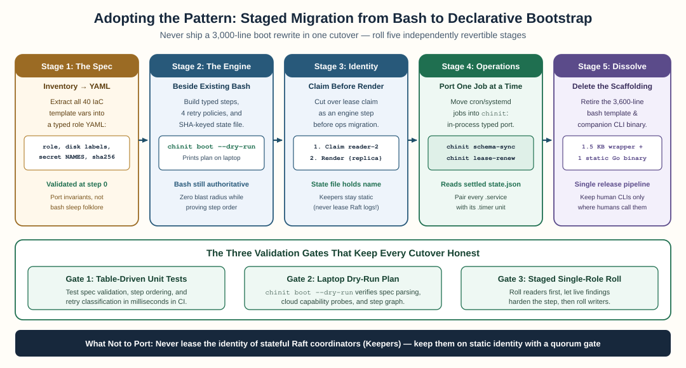
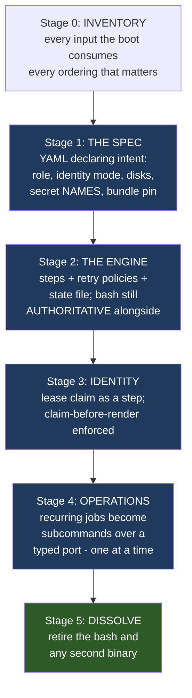
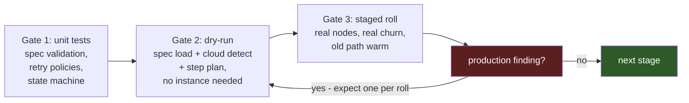

This is the last post in the chinit arc, and it answers the question
every reader of the first three has some version of: **fine, but how
would I do this on my fleet?**

The arc so far: [why one binary replaces the bash](/blog/chinit-one-binary-node-bootstrap/),
[why its companion CLI dissolved into typed in-process operations](/blog/chinit-dissolve-second-binary/),
and [how lease identity reconciles stateful replicas with horizontal
scaling groups](/blog/chinit-lease-identity-ephemeral-fleet/). Each
post defended one design. This one is the field manual: the staged
order that worked, the traps that cost us live cutovers, what to leave
behind, and how to know the pattern is finished taking over.

Everything here is cloud-neutral by construction — the bootstrapper's
provider factory is the portability layer, and the identity protocol
needs only a store with conditional writes and a TTL, which every
cloud and most on-prem stacks have.

## The migration wants an order

*Migrate in five independently revertible stages — Spec, Engine alongside bash, Lease Identity before render, In-Process Operations, and Dissolve — gated by unit tests, `--dry-run`, and single-role rollouts.*

A boot migration fails most often by attempting the whole thing at
once — the three-thousand-line rewrite that ships with no stage
verified against a real fleet. The order that worked for us had five
stages, and each stage is independently revertible:

**Stage 0 — inventory, and it is more than it sounds.** Every variable
the IaC tool interpolates into your script; every ordering constraint
("disks before service start"); every step that has ever needed a
retry; every role difference. This inventory *is* the spec's content
and the pipeline's step list — the migration's real requirements
gathering, and the bash era never wrote it down anywhere.

**Stage 1 — the spec is the contract.** Write the YAML that declares
what the boot *wants*, not what it *does*: role, identity mode, disk
labels, secret names, the config bundle and its checksum. Two rules
that matter: secrets are **references, never values**, and validation
happens once at load — malformed specs fail before any side effect.

**Stage 2 — the engine, with bash still authoritative.** Build the
pipeline — steps with declared criticality, four named retry policies,
the state file keyed to the bundle checksum — but run it *beside* the
existing boot, not instead of it. This is the stage with the
highest-value flag in the whole design: **dry-run mode**, which loads
the spec, detects the cloud, and prints the plan without touching the
machine. The dry-run validates the whole stack on a laptop, before any
instance exists.

**Stage 3 — identity, as a step.** The lease claim becomes a pipeline
step *before any render*, which is the enforcement mechanism for the
pattern's hardest constraint. Identity persists to the state file the
moment it settles — not at pipeline completion — because every later
step and subcommand reads it from there.

**Stage 4 — operations, one subcommand at a time.** Each recurring job
becomes a subcommand calling through the typed port. Cut them over
individually: schema propagation first (most exercised, clearest
signal), then replica sync, then the garbage collector with its
live-lease safety gate, then health. Each keeps its systemd line; only
the interior changes.

**Stage 5 — dissolve.** Retire the bash. Retire the second binary if
you grew one. The fleet rolls on the golden image, and the image is
now the version gate: one binary, one pin, one checksum.

## The three gates that keep the migration honest

At every stage, the same three gates, in escalating fidelity:

The loop at the bottom is the honest part: **expect one production
finding per roll.** Our cutovers produced them like clockwork —
identity rendered before it settled, a crash leaving an orphaned
state, a fatal health gate wedging a boot loop, a peer selection
hardcoded to a node that was itself being replaced. The pattern is
not that a good design avoids findings; it is that a good design
makes each finding a **one-line fix in a typed step** instead of a
sed across three scripts. That difference — the cost of a lesson — is
the actual argument for the whole migration.

## The traps, from the field

Each of these cost us a live-cutover debugging cycle; none is
obvious from the outside:

**Porting the bash instead of the intent.** The bash encodes folklore:
sleeps that papered over race conditions, orderings that mattered for
forgotten reasons. Write the spec from the *invariants*, not from the
script. Where the bash's behavior is inexplicable, the pipeline forces
the choice into the open — and about half turn out to be bugs you are
glad to leave behind. The other half are requirements nobody ever
wrote down; put them in the spec's comments, because they are the
real documentation.

**Identity as a convention instead of a step.** The lease claim wants
to live *inside* the pipeline, where claim-before-render is structural.
As a convention ("call the claim script first"), it is one refactor
away from violated — and the violation's failure mode is the worst
kind: an ephemeral identity baked into durable replication paths,
invisible until the third replacement.

**The health gate that must not be fatal.** A boot that aborts on
peer failure wedges a fleet roll: node boots mid-roll, peer is down,
health fails, replacement replaces the node, the new node sees the
same peer, loop. The gate is a warning — loud, logged, never blocking
the boot-finished marker. This wants to be a declared property of the
step, not a discipline in the code.

**Crash semantics define the state file's shape.** The test that
matters is not the clean boot; it is the node killed at step fourteen
of twenty. Persist identity immediately; record each step on
completion; invalidate all records when the bundle checksum changes.
If you cannot answer "what does a re-run do after a crash at step N?"
for every N, the state file is not done.

**A second binary's version pin is a distributed bug.** Every extra
artifact in the image is a version that can mismatch — and the
mismatch surfaces at 3 a.m. as a call with a subtly wrong interface.
Dissolve aggressively; keep a CLI only where a human types.

## What not to port

Two deliberate exceptions, both from the hard-won side:

1. **Keep a human-facing CLI.** The terminal is a legitimate
   interface — exploratory queries, break-glass operations, debugging
   at the node. The argument against a process boundary applies to
   machine-to-machine calls, not to humans. The right end state is
   the CLI calling the same typed interface the subcommands do, not
   the CLI's absence.
2. **Do not lease coordination members.** Keeper-like ensemble nodes
   are the exception that proves the stateless rule: their state is a
   Raft log that **cannot** be rebuilt from peers, their identity is
   their quorum seat, and a replacement is an ensemble event, not a
   scaling action. They belong outside the scaling group, with
   persistent identity, a quorum gate on every restart, and one-at-a-
   time discipline. The lease pattern is for the *replicated data
   plane* — the tier where durability lives in peers and object
   storage.

## How you know it is done

The migration is finished not when the binary ships, but when the
fleet's behavior answers these without hesitation:

- **What does a re-run do?** Skips done steps, re-runs on a checksum
  change, resumes after a crash — one sentence, and the sentence is
  true because the state file enforces it.
- **What happens when a node dies mid-boot?** The lease expires, the
  replacement claims it, the catalog rebuilds. No human action.
- **What does a fleet roll cost?** One instance-warmup window per
  node, staggered, with the drain protocol covering each outgoing
  replacement.
- **Where does a secret live?** Named in the spec, resolved at boot to
  a 0600 file, and nowhere else — not the spec, not the IaC state,
  not the log, not argv.
- **How many binaries are in the image?** One. Its version is the
  image's version, and the image is the gate.

The series continues beyond the arc with the operations that this
foundation made possible — the drain hooks, the rolling refreshes,
the garbage collectors that each became a subcommand in the one
binary.

---

*This closes the four-post chinit arc:
[one binary over bash](/blog/chinit-one-binary-node-bootstrap/),
[dissolving the second binary](/blog/chinit-dissolve-second-binary/),
[lease identity for ephemeral fleets](/blog/chinit-lease-identity-ephemeral-fleet/),
and this migration guide. The arc sits inside
[self-managed ClickHouse from first principles](/series/clickhouse-on-aws/) —
start at the beginning, or jump to
[what the boot sequence is a contract for](/blog/clickhouse-boot-sequence-contract/).*
