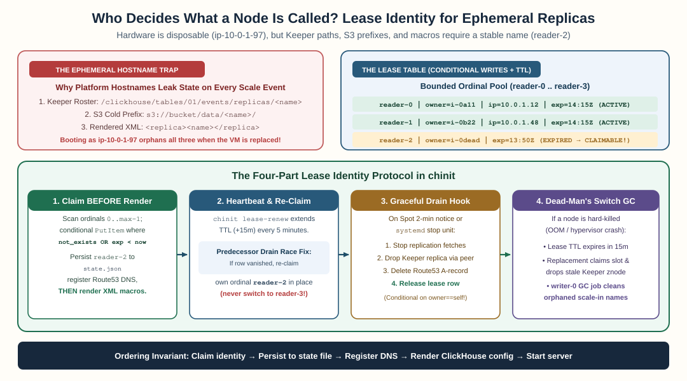
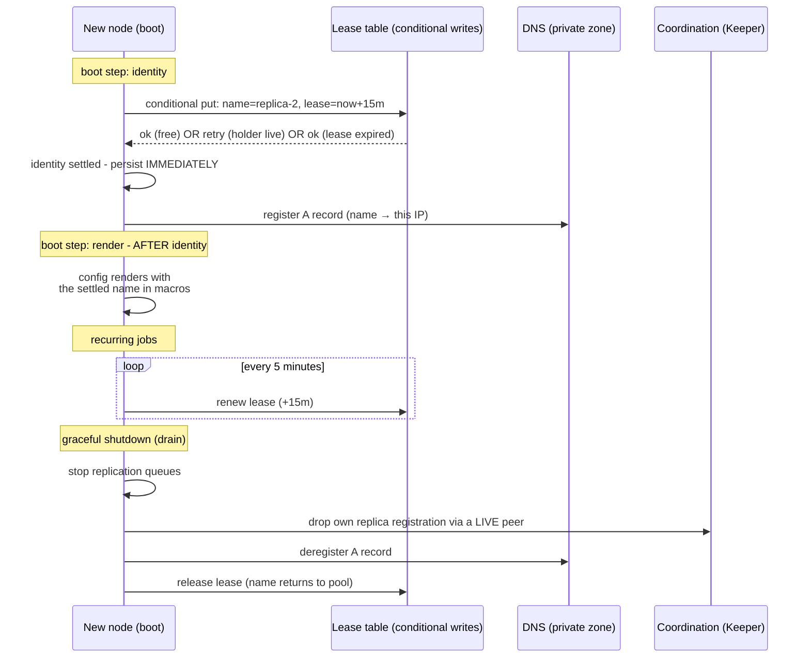
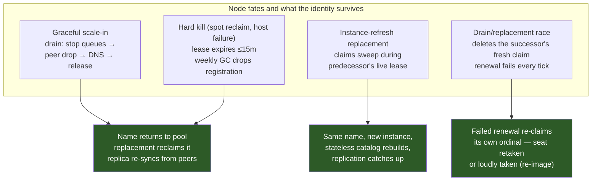

Every fleet that mixes stateful replicas with a horizontal scaling
group eventually hits the same contradiction. The scaling group's whole
value is that it replaces instances freely — unhealthy ones, outdated
ones, spot-reclaimed ones. But stateful replication keys on names that
must outlive the instance: replica registrations in the coordination
service, per-replica prefixes in shared storage, configuration macros
rendered once and baked in. An
[ephemeral reader](/blog/clickhouse-spot-readers-stable-identity/) that
boots as `ip-10-0-1-97` and registers under that name is a fleet with
an identity leak — every replacement strands data and registrations
under a name that will never come back.

This post is the pattern that resolves the contradiction for our
[self-managed ClickHouse](/blog/clickhouse-ec2-vs-k8s-mermaid-data-flow/)
fleet — lease-based identity, as [chinit](/blog/chinit-one-binary-node-bootstrap/)
implements it — and the five production findings that shaped each part.
It is written cloud-neutral on purpose: the primitives are a
conditional write and a time-to-live (TTL), and every cloud has both.

## The identity that a stateful replica actually needs

*A conditional-write lease table bridges disposable ASG instances (`ip-10-0-1-97`) and durable replica names (`reader-2`) by enforcing claim-before-render, heartbeat renewal with self-reclaim fallback, and graceful shutdown drain.*

Three things key on a stable name. Get them wrong and the failures are
silent until the third replacement:

1. **Replication paths.** Every replicated table registers under a
   path like `/clickhouse/tables/{shard}/<table>/replicas/<name>`. The
   `<name>` is the node's identity. A node that boots under its
   platform hostname registers under an address that means nothing
   after replacement — and the data filed under it is stranded.
2. **Per-replica object-storage prefixes.** With zero-copy replication
   [deprecated upstream](/blog/clickhouse-s3-key-prefix-silent-config-bug/),
   each replica physically copies parts, and each replica's parts live
   under its own prefix expanded from the `{replica}` macro. The macro
   renders from identity — claim order matters before the render.
3. **Configuration macros.** The rendered config carries the identity
   into every macro the database expands. Render first, and the
   ephemeral name is baked into durable paths.

So the identity must satisfy a hard constraint: **it must be settled
before anything renders, and it must survive instance replacement.**
The scaling group supplies neither; the platform hostname is exactly
the wrong identity — available instantly, valid forever after nothing.

## The pattern: one conditional write, one lease, one heartbeat

The fix is a tiny protocol, not a service. A coordination table with
conditional writes (any cloud's table store has them), four
operations, and the bootstrapper enforcing the ordering:

The four operations, each with a reason it exists:

**Claim** — one conditional put: the write succeeds only if the name is
unclaimed or the previous holder's lease has expired. The conditional
write is the entire concurrency story; no locks, no leader election,
no coordination service beyond the table itself.

**Renew** — the heartbeat. The claim's TTL is the dead-man's switch:
a node that dies hard stops renewing, and within one lease window its
name is back in the pool. The renewal cadence tolerates two missed
heartbeats by design — five-minute renewal against a fifteen-minute
lease. And the renewer self-heals: a renewal that fails against a
vanished or re-assigned row re-claims the node's *own* ordinal rather
than failing every tick (a race we hit live — the drain of a dying
predecessor deleted the replacement's fresh claim — previously a
manual table edit was the only recovery).

**Release** — the graceful path. A draining node deletes its own claim
so the replacement can claim the name immediately instead of waiting
out the lease.

**List** — the discovery read. Every node's operations that need the
cluster inventory — health fan-outs, schema propagation, peer
selection — enumerate **active claims only**. A reserved-but-vacant
slot never appears in a cluster query, which is the difference between
a degraded answer and a wrong one.

## Five production findings, each one a design constraint

We did not design this protocol on paper first. The paper version and
the production version differ in exactly five places, each taught by a
failure:

**1. The claim must sweep, not fail.** An instance-refresh replacement
boots while its predecessor's lease is still live — the old node
renews until the second it dies. A single failed claim would wedge the
replacement. The claim loop sweeps the ordinal range and retries within
one lease window; a replacement always lands.

**2. Identity persists before the pipeline continues.** The first
implementation recorded identity at boot completion. A crash after
claiming but before completing left an orphaned lease and a
half-configured node. The fix: the settled identity persists to the
state file **immediately** — later steps, not at the end — and every
later step and subcommand reads it from there, never re-deriving it.

**3. The drain protocol needs a live peer, and the live peer must not
be hardcoded.** Dropping a replica registration is a peer-side
operation — the dying node cannot do it alone. The first version
hardcoded "ask node-0," which fails exactly when node-0 is the node
being replaced. The production drain picks the peer from **live
claims**: prefer the zero ordinal, fall back to any live peer of the
same role, fall back to the local best-effort drop. The weekly
garbage collector catches whatever the drain misses.

**4. The garbage collector's safety gate is the live-lease set.** The
periodic sweep that drops stale registrations runs over a name pattern
— but a pattern alone would happily drop a mid-boot replacement's
fresh registration. The production gate: the sweep enumerates
**active leases** and excludes every live name from its drop set. A
node that is merely young is never mistaken for a dead one.

**5. The renewal must be a claim against its own ordinal, not a
one-way heartbeat.** The replacement-race finding: a dying node's
drain deletes its claim *after* the replacement has already claimed
the same name — and the sequence that deletes "the predecessor's row"
can take the *successor's* fresh one with it. The renewer then fails
its conditional write on every tick, forever, while the node keeps
serving under an identity no table believes it holds. Recovery was a
manual table write. The production answer: a failed renewal
re-claims the node's own ordinal — the conditional write either takes
the now-free seat back (the common race outcome) or answers taken (a
replacement owns the name and this node must re-image). A *different*
ordinal answering is Fatal: the hostname, the DNS record, and the
Keeper registrations all key on the name, and a timer cannot converge
an identity change.

Together these five make the pattern self-healing in the hard cases —
not just the happy path:

## What this unlocks: stateless replacement as the design goal

The pattern's payoff is bigger than stable names. Once identity is a
lease, **replacement becomes the repair strategy**: a node carries no
state a peer cannot rebuild. The parts catalog is a pointer map to
shared object storage; durability lives in the object store and in
replication itself. A replacement claims its name, renders its config,
and the replica fetches parts from peers until caught up.

That is a deliberate shape, and it is not free — a replacement pays a
re-warm (part fetches, cache cold) measured in minutes. The trade:

| | Persistent catalog (pre-lease) | Stateless + lease identity |
|---|---|---|
| Replacement cost | Catalog survives — fast rejoin | Re-warm from peers — minutes |
| Failure surface | State must be migrated, reattached, versioned | No state to lose or orphan |
| Fleet scaling | Identity coupled to instance lifecycle | Identity decoupled — ordinals claimable |
| Worst case | Orphaned volume, stranded registration | One lease window of absence |

For a **replicated hot tier** — where every part exists on peers and in
object storage — the stateless shape wins: the failure modes are all
self-healing, and self-healing is what a horizontal scaling group is
for. (Keepers and other coordination members are the exception that
proves the rule — they are not part of the replicated data plane, their
state is a Raft log that *cannot* be rebuilt from peers, and they
belong outside the scaling group entirely.)

## Adopting the pattern elsewhere

The requirements list is short, which is why this generalizes:

1. **A store with conditional writes and a TTL.** Every cloud's table
   service has both; on-prem, any database with compare-and-set
   semantics works.
2. **A name range with an explicit ceiling.** Ordinals 0..N-1 where N
   is the scaling group's maximum — and the ceiling must be *reserved*
   elsewhere (slot arithmetic) so names never shift when the fleet
   resizes.
3. **A bootstrapper that enforces claim-before-render.** This is the
   constraint the whole pattern hangs on; it wants to be a typed
   pipeline step, not a convention in a script.
4. **A drain hook on the scaling group's termination path.** Graceful
   release is an optimization — the lease TTL is the correctness
   floor — but it turns a fifteen-minute absence into an instant one.
5. **A periodic garbage collector with the live-lease gate.** The
   safety net that catches every drain failure; never drop a name whose
   lease is live.

The next post closes the arc with the adoption view: [how to take
this whole pattern — the bootstrapper, the in-process operations, the
lease identity — to your own fleet](/blog/chinit-adopt-pattern-fleet/),
what to port first, and the order the migration wants.

---

*Related in this series: [stable identity for spot readers](/blog/clickhouse-spot-readers-stable-identity/),
[the boot sequence as a contract](/blog/clickhouse-boot-sequence-contract/),
and [dissolving the second binary](/blog/chinit-dissolve-second-binary/).*
