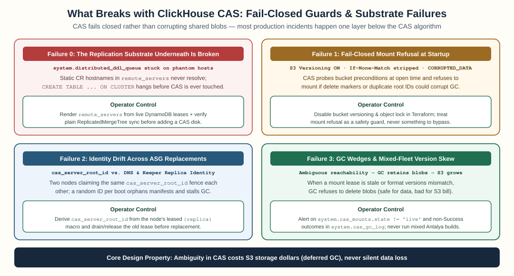
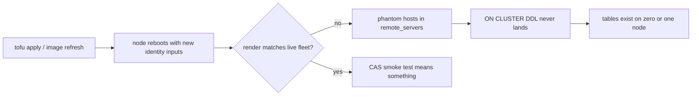
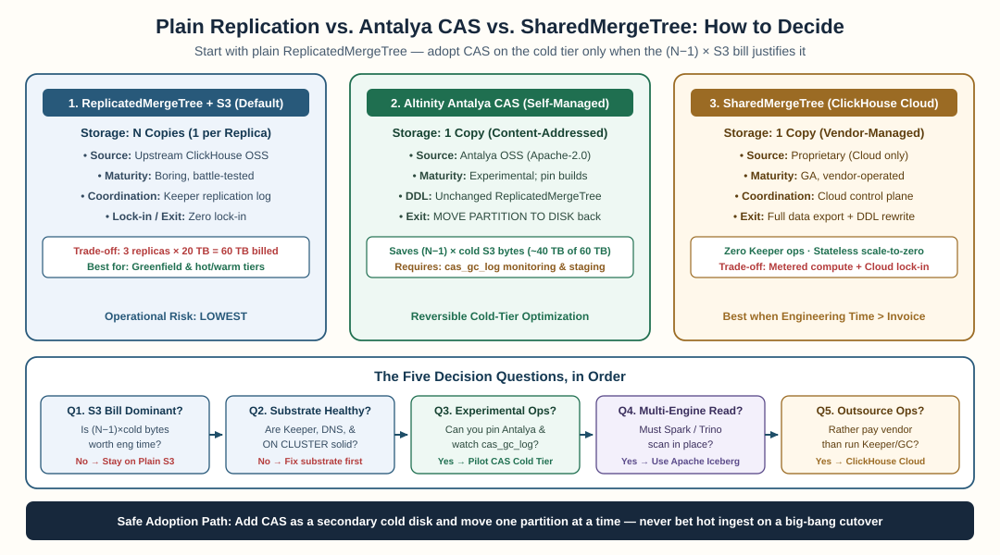

Every storage engine is sold on its happy path. This post is the unhappy one — and then the deciding one.

Part 1 is every failure mode I found before I'd trust a shared pool, written from a dev cluster where we attempted a writer→reader verification and hit a wall that had nothing to do with CAS — which is itself the lesson: **the failure modes that will actually get you are usually one layer below the feature you are evaluating.** Part 2 is the scorecard I'd run those failure modes through: CAS vs ClickHouse Cloud SharedMergeTree vs plain ReplicatedMergeTree replication, with the costs and the exit costs, and one honesty up front that shapes everything below — **CAS is experimental.**

**Key takeaways**

- CAS fails closed. Mount refusal, ambiguous GC, lost leases: all stop work rather than proceed unsafely. That is good design and it still means an outage if you ignore the signals.
- Most real failures are identity, config render, or bucket misconfiguration — not the CAS algorithm.
- Your replication layer is a prerequisite, not a beneficiary. Broken `ON CLUSTER` DDL stays broken with CAS.
- Alert on `cas_mounts` and `cas_gc_log` before you need them.
- Plain replication is the right default. CAS is a cost optimization for the cold tier, gated on evidence.
- CAS wins when the storage multiplier is your dominant cost and you can run experimental software deliberately. SharedMergeTree wins when you would rather pay ClickHouse to own the problem and you accept Cloud lock-in.
- The decision is reversible in one direction only if you design for it up front (disks and policies, not engine rewrites).
{: .key-takeaways}

---

## Failure 0: the cluster underneath is already broken



*CAS fails closed when bucket preconditions or mount leases are ambiguous — and most field failures originate one layer below in `remote_servers` host lists or replica identity drift.*

Before any CAS semantics matter, the cluster has to replicate. On our dev cluster the pre-CAS smoke test failed for boring reasons that CAS cannot fix and will not hide:

```text
system.distributed_ddl_queue — every task Inactive on all 12 listed hosts
reason: hosts chi-ch-int-dev-ch-int-dev-01-2 … -01-11 resolve to nothing
```

The config render produced a static list of CR-style hostnames that have no DNS entries. DDL is dispatched to the full list, every unreachable host holds its slot, the task never completes, and nothing is applied anywhere — not on the writer, not on the reader. Symptoms that followed:

- `CREATE TABLE ... ON CLUSTER` never materialises the table on either node.
- The reader's `replication_queue` drained once `/etc/hosts` on the reader pinned `writer-0` to the live IP (`10.0.1.162` was the pre-refresh writer; the replacement is `10.0.1.254`).
- Writer replacement by the ASG left `writer-1`-era state behind: stale Route53 records, a stale Kubernetes-style CR name in the remote servers list, and a Keeper `replicas` znode for `writer-1` that nothing cleaned up.

None of this is CAS. All of it must be fixed first. If your `ON CLUSTER` DDL does not complete reliably today, adding a shared storage pool will only make the resulting confusion more expensive.



## Failure 1: the mount refuses to come up

CAS probes the bucket at open time. Expect refusal when:

| Symptom | Cause | Fix |
|---|---|---|
| Mount fails, log mentions versioning | bucket versioning enabled | suspend it; re-mount |
| Mount fails, `If-None-Match` not honored | store or gateway strips conditional headers | use a supporting store or stop |
| `CORRUPTED_DATA` on mount | `cas_server_root_id` reused, or orphaned owner record | pick a fresh id, or decommission the old member properly |
| Server boots, disk missing from `system.disks` | config not rendered into the node (refresher didn't fire) | check the config refresher / SSM document, not ClickHouse |

The pattern: **the refusal is the feature**. A CAS that mounted anyway on an untrusted bucket would eventually delete the wrong object with total confidence.

## Failure 2: identity drift across ASG replacements

The writer in our cluster was replaced by an instance refresh. The old DNS record lingered, the reader resolved the dead IP, replication stalled with `No route to host`, and the parts queue grew to ~1000 entries before anyone noticed. For CAS this is worse, because the *pool identity* (`cas_server_root_id`) and the *network identity* (DNS, leases) are separate things that can each go stale independently.

Controls:

- derive `cas_server_root_id` from the same ordinal/lease mechanism as the rest of the node's identity;
- TTL the DNS records aggressively; never pin cluster peers in `/etc/hosts`
- alarm on `replication_queue` depth and on `system.replicas` `absolute_delay`;
- on replacement, verify the old node's lease is actually released before the new one claims the slot.

## Failure 3: GC distress

CAS GC is not a cron `rm`. A round is 18 phases over ref logs and manifests; it loses leadership politely, defers when the fold is expensive, and aborts rather than guess. What you will see in practice:

```sql
SELECT outcome, count() FROM system.cas_gc_log
WHERE event_type='Finish' GROUP BY outcome;
```

| Outcome | Meaning | Action |
|---|---|---|
| `Success` | round completed | none |
| `NotALeader` | another replica holds the GC lease | none — by design |
| `Deferred` | not enough change to fold | none |
| `Aborted` | interrupted; retried next round | watch the streak |
| `Error` | round failed | investigate now; sustained = stop writing to the pool |

A rising `wedged_namespace_count` in `system.cas_mounts` means a ref-append lane is stuck; `pending_reclaim` climbing without bound means GC is not keeping up with ingest. Both are capacity/tuning signals, not corruption — but treat them as pages, not graphs.

## Failure 4: the mixed fleet

Antalya 26.6 and upstream 26.8 do not share a storage format on disk. If a pool contains objects written by a build whose manifest version the reader does not understand, you get `UNKNOWN_FORMAT_VERSION` — loud, not silent, but hard to recover without the matching binary. Never let two different CAS builds write to one pool.

## Failure 5: the blast radius is the pool, not the node

With per-replica prefixes, one broken replica costs you its copy. With CAS, one pool holds everyone's bytes. That is the point of dedup and also the risk:

- a corrupt bucket policy that revokes `s3:GetObject` on `cas/*` takes out every reader at once;
- `aws s3 rm s3://bucket/cas/ --recursive` executed by a tired human deletes the deduped 60% and leaves some parts unreadable everywhere;
- lifecycle rules that expire "old" objects without knowing they are referenced will do the same, slower.

Mitigations: separate prefix + explicit IAM allow (not wildcard), no lifecycle expiry on the pool, object-lock *disabled* (required) compensated by out-of-band backups, and a tested restore.

## Failure 6: the verification gap

The most expensive failure is declaring success because the server started. Minimum bar before calling CAS healthy:

```sql
-- every pool member live
SELECT countIf(state <> 'live') FROM system.cas_mounts WHERE disk LIKE 'cas%';   -- 0
-- GC closing rounds cleanly
SELECT countIf(outcome = 'Error') FROM system.cas_gc_log WHERE event_type='Finish';  -- 0
-- data actually co-located
SELECT disk_name, count() FROM system.parts WHERE active GROUP BY disk_name;
-- and the bucket agrees
-- aws s3 ls s3://bucket/cas/default/ --recursive | wc -l
```

Plus: create a table on the writer, see it on the reader, restart a node, confirm it rejoins the pool, and restore from backup at least once.

## The short list

CAS does not remove the need for the boring work. It removes the duplicated bytes. Everything else — DNS, Keeper, IAM, backups, honest smoke tests — still decides whether you sleep.

---

## Part 2: now that you know what breaks, how do you decide

That is the failure catalog. What remains is whether any of it should stop you — and if not, which option gets the bytes. This is the framework I would use in a design review — weighted the way a bill-paying engineer would, not the way a benchmark author would.

### The three options



*Start with plain `ReplicatedMergeTree` on S3; adopt Antalya CAS on the cold tier when `(replicas − 1) × S3 bytes` justifies operating an experimental pool, or choose `SharedMergeTree` when outsourcing operations outweighs Cloud lock-in.*

| | ReplicatedMergeTree + S3 | CAS (Antalya) | SharedMergeTree (Cloud) |
|---|---|---|---|
| Where the bytes live | 1 copy per replica | 1 copy per unique blob | 1 copy, managed |
| Source | upstream OSS | Altinity Antalya OSS (experimental) | ClickHouse Cloud only |
| Coordination | Keeper (replication log) | Keeper (unchanged) + pool-internal leases/GC in S3 | Cloud control plane |
| DDL | `ON CLUSTER` | `ON CLUSTER` (unchanged) | Cloud semantics; engines are `Shared*` |
| Maturity | boring, battle-tested | experimental; format may change | GA in Cloud |
| Cost model | S3 × replica count | S3 × 1 (+ request overhead during folds) | Metered storage + compute |
| Lock-in | none | low (data is ordinary parts) | high (`SHOW CREATE TABLE` shows engines that don't exist in OSS) |
| Exit | trivial | `MOVE PARTITION` back | export + DDL rewrite |

### Decision questions, in order

**1. Is your S3 line item actually the problem?**
If compute and Keeper dominate, stop here. CAS optimizes bytes, not anything else. Pull the last three months of S3 storage by prefix and compute `bytes × (replicas − 1) × price`. If that number is not worth engineering time, you are done.

**2. Is your replication layer healthy?**
If `ON CLUSTER` DDL is flaky, Keeper has drift, or replicas flap, fix that first. CAS inherits the replication substrate; it does not stabilize it. Failure 0 above shows what "broken underneath" looks like.

**3. Can you operate experimental software deliberately?**
CAS means: pinned builds, a staging pool, release-note reading, `cas_gc_log` in your dashboards, and a rollback plan you have actually executed. If your org cannot do that, you have your answer.

**4. Do you need other engines to read the same data?**
If Spark/DuckDB/Trino must scan the table in place, neither CAS nor ReplicatedMergeTree is the answer — that is Iceberg territory, a different trade (open format, external catalog, no ClickHouse-native merges).

**5. Would you rather pay someone?**
ClickHouse Cloud exists for teams who looked at items 1–4 and decided their time was worth more than the invoice delta. That is a legitimate answer, and it comes with SharedMergeTree, no Keeper to run, and no DDL fan-out to debug. The cost is meters you cannot turn off and DDL you cannot take with you.

### A scoring sheet you can argue with

Weight each 0–3, multiply, sum per column. It is not scientific; it makes the implicit explicit.

| Criterion (weight) | Replicated | CAS | SharedMT |
|---|---|---|---|
| Cold-tier storage cost (3) | 0 | 9 | 9 |
| Operational risk (3, higher=better/safer) | 9 | 5 | 9 |
| Exit cost / portability (2) | 6 | 5 | 1 |
| Feature velocity / support (1) | 2 | 1 | 3 |
| Fit with existing IaC & IAM (1) | 3 | 2 | 0 |
| **Total** | **17** | **17** | **22** |

Flip the storage weight and CAS wins decisively; flip the risk weight and plain replication does. The point is not the number — it is that the decision moves with your weights, and you should be able to say which weights you used out loud.

### The adoption path I would actually take

1. **Today:** per-replica S3 prefixes, `TTL ... TO VOLUME 'cold'`, tenant policies, per-partition accounting. Zero new risk. Most clusters stop here and should.
2. **When storage cost shows up on a budget review:** add CAS disks *alongside* existing ones, no table touched. Verify mounts on every node.
3. **Pilot:** one cold, low-traffic table; `MOVE PARTITION` one partition; measure S3 bytes before/after and GC behavior for two weeks.
4. **Expand:** tenant by tenant. Keep `cas_config` in git. Review the GC log weekly until it is boring.
5. **Never:** big-bang migration, mixed-version CAS fleets, CAS as primary storage for hot data.

### What I would tell a team adopting this quarter

Budget two weeks of platform work before the first partition moves: AMI build, bucket preconditions, IAM scoping, monitoring, rollback rehearsal, and one page of runbook. The software is ready to try. Your control plane probably is not, and that is where the time goes.

## References

- Altinity Antalya CAS docs: <https://docs.altinity.com/altinityantalya/> — `operations/monitoring`, `operations/troubleshooting`, `architecture/garbage-collection`
- Altinity's CAS announcement: <https://altinity.com/blog/introducing-cas-drop-in-compute-storage-separation-for-clickhouse-mergetree-tables>
- CAS source: `src/Disks/DiskObjectStorage/MetadataStorages/ContentAddressed/`
- Cloud SharedMergeTree docs: <https://clickhouse.com/docs/cloud/managing-services/shared-merge-tree>

---

*The failure modes are the price of admission; the scorecard is how you decide whether the seat is worth it. Earlier in this arc: [ClickHouse zero-copy replication is dead: what actually replaced it](/blog/clickhouse-zero-copy-replication-dead/) — the intro primer — and [Touching CAS Without Betting the Cluster: A Hands-On Staging Walkthrough](/blog/clickhouse-cas-on-aws-walkthrough/), where you run every check above on a real pool before trusting it.*
