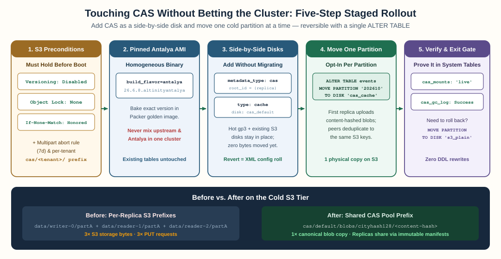
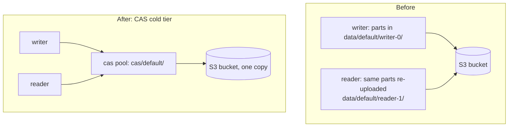

This is the field guide for the CDK-free path: adding Altinity Antalya's content-addressed storage (CAS) to a self-managed ClickHouse cluster on Amazon Simple Storage Service (S3) without betting production on it. Everything here is either from the Antalya docs or from a real dev cluster rollout; where I got burned, the burn is included.

**Key takeaways**

- CAS is opt-in **per disk**, not per cluster. You can add it next to your existing disks and move data one partition at a time.
- The prerequisites are bucket properties, not instance sizes: versioning off, no object lock, conditional writes honored, `AbortIncompleteMultipartUpload` lifecycle.
- The failure mode that bites people is a mount that won't start. That is a feature: CAS refuses to run on a bucket it cannot reason about.
- Verify with `system.cas_mounts`, `system.cas_gc_log`, and `system.parts` — never with "the server started".
{: .key-takeaways}

---

## 0. What you will end up with



*Add the `cas` and `cas_cache` disks alongside existing storage, verify S3 preconditions, and migrate one cold partition at a time with `ALTER TABLE ... MOVE PARTITION`.*



Two disks get added, nothing is removed: a `cas` disk (`metadata_type=cas`) and a `cas_cache` wrapper. Your policies keep their hot local disk; the cold volume points at the cache wrapper.

## 1. Bucket preconditions — check these first

CAS's mount-time capability probe is unforgiving by design. On AWS S3:

```bash
aws s3api get-bucket-versioning --bucket "$BUCKET"     # must be {} or Disabled
aws s3api get-object-lock-configuration --bucket "$BUCKET"   # must not exist
aws s3api get-bucket-lifecycle-configuration --bucket "$BUCKET"
# must include AbortIncompleteMultipartUpload (7 days is fine)
```

If versioning is on, the mount refuses to start and the server won't boot with that disk in config. That is correct behavior — a delete marker over a live key would silently defeat every GC invariant the pool relies on. Fix the bucket, not the config.

Also decide the pool layout now: a single shared pool (`cas/`), a pool per tenant (`cas/<tenant>/`), or per shard (`cas/<shard>/`). Per-tenant is the right default for multi-tenant fleets; rebalancing pools later means moving data.

## 2. The build

Upstream ClickHouse does not have this code. You need the Antalya build:

```bash
# packer
packer build -var build_flavor=antalya \
             -var clickhouse_version=26.6.8.20004.altinityantalya \
             packer/clickhouse.pkr.hcl
```

The APT repo is `https://builds.altinity.cloud/antalya-apt-repo` (`stable`). Pin the exact version in your golden image and smoke-test `clickhouse-server --version` before the rollout. A mixed fleet — some nodes Antalya, some upstream — is unsupported, and the failure is silent at best.

## 3. The disk config

The minimal per-node shape (Terraform-rendered in the reference repo):

```xml
<clickhouse>
  <storage_configuration>
    <disks>
      <cas>
        <type>object_storage</type>
        <object_storage_type>s3</object_storage_type>
        <metadata_type>cas</metadata_type>
        <cas_server_root_id>{replica}</cas_server_root_id>
        <endpoint from_env="CH_S3_ENDPOINT"/>
        <endpoint_subpath>cas/default/</endpoint_subpath>
        <use_environment_credentials>true</use_environment_credentials>
        <skip_bucket_creation>true</skip_bucket_creation>
        <http_keep_alive_timeout>30</http_keep_alive_timeout>
        <http_keep_alive_max_requests>10000</http_keep_alive_max_requests>
      </cas>
      <cas_cache>
        <type>cache</type>
        <disk>cas</disk>
        <path>/var/lib/clickhouse/disks/cas_cache/</path>
        <max_size>17179869184</max_size>   <!-- raw bytes, not "16Gi" -->
        <cache_on_write_operations>true</cache_on_write_operations>
      </cas>
    </disks>
    <policies>
      <cas_default>
        <volumes>
          <hot><disk>default</disk><volume_priority>1</volume_priority></hot>
          <cold>
            <disk>cas_cache</disk>
            <volume_priority>2</volume_priority>
            <perform_ttl_move_on_insert>false</perform_ttl_move_on_insert>
            <prefer_not_to_merge>true</prefer_not_to_merge>
          </cold>
        </volumes>
        <move_factor>0.1</move_factor>
      </cas_default>
    </policies>
  </storage_configuration>
</clickhouse>
```

Notes that will save you an hour:

- `cas_server_root_id={replica}` — one stable identity per node, from the same macros that drive replication. Never reuse an id across nodes that share a pool.
- Policy volumes point at the **cache** disk, never at `cas` directly.
- `max_size` is raw bytes. `"16Gi"` is a parse error in this element.
- Keep the existing `tiered`/`tenant_*` policies in place. CAS is additive until you move a partition.

## 4. Enable, boot, verify the mount

Roll the fleet (new AMI or config-refresh). Then, on **every** node:

```sql
SELECT disk, server_root_id, state, is_leader, pending_reclaim
FROM system.cas_mounts;
```

Expected: one row per CAS disk, `state = 'live'`. Anything else and you stop here and read the log — `CORRUPTED_DATA` means the identity or the bucket is wrong; fix that, not the query.

Also check the GC log exists and is not erroring:

```sql
SELECT outcome, count()
FROM system.cas_gc_log
WHERE event_type = 'Finish'
GROUP BY outcome;
```

## 5. Move one partition, not the table

Do not flip `storage_policy` in place — `StoragePolicy::checkCompatibleWith` rejects a policy that does not contain the old disks. Adopt CAS per partition:

```sql
ALTER TABLE default.edge_requests
  MOVE PARTITION '2026-10-01' TO DISK 'cas_cache';
```

Watch it land:

```sql
SELECT partition, disk_name, count()
FROM system.parts
WHERE table = 'events' AND active
GROUP BY partition, disk_name
ORDER BY partition;
```

And confirm the pool grew instead of the per-replica prefix:

```bash
aws s3 ls s3://ch-int-dev-clickhouse-data/cas/default/ --recursive | head
aws s3 ls s3://ch-int-dev-clickhouse-data/data/default/ | head
```

Expect far fewer bytes in the per-replica tree after a full re-tier.

## 6. Rollback

Before any MOVE, rollback is a config revert. After MOVEs:

```sql
ALTER TABLE default.edge_requests MOVE PARTITION '2026-10-01' TO DISK 's3_cache';  -- or disk_default
```

then set `cas_config.enabled = false` and re-apply. Do not delete `cas/` from the bucket until `SELECT count() FROM system.parts WHERE disk_name LIKE 'cas%'` returns 0 and no node mounts the pool.

## 7. The order I would run it in a real cluster

1. Reproduce on a disposable table on a dev cluster. Break it deliberately (bad `cas_server_root_id`, versioned bucket) and see the refusal.
2. Verify writer→reader replication and `ON CLUSTER` DDL on that cluster first — CAS sits on top of a healthy replication layer, it does not fix an unhealthy one. (Ours was broken by phantom hosts in the rendered `remote_servers`; fix that class of bug before CAS work starts.)
3. Enable on one reader, then one writer, watching `cas_gc_log`.
4. Move one cold partition of a low-traffic table. Watch for a day.
5. Extend by tenant. Never big-bang.

That is the whole playbook. What actually breaks along the way is the next post.

## References

- Altinity Antalya CAS docs: <https://docs.altinity.com/altinityantalya/> (`quick-start`, `bucket-requirements`, `configuration`)
- Terraform shape used here: a `cas_config` root variable gating `cas_*` disk/policy templates, an IAM grant scoped to `cas/*` on the data bucket, and a `cas_config.enabled = false` default. Config renders only when the flag is on, so a plain `tofu apply` changes nothing on an existing fleet.
