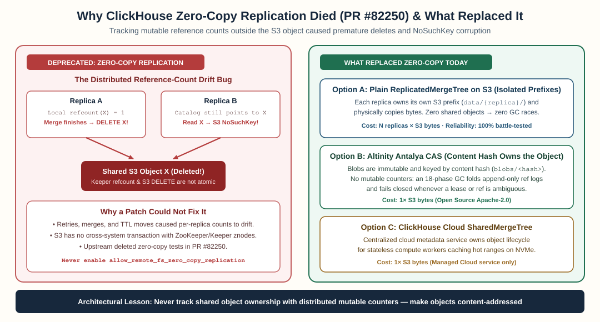
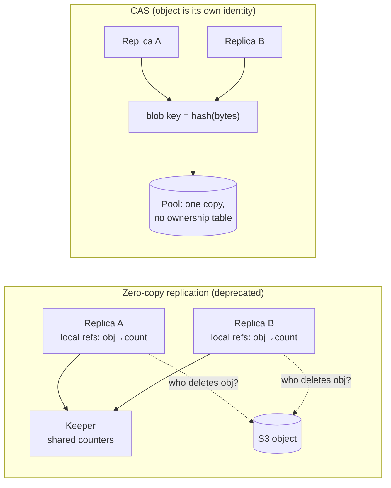
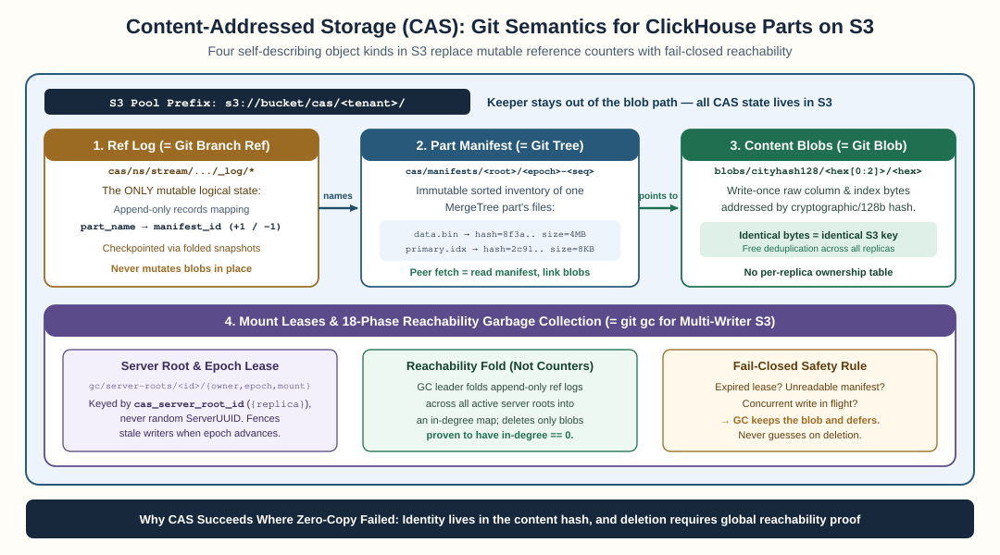
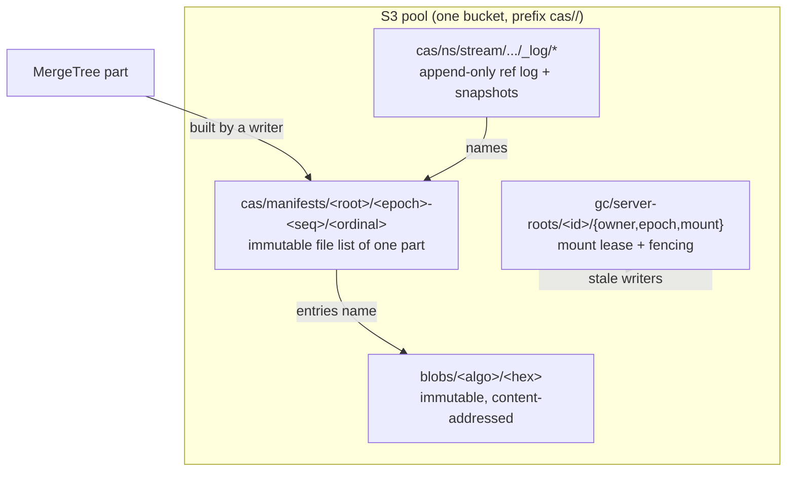

Every team that runs ClickHouse on S3 eventually hits the same wall. Replication works. The bill does not. Three replicas mean three copies of every part, three times the PUT requests, and a cache-warming exercise after every resize. The obvious fix — "just let the replicas share the objects" — was tried, shipped, and then removed. The first half of this post is the post-mortem; the second half is the design that learned from that failure, and the reason the next two posts exist.

**Key takeaways**

- Upstream ClickHouse deprecated zero-copy replication; PR [#82250](https://github.com/ClickHouse/ClickHouse/pull/82250) removed its tests, and the setting is not one to plan around.
- The failure was a distributed-reference-counting problem. Ownership was tracked per replica, not with the object, so garbage collection (GC) could not prove an object was safe to delete.
- Today, every replica of a `ReplicatedMergeTree` table physically copies parts. Storage cost scales linearly with replica count.
- The open-source successor is Altinity Antalya's content-addressed storage (CAS): one shared pool of four object kinds — blobs, manifests, an append-only ref log, and a mount lease per server — with no separate metadata service.
- Blobs are keyed by the hash of their bytes, so identical content lands at one key and dedup is free. The content hash, not a refcount table, is the owner. (ClickHouse Cloud's SharedMergeTree instead makes the metadata service the owner.)
- Reachability replaces reference counts. GC folds the ref log into an in-degree map, deletes only what no ref names, and refuses to run without a live mount lease.
- Keeper is untouched. Replicas still agree on the part set through the normal replication log; CAS only changes how the bytes underneath are stored and shared.
{: .key-takeaways}

---

## What zero-copy actually promised

*Zero-copy replication tracked mutable reference counts outside the S3 object, allowing count drift to delete live parts (`NoSuchKey`); modern replacements either isolate per-replica S3 prefixes or address blobs by content hash.*

`allow_remote_fs_zero_copy_replication` let ReplicatedMergeTree skip the byte copy when a part already existed on shared object storage. Replica A wrote part `all_1000_1000_1` to `s3://bucket/prefix/…`. Replica B, seeing the same part in its replication queue, would record a reference to A's objects instead of downloading and re-uploading them. Three replicas, one physical copy. It looked exactly like what everyone wanted.

The mechanics hid the hard part. An object in S3 has no idea how many replicas reference it. So ClickHouse tracked reference counts in ZooKeeper, with each replica keeping local state about which remote objects it used. The invariant — "this object may be deleted only when count reaches zero" — had to hold across crashes, retries, merge rewrites, TTL moves, and detached parts.

## How it actually broke

The failure mode was never "corruption on write". Writes went through fine. The failure was in **reclamation**:

1. Replica A and B both referenced object `X`. A's local count said 2, B's said 2.
2. B re-fetched or re-created its metadata, or a merge rewrote the part, or a TTL move re-homed the part. The counts drifted — one said 1, the other said 2. There was no single place that could reconcile them.
3. A merge on A deleted "its" copy of the shared objects, because A's bookkeeping said nobody else needed them.
4. B held a dangling reference. The next read of that part returned NoSuchKey. The part was, from B's point of view, gone from storage but present in the parts catalog.

Recovery meant finding every part whose backing objects were gone and re-fetching or re-creating them — often impossible if the originating replica had also moved on. Support threads and the [issue tracker](https://github.com/ClickHouse/ClickHouse/issues/98475) filled with exactly this shape of corruption report.

The upstream response was decisive: deprecate the feature, delete the tests in [#82250](https://github.com/ClickHouse/ClickHouse/pull/82250), and stop describing it as production-viable. That is not a bug fix waiting to land; it is a design retreat.

## Why the naive fix does not work either

"Just add a refcount in Keeper" is the first proposal everyone makes. It does not close the hole: refcount updates are not transactional with S3 operations. You can make the refcount perfect and still delete an object in the gap between one replica reading the refcount and another incrementing it — or you can hold a lock so long that merges serialize on it. The problem is not the counter. The problem is that *ownership lives outside the object*.

Any design that tracks sharing as separate mutable state — local files, Keeper znodes, refcount tables — has the same failure shape. The designs that survive move the answer into the object itself.

## What this costs you in practice

On a self-managed cluster, the practical consequences are:

- **Storage:** cold data is multiplied by replica count. My own dev cluster shows this clearly — the writer and reader each hold full copies of the shared `events` table (hundreds of millions of rows), and a third replica would triple it again.
- **Network:** every replica fetches parts independently after every merge.
- **Headroom for scale-out:** adding a reader is not free capacity; it is a full data copy and a cache warm-up.
- **Backups:** every replica is a separate copy to back up, or you back up once from one replica and accept that restore semantics differ from the others.

None of these are reasons to avoid replication. They are reasons to look hard at whether your cold tier can avoid the multiplier.

## What replaced it: an object that names itself

The second half of this post opens the object that the first half says must own its own identity. CAS — content-addressed storage, shipped in Altinity's Antalya builds — is small enough to hold in your head in one sitting, and understanding it is the difference between evaluating it and cargo-culting it.

Everything below is from the open-source Antalya sources and docs (Apache-2.0): `src/Disks/DiskObjectStorage/MetadataStorages/ContentAddressed/` and `docs/en/antalya/cas/`. File and class names are stable enough to grep.

## The Git analogy, made precise

*CAS stores MergeTree parts in S3 like a multi-writer Git repository: content-hashed blobs, immutable part manifests, append-only ref logs, and epoch-fenced mount leases driving reachability garbage collection.*

CAS is easiest to load into memory through Git. A part file is a **blob** keyed by content hash. A **manifest** is the tree — the immutable list of files that make up one MergeTree part. A **ref** is a branch head — a mutable pointer from `part name → manifest`. GC is `git gc`: keep what refs can reach, drop the rest.

| Git | CAS |
|---|---|
| blob | one part file's bytes, key = content hash |
| tree | part manifest (sorted entries: path, hash, size) |
| ref | `part name → manifest id`, the only mutable state |
| `git gc` | 18-phase reachability fold over the ref log |

Where the analogy breaks: Git has one writer and a local disk. A CAS pool is multi-writer over S3 with no transactions across objects, so the design has to name every ambiguity and fail closed on it. That is what most of the code is doing.

## The four object kinds

1. **Blob** — one file's bytes (`blobs/<algo>/<hex[0:2]>/<hex>`). Hash algorithm is per-pool (`cityhash128` default, `xxh3`, or `sha256`), fixed at pool creation and stored in `_pool_meta`. Blobs are write-once; there is no in-place update.
2. **Manifest** — the file list of one part. Manifest ids are `{writer_epoch, build_sequence, ordinal}`, not hashes. Immutable after write; rewriting a part writes a new manifest and moves the ref.
3. **Ref log** — the only mutable state. Append-only records (`+1` / `-1` on blob in-degree, plus namespace transitions) folded into in-degree increments/decrements. Snapshots checkpoint the fold.
4. **Mount lease** (`gc/server-roots/<root>/mount`) — a renewable lease with a fencing token (`epoch`). No lease, no GC authority; a stale writer is fenced rather than trusted.

Every object is text with a versioned envelope (`{"type":"cas_...","v":N}`), zstd-compressed where it is large. That is deliberate: you can `aws s3 cp` a manifest and read it with `jq`, and an unreadable version fails loudly with `UNKNOWN_FORMAT_VERSION` rather than being half-parsed.

## Mounting: what `cas_server_root_id` really is

Every CAS disk needs a `cas_server_root_id` — e.g. the `{replica}` macro. It is not a display name:

- It namespaces the server's manifests, staging area, owner record, and GC authority.
- It must be unique per server sharing the pool. Two servers with the same id, or one server whose id was recycled after a wipe, corrupt each other's view.
- It is deliberately **not** derived from the server UUID, because a wiped local directory can regenerate a UUID but must not silently inherit ownership of someone else's pool subtree. A mismatch is `CORRUPTED_DATA`, not a silent takeover.
- On mount, the server claims (or re-confirms) an owner record and renews a lease. Peers fence it by epoch when it goes stale.

In practice this is where most "CAS won't start" incidents come from: an id that moved, a reused volume, or a config rendered with the wrong macro.

## Fetching a part without moving bytes

When a replica needs a part the pool already holds, it does not copy it:

1. Receiver advertises the pool UUIDs it can see and protocol version 11.
2. Sender resolves the part **once** (manifest + confirm token from the same view) and answers with the manifest bytes plus a token.
3. Receiver stages the manifest locally (`precommitAdd`) — a +1 edge that makes the blobs un-deletable before anyone is told they are referenced.
4. Receiver confirms the token with the sender (`cas_confirm`). Only a literal `yes` authorizes promotion.
5. Receiver promotes: the ref is published, the +1 folds into the in-degree, and the part is live without a single byte crossing the network.

If step 4 cannot get a clean `yes` — stale cache, unfenced mount, network flake — the fetch falls back to downloading bytes, which content-addresses and dedups on arrival anyway. Relink failure never corrupts; it just costs bandwidth.

## GC: why zero-copy died and this does not

Zero-copy kept a number per object. CAS keeps a **log** and a **fold**:

- Reachability is computed from ref logs and manifests, never from a stored count.
- Each round is an 18-phase pipeline: establish or renew the GC lease, fold the log into in-degree deltas, condemn blobs that reach zero, then delete them only after a full extra round confirms they stayed at zero.
- Deletes use exact tokens, never "delete whatever is at this key". A blob that was recreated in between is never touched.
- If anything is ambiguous — an incomplete listing, a missing lease, a corrupt manifest — the round aborts or skips the item. It never "best effort" deletes.

So the invariant is simple to state: **the pool never deletes an object that a live ref transitively names, and it never deletes anything when it cannot tell.** That is a stronger guarantee than zero-copy ever had, and it is the reason CAS is plausible for production.

## What you can and cannot conclude from this

You can conclude: the design has no per-object mutable refcount, no external coordinator, and a fail-closed delete path. You cannot conclude: that it is production-hardened for your workload, that your S3 backend satisfies the conditional-write contract CAS requires, or that your ops team is ready to read `system.cas_gc_log`. Those are the next two posts: the [hands-on AWS walkthrough](/blog/clickhouse-cas-on-aws-walkthrough/) wires up a pool for real, and [the failure modes and the build/buy decision](/blog/clickhouse-cas-failure-modes/) covers what breaks and when CAS is the wrong answer.

## What to do on Monday

1. **Do not enable `allow_remote_fs_zero_copy_replication`** on anything you care about, regardless of what an old blog post or config comment says. Mine once said exactly that, and it was wrong (I wrote about it in [The S3 Path Bug Nobody Sees](/blog/clickhouse-s3-key-prefix-silent-config-bug/)).
2. **Give each replica its own prefix** (`data/<tenant>/{replica}/`) so merges cannot delete across replicas. This is mandatory, not an optimization.
3. **Treat cold-tier cost as a capacity-planning input**, not an afterthought. Model replica × bytes.
4. If the multiplier hurts, evaluate CAS (the model above) or [ClickHouse Cloud](/blog/clickhouse-whats-next-cas-iceberg/) rather than reaching for the deprecated flag.

## References

- ClickHouse PR [#82250](https://github.com/ClickHouse/ClickHouse/pull/82250) — removal of zero-copy replication tests
- [Issue #98475](https://github.com/ClickHouse/ClickHouse/issues/98475) — zero-copy corruption reports
- Altinity Antalya CAS overview: <https://altinity.com/blog/introducing-cas-drop-in-compute-storage-separation-for-clickhouse-mergetree-tables>
- Altinity Antalya docs, CAS section (`cas/architecture/*`): <https://docs.altinity.com/altinityantalya/>
- CAS source: `src/Disks/DiskObjectStorage/MetadataStorages/ContentAddressed/` in [Altinity/ClickHouse](https://github.com/Altinity/ClickHouse), branch `antalya-26.6`
- [Quick start and config reference](https://docs.altinity.com/altinityantalya/cas/quick-start)
