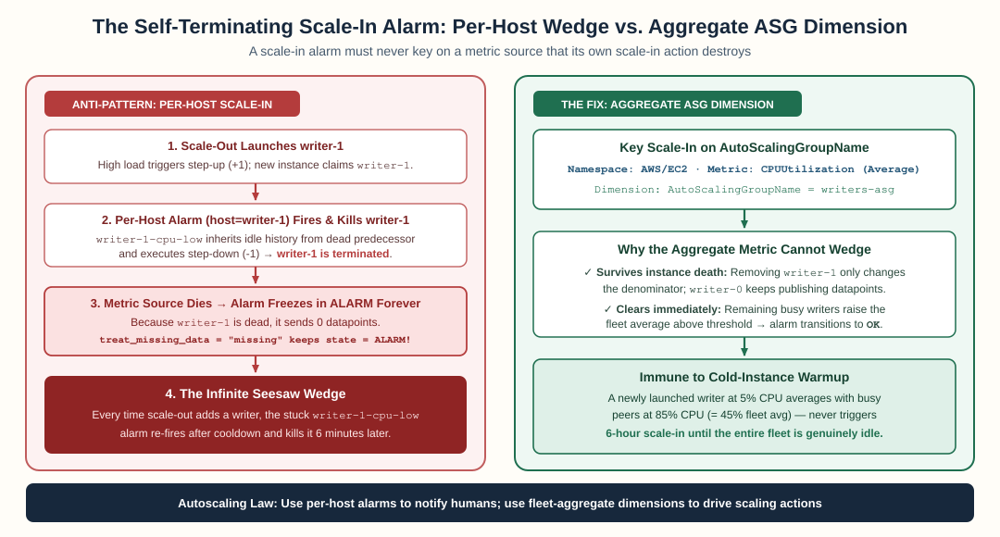

The writers fleet had a strange property: it could scale out but it could not stay scaled out. Load would rise, the CPU alarm would fire, a second writer would launch — and roughly six minutes later, a different alarm would quietly terminate it. Scale up, get killed, scale up, get killed. The fleet sat pinned at its minimum for hours while alarms on both ends insisted they were doing their jobs.

Nothing was misconfigured in the way you'd expect. Both alarms had sensible thresholds. Both scaling policies worked in isolation. The bug was in an interaction nobody designs for: **the scale-in alarm was keyed to a single host, and its own action destroyed its metric source.**

This post is the anatomy of that wedge — how a per-host alarm terminates itself, why the alarm never clears, and the two-line redesign (an aggregate alarm on the ASG dimension) that makes scale-in safe.

## The setup that wedged



*A per-host scale-in alarm kills its own metric source and freezes in `ALARM` forever under `treat_missing_data = "missing"`; keying scale-in on the aggregate `AutoScalingGroupName` dimension survives instance termination and clears as soon as remaining writers carry load.*

The writers ASG scaled on two CloudWatch alarms, both reading node-level CPU:

- **Scale-up**: `writer-N-cpu-high` — the agent's `cpu_usage_idle` metric for a specific writer hostname, breaching when the host is too busy. Wired to a step-up policy (`+1` instance).
- **Scale-down**: `writer-N-cpu-low` — the same metric for a specific writer hostname, breaching when the host has been too *idle* for six hours (72 evaluation periods at 5 minutes). Wired to a step-down policy (`-1` instance), the fleet's cost-recovery path.

Per-host alarms feel natural when you come to autoscaling from node monitoring: you already have per-host CPU dashboards, so you wire the alarm to the same dimension. The readers fleet scaled on a target-tracking policy keyed to the ASG itself, which is why it never had this problem — but that's getting ahead of the story.

## The wedge, step by step

Here's the sequence that repeated for hours, reconstructed from the ASG's scaling-activity history:

1. **Minute zero** — Ingest load rises. `writer-0-cpu-high` breaches; the step-up policy adds a writer. The ASG launches a second instance, which claims the `writer-1` ordinal lease and comes up as writer-1.
2. **Six minutes later** — the low-CPU alarm for the writer-1 *name* fires. Six minutes earlier this alarm had started watching the *new* writer-1, a fresh instance whose CPU is naturally idle while it warms up joins, fetches its replica queue, and waits for load to balance across the fleet. A fresh writer is a low-CPU writer. The alarm's threshold — idle for 6 hours — was satisfied by **datapoints inherited from the dead predecessor of the same name** (more on that in a moment), or in the faster variants, by the alarm simply still being in ALARM from its previous evaluation.
3. The step-down policy terminates writer-1 — the instance the scale-up just paid for.
4. **Cooldown ends** — the `writer-1-cpu-low` alarm is still in ALARM. Its host is terminated; its metric has no source. CloudWatch's `treat_missing_data = "missing"` preserves the alarm's last state, and the alarm re-fires the step-down policy at the next evaluation. The next victim is whichever instance the ASG picks — sometimes the original writer-0, sometimes a newly-scaled-out node.
5. Go to step 1.

Two properties of CloudWatch alarms make this loop unbreakable from the inside:

**A dead host's alarm never clears.** With `treat_missing_data = "missing"`, an alarm whose metric vanishes stays in its last state — ALARM — indefinitely. It doesn't go to OK (that would stop the scale-ins). It doesn't go to INSUFFICIENT_DATA (that wouldn't fire the policy, but it also wouldn't tell anyone). It just sits there, armed, re-firing the step-down policy after every cooldown, forever.

**The alarm's dimension is a name, and names get recycled.** The fleet's identity layer gives the ordinal `writer-1` to whichever instance holds the lease. When the first writer-1 was terminated and a replacement claimed the same name, the per-host alarm started watching the *new* instance — but its 72-period evaluation window was already full of the *old* instance's idle datapoints. The fresh writer inherited a six-hour idle verdict on its first minute of life.

## Why this is an autoscaling anti-pattern, not a bug

The deep problem: **a scale-in alarm must not have a metric source that its own action destroys.** The whole point of scale-in is to remove an instance. If the alarm that triggers removal is keyed to that instance, every removal orphans the alarm in its triggered state, and a triggered scale-in policy on cooldown is a standing order to remove the next instance.

Per-host alarms are fine for **notifying** — "writer-1 has been idle for six hours" is a useful Slack message. They are categorically wrong for **acting**. The action belongs to a metric that describes the fleet, because the fleet is what the ASG scales.

The same logic applies to any per-entity alarm wired to an action that changes the entity population: per-pod alarms driving pod deletion, per-node alarms driving node drains, per-shard alarms driving shard rebalancing. The moment the action can remove the metric's subject, the alarm needs an aggregate dimension instead.

## The fix: one aggregate alarm, keyed to the ASG

AWS publishes `AWS/EC2 CPUUtilization` with a built-in `AutoScalingGroupName` dimension — the fleet-average CPU, maintained by the service itself, computed over whichever instances exist right now. It has exactly the properties a scale-in alarm needs:

- It survives instance termination — the average is over the ASG, so removing one member just changes the denominator.
- It clears when the remaining fleet is genuinely busy — after scale-in, if the survivors are at 80% CPU, the average says so and the alarm goes to OK.
- It cannot be satisfied by a *new* instance's warmup — the average includes every in-service instance, and one cold instance cannot drag a fleet average below a six-hour idle threshold.

```hcl
resource "aws_cloudwatch_metric_alarm" "writers_asg_idle" {
  count = var.enabled && var.writers_step_down_policy_arn != null ? 1 : 0

  alarm_name          = "${local.alarm_prefix}-writers-asg-idle"
  namespace           = "AWS/EC2"
  metric_name         = "CPUUtilization"
  statistic           = "Average"
  period              = 300
  evaluation_periods  = 72          # 6 hours of sustained idleness
  threshold           = var.scale_down_cpu_threshold
  comparison_operator = "LessThanThreshold"

  dimensions = {
    AutoScalingGroupName = var.writers_asg_name
  }

  # Scale-IN policies fire on the ALARM state (AWS semantics: ok_actions
  # never invoke scaling). The step-down policy goes here, next to SNS.
  alarm_actions = compact(concat(
    local.alert_topic_arns,
    [var.writers_step_down_policy_arn],
  ))
  ok_actions = local.alert_topic_arns
}
```

And the per-host alarms stay — demoted to guidance:

```hcl
# Per-host low-CPU alarms: GUIDANCE ONLY (SNS, no scaling action).
# The scale-in decision belongs to the aggregate writers-asg-idle
# alarm, which survives host death.
alarm_actions = local.alert_topic_arns
```

The comment in the code says it best: *this alarm's metric dies with its host; wiring a scaling action to it is the wedge, never a feature.*

## Detecting the wedge before it costs you hours

Three signatures would have caught this the day it started:

1. **An alarm in ALARM with no recent datapoints.** After its host terminates, the per-host alarm sits in ALARM against a dark series. Any liveness check over your alarm inventory — "list alarms in ALARM whose metric has no data in the last N periods" — flags it immediately. (This is the same gray-state discipline from the keeper monitoring post; the states differ but the smell is identical.)
2. **Scale-out and scale-in inside one cooldown window.** The activity history showed `+1` followed by `-1` six minutes later. A healthy fleet under steady load sees scale events minutes-to-hours apart, not seesawing inside a single cooldown. A tiny query over `DescribeScalingActivities` (or a metric-filter on your activity stream) makes seesaws visible.
3. **The fleet pinned at min while a scale-up alarm is also firing.** If scale-up keeps succeeding and capacity keeps ending up at min anyway, something is undoing the scale-ups. The two alarms firing *at the same time* — one saying busy, one saying idle — is itself the tell: they cannot both be describing the same fleet.

## The general lessons

- **Scale-in alarms key on the fleet dimension, never the instance.** `AutoScalingGroupName` exists precisely so your scaling decisions can observe the thing being scaled. Use it for any alarm with a scaling action.
- **An alarm wired to an action must survive the action's side effects.** Ask of every action-alarm pair: "does the action change the population this metric measures?" If yes, aggregate the metric or reconsider the trigger.
- **`treat_missing_data` is a design decision, not a default.** For a per-host alarm that survives termination, `missing` turns a dead series into a permanently armed trigger. Decide explicitly what each alarm's gray state means.
- **Recycled identity + long evaluation windows = inherited verdicts.** If your fleet gives recycled names to replacements (lease ordinals, stateful-set ordinals), a per-name alarm's window mixes datapoints from different physical instances. Another reason the action-grade metric must be aggregate.

The fleet now scales out under load, holds, and scales back in when the aggregate average says the capacity is genuinely surplus. The per-host alarms still page — as guidance, they're useful — but the terminations belong to a metric that can't be killed by its own decision.
