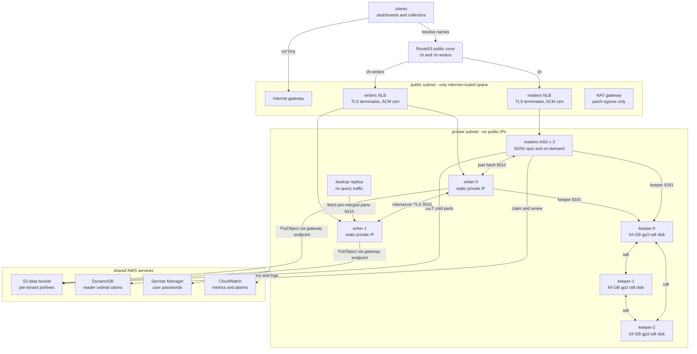
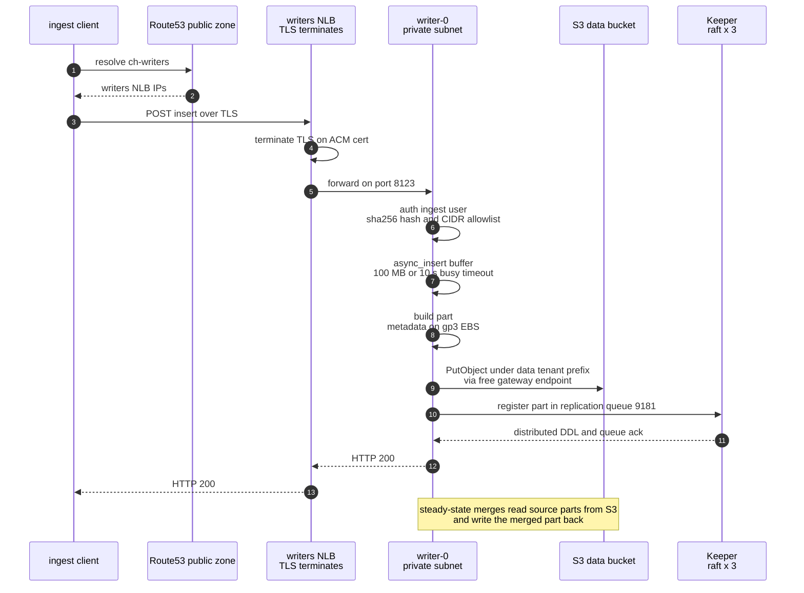
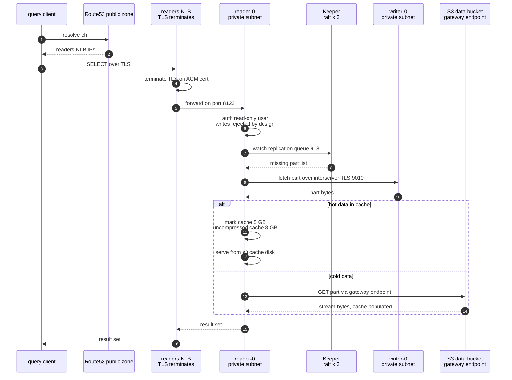

A junior engineer can read the Terraform for the log analytics platform I run and still not answer the question that matters: where does an INSERT physically go? Terraform tells you what exists — subnets, security groups, load balancers. It says nothing about order. Which hop terminates Transport Layer Security (TLS)? Which credential gets checked, at which layer? Which port does a part fetch use?

A sequence diagram answers, because you cannot draw one without naming every hop. Think of a metro map. It does not show every street. It shows only how the lines connect. A visitor can trace "how do I get from the airport to the hotel" without knowing the city — but only because the map names every station. In architecture terms, the diagram is the metro map of the cluster: every station is a hop, and a station you cannot name is a gap in your understanding. This post is the three diagrams the series built toward — topology, ingest path, query path — and the decision drawing them made obvious: why this cluster runs on Amazon Elastic Compute Cloud (EC2) instead of Kubernetes.

**Key takeaways**

- Drawing a data flow is a test you run on your own understanding. The ingest diagram forced the TLS termination point, the credential check, and every port into named boxes.
- The public subnet is the only internet-routed space in the virtual private cloud (VPC) and holds only traffic appliances. Every ClickHouse node is private. Access is enforced twice: security groups at the wire, `<networks>` in the database.
- Inserts buffer in `async_insert` — 100 megabytes (MB) or 10 seconds — because Amazon Simple Storage Service (S3) writes cost tens of milliseconds and small parts would outpace merges. Hypertext Transfer Protocol (HTTP) 200 returns only after Keeper registers the part on 9181.
- Reads are read-only by design. Hot data comes from a 5-gigabyte (GB) mark cache, an 8 GB uncompressed cache, and the cache disk; cold data streams from S3 through the free gateway endpoint.
- EC2 beat Kubernetes on four counts: spot identity, Keeper roll discipline, the S3 storage shape, the control-plane tax. Not because the operator is bad software.
{: .key-takeaways}

---

## Why diagrams at all

Mermaid is a text format for diagrams — flowcharts, sequence diagrams — written inside a fenced code block in markdown ([mermaid.js.org](https://mermaid.js.org/)). The architecture docs I keep are diagrams-first for three reasons.

A sequence diagram is a test you can fail. Prose can wave at "the network layer" and skip a hop. A diagram has to name the actor that terminates TLS. Drawing the ingest path turned "does the certificate live on the load balancer or the instance?" into a box I had to fill — and filling it deleted a runbook I did not want to own: certificate expiry.

It is text, so it reviews like code: a pull request that opens a security group shows that diff next to the diagram line naming the port. And it renders where the repository already lives — GitHub natively, editors, this site via a small client-side loader. No build plugin, so GitHub Pages stays stock.

## The topology

*One rule: the public subnet is the only internet-routed space, and it holds only traffic appliances. Every ClickHouse node is private.*

Think of a hotel with one reception gate. Every visitor must pass reception. No visitor walks directly into the kitchen. In this VPC (Amazon's private network for your resources), the public subnet is the reception gate and the private subnet is the kitchen.

The public subnet is the only subnet with a route to the internet gateway. It contains two Amazon Web Services (AWS) Network Load Balancers (NLBs), which distribute Transmission Control Protocol (TCP) connections across servers, a network address translation (NAT) gateway for patch egress (outbound traffic for operating system (OS) updates), and nothing else. Every ClickHouse node lives in the private subnet with no public Internet Protocol (IP) address. Route 53, AWS's Domain Name System (DNS) service, maps `ch` to the readers NLB and `ch-writers` to the writers NLB. The internet learns exactly two names: two load balancers.

Access is checked twice, like a guard at the gate and a second name check at the kitchen door. Security groups permit the client ports only from allowlisted CIDR blocks — CIDR means Classless Inter-Domain Routing, a way to write an IP range; `203.0.113.0/24` means all 256 addresses starting at `203.0.113.0`. Then `<networks>` in each ClickHouse user repeats the same CIDR check inside the database. A security-group mistake does not become database access; a user-definition mistake does not bypass the subnet boundary.

S3 traffic never leaves the VPC. The gateway endpoint is free; the NAT alternative bills $0.045 per GB.

## The ingest path, hop by hop

*An insert over HTTP. Steady-state merges run the loop in the note.*

Walk the numbers.

1. **TLS terminates at the NLB.** TLS is the encryption that protects data on the network; "terminates" means the encrypted connection ends here and someone decrypts it. Think of sealed letters at a hotel gate: visitors hand sealed letters to reception, reception opens them, and inside the building staff pass notes openly because only staff can be inside. In cluster terms, the NLB is reception — it decrypts, and traffic inside the private subnet stays inside. The certificate comes from AWS Certificate Manager (ACM). An ACM public certificate attaches to a load balancer but cannot be exported and installed on an EC2 instance. That constraint works for me: AWS renews it automatically, so there is no expiry runbook and no countdown-to-outage ticket.
2. **Auth on the writer.** The ingest user's password is stored as a sha256 hash, never plaintext, and its `<networks>` repeats the CIDR allowlist. A credential used from outside the allowlist is rejected at the database, not just at the wire.
3. **async_insert buffers.** Think of a postman. He does not deliver each letter the moment it is posted. He collects letters until the bag is full enough, then makes one delivery. `async_insert` is that bag: inserts collect server-side until 100 MB or 10 seconds, whichever comes first, then fold into one large part. This exists because of S3. A PUT takes tens of milliseconds, log traffic arrives as thousands of small inserts, and unbuffered parts appear faster than merges fold them. The failure is `Too many parts`.
4. **The part lands in two places.** Metadata — the map from tables to parts to S3 object keys — goes on the writer's gp3 Elastic Block Store (EBS) volume, snapshotted daily. The bytes go to the tenant's `data/` prefix through the free gateway endpoint.
5. **Keeper hears about it.** The writer registers the part in its replication queue and coordinates distributed data definition language (DDL) through Keeper — the coordination service that replaced ZooKeeper — on port 9181. Only then does HTTP 200 go back.

Steady state is the same loop: merges read every source part from S3 and write the merged part back. Every cold merge is an S3 round trip.

## The query path, hop by hop

*A query over HTTP, with the background replication loop that keeps the reader current. The alt block is the hot or cold split.*

- **Read-only by design.** The query user on readers has read-only access. Any write statement is rejected. A reader is a replica. If a bug wrote to it, replicas would differ — writers are the only write path.
- **Steps 7 to 10 are background, not the query.** The reader watches its replication queue in Keeper, sees which parts it is missing, and fetches them from a writer over interserver TLS on port 9010 — ClickHouse's node-to-node channel, replication traffic only. By query time the part is almost always local. Drawing this loop surfaced the hostname bug at the end of this post.
- **Hot versus cold.** Think of a cook. The shelf above the stove holds the ingredients used today — within reach. The basement storeroom holds the rest; fetching from it is a long trip, but the item goes onto the shelf for next time. In ClickHouse terms, the shelf is the cache stack — the mark cache (5 GB in random-access memory (RAM) — primary-key index offsets), the uncompressed cache (8 GB in RAM — recently decompressed blocks), and the cache disk wrapping the s3 disk — and hot data served from it never touches S3. Cold data takes one GET from S3 through the gateway endpoint, and the fetched bytes populate the cache on the way in. The next identical query is hot.

## Why EC2 beat Kubernetes here

Fair framing first: [Altinity's clickhouse-operator](https://github.com/Altinity/clickhouse-operator) is excellent software. You write a ClickHouseInstallation — a CRD, meaning a custom resource definition: Kubernetes lets you define your own object type, and the operator adds one for ClickHouse. A controller reconciles it into [StatefulSets](https://kubernetes.io/docs/concepts/workloads/controllers/statefulset/) — a Kubernetes controller for pods that each need a stable name and a stable disk. Pods get ordinals (numbers in the name, like `clickhouse-0`, `clickhouse-1`) and PersistentVolumeClaims (PVC — Kubernetes's request for a persistent disk, attached to one pod). You get schema auto-creation on scale-out, dead-replica cleanup (SYSTEM DROP REPLICA), graceful shutdown hooks, rolling updates with abort and rollback, and an alert catalog. If you already run Kubernetes, it is a good default.

Four things pushed this cluster to EC2.

**Identity under spot churn.** A StatefulSet's names are like hotel room numbers painted by the builder: the numbers stay fixed. But spot reclaim, PVC re-binding races (a replaced pod's disk may not re-attach cleanly), and node-pressure eviction all fight that guarantee — and when the builder rebuilds a wing under pressure, the renumbering fight is your problem, and you pay for the wing. The claimer here is a guest book the guests sign themselves, so any building works. In cluster terms, identity is one conditional DynamoDB write — a replacement reader re-claims the name `reader-0` — plus a private DNS record ([the spot post](/blog/clickhouse-spot-readers-stable-identity/)).

**The 50/50 spot split.** Think of a taxi company: half the fleet is owned outright, half is hired by the hour. A storm can take the hired half off the road, but the owned half keeps running. In cluster terms, the reader Auto Scaling Group runs half its instances on spot and half on-demand natively — the on-demand floor bounds worst-case loss — and one StatefulSet cannot split its ordinals that way.

**Keeper raft safety.** Keeper is like three bank managers who must all sign the same ledger. You can replace one manager at a time without stopping the bank — but only if the handover procedure is followed exactly, by hand. There is no assistant-manager software that can safely sign for you mid-handover. In cluster terms, raft safety is your discipline either way: roll one node at a time, preserve `myid`, wait for a healthy leader between steps ([Keeper docs](https://clickhouse.com/docs/en/operations/clickhouse-keeper)). On static-IP EC2 with dedicated raft disks, the runbook is the gate — no controller I did not write can act mid-roll.

**The storage shape.** The whole design is S3-tiered storage policies with cache disks ([the storage post](/blog/clickhouse-s3-tiered-storage/); [storing data](https://clickhouse.com/docs/en/operations/storing-data)). A PersistentVolume per replica is the wrong shape. The operator supports S3 disks too, but then the PV is only metadata, and EBS-through-a-PVC adds a layer over a design where the metadata disk is small, snapshotted, and never deleted.

**The cluster tax.** This is the one strong metaphor in the post: a tax is a cost you pay whether or not you wanted the service. Running ClickHouse on Kubernetes production-ready means maintaining a cluster: the control plane (the Kubernetes components that decide where pods run), CNI (the container network interface — the plugin that gives pods network addresses), storage classes, node pools, and cert-manager (software that renews certificates automatically) — even with EKS, AWS's managed Kubernetes, absorbing some of it ([what EKS is](https://docs.aws.amazon.com/eks/latest/userguide/what-is-eks.html)). It is like renting an entire office building to house nine employees: rent, security, and cleaning cost more than the nine desks, unless you already own the building. In fleet terms, six to nine stateful nodes means more moving parts than the fleet. The operator-parity debt — schema sync, replica garbage collection, graceful drain — came to about 300 lines of cloud-init and two systemd timers ([the operations post](/blog/clickhouse-operations-runbooks/)).

The honest reversal: with a large EKS cluster already running stateful workloads and a platform team behind it, the operator is less code to own than my cloud-init. The right question is not "EC2 or Kubernetes?" It is "what do I already operate well?" I already operate EC2, S3, and Terraform. The answer followed.

## How to keep diagrams honest

Diagrams go stale. Configs change, the drawing stays at last year's shape, and a stale diagram you trust is worse than no diagram. Three rules:

1. Diagrams live in the repository, next to the configs they describe. Same pull request, same review.
2. A network change touches the diagram in the same commit. A diff showing the security group but not the diagram is a review comment, not a merge.
3. Annotate verification. "Verified live" means I watched the traffic or logs; "designed" means the config says so and I have not. The replication steps in the query diagram were drawn after watching real replication — and watching found a wrong assumption: Keeper registers nodes by short hostname, short names were not resolving, and `/etc/hosts` entries went onto every node. The diagram found the gap.

Previous: [After ReplicatedMergeTree: Content-Addressed Storage (CAS), Iceberg, and When to Just Buy ClickHouse Cloud](/blog/clickhouse-whats-next-cas-iceberg/).

*That's the series: mental model → engines → topology → storage → spot identity → operations → cost → what's next → this. The repo is the rest of the documentation.* Series index: [ClickHouse on AWS: Self-Managed from First Principles](/series/clickhouse-on-aws/).
