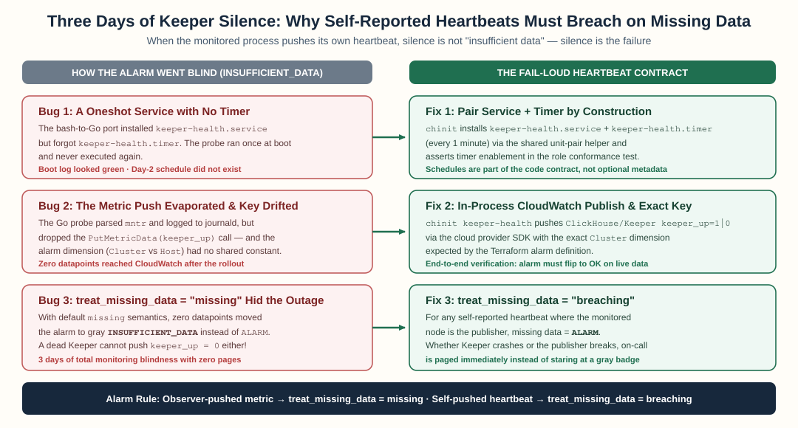

The dashboard looked fine. Green checkmarks on every Keeper widget — latency flat, outstanding requests at zero, snapshot creations healthy. The only oddity was one alarm sitting in `INSUFFICIENT_DATA` since November 13. Everyone's eye slides past that gray state; gray means "not enough information," which reads as "probably fine."

It was not fine. The alarm in question — `keeper-down`, the one designed to tell us the moment Keeper lost quorum and every replicated table flipped read-only — had been **blind for three days**. Not because Keeper was unhealthy. Because the one line of bash that published its heartbeat metric never survived a rewrite, and the alarm was watching a metric that no longer existed.

This post is the anatomy of that blind spot: how a monitoring gap hides inside a healthy-looking port, why CloudWatch's missing-data semantics made it worse, and the fix that makes this class of failure loud instead of invisible.

## The system that was being monitored



*Pairing `keeper-health.service` with its `.timer`, publishing `keeper_up` with the exact `Cluster` dimension, and setting `treat_missing_data = "breaching"` ensures a silent Keeper pages immediately instead of turning gray.*

Self-managed ClickHouse needs ClickHouse Keeper the way a distributed database needs a majority vote: every replicated table registers its replica path in Keeper, and inserts to ReplicatedMergeTree are only acknowledged once Keeper agrees. If Keeper loses quorum, writes don't just slow down — every replicated table in the cluster flips to `read-only` and inserts start failing with `Table is in read-only mode`.

So Keeper liveness is the single highest-leverage thing to alarm on a self-managed fleet. Our design was the standard one:

1. A health probe runs **on the keeper node itself**, every minute — `mntr` over the keeper port, the four-letter word that returns quorum state, latency, and follower counts.
2. The probe's verdict gets pushed to CloudWatch as a custom metric: `keeper_up`, value 1 on success, 0 on failure, under the `ClickHouse/Keeper` namespace.
3. A `keeper-down` alarm evaluates that metric and pages the on-call topic.

Three simple pieces. Two of them were broken.

## Bug one: the timer that never existed

The probe itself had been rewritten from a bash cron into a Go binary — a deliberate, well-tested port. The Go version installed a systemd service for the probe: `keeper-health.service`, a oneshot unit that runs the health check.

What it did **not** install was the timer. In the bash era, the cron entry carried both the probe and its schedule. When the port replaced "cron line" with "systemd service," it translated the probe faithfully and dropped the schedule. A oneshot service with no timer runs exactly once — at boot — and never again.

The probe worked. The logs proved the probe worked. What was missing was any mechanism for it to run *again*.

The lesson is about porting operational tooling: **schedules are not optional metadata**. When you port a recurring job, the recurrence itself is part of the contract. The port's unit-installer had a helper for pairing services with timers — the schema-sync job got one, the lease-renew job got one, the dead-replica GC got one. The keeper-health job, the one watching the most critical component in the fleet, was the only one that shipped a service with no timer. The unit-test matrix asserted which units each role got, and it asserted the correct set — because the test was written against the same mental model that forgot the timer. Tests encode your assumptions; they cannot catch an assumption you never knew you had.

## Bug two: the metric push that evaporated

Even with a timer, the alarm would still have been blind — because the push was gone too.

The bash version ended with something like:

```bash
aws cloudwatch put-metric-data \
  --namespace ClickHouse/Keeper \
  --metric-name keeper_up \
  --value $VERDICT \
  --dimensions Cluster=$CLUSTER
```

The Go rewrite printed the `mntr` output to the journal, returned a correct exit code — and stopped. The push wasn't commented out or stubbed; it simply had no equivalent in the new code path. Nobody decided to remove it. The rewrite just didn't have a "publish to CloudWatch" step in its vocabulary, because the new design kept everything in-process: probe, parse, verdict. Publishing to an external metrics API was a side effect the port didn't model.

When the fleet rolled to the new binary, `keeper_up` datapoints stopped at the exact roll timestamp. The alarm keyed on a series that had gone dark.

## Why the alarm didn't scream

Here is the part that turns an outage of monitoring into a three-day silence: how CloudWatch evaluates an alarm when the metric has no data.

By default, CloudWatch treats missing datapoints as `missing` — the evaluation window simply doesn't count them. An alarm with `treat_missing_data = "missing"` that receives **zero** datapoints doesn't go to ALARM; it goes to `INSUFFICIENT_DATA` and stays there, indefinitely. The state reads as "waiting for more information." It is actually "the thing I'm watching no longer reports."

That default is right for many metrics. If an NLB stops publishing `UnHealthyHostCount`, you probably want to investigate the observability pipeline, not page the on-call about your targets. Missing data on an observer-produced metric usually means the *observer* broke.

But for a **self-reported liveness metric**, the default is exactly backwards. The keeper pushes its own heartbeat. A keeper that has crashed cannot push "I am down" — silence is the only failure signal it can send. For this class of metric, `treat_missing_data` must be `breaching`:

```hcl
resource "aws_cloudwatch_metric_alarm" "keeper_down" {
  alarm_name          = "${local.alarm_prefix}-keeper-down"
  namespace           = "ClickHouse/Keeper"
  metric_name         = "keeper_up"
  statistic           = "Maximum"
  period              = 300
  evaluation_periods  = 2
  threshold           = 0
  comparison_operator = "LessThanOrEqualToThreshold"

  dimensions = {
    Cluster = var.cluster_name
  }

  # A keeper that stops PUSHING is indistinguishable from a keeper
  # that is DOWN — the probe runs ON the keeper. Silence IS downtime.
  treat_missing_data = "breaching"
}
```

With that one line, the three-day gray state becomes a three-minute red alarm, and the lost push becomes a detected outage of monitoring instead of an unnoticed one.

## The dimension trap (the same bug's twin)

While fixing this, we found the same class of failure hiding a second time. The alarm declared its dimension as `ClusterName = <cluster>`. The publisher — both in bash and in the restored Go push — emitted `Cluster = <cluster>`. One character of difference.

CloudWatch dimensions are not a fuzzy match. An alarm keyed on `ClusterName` watches a series tagged `ClusterName`; a metric published as `Cluster` is a different series entirely. The alarm was syntactically perfect and semantically attached to nothing.

This is why "the metric exists in the namespace" is not verification. The verification that matters is: **the alarm changes state in response to real datapoints**. After restoring the push, the first live `keeper_up = 1.0` datapoint flipped the alarm to OK within one evaluation window. That state transition — watched, timestamped — is the only proof that producer and consumer agree.

## Making the port honest: the fix in three layers

The fix went in at three levels, because a single fix only protects the one path you noticed:

**1. The timer ships with the service.** The unit installer now pairs `keeper-health.service` with `keeper-health.timer` (`OnCalendar=*-*-* *:*:00` — every minute, the cron cadence). The unit-matrix test now asserts the timer exists *and* carries the every-minute calendar — the assertion that was missing encodes the schedule as part of the job's contract.

**2. The push is a first-class capability.** Instead of shelling out to `aws cloudwatch put-metric-data` (which recreates the fragile bash coupling), the Go binary got a `MetricPusher` port — a typed interface the AWS provider implements, probed at runtime the way every other optional capability is. On a provider without the capability the probe logs a loud warning and still exits with its verdict; the probe result, not the push, remains authoritative. A broken metrics API can never make a healthy keeper look down, and a missing push is visible in the journal the moment it happens.

**3. The alarm treats silence as failure.** `treat_missing_data = "breaching"` on `keeper-down`, with a description that explains *why*: the probe runs on the keeper, so no datapoints means the keeper cannot report.

## The general lessons

- **A liveness alarm's producer is its own subject.** When the monitored thing is also the metric's publisher, missing data is the failure mode. Every heartbeat-style alarm (keepalives, health probes, agents) belongs to this class and needs breaching-on-missing semantics.
- **A rewrite must enumerate its side effects.** The bash probe had two responsibilities: probe, and publish. The port carried the first and dropped the second because the second lived in a one-line pipe at the bottom of a script. When porting operational code, list what the old version *did* — including what it did to external systems — and check every item against the new version. "It exits 0" verifies the probe, not the system.
- **Gray is a color.** `INSUFFICIENT_DATA` on a liveness alarm deserves the same attention as ALARM. If a metric in your namespace has a gap longer than a few evaluation windows, someone should be asking why — because the answer is either "the publisher broke" or "the publisher is gone," and both need a human.
- **The only real test of a monitoring path is the state transition.** Unit tests assert the push happens; integration can assert the datapoint exists. But the contract — "this alarm fires when Keeper dies" — is only proven when you watch the alarm change state from the metric flowing. Automate that if you can; do it manually before you sign off if you can't.

The keeper never actually went down during those three days — the failure was a failure of monitoring, caught while the system it watched was still healthy. The next one might not be so cooperative. Silence is not health; make sure your alarms agree.
