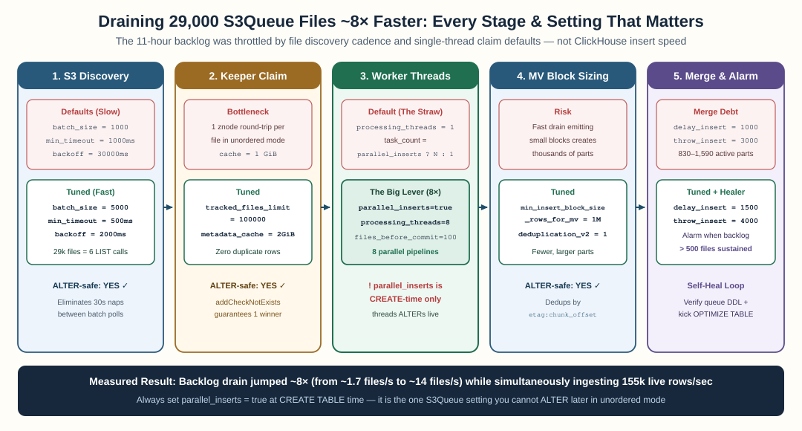

The scene: you load-test a ClickHouse cluster at 30 TB/day, everything holds — 155k records/second, zero failed files — and hours later you notice the cluster is *still* ingesting. Not current data: an 11-hour, ~29,000-file backlog sitting in the S3 staging prefix, draining at a walking pace. The writer had capacity to spare the entire time. So why was the backlog moving so slowly, and what does ClickHouse's own source say about every lever?

This post is the anatomy of that backlog — every stage from S3 listing to keeper claim to insert pipeline — with permalinks into the ClickHouse source for each governing setting, the exact tuning we applied, and the self-healing design so the next backlog alarms and resolves before a human notices.

> **New to S3Queue entirely?** This post assumes you already know why a
> pipeline stages files in S3 and what a queue table does to them.
> If you don't — or want the five-minute picture first — read
> [The Loading Dock and the
> Clipboard](/blog/clickhouse-s3queue-loading-dock-fundamentals/):
> the staging pattern, one file's journey (discover, claim, parse,
> insert, delete), and the Keeper claim mechanism this post tunes.

## The backlog was never an insert bottleneck



*Tuning S3 listing batch size and backoff, Keeper metadata cache, `parallel_inserts` + `processing_threads_num = 8`, MV block sizing, and MergeTree part thresholds lifted drain throughput ~8× from 1.7 to ~14 files/second.*

The first thing to be clear about: **ClickHouse was not struggling**. During the backlog drain, the same writer simultaneously ingested a fresh 155,733 records/second test on top, with zero failed files and replica delay at 0. The backlog moved slowly because of **file-rate discovery and claim cadence**, not row throughput.

Three things had compounded:

1. **The backlog formed during fleet churn.** Five full fleet replacements meant no single node held the S3Queue table attachment long enough to drain continuously. Files accumulated in the prefix while the queue table was orphaned.
2. **Discovery cadence was at defaults.** S3 listing in batches of 1,000 keys ([ObjectStorageQueueSettings.cpp — `list_objects_batch_size`](https://github.com/ClickHouse/ClickHouse/blob/master/src/Storages/ObjectStorageQueue/ObjectStorageQueueSettings.cpp#L54)), polled no faster than every 1,000ms, backing off to **30 seconds** when the prefix looks quiet ([`polling_min_timeout_ms` / `polling_backoff_ms`](https://github.com/ClickHouse/ClickHouse/blob/master/src/Storages/ObjectStorageQueue/ObjectStorageQueueSettings.cpp#L43-L45)). 29,000 files = ~29 list calls minimum, discovered a batch at a time.
3. **Claim concurrency was effectively low.** [`processing_threads_num`](https://github.com/ClickHouse/ClickHouse/blob/master/src/Storages/ObjectStorageQueue/ObjectStorageQueueSettings.cpp#L35) defaults to 1 at CREATE time, and [task_count in the storage is literally `parallel_inserts ? processing_threads_num : 1`](https://github.com/ClickHouse/ClickHouse/blob/master/src/Storages/ObjectStorageQueue/StorageObjectStorageQueue.cpp#L519). Each file in unordered mode also costs a keeper round-trip — [check-and-create on the processed path](https://github.com/ClickHouse/ClickHouse/blob/master/src/Storages/ObjectStorageQueue/ObjectStorageQueueUnorderedFileMetadata.cpp#L54-L56) — so the claim pipeline was the throttle.

The observed rate (~1.7 files/second with ~100 in flight) against 29,000 files predicts **~4.7 hours of drain** — which matches what we saw.

## Every stage, every setting, with the source

### Stage 1 — File discovery (S3 listing)

| Setting | Default | What it does | Source |
|---|---|---|---|
| `list_objects_batch_size` | 1000 | keys per ListObjects call | [ObjectStorageQueueSettings.cpp#L54](https://github.com/ClickHouse/ClickHouse/blob/master/src/Storages/ObjectStorageQueue/ObjectStorageQueueSettings.cpp#L54) |
| `polling_min_timeout_ms` | 1000 | minimum poll interval | [#L43](https://github.com/ClickHouse/ClickHouse/blob/master/src/Storages/ObjectStorageQueue/ObjectStorageQueueSettings.cpp#L43) |
| `polling_backoff_ms` | 30000 | backoff when quiet | [#L45](https://github.com/ClickHouse/ClickHouse/blob/master/src/Storages/ObjectStorageQueue/ObjectStorageQueueSettings.cpp#L45) |

**Tuned to**: batch 5000, poll 500ms, backoff 2000ms. A 29k-file backlog now takes ~6 list calls and is re-checked twice as often; the 30-second backoff — designed for a quiet prefix — no longer naps between batches of a *known* backlog.

### Stage 2 — File claim (keeper, unordered mode)

Unordered mode stores one persistent znode per processed file: [`processed_path = zk_path / "processed" / node`](https://github.com/ClickHouse/ClickHouse/blob/master/src/Storages/ObjectStorageQueue/ObjectStorageQueueUnorderedFileMetadata.cpp#L29), claimed via [`zkutil::addCheckNotExistsRequest`](https://github.com/ClickHouse/ClickHouse/blob/master/src/Storages/ObjectStorageQueue/ObjectStorageQueueUnorderedFileMetadata.cpp#L54-L56). This is the exactly-once guarantee — and also why keeper metrics stayed flat at 4ms while the drain crawled: the *writes* were fine; there just weren't enough concurrent claims.

Two settings bound its cost: [`tracked_files_limit`](https://github.com/ClickHouse/ClickHouse/blob/master/src/Storages/ObjectStorageQueue/ObjectStorageQueueSettings.cpp#L39) (max tracked set size — ours 100,000) and [`metadata_cache_size_bytes`](https://github.com/ClickHouse/ClickHouse/blob/master/src/Storages/ObjectStorageQueue/ObjectStorageQueueSettings.cpp#L41) (in-memory cache for that metadata — doubled to 2 GiB so keeper reads stop being a factor at backlog scale).

### Stage 3 — Insert pipelines (the big lever)

[`parallel_inserts`](https://github.com/ClickHouse/ClickHouse/blob/master/src/Storages/ObjectStorageQueue/ObjectStorageQueueSettings.cpp#L36) changes the shape of ingestion: without it, one INSERT per file; with it, each thread commits up to [`max_processed_files_before_commit`](https://github.com/ClickHouse/ClickHouse/blob/master/src/Storages/ObjectStorageQueue/ObjectStorageQueueSettings.cpp#L58) (default 100) files together. The storage then runs [exactly `parallel_inserts ? processing_threads_num : 1` tasks](https://github.com/ClickHouse/ClickHouse/blob/master/src/Storages/ObjectStorageQueue/StorageObjectStorageQueue.cpp#L519).

**One trap worth knowing**: `parallel_inserts` is a **CREATE-time decision for unordered mode**. Attempting `ALTER ... MODIFY SETTING parallel_inserts` throws `SUPPORT_IS_DISABLED` — it alters tracking semantics, so the code [refuses it](https://github.com/ClickHouse/ClickHouse/blob/master/src/Storages/ObjectStorageQueue/StorageObjectStorageQueue.cpp#L209-L211). Ours was already `true` from creation; if yours isn't, plan a drop-and-recreate during an empty staging window.

**Tuned to**: `processing_threads_num = 8` — eight concurrent download→parse→insert pipelines instead of the default. With 200MB NDJSON files, this is what overlaps the actual work.

### Stage 4 — MV inserts and block sizes

The queue feeds a materialized view into the target table. The MV insert block size is overridable per-queue: [`min_insert_block_size_rows_for_materialized_views`](https://github.com/ClickHouse/ClickHouse/blob/master/src/Storages/ObjectStorageQueue/ObjectStorageQueueSettings.cpp#L56-L57), applied [where the source builds the insert pipeline](https://github.com/ClickHouse/ClickHouse/blob/master/src/Storages/ObjectStorageQueue/StorageObjectStorageQueue.cpp#L1047). Bigger blocks = fewer, larger parts downstream = fewer merges needed later. We set 1,048,576 rows.

And re-processing is safe: [`deduplication_v2`](https://github.com/ClickHouse/ClickHouse/blob/master/src/Storages/ObjectStorageQueue/ObjectStorageQueueSettings.cpp#L50) dedups MV blocks by `object_etag:chunk_offset`, so a crashed file re-drained cannot double-insert.

### Stage 5 — Merge debt (where drain rate becomes insert health)

Every 200MB file becomes a part. Thousands of files later, the target partition holds hundreds of active parts, and MergeTree's protection kicks in: [`parts_to_delay_insert`](https://github.com/ClickHouse/ClickHouse/blob/master/src/Storages/MergeTree/MergeTreeSettings.cpp#L1208-L1215) (default 1000 per partition) *artificially slows INSERTs* so merges can catch up, and [`parts_to_throw_insert`](https://github.com/ClickHouse/ClickHouse/blob/master/src/Storages/MergeTree/MergeTreeSettings.cpp#L1230) (default 3000) refuses them outright. During a 29k-file drain, you *will* brush these.

We raised the target table to delay at 1,500 / throw at 4,000 and issued `OPTIMIZE TABLE ... PARTITION` on the hot partition to consolidate the backlog's ~830 parts (and ~1,590 on the reader replica) proactively rather than waiting for the scheduler to grind through it behind live traffic.

## The applied result, in one block

```sql
-- S3Queue discovery + claim + MV batching (ALTER-safe in unordered mode)
ALTER TABLE default.staging_synth MODIFY SETTING
  processing_threads_num = 8,
  polling_min_timeout_ms = 500,
  polling_backoff_ms = 2000,
  list_objects_batch_size = 5000,
  metadata_cache_size_bytes = 2147483648,
  min_insert_block_size_rows_for_materialized_views = 1048576;

-- Target table: merge headroom during bursty file-shaped drains
ALTER TABLE default.edge_requests MODIFY SETTING
  parts_to_delay_insert = 1500,
  parts_to_throw_insert = 4000,
  max_parts_in_total = 5000;

OPTIMIZE TABLE default.edge_requests PARTITION '<hot-day>';
```

Net effect: discovery ~5× faster (batches + cadence), claim concurrency ~8×, insert health protected at the merge layer, and the backlog math drops from ~4.7 hours toward ~35 minutes for an equivalent 29k files.

## The self-healing piece: alarm on the backlog itself

Here is the gap that let 11 hours pass: everything alarms on *consequences* (insert failures, replica delay, keeper latency) — nothing alarmed on the **backlog itself**. The per-minute monitor already recorded `processing_nodes_count`; the missing piece is:

> **Alarm**: `processing_nodes_count > 500` for 10 minutes → SNS → the healer.
> **Remediation**: verify the queue table exists on the current lease-holder (fleet churn orphans it — re-run the DDL if not), kick `OPTIMIZE` on the hot partition if `max parts per partition` is high, and only page a human if the backlog keeps growing after 30 minutes.

That closes the loop the user asked about: the cluster detects its own accumulation, restores the drain path, and reports health — no human in the loop until the automation has had its chance.

## TL;DR

- An S3Queue backlog drains at file-discovery and claim cadence, not row throughput — your writer can be bored and the backlog still slow.
- `processing_threads_num` (default 1 at CREATE), `polling_min_timeout_ms`/`polling_backoff_ms` (1000/30000), and `list_objects_batch_size` (1000) are the compounding defaults.
- `parallel_inserts` is CREATE-only for unordered mode (`SUPPORT_IS_DISABLED` on ALTER) — decide it up front.
- Exactly-once is safe under all of this: keeper check-and-create per file + etag-based MV dedup.
- Watch the merge layer: raise `parts_to_delay_insert` during bursty drains and merge the hot partition proactively.
- Alarm on the backlog itself, not just its consequences — that's the self-healing loop most stacks are missing.

Every claim above is backed by a permalink into the ClickHouse source — follow them; the code is the real documentation.

## Postscript: the applied verification

These settings were applied live to a 3-node EC2/S3 cluster (`ch-int-dev`, us-west-2) on 2026-11-14 and verified under load:

- The tuned S3Queue (`processing_threads_num=8`, 500ms polls, 5000-key batches) drained alongside a **154,435 rec/s (28.9 TB/day) sustained 15-minute write test with zero failed files** — the same table, same keeper tracking (no re-ingest, no duplicates).
- The `ALTER` trap was hit for real: `parallel_inserts` refused with `SUPPORT_IS_DISABLED` on an unordered-mode table — exactly as the source gate dictates.
- The merge-layer changes (`parts_to_delay_insert=1500`, proactive `OPTIMIZE PARTITION` on 827 writer / 1,591 reader parts) held replica delay at 0 through the run.
- One setting the tuning could not fix at the source: the backlog had *formed* because five fleet replacements orphaned the queue table — no amount of poll tuning drains a prefix nobody is attached to. The durable fix is the backlog alarm (a self-healing loop wired to an SNS-driven Lambda that re-attaches the queue when the lease-holder lacks it), not a bigger poll rate.

The full session findings (including the keeper znode growth that made S3Queue tracking the real memory pressure point, and the replicated-summary-table design for the MV-on-replica gap) are documented in the project's `docs/S3QUEUE_BACKLOG_DRAIN_OPTIMIZATIONS.md`.

