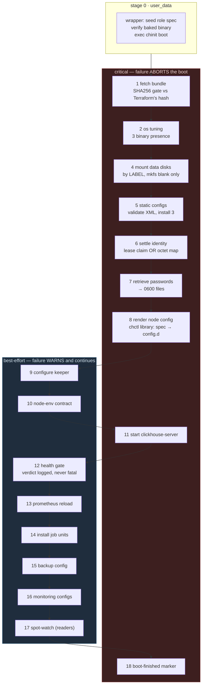
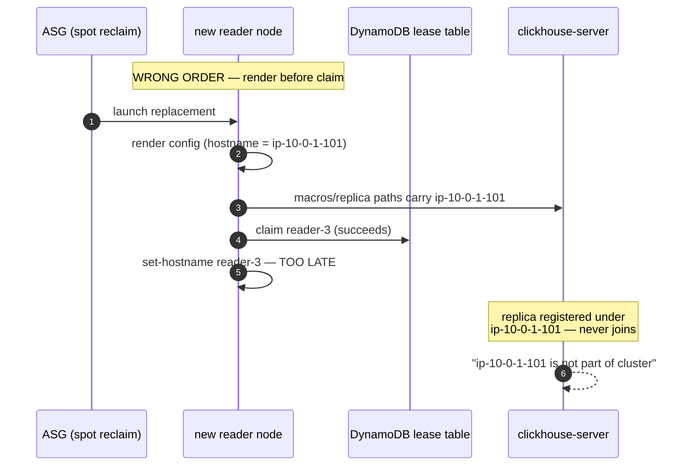
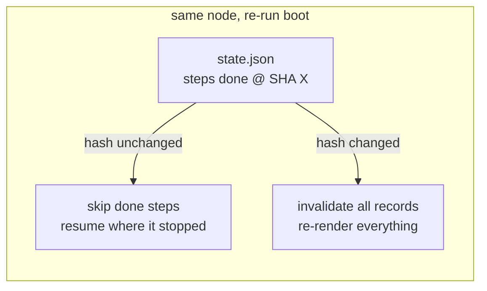
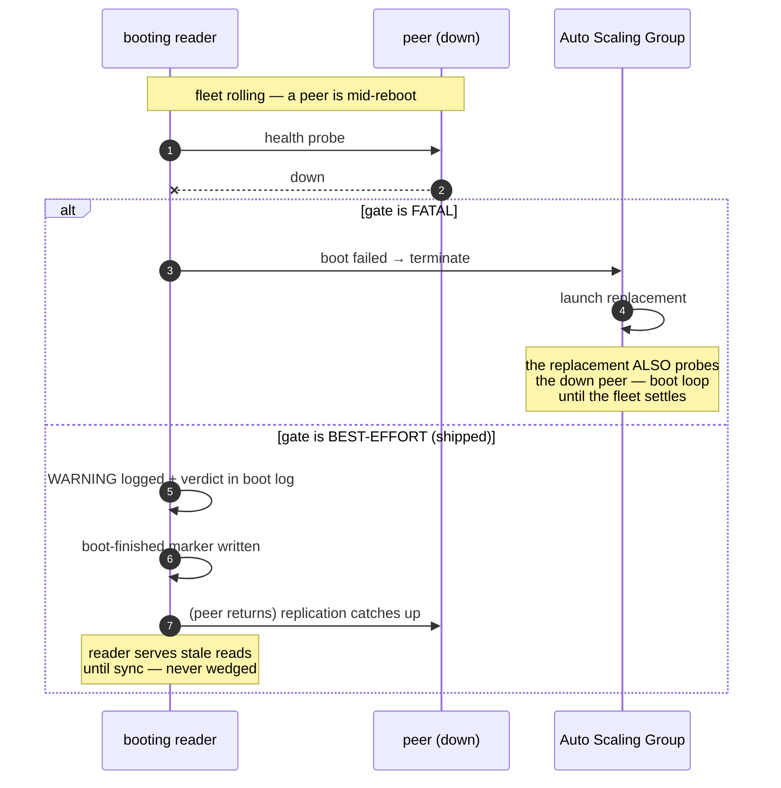

Boot scripts are the least-reviewed production code in a self-managed
database deployment. Everyone reads the DDL, the schema, the Grafana
dashboards. Almost nobody reads what runs between the instance launching
and the first successful query — which is exactly where the interesting
failures live. This post walks the boot sequence of the
[self-managed ClickHouse cluster](/blog/clickhouse-ec2-vs-k8s-mermaid-data-flow/)
in this series, built as [chinit](https://github.com/sks/clickhouse-operator)
— a Go bootstrapper that replaced roughly 3,600 lines of Terraform-templated
bash — with every step's failure semantics made explicit, and the
production findings that forced its ordering.

The framing I want to defend: **the boot sequence is a contract** between
the node and the rest of the fleet. Not a list of setup chores — an
ordering with invariants that, if violated, produce failures nobody can
debug from the node's own logs. Three of the invariants here come from
incidents; each one is explained where it appears in the sequence.

---

## The cast: one binary, four roles

Every node boots the same binary and converges against the same shape of
spec; the role is data, not code. That one decision deletes an entire
failure class the bash era had — four parallel 3,000-line scripts,
each drifting at its own pace.

| Role | Compute shape | Identity mechanism | Notes |
|---|---|---|---|
| writer | fixed instance | static — last octet of the private IP maps to `writer-N` | Terraform allocates IPs at offset `.10+` |
| reader | ASG member (spot/on-demand mix) | **lease** — claims `reader-N` from a DynamoDB TTL lease | identity outlives the instance; the claim does |
| keeper | fixed instance | static — `.20+` → `keeper-N` | runs `clickhouse-keeper`, never the server |
| backup | single instance | static — `.30` → `backup-0` | renders *out of* the CR on purpose |

The static identity works because the fleet's IP addresses are part of
the Terraform contract. Readers have no such contract — spot reclaims
make them ephemeral — so their identity is claimed, leased and renewed,
never derived. Confusing the two is how you get `writer-N` name collisions
or a reader whose replica path changes every reboot.

## Stage 0: the wrapper is deliberately boring

The user_data payload is ~1.5 KB of shell with one job: make sure the
bootstrapper is the pinned version and hand it the role's spec. It does
**not** install any database component. The golden image — built by
packer, checksum-gated in CI — owns every binary at a pinned, validated
version. The boot only verifies presence:

```bash
if [ ! -x /usr/local/bin/chinit ]; then
    echo "ERROR: chinit not found in the golden AMI - wrong or broken image" >&2
    exit 1
fi
exec /usr/local/bin/chinit boot -spec ... -cloud aws
```

Lesson baked into this shape: the previous generation of scripts
command-guarded their apt installs (`command -v curl || apt-get install`),
so on the golden image they *never ran* — and when a node booted from a
plain AMI they silently installed whatever the distro repo had drifted
to, unvalidated. A missing binary is now a loud image bug, not a quiet
supply-chain gamble. An image that passes the packer build **is** the
version of the software; the boot treats anything else as foreign and
dies.

## The pipeline: eighteen steps, two failure classes

Here is the whole sequence. Two properties matter on every row: what the
step *converges* (probe-then-act — a re-run of a completed step is a
no-op), and what happens when it *fails*.



The color split is the semantics. A **critical** failure exits non-zero
after its retry policy — for an ASG role the group replaces the
instance, because a node that cannot mount its metadata disk or resolve
its secrets cannot self-heal; it is evidence of a broken image, a broken
tfvars, or a broken platform, and replacement is the remediation. A
**best-effort** failure logs `WARNING: … boot continues` and shows up in
the timing summary — the boot *should* continue past those, and the next
section shows why with a real incident.

That distinction is a first-class property of each step, not a `set -e`
toggle sprinkled through a script. Criticality is data, which makes it
reviewable in a diff: when someone proposes making `health_gate` fatal,
the reviewer sees the flag flip in context and can ask "which boot loop
do you want?"

## The finding that forced step 6 before step 8

The bug that shaped this pipeline the most was an ordering bug. The
reader claims its ordinal from DynamoDB — a conditional put ("this name
is absent, or its lease expired") swept over the fleet's ordinals,
retried for one full lease window because a spot-replacement reader
*should* wait out a dead predecessor's claim. But the first shipped order
rendered config **before** the claim:



The rendered `<replica>` macro and keeper path are *identity-shaped* —
they are written into the cluster's S3 parts metadata and zookeeper
namespace. Once rendered with an ephemeral `ip-*` name, no later rename
fixes it; the parts are already registered under the wrong identity. The
fix is the ordering: **settle identity first, render second** — and make
it part of the contract so a refactor cannot silently swap it:

```mermaid
sequenceDiagram
    autonumber
    participant ASG as ASG
    participant N as new reader node
    participant DDB as lease table
    participant R53 as Route53
    participant CH as clickhouse-server

    ASG->>N: launch replacement
    N->>DDB: conditional put reader-3 (absent OR lease expired)
    alt claim succeeds
        DDB-->>N: ok (lease 15 min)
    else sweep retries one lease window
        Note over N: dead node's renewal cron is gone;<br/>TTL expiry frees the ordinal
    end
    N->>N: set-hostname reader-3 (static + transient)
    N->>R53: UPSERT reader-3 → IP (TTL 60)
    N->>N: persist identity to state.json
    Note over N: ONLY NOW: render
    N->>CH: replica paths carry reader-3

    loop every 5 min (unit timer)
        N->>DDB: renew lease (instance_id-guarded)
    end
```

The same invariant generalized: **identity settles before identity is
consumed**. Secrets (step 7) land before the render because the render
resolves `passwordFrom` references at render time — and I learned from a
nil-resolver panic that "the renderer can skip a missing secret
reference" was not a real property; it dereferences every declared user.

## What failure actually looks like: two crash loops, one root cause

The ordering rules earn their keep on the worst day. A real writer
crash-loop, repaired during a recon of the dev cluster:

**Crash 1 — exit code 347.** A leftover `users.d/chop-generated-users.xml`
referencing an on-cluster-only profile (`clickhouse_operator`) that the
off-cluster render does not emit. The config-merge accepted it on boot 1
and poisoned every restart after. Remediation: move the stale file aside,
restart. Root cause: the boot did not *own* its config directory — a
file from a previous software generation outranked the render. The fix
in the pipeline is now structural: the render step installs a per-directory
manifest and prunes every file it previously managed; the boot also
actively *removes* retired overlays (a hand-written `settings.xml` from
the bash era, the pre-chctl `delete_default_user.xml`). A config
directory is a **derived artifact** — the boot treats drift as its own
bug, not the operator's chore.

**Crash 2 — exit code 36, "Empty protocol in URL".** The S3 disk's
endpoint is configured through an environment file
(`/etc/default/clickhouse-server`) the boot writes from the spec. One
spec field was missing from the rendered `chinit.yaml` → the env-file
step never fired → the S3 disk parsed an empty URL → the server refused
to start. Two lessons, both now structural:

1. **Specs are validated where they are consumed.** The pipeline
   validates the whole BootSpec on load — role invariants, bucket
   present, disk label present — before a single provider call. A
   missing field fails the boot at step 0 with the field *named*, not at
   step 11 as an S3 parse error three minutes in.
2. **The spec is the only mutable input, so the spec is the only thing
   to review.** Terraform renders it, the SHA-pinned bundle delivers it,
   every node consumes the same shape. Nobody edits a config on a node
   and hopes — `tofu apply` re-renders, and the fleet rolls.

And the meta-lesson, which applies to any database boot anywhere: a
crash-looping node's *exit code* is the cheapest diagnostic you have.
Code 347 = config-merge poison. Code 36 = resource-parsing failure. The
runbook table is short and the boot logs now include the step name that
produced each file — triage is a two-minute `state.json` read.

## Convergence: the boot is a loop, not a line

The boot records every step's outcome — duration, status, and the config
bundle SHA it ran against — into `/var/lib/chinit/state.json`. That file
carries two behaviors bash couldn't:



Re-running a boot is safe *by design*: a crashed mid-pipeline node resumes
where it stopped, and — the important one — a node re-rendering through
a config change does not skip the render because yesterday's run marked
it done. The config bundle SHA is the invalidation key: a new hash means
a new fleet, and yesterday's step outcomes are not evidence about today's
release.

Convergence also means the recurring jobs are the same pipeline shape.
Schema sync retries whole passes (a materialized view whose TO-target
table lands later in the same batch needs a second pass — deterministic,
no human in the loop), prunes the node's own stale replica registration
after ASG replacements, and re-runs on an hourly timer as the safety net.

## The gate that must not be fatal

The health gate (step 12) runs after the server start: every inventory
host must answer SQL, every replica must be writable and registered, the
keeper ensemble must answer mntr, and the spec's tables must exist. It
is **deliberately best-effort**, and this is the kind of choice that
looks wrong until the failure mode is drawn:



A reader booting during a fleet roll *will* see downed peers — that is
the normal case for spot churn, not an anomaly. A fatal gate turns a
fleet's ordinary rolling upgrade into a synchronized boot loop. The
degraded boot is loud in the logs instead, because the worst outcome is
not "node is behind" — it's "nobody can tell whether the node is
behind or broken."

The contrast is the step list's asymmetry, and it is worth internalizing
as a design rule: **fail-fast on things only a rebuild fixes (image
content, disks, secrets, identity); warn-and-continue on things time
fixes (peer availability, replica lag, a metrics endpoint that comes
back after a reload)**.

## Steady state: the boot installs its own maintenance

The boot's last act is installing the systemd units — and their
ExecStart lines are the *same binary in job mode*, not a second
hand-written script family. The recurring jobs are the operator's own
semantics (the Altinity schemer's propagation SQL, replica GC parity),
carried into the Go codebase rather than re-derived in bash — the reason
[the operator's domain layer was imported, not reimplemented](/blog/clickhouse-operate-without-kubernetes/).

| Job | Role | Cadence | Operator-parity job |
|---|---|---|---|
| replica-sync | server nodes | per boot | HostSyncTables |
| schema-sync + hourly timer | server nodes | on-boot + hourly | ClusterSchemer / HostCreateTables |
| lease-renew | readers | 5-min | (identity lease, TTL 15 min) |
| spot-watch | readers | daemon | HostShutdown / HostDropReplica parity |
| keeper-health | keepers | cron | keeper mntr + quorum math |
| dead-replica-gc | writer-0 | weekly | replica GC |
| orphaned-data-gc | writer-0 | weekly | S3 census vs referenced metadata |
| backup-daily | backup replica | 02:00 | clickhouse-backup create/upload/prune |

Every job reloads its identity from the boot's state file — never
re-derives it. That one rule closes the last identity bug class: a cron
script that re-derives the hostname at 03:00 captures whatever the
platform calls the node *at 03:00*, which for a spot-replaced reader is
not always the cluster's name for it anymore.

## The spot drain: the one place a boot rule inverts

Spot reclamation gives a reader ~120 seconds. The drain daemon watches
the IMDS interruption endpoint (or Azure scheduled events — the same
contract, different wire), then executes a strict sequence, time-budgeted:

1. `SYSTEM STOP REPLICATION QUEUES` + `SYSTEM STOP DISTRIBUTED SENDS` —
   stop *starting* work before stopping the server (merges and sends
   killed mid-flight are the expensive failure)
2. `chctl replica drop` against writer-0 — peer-side removal cleans the
   table replica *and* the database replica registration the local-only
   statement misses; the weekly GC is the safety net if writer-0 is
   unreachable inside the window
3. Release the DNS record and the lease (best-effort — the TTL expiry is
   the real backstop; the instance may not get another second)
4. `SYSTEM SHUTDOWN`

Step 1 first is the drain's own ordering invariant: fastest-failure-first.
Networking calls (steps 2–3) may fail inside the window; stopping local
queue processing cannot. Everything that costs replication integrity is
done before anything that costs network round-trips.

## The checklist, as a contract

If you are building this — for ClickHouse or any stateful node — the
version of the checklist that would have saved the crash loops above:

1. **Make the ordering invariants named, testable properties.** Not
   comments — assertions. "Identity settles before render" and "secrets
   before render" are two lines of test that fail loudly when someone
   reorders steps.
2. **Give every step a criticality, and review changes to it like schema
   changes.** Flipping the health gate to fatal *is* a cluster-wide
   behavior change wearing a one-flag diff.
3. **Consume-specs-where-they're-defined: validate the whole spec at
   load.** The spec is data; a missing field should fail at parse time
   with the field named, not three steps later as a resource error that
   looks like a platform bug.
4. **Treat the config directory as a derived artifact.** Install a
   manifest, prune what you own, actively remove what your predecessors
   shipped. Leftover config files from a previous software generation
   are the classic crash-loop source, and they always survive longer
   than the machine's uptime.
5. **Hash the mutable input and use the hash as the re-run's invalidation
   key.** Re-run safety and config-roll correctness are the same
   property.
6. **The golden image is the version.** Pinned, checksummed at build;
   boot verifies presence and dies otherwise. Boot-time installers are
   how unvalidated versions enter a fleet quietly.
7. **Write down what the boot can and cannot tolerate.** Peer-down at
   boot: tolerable, warn. Broken metadata disk: not tolerable, abort.
   The matrix is small, but unwritten it drifts one incident at a time.

The boot sequence is the cheapest place to encode everything your team
has learned about running the database — because it is the only code
that runs on every node, every day, before anything else gets a chance
to be wrong. Treat it like you'd treat schema migrations: versioned,
tested, reviewed, and boring on purpose.

---

*Related in this series: [why the data flows are drawn](/blog/clickhouse-ec2-vs-k8s-mermaid-data-flow/),
[spot readers and stable identity](/blog/clickhouse-spot-readers-stable-identity/),
[operator runbooks without Kubernetes](/blog/clickhouse-operations-runbooks/),
and [teaching the operator's brain to run off-cluster](/blog/clickhouse-operate-without-kubernetes/).*
