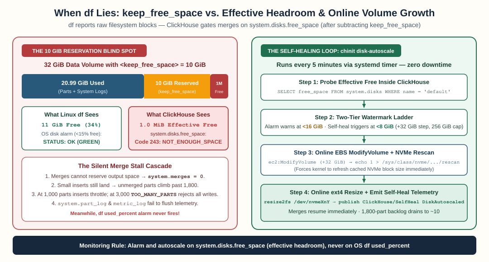

The alarm that was supposed to catch this never fired. Every disk widget was green, `df` showed 30% free on the data volume, and the node was hours from refusing every insert in the cluster. The failure was already visible in a different metric — parts-per-partition climbing past 1,800, headed for the hard-reject at 3,000 — but the dashboard was watching the wrong disk number.

The root cause was a 10 GiB reservation. This post is about the gap between what your filesystem says and what your database means: why `df` lies to ClickHouse operators, what the merge engine actually gates its writes on, and the self-healing loop we built so a data volume grows itself before parts explode — no human, no downtime.

## The number ClickHouse sees is not the number df prints



*Linux `df` ignores ClickHouse's `keep_free_space` reservation; `chinit disk-autoscale` probes `system.disks.free_space` every five minutes and grows EBS gp3 + ext4 online before parts accumulate.*

ClickHouse storage configs commonly carry a safety valve:

```xml
<keep_free_space>10737418240</keep_free_space>  <!-- 10 GiB -->
```

The intent is sound: leave headroom on the disk so a sudden burst of part writes can't fill the filesystem that also holds logs, tmp, and the parts catalog. ClickHouse honors it by subtracting the reservation from every free-space check. The number `system.disks` reports as `free_space` is the **effective** free space — what the engine will actually let you write — not the filesystem's raw free space.

`df` knows nothing about ClickHouse's XML. It reports the raw view. On our node:

- **df**: 32 GiB volume, 20 GiB used, **11 GiB free (30% available)** — looks fine
- **system.disks**: `free_space = 1,019,904` bytes — **~1 MiB effective**

The difference is exactly the 10 GiB reservation. Neither number is wrong; they answer different questions. But the merge engine makes its decisions on the effective number, so the effective number is the only one your monitoring may trust for write-path health.

## What a stalled merge queue looks like

When effective free hits the floor, the failure cascade is distinctive:

1. **Merge output fails** — `Code: 243 NOT_ENOUGH_SPACE`, `Cannot reserve 1.00 MiB`. ClickHouse retries the merge. It fails again.
2. **The merge queue stalls while inserts continue.** Every insert lands a new part. Nothing merges. We watched `system.merges` report **zero running merges** on a node actively ingesting.
3. **Parts accumulate per partition.** The parts-per-partition metric climbed linearly — from a healthy ~10, past the 300 alarm threshold, past 1,800, with the slope constant. ClickHouse has two guardrails on this path: `parts_to_delay_insert = 1000` starts throttling inserts, and `parts_to_throw_insert = 3000` **rejects them with `TOO_MANY_PARTS`**. At the observed slope, the cluster was under two hours from hard-rejecting ingest.
4. **Everything else looks fine.** CPU normal. Memory normal. Replication healthy — the parts count was the *only* signal climbing, and the node-level disk alarm (keyed on `used_percent`, the df view) stayed green the whole way.

The error log had been narrating the whole time: repeated `NOT_ENOUGH_SPACE` flush failures for `system.part_log`, `system.trace_log`, `system.metric_log` — the server couldn't even write its own telemetry. And in the earlier phase, a quieter signature: `memory limit exceeded` merge failures from a different but related pressure (the same merge queue, failing for a second reason). Both failure modes share the property that the *symptom* — parts piling up — is two steps removed from the *cause*.

## The immediate fix: grow the volume online

EBS gp3 volumes grow without detachment, and ext4 grows while mounted. On the starving node:

```bash
aws ec2 modify-volume --volume-id <your-data-volume-id> --size 64
# then on the node:
resize2fs /dev/nvme1n1
```

Within minutes, effective free went from ~1 MiB to ~30 GiB. Merges resumed — `system.merges` repopulated — and the parts curve, which had been climbing steadily for hours, flattened and then reversed. No downtime, no detach, no restart. The volume grew from 32 to 64 GiB in place, on a node serving production traffic.

Two operational gotchas we hit, both worth knowing before you need them:

- **The kernel caches the NVMe device size.** After `ModifyVolume`, `/sys/block/nvme1n1/size` showed the new 64 GiB capacity, but `resize2fs` still read the stale 32 GiB through the mounted device's file descriptor. The fix is a controller rescan before the resize: `echo 1 > /sys/class/nvme/nvme1/device/rescan`. (On one node the old fd was pinned by the long-running server process and only a restart cleared it — size the window for that before doing this under load.)
- **"optimizing" is not "pending".** After a modify, the volume state passes through `optimizing` at 0% progress for a while — that's gp3 performance rebalancing, not a capacity wait. The capacity is live immediately; `resize2fs` works during optimizing.

## The self-healing loop: a job that grows its own disk

The manual fix took minutes. Finding the monitoring gap took longer than applying the fix — a humbling asymmetry. That asymmetry is the argument for automation: a human with a console is a fine *fallback* but a terrible *primary* for a failure mode with a mechanical remedy.

So the node bootstrapper grew a new recurring job — `disk-autoscale`, every five minutes on every node that owns a data disk:

1. **Probe the effective number, from inside the engine.** `SELECT free_space FROM system.disks WHERE name = 'default'` — the same value the merge engine gates on, reservation already applied. This is the critical design point: a probe that reads `df` would have the same blind spot as the alarm that missed the incident.
2. **Compare against a floor** — 8 GiB effective. Above the floor: exit 0, a no-op. (The alarm side runs at a higher floor, 16 GiB, so an alarm firing means the *self-healing tier already failed* — two thresholds, one escalation ladder.)
3. **Grow the node's own volume** — the job finds the volume attached to its own instance (by attachment filter), calls `ModifyVolume` with `current + 32 GiB`, bounded by a hard ceiling of 256 GiB. It never touches a volume it didn't discover attached to itself, and the IAM policy underneath scopes `ec2:ModifyVolume` to the cluster's `NodeType`-tagged volumes — a role-tag condition the subcommand can't bypass even if it wanted to.
4. **Rescan the controller, resize the filesystem** — the NVMe gotcha from above, handled in code, then `resize2fs` on the mounted device.
5. **Publish the outcome** — a `ClickHouse/SelfHeal` metric for the effective-free gauge and a `DiskAutoscaled` event, so the alarm side can see what the healer did.

The failure modes are deliberate too: if the provider can't grow volumes, the job publishes the pressure finding and exits loudly — a silent skip is how blind spots form. If the volume is already at the ceiling, same: report, fail visibly, let the alarm page a human for a decision only a human can make (a bigger ceiling is a cost decision, not an operational one).

## The alarm that watches the number that matters

The monitoring fix is one alarm on the effective metric:

```
Namespace:   ClickHouse/Server
Metric:      ClickHouseAsyncMetrics_DiskAvailable
Dimensions:  ClusterName, disk=default
Statistic:   Minimum
Threshold:   16 GiB (bytes), breaching below
```

`ClickHouseAsyncMetrics_DiskAvailable` comes off the node's `:9363` metrics endpoint and already accounts for `keep_free_space` — it *is* `system.disks` free space, exported. Keying on `disk=default` scopes the alarm to the data disk, keeping the S3-backed disks (which report enormous free space) out of the evaluation.

The alarm's description carries the runbook hook: at this threshold the chinit disk-autoscale timer should already have acted; if the alarm fires, the healer is failing or absent — `systemctl status chinit-disk-autoscale.timer` on the flagged node is the next step. Two-tier thresholds turn a single alarm into a story: the healer acts at the lower floor, and the alarm at the higher floor means the healer didn't.

## The sizing lesson underneath it all

The deepest fix is arithmetic. A `keep_free_space` reservation is a **fraction of the disk you never touch**, which means the disk you provision must be `reservation + your real working set`. On a 32 GiB volume with a 10 GiB reservation, the usable capacity is 22 GiB — and the moment the parts catalog grows toward 20 GiB, you're at the floor with df reporting 30% free. The reservation that was meant to be a safety valve became a third of the disk.

Moving the metadata disks to 64 GiB left the same reservation with over 50% effective headroom. The reservation stayed; the ratio changed. If you run reservations, compute your utilization as `used / (total - reservation)` and alarm on **that** — or better, skip the algebra and read `system.disks` directly, because the engine already did the arithmetic for you.

## The general lessons

- **Monitor the number the engine gates on, not the number the kernel prints.** For every database with an internal quota, reservation, or throttling threshold, find the engine's own view of the resource and export *that*. `df` is a filesystem tool; it cannot know about database reservations.
- **A stalled merge queue is a disk signal wearing a parts-count costume.** When parts-per-partition climbs while CPU and memory stay flat, and the node-level disk alarms stay green, the merge queue is failing for a reason the node metrics can't see. Query `system.merges` — zero running merges on an ingesting node is its own alarm.
- **Mechanical remedies belong to machines.** Volume growth is idempotent, bounded, non-destructive, and observable — the four properties that make an operation safe to automate. The design work is in the boundaries (own-instance attachment, tag-scoped IAM, size ceiling, loud failure), not in whether to automate.
- **Tier your thresholds around your automation.** The healer acts at 8 GiB; the alarm fires at 16 GiB. When the alarm pages, it carries meaning the raw threshold never could: *the self-healing tier already tried and failed.* That's the difference between an alert and an escalation.

The fleet now runs with a disk story that needs no operator in the loop: the job probes the effective number every five minutes, grows the volume in place when it dips, and publishes what it did. The alarm watches the same number at a higher threshold, and the dashboard graphs it next to running merges — so the next time headroom tightens, the first thing anyone sees is the healer doing its job, not a parts curve heading for the hard-reject.
