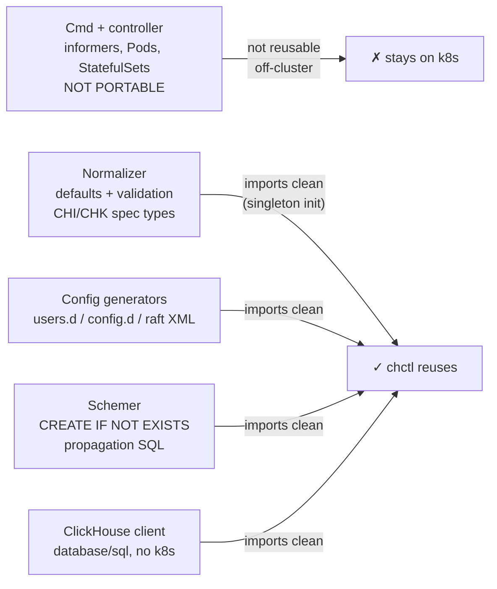
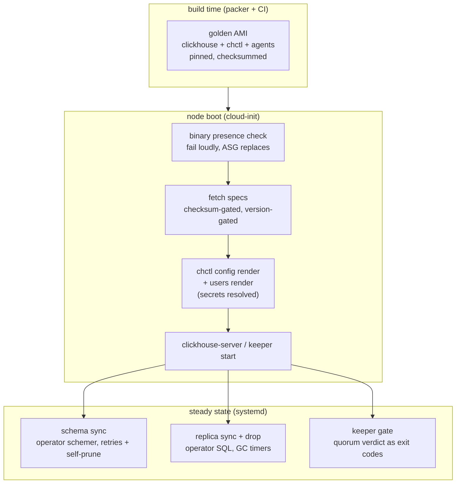

This is the story of the second half of the migration. The first half —
[provisioning ClickHouse on Amazon Elastic Compute Cloud (EC2) from Terraform](/blog/clickhouse-ec2-vs-k8s-mermaid-data-flow/)
— covered storage, Domain Name System (DNS), and spot autoscaling. This half is the part I keep
describing to other engineers as "we taught the Altinity operator to work
without Kubernetes," which sounds impossible. Some of it was.

## Why not just run the operator?

The obvious question. The answer starts with reading the operator's source
tree as three distinct layers, split by how hard each one leans on the Kubernetes application programming interface (API):



The controller is the operator, in the informer-watches-a-CRD sense, and it
is welded to Pods. But underneath it sits a domain layer that turns a `ClickHouseInstallation` YAML Ain't Markup Language (YAML) document into validated, defaulted,
runtime-wired structures — and generators that emit the config Extensible Markup Language (XML) — with a
coupling to Kubernetes so shallow that the operator's own unit tests
initialize it with `chop.New(nil, nil, "")` and a nil clientset.

That was the bet: **the operator's brain is reusable; its nervous system
is not.** Rebuilding the brain as bash was the mistake this whole exercise
started from — three systemd units re-implementing the schemer's Structured Query Language (SQL), one
regular expression (regex) at a time, drifting one upstream release behind.

## The import

The mechanics turned out to be boring, which is the good news. One `go.mod`
require, one commit hash:

```go
require github.com/altinity/clickhouse-operator v0.0.0-20261112224202-7e08a1a
```

Three things needed handling:

1. **The replace does not propagate.** Upstream wires a mergo *fork* —
   `WithSliceDeepMerge` exists only in `sunsingerus/mergo` — through a
   `replace` directive, which the Go modules spec applies only to the main
   module. Every library consumer got `undefined:
   mergo.WithSliceDeepMerge`. The fix on my fork: vendor the ~840 lines
   in-repo with provenance. (Proposed upstream; now merged into the fork's
   tree so consumers need nothing.)

2. **Tags are not semantic versioning (semver).** Upstream tags read `release-0.27.4`; Go module
   resolution wants `v0.27.4`. Every dependency pin is a commit
   pseudo-version, which in practice means: bumps are an explicit diff
   review, never `@latest`. I've come to like this even as a constraint —
   it matches how infrequently a ClickHouse cluster should change.

3. **YAML parses like JavaScript Object Notation (JSON) if you want the user sections back.** The
   operator's `Settings` type implements `UnmarshalJSON` only — its YAML
   unmarshaler is commented upstream. A direct `yaml.Unmarshal` into the CR
   silently produces empty users and profiles. Every spec load goes YAML →
   JSON → Unmarshal through one helper, with a test that would fail if
   anyone "simplifies" it back.

One more bootstrap line, from the operator's own test suite:

```go
chop.New(nil, nil, "") // the off-cluster singleton, exactly as upstream tests do
```

With those four pieces in place, `normalizer.CreateTemplated(spec)` returned
a fully defaulted, runtime-wired custom resource (CR) on a laptop with no kubeconfig.

## What "reusable" is worth

Concretely, [chctl](https://github.com/Altinity/clickhouse-operator/tree/master/cmd/chctl)
is five commands, all thin wrappers over operator packages:

| Command | Operator code underneath | Replaces |
|---|---|---|
| `config render` | chi + chk FilesGenerator | hand-written config XML |
| `users render` | Settings emitter + user defaults | users.xml assembled in bash |
| `schema sync` | `ClusterSchemer.HostCreateTables` | 60-line `clusterAllReplicas` SQL port |
| `replica drop` / `sync` | `HostDropReplica` / `HostSyncTables` | weekly garbage collection (GC) cron + drain SQL |
| `keeper safe-to-stop` | raft-safety math from the controller | "restart keepers one at a time" runbooks |

The last one deserves a beat. The operator's keeper reconciliation won't
disrupt a host if doing so drops the ensemble below Raft majority, and its
controller carries that logic as functions. Off-cluster, "restart keepers
one at a time" was documentation. Now it's:

```bash
chctl keeper safe-to-stop -keeper 10.0.3.10:9181
# exit 0 — proceed    exit 2 — held, heartbeat the hook    exit 3 — probe error
```

…and the exit codes are what an autoscaling-group lifecycle hook
understands natively.

## The five bugs the rollout caught

This is the part worth the read. The whole point of building a validation
harness — one script that runs the released binary against the live dev
cluster — was that the loop "fix, tag, release, re-verify" took under five
minutes. It got used, because real clusters find things unit tests miss.
Five findings, in the order the cluster served them:

### 1. `Settings` has no YAML unmarshaler (silent)

Specs loaded, normalized, rendered — empty users files. No error anywhere.
The YAML unmarshaler is commented out in the operator because Kubernetes
decodes CRs as JSON. A spec must go YAML → JSON → `Unmarshal`, or user
sections vanish silently. Now guarded by a test.

### 2. `.gitignore` ate the package

`chctl` — the entry for a stray local binary — also matched the directory
`pkg/chctl/`. A file added to that package was silently excluded from every
commit, and the first release build failed with `undefined: newCloudNamer`.
A release gate is only as good as its working tree; the pattern became
`/chctl`, root-anchored.

### 3. Two embedded levels, one namer override

The schemer resolves exec hosts through an embedded `INameManager`, whose
output is the Kubernetes pod fully qualified domain name (FQDN) — fine on a cluster, unresolvable on EC2.
Wrapping the namers: the override had to be set on *both* embedding levels,
and the live error was exactly the tell — `no such host` for
`chi-...svc.cluster.local`. When you adapt a package through composition,
trace which struct instance actually receives the method call.

### 4. Identity conventions disagree by one

Keeper's raft entry carried the operator's convention, the myid file
carried the provisioning one, and the two differed by one. Exit code 56, on
every start, after the state was already clean. The durable fix was boring
on purpose: pick one convention, write it down as the one place both are
derived from, and diff the myid file against the rendered entry as a
pre-flight check.

### 5. The wrapper that broke the format

The first users render emitted raw user trees at the document root, and my
wrapper — written to add the `<users>` element — double-wrapped it.
`SAXParseException: Tag mismatch, line 24`. That XML now goes through a real parser in continuous integration (CI), not a substring check.

## Where the line moved

The honest measure: cloud-init went from ~2,966 lines to 2,909, and what
changed is not the count but the *shape*. The installers are gone — packer
bakes every binary, and boot fails loudly if one is missing instead of
silently apt-installing an unvalidated version. The operator's domain work —
user rendering, schema propagation, replica hygiene, keeper topology — is
not what cloud-init does anymore. It hands specs to the binary that owns
the domain.



The line between the two halves is worth stating plainly, because it is the
decision I'd make differently a year from now, and it is worth knowing why
today's shape is what it is:

- **Operator packages own ClickHouse semantics.** Spec → validation →
  XML → schema data definition language (DDL) → replica hygiene. Everything upstream might improve;
  everything I'd otherwise re-derive and inevitably drift.
- **chctl (my code) owns the boundary.** Cloud inventory, secret sources,
  the command-line interface (CLI), the version gate. Thin, tested, replaceable.
- **cloud-init owns the cloud.** Mounts by label, DNS, ordinals, secrets
  fetch, spot drain orchestration. Everything upstream *can't* express.

## The checklist

If you're standing the same bridge — operator code, non-Kubernetes target —
the version of this audit that would have saved me a week:

1. **Read the import graph before believing the diagram.** `grep` for
   `k8s.io` in each candidate package, including tests, and find the
   singleton initializers. The boundary is where the imports stop, not
   where a README says it is.
2. **Pin by commit, budget for the pseudoversion.** Library forks without
   semver tags mean every dependency line is a review artifact. That is
   *good* discipline for anything feeding a database.
3. **Ship a harness before you ship the binary.** Released binary → live
   cluster → verdict, one command, five minutes. Every finding above came
   through that loop, and none of them would have come through `go test`.
4. **Check for commented-out unmarshalers.** If a type implements
   UnmarshalJSON but not UnmarshalYAML, YAML loading is silently lossy.
5. **Diff rendered output against live config byte-for-byte at least
   once per role.** The parity diff is what tells you which convention
   disagreement is actually the migration, and which is a renderer bug.

The series continues with the keeper quorum gate wired into an actual
autoscaling lifecycle hook — the last piece that turns "exit codes a
machine can read" into automation the cluster can trust.
