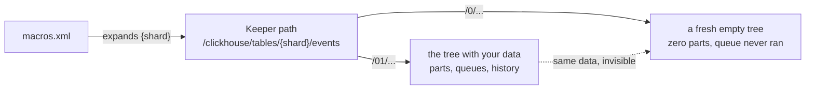

I thought replacing hand-written ClickHouse cluster XML was a config cleanup.
It was actually a tour of the identity machinery that most ClickHouse
documentation waves at: the macros that name a replica, the Keeper paths
those macros expand into, the raft IDs that name a keeper, and the exact
places where "just regenerate the config" silently re-identifies a node
with live data.

This post is that tour. The vehicle is [chctl](https://github.com/Altinity/clickhouse-operator/tree/master/cmd/chctl)
— the Altinity [clickhouse-operator](https://github.com/Altinity/clickhouse-operator)
repackaged as a single binary that runs the operator's own code paths
without Kubernetes — but the lessons are pure ClickHouse. If you run
ReplicatedMergeTree anywhere, they apply to you.

**Key takeaways**

- The `<macros>` block is not metadata. It is the *name* your data is filed
  under: Keeper paths and, with S3-tiered storage, part of the S3 prefix.
  Changing a macro value on a live cluster does not migrate anything —
  it re-keys every table.
- The Altinity operator's value off-Kubernetes is its domain code: the
  spec normalizer, the config generators, the schemer that propagates
  schema to scaled-out replicas. chctl runs those against EC2, VMs, or
  bare metal.
- Keeper identity (server_id, raft_configuration IDs) must be treated as
  state that outlives the instance — it lives in the raft log, and the
  config must follow it, never the reverse.
- A cluster's config generator must be pinned and versioned exactly like
  a database engine. "The config is generated" means "the generator is
  in your blast radius."
{: .key-takeaways}

## The setup: generated config, at last

A ClickHouse node's config is a directory of XML fragments —
`remote_servers.xml` naming every replica in the cluster, `macros.xml`
naming this node, a `zookeeper.xml` pointing at the coordination
service, users, profiles, and for keeper nodes a full
`keeper_config.xml`. Hand-written per deployment, these fragments drift
from ClickHouse behavior and from each other. Every stack carries its
own subtly different copy.

The Altinity operator solved this for Kubernetes: you write one
`ClickHouseInstallation` spec — topology, settings, users — and its
generators emit the XML that ClickHouse actually reads. The problem,
historically, is that this only ran on a cluster you managed with
Kubernetes.

chctl removes that constraint. The operator's normalizer defaults and
validates your spec, its generators render the config files, and its
schemer runs `CREATE ... IF NOT EXISTS` propagation to scaled-out
replicas — as a standalone binary:

```bash
chctl config render \
  -spec cluster.yaml \
  -host 0-0=writer-0.internal \
  -replica 0-0=writer-0 \
  -out /etc/clickhouse-server/config.d
```

The `-host name=address` inventory maps the spec's abstract host names to
real DNS. The `-replica` flag answers the question the operator never
had to ask on Kubernetes: *what is this node's replica name?* On EC2
the answer is your hostname convention — `writer-0`, `reader-3` — because
that's what your autoscaling identity scheme gives you.

So far, so good. Three files render, the node boots. Then I looked at
what the generator had written.

## The macros are the name of your data

The operator's macros generator emits, among other things:

```xml
<macros>
    <cluster>logs</cluster>
    <shard>0</shard>
    <replica>writer-0</replica>
</macros>
```

My hand-written file had said `<shard>01</shard>`. One character. Zero
versus zero-one.

Here is why that character is not cosmetic. The tables were created as:

```sql
CREATE TABLE events
ENGINE = ReplicatedMergeTree(
    '/clickhouse/tables/{shard}/events',
    '{replica}'
)
```

That `{shard}` is a macro. ClickHouse expands it at load time. With
`<shard>01</shard>` the table registers at
`/clickhouse/tables/01/events/replicas/writer-0` in Keeper. With
`<shard>0</shard>` the *same table definition* registers at
`/clickhouse/tables/0/events/replicas/writer-0`.

Two different Keeper addresses. Two different replicas.

Nothing errors. The new registration is under a fresh, empty tree, so
the table comes up with zero parts and a queue that has nothing to do.
`system.replicas` reports the replica as healthy — `is_readonly = 0`,
delay zero, everything green — because *it is* healthy, as a brand-new
replica nobody has ever written to. The 100 rows in the `events` table
do not fail to load; they simply belong to the *other* replica named
writer-0, the one filed under `/01/`, which nobody is currently
impersonating.

The failure signature is quiet: `last_queue_update` reads
`1970-01-01 00:00:00` — the queue never ran — while every other metric
looks fine. If you don't know the invariant, you check memory, then
disk, then Keeper connectivity, then the replication settings. The
actual answer is one config fragment that changed the table's Keeper
address.



The invariant: **macros are the name your data is filed under, and names
must never change on a live cluster.** Not in a config render, not in a
version upgrade, not "temporarily". If you must change them, you are not
editing config — you are migrating tables, and the runbook is
`SYSTEM RESTORE REPLICA` territory: fix the macros, restart, then walk
each table re-registering it under the tree its parts actually live in.

The fix in the spec is one line, and it's the operator's own mechanism —
the cluster layout accepts a *named* shard:

```yaml
clusters:
  - name: logs
    layout:
      shards:
        - name: "01"     # <- renders <shard>01</shard>
          replicasCount: 2
```

Named, not counted. A `shardsCount` layout gives shards
operator-generated names — zero-based indices — which is correct for a
cluster born under the operator and wrong for one adopting it. The name
is the compatibility contract with your existing Keeper tree.

## Identity is state, and state outlives instances

That one shard macro forced a bigger question: *which parts of a node's
identity are config, and which are state?*

The answer turned out to be a clean split, and it's the design principle
I'd keep from this whole exercise:

**Config is what the cluster looks like. State is who the node is.**

| | Config (regenerate freely) | State (must survive) |
|---|---|---|
| Writers/readers | remote_servers, users, profiles, settings | the replica name in Keeper; the parts on disk and in S3 |
| Keepers | ports, timeouts, logger format | server_id; the raft log; the ensemble's member IDs |

For keeper nodes the split bites hardest, twice.

**First bite: the server ID.** ClickHouse Keeper identifies raft members
by an integer. A fresh `keeper_config.xml` from any generator will
derive one — an index, a hash, whatever the generator's convention is.
But a re-imaged keeper joining an *existing* ensemble must present the
ID its raft log was written under, or the surviving members see a
stranger: raft recovery stalls, keeper logs a raft ID mismatch, exits.
The myid file lives on the raft disk next to the log, and it is the
authority. The config must be rendered to match it, never the reverse:

```bash
MYID=$(cat /var/lib/clickhouse-keeper/log/myid)
chctl config render -keeper -spec keeper.yaml \
  -server-id "$MYID" \
  -raft-id 0-0=1 -raft-id 0-1=2 -raft-id 0-2=3 \
  -single-file /etc/clickhouse-keeper/keeper_config.xml
```

The `-raft-id` flag exists for exactly this: an ensemble's member IDs
are whatever the bootstrap wrote years ago, and a config tool that only
speaks its own convention cannot describe a real running cluster.

**Second bite: the listener.** This one cost me a full debug loop and it
is pure ClickHouse Keeper behavior, independent of any tool. In
clickhouse-server, `<listen_host>` is a top-level setting. In
clickhouse-keeper, a `<listen_host>` placed under `<keeper_server>` is
*ignored*. Silently. The node starts, reports active, answers `mntr` on
localhost — and every other node in the fleet fails to reach port 9181
because the listener never left 127.0.0.1:

```bash
$ ss -tln | grep 9181
LISTEN 0  64  127.0.0.1:9181  0.0.0.0:*     # <-- bound to localhost
```

The replication symptom is unhelpful: `Cannot use any of provided
ZooKeeper nodes`. From the node itself everything works, because
everything you test from the node is localhost. The fix is placing
`<listen_host>` at the root of the config — and the real fix is a
generator that knows this and *warns* when it sees the wrong placement,
because no error will ever tell you.

## The schemer, or: why schema propagation is harder than it looks

Rendering config is half the job. The other half is bringing a *new*
replica up with the schema already in place — the operator's
`HostCreateTables`: read the schema from cluster peers, rewrite `CREATE`
statements to `CREATE ... IF NOT EXISTS`, run them on the new host.

Three failure modes surfaced, all worth knowing about because none of
them is a bug in anyone's code — they're emergent properties of
replication:

**1. Materialized views have dependencies.** The schemer creates tables
and views in one batch. A materialized view targeting a summary table
can be created before the table it writes to — `TO` fails with "table
does not exist", the view is skipped, and everything else succeeds. The
batch looks green except for one missing object. The fix is boring and
effective: run the pass again. Second pass, the table exists, the view
lands. `-retries 2` is now the default in chctl for exactly this — the
operator never needed it because on Kubernetes a pod restart re-ran the
whole reconcile.

**2. A fresh replica can inherit its predecessor's ghost.** An
autoscaling reader claims the name `reader-0`. It boots with an empty
disk, tries `CREATE TABLE IF NOT EXISTS` — and gets:

```
Code: 253. DB::Exception: Replica /clickhouse/tables/01/events/replicas/reader-0
already exists
```

The *previous* instance holding that name died without draining, and its
znode persists in Keeper. `IF NOT EXISTS` does not help — the
registration exists, so nothing is created; the table does not exist
locally, so there's nothing to attach to. The node is stuck schemaless
until someone runs `SYSTEM DROP REPLICA 'reader-0'` from a peer.

This is the spot-replacement tax on stable identity: the same mechanism
that makes identity cheap to recover (claim the name, re-fetch the
parts) makes its *garbage* persistent too. The fix belongs in the
bootstrap path itself — after a create fails with the
already-exists error for *your own name*, drop that name's registration
and retry. Your own name only; the inventory gate refuses anything else,
because a tool that auto-dropped *other* replicas' registrations would
be a footgun with a safety catch made of tape.

**3. Schema discovery needs a peer, not itself.** The schemer reads
`clusterAllReplicas` to find what to create. A freshly-booted replica
asked "what tables exist?" will happily answer "none" — its own empty
catalog responds first and short-circuits the fanout. Exclude self from
the discovery query, or a replacement node will conclude the cluster has
no schema and proudly create nothing.

None of these are exotic. If you run spot or autoscaling replicas with
stable names, all three will visit you within a quarter.

## The operator's code, off the leash

Worth saying plainly: the interesting part of a Kubernetes operator for
a stateful system is usually not the Kubernetes part.

The Altinity operator's assets here are the *domain* pieces — a
normalizer that applies hundreds of defaults and hardenings to a spec,
generators whose output ClickHouse parses correctly because they're the
same generators the on-cluster ConfigMaps come from, and a schemer that
has handled edge cases like UUID collisions and ATTACH fallbacks for
years. The Kubernetes-specific part is mostly plumbing: StatefulSets,
pod hostnames, PVC binding.

chctl is that observation, packaged. The normalizer, generators, and
schemer run as a single static binary against any cluster. The
translation layer is thin: where the operator resolves a pod FQDN, the
off-cluster binary takes a `-host name=address` inventory; where the
operator derives a replica name from the pod, the binary takes a
`-replica` mapping. Everything past that boundary is the same code.

That's also why the shard-macro incident happened and why it's
instructive: I didn't hit a bug in the generator. I hit a *convention*
in the generator — zero-based shard indices — meeting a cluster filed
under a different convention. Generated config does not eliminate
conventions; it relocates them from your templates into the generator's
code. Which means the generator itself needs what any stateful
component needs:

- **A version.** `chctl version` — you cannot gate upgrades on a binary
  you can't ask.
- **A release process.** Cross-compiled binaries, checksums, a tagged
  workflow that runs the tests before publishing.
- **Blast-radius discipline.** The render surface changed faster than
  the image build cycle, so the golden AMI bakes one version and node
  bootstrap swaps in a newer one, checksum-gated — same discipline as
  the database itself, applied to the thing that configures the
  database.

## The checklist

If you're moving a running ClickHouse cluster onto generated config —
from the Altinity operator or any other generator — the audit that
would have saved my afternoon:

1. **Dump the current identity.** From a live node:
   `SELECT table, replica_path FROM system.replicas` — and read the
   macros file. These are the Keeper addresses your data is filed under.
2. **Render before you deploy.** Run the generator in dry-run against
   your spec and diff the output against the live files — byte by byte.
   The one that differs by "one character" is the migration.
3. **Check the macro expansion sites.** Keeper paths, S3-tiered storage
   prefixes, `ON CLUSTER` DDL — everything that interpolates `{shard}`
   or `{replica}`. Those are the contracts your config must honor.
4. **Keepers: read the myid before you write any config.** Then verify
   with `ss -tln` that the client port actually bound where you think.
5. **Make the generator earn trust the way the database did**: version
   it, pin it, and change it deliberately.

Config feels like the safe part of a database stack — the part you edit
without a runbook. For ClickHouse, the identity macros make it the
opposite: the config *is* the filing system. Generate it, by all means —
the operator's generators are better than your templates and mine. But
treat the generator like a schema migration tool, because that's what
it's holding.
