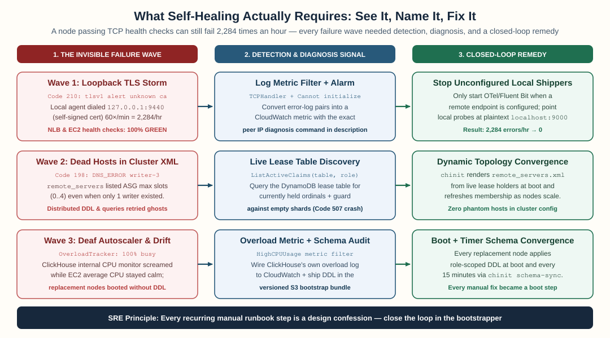
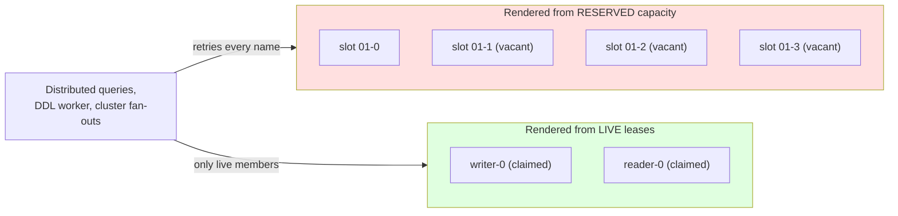
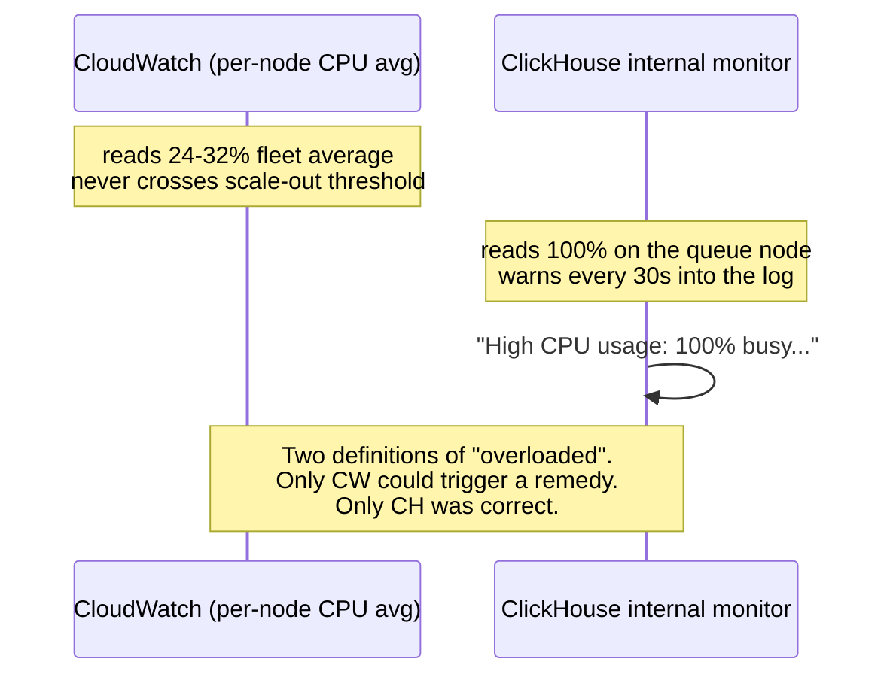

I started a four-hour load soak expecting to watch dashboards. Instead I watched a
cluster argue with itself for two days.

The errors came in waves that looked unrelated at first: a TLS storm from a
client that did not exist, DNS lookups for machines that were long dead, CPU
warnings from a monitor the autoscaler could not hear, and crashes in a code
path I had never read. Each one taught me something about what "self-healing"
actually means — and most of the lesson was that healing is not a property you
can claim. It is a chain: something must *see* the failure, something must
*name* it, and something must *fix* it. Break any link and your fleet limps
along at full health-check compliance while serving nothing.

This post walks the waves, in the order they fell.

**Key takeaways**

- Self-healing has three layers — detection, diagnosis, remedy — and the
  TLS storm slipped through all of them. A node passing every health check can
  still be failing every client.
- `remote_servers` is a *membership* document. Rendering it from reserved
  capacity instead of live leases means every distributed query retries dead
  names forever — and ClickHouse's cluster parser will crash outright on a
  shard left with zero replicas.
- ClickHouse ships its own CPU monitor, and it disagrees with the
  infrastructure's CPU metric by design. If your autoscaler keys on the
  infrastructure number, you have two definitions of "overloaded" and only one
  of them can trigger a scale-out.
- Every recurring manual fix is a design confession. The day we stopped
  re-running DDL by hand and put the schema in the node's boot bundle was the
  day the fleet actually healed itself.
{: .key-takeaways}

## Wave one: the TLS storm from nowhere



*Self-healing requires all three links in the chain — detection, diagnosis, and a closed-loop remedy — across loopback TLS storms, phantom DNS entries in `remote_servers`, and internal CPU overload warnings.*

The first wave looked like this in the error log, one pair every second:

```json
{"severity":"Error","logger":"TCPHandler",
 "message":"Cannot initialize connection: Code: 210. DB::NetException: SSL Exception: error:0A000418:SSL routines::tlsv1 alert unknown ca, while reading from socket (peer: 127.0.0.1:34734, local: 127.0.0.1:9440)"}
{"severity":"Error","logger":"TCPHandler",
 "message":"Cannot send exception to client: ... Socket is not connected"}
```

The second line is noise — the server trying to report the first failure back
over a socket the client had already closed. That pairing is diagnostic gold:
when you see "cannot initialize" and "socket is not connected" together, one
client is failing handshakes and hanging up mid-report. The real signal is
the first line.

Decoding `tlsv1 alert unknown ca`:

- It is an *alert the client sent* during the handshake. The word "alert" in
  TLS means one side is telling the other what went wrong — this one says "I
  don't recognize your certificate authority."
- The peer was `127.0.0.1` — the client was on the node itself.
- Port 9440 is ClickHouse's secure native protocol port — the TLS listener.

So: something on the node was dialing localhost's secure port in a retry loop,
and rejecting the server's certificate because the certificate's CA was not in
its trust store. The server-side code that logs each failed handshake is
[the `Cannot initialize connection` catch in TCPHandler.cpp](https://github.com/ClickHouse/ClickHouse/blob/master/src/Server/TCPHandler.cpp#L442) —
one log pair per attempt, which is how 60 attempts a minute becomes 2,284
errors an hour.

Why was the certificate untrusted? Because in this topology, client TLS is
*supposed* to terminate at the network load balancer, which presents a
properly-signed certificate. The nodes behind it serve self-signed certs by
design — node-to-node traffic rides a separate internal port with its own
trust setup, and nothing is *supposed* to dial `127.0.0.1:9440` with a
public-CA expectation. The client doing so was misconfigured — pointed at the
node instead of the load balancer.

The gotcha: **nothing in the fleet could see this.** The node was up,
accepting TCP, and passing every EC2 and load balancer health check. The
autoscaling group saw a healthy fleet. The errors existed only as log lines
with no alarm watching them.

The fix came in layers:

1. **Detection** — a CloudWatch Logs metric filter on
   `"Cannot initialize connection"` feeding an alarm above 10 hits a minute.
   The alarm description says what the line means and how to find the client:
   `ss -tnp | grep 9440` on the node catches the PID in the act.
2. **Diagnosis** — a runbook page that explains the three legitimate client
   shapes: connect via the load balancer DNS name (public CA works), connect
   to localhost on the plaintext port (no TLS needed), or connect to
   localhost's TLS port *with the node's own CA in your trust store*.
3. **Prevention** — the recurring noise stopped when the client was fixed;
   the alarm stays armed for the next one.

## Wave two: the cluster that listed its own dead

Once the TLS storm quieted, the next-largest error class was DNS failures —
and this one was self-inflicted by design.



The cluster's `remote_servers` config — the document that names every node a
distributed query may talk to — had been rendered from the autoscaling
maximum: *five writer slots and four reader slots*, whether or not anything
claimed them. A fleet of two live nodes was therefore carrying a membership
list with seven unresolvable names, and every cluster fan-out, every DDL
worker pass, retried them all. Hundreds of DNS failures an hour, forever,
from a config that was "correct" by its own render rules.

Two layers of fix:

- **Render from live leases.** Membership keys on claims — only a node
  holding a lease in the claim table appears in the config. Churn converges
  on the next render.
- **The parser crash nobody expects.** There is a second, sharper gotcha
  here, and it lives in ClickHouse itself. Some generated cluster sections
  put *each replica in its own shard* — so when you filter out a vacant
  replica you can leave a shard with **zero replicas**, and the server does
  not skip that shard gracefully. It calls
  [`addresses.at(0)` on the empty address vector in Cluster.cpp](https://github.com/ClickHouse/ClickHouse/blob/master/src/Interpreters/Cluster.cpp#L773)
  and dies with `std::out_of_range` — at *startup*, while parsing
  `remote_servers`, before serving a single query. Every node rendered with
  the bad config crash-looped. The lesson: when you filter generated config,
  filter at the level of the container. Drop the whole shard when its last
  replica goes, not just the replica.

The one-line summary of wave two: **a cluster definition is a membership
document, not a capacity plan.** If you render it from what *could* exist,
the fleet spends its life retrying what doesn't.

## Wave three: the CPU monitor nobody listens to

The third wave was not an error at all — it was a warning, repeated every
thirty seconds for hours:

```
High CPU usage: 100% busy (>= 90%) for at least 600 second(s)
```

This is ClickHouse's *own* overload monitor, in
[AsynchronousMetrics.cpp](https://github.com/ClickHouse/ClickHouse/blob/master/src/Common/AsynchronousMetrics.cpp#L1398-L1405):
it measures busy time as `1 - idle - iowait`, warns when it holds above 90%
for ten minutes, and clears at 85%. It is configurable —
`resource_overload_warnings.cpu_overload_warn_ratio` and its friends — and it
is *not* the number your infrastructure's CPU metric shows.

The trap: our autoscaler keyed on the infrastructure's per-node CPU average.
The node running the S3Queue ingest was at 100% by ClickHouse's internal
measure — genuinely saturated — while the fleet-wide average sat comfortably
under every scale-out threshold. Two definitions of "overloaded," and only
one of them could trigger a remedy.

The gotcha deepens on burstable instances: a `t4g` sustained at 100% is also
burning CPU credits, and when credits run out the *effective* rate drops
while the metric still reads ~100%. Your autoscaler sees a plateau and reads
it as "stable." It is actually a node being throttled.

The fixes, in honesty order:

- **An alarm on the internal monitor's own line.** A log filter on
  `"High CPU usage"` makes the warning page. It is the only way the
  signal becomes actionable — the line is ClickHouse telling you it is
  overloaded in its own words.
- **Non-burstable instances for sustained load.** We moved the ingest tier to
  `r8g` — same arm64, no credit meter running at the worst moment. Constant
  load and burstable credits are a tax on exactly the days you cannot
  afford it.
- **A bigger queue node, or many.** The deeper cause was architectural: all
  ingest funneled through one node's queue table. The S3Queue engine is
  *natively multi-node* — deploy the identical queue table on every writer
  and Keeper-tracked file claims give you exactly-once processing across
  the fleet, with each node's commit caps applying per node. Two writers
  doubled the ceiling; the fleet CPU dropped to single digits.



## The meta-lesson: manual fixes are design confessions

By the end of the soak I had a pile of recurring manual interventions:
recreate the tables after a full churn, rewrite the lease rows after a race,
re-deploy the queue per writer. Each one was a small script run over SSM —
and each one was a confession that the design did not cover the case.

The fix that mattered most was not any single patch. It was moving the
*schema itself* into the node's boot bundle: a DDL file shipped next to the
XML configs, hash-gated so any change rolls the fleet, executed
idempotently by a new boot step (`CREATE ... IF NOT EXISTS` with the node's
own macros). After that, a fully-churned fleet re-materializes its own
tables on boot. The failure class "every node replaced at once, no peer
left holding the schema" — which we hit for real — stops requiring a human.

That is the shape of real self-healing. Not a dashboard claim. A chain:
the failure is *seen* (a log filter feeds an alarm), it is *named* (the
alarm text carries the diagnosis), and it is *fixed* (the remedy is a boot
step, a config render, or an autoscaler — not a human with a script). Each
wave in this post closed when its link in the chain was built.

## The checklist that came out of it

If you run a fleet that claims to self-heal, ask these about every failure
class you have met:

1. **What would see it?** Not "could see it" — *would*. Is there an alarm
   whose state changes, or does the evidence live in a log nobody greps?
2. **What would name it?** When the alarm fires at 3 a.m., does the
   description carry the diagnosis, or does it carry a metric name?
3. **What would fix it?** If the answer is a person, that is fine — but say
   so, and write the runbook. If the answer is "the next boot" or "the
   autoscaler," you have actual self-healing.
4. **Is the config that names the cluster a membership document or a
   capacity plan?** Render membership from live state, and never ship a
   shard with zero replicas.
5. **Do you have one definition of "overloaded" or two?** If the internal
   monitor and the autoscaler disagree, one of them is wrong, and your
   fleet behaves like the wrong one.
