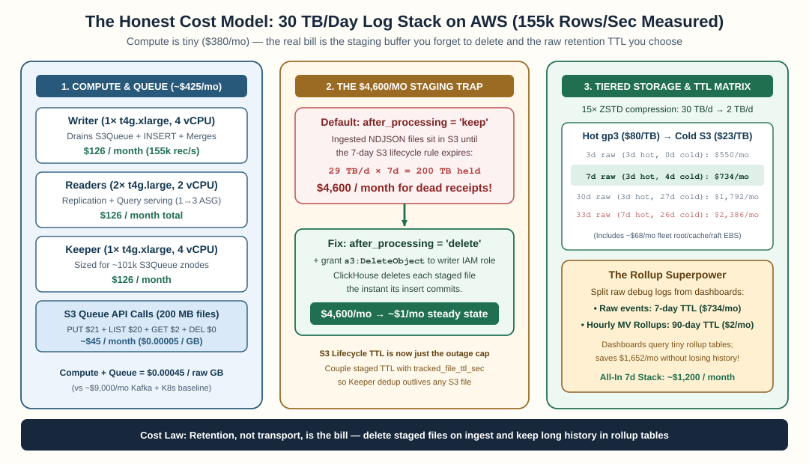

The scene: you build a log pipeline on ClickHouse on EC2 with S3 behind it, you sketch the costs on paper, and the paper says a few hundred dollars a month. Then you load-test the thing at 30 TB/day for a month of runs — calibrating, breaking, fixing, re-running — and the bill tells you a different story. Not a dramatically different one, but an honest one: the compute you sized was never the problem, the buffer you forgot was quietly bigger than the database, and the only cost lever that matters is a number you set in a TTL clause.

This post is the cost model that came out the other side — every number measured, not modeled — and the lessons that only appear when you run a stack hard enough to see where the money actually goes. The stack: a producer writes NDJSON files to an S3 prefix, ClickHouse's S3Queue engine drains them into a replicated MergeTree with tiered storage (EBS hot, S3 cold), and readers serve queries.

## The setup, in one paragraph

*At 155,000 records/second (30 TB/day raw), EC2 compute and S3 queue requests cost ~$425/month; the real levers are `after_processing = 'delete'` on the staging prefix (collapsing a $4,600/month buffer to ~$1/month) and pairing a 7-day raw TTL with cheap 90-day rollup tables.*

One writer instance (4 vCPU, on-demand) runs the S3Queue engine and the INSERT pipeline. Two readers (2 vCPU each) replicate and serve queries, scaling 1→3 on CPU via target-tracking. One keeper. The data path is deliberately boring: producer → S3 staging prefix → S3Queue table → materialized view → events table (hot on gp3, TTL-moved to S3). No Kafka, no worker fleet — the queue *is* S3, and the drain is ClickHouse's own engine. That design choice is itself the first cost lesson: when the buffer is object storage, the buffer bills like object storage.

## What 155k records/second actually costs in compute

Across the verification runs the cluster sustained **155,000 records/second — 29 TB/day — for a full hour with zero insert errors**: 560M records, 1.1 TB of NDJSON, and the reader's count caught up with and passed the writer mid-run. The generator itself ran at 20% CPU on a 16-vCPU instance (the one piece you must remember to stop — a left-on load generator is $670/month of nothing).

The compute that absorbed all of this:

| Node | Shape | $/month | What it does at full rate |
|---|---|---|---|
| Writer | 4 vCPU (t4g.xlarge class) | $126 | S3Queue drain + INSERT + merges; ~84% CPU at sustained rate on the *smaller* shape, comfortable on xlarge |
| Readers ×2 | 2 vCPU each (t4g.large class) | $126 | Replication target + query path; scaled 1→3→2 autonomously during the test |
| Keeper | 4 vCPU (t4g.xlarge class) | $126 | Raft + S3Queue per-file tracking; 35–40% CPU, ~101k znodes |

**Total: ~$380/month of EC2 for ~912 TB of monthly ingest — $0.0004 per raw GB.** The writer never needed ingest-driven scaling; the ASG exists for failure classes, not throughput. Two caveats from the measurements: a fresh writer *draining an old backlog while ingesting new data* pins at 98% CPU (dual-load headroom is real, and it's why the scale-out alarm exists), and the keeper's capacity axis is **znode count, not CPU** — one znode per tracked file, ~101k at full rate, which is what sized the keeper up, not load.

The request-driven queue costs almost nothing: at 200 MB/file the producer writes ~141k files/day — PUTs ~$21/month, the engine's LIST polls ~$13–26, GETs ~$2, DELETEs free. **~$40–50/month total: $0.00005/GB.** With `after_processing='delete'` (below), the staging prefix itself holds minutes of data — ~$1/month at any volume.

The uncomfortable arithmetic for the alternative: a Kubernetes-hosted pipeline measured at the same ingest class — Kafka brokers, worker deployments, a heavier compute floor — runs ~$9k/month, and it bills whether data flows or not. The EC2 stack concentrates its cost in storage, which means in retention, which means in a number you choose. That's the whole trade.

## The $4,600/month no one was watching

Here is where paper estimates die. The staging prefix — where the producer drops NDJSON and the S3Queue engine picks it up — had a 7-day S3 lifecycle rule, the standard "buffer safety" hedge. The assumption was that files get consumed quickly and the prefix stays shallow.

What actually happened: **files are kept after successful processing by default**. The engine tracks what it consumed (keeper znodes for dedup), but the objects stay in S3 until the lifecycle rule eventually deletes them, seven days later. At 29 TB/day of raw NDJSON, a 7-day window is **~200 TB held — $4,600/month** of already-processed files sitting in the prefix like a receipt you never threw away.

The fix is one setting in the S3Queue DDL — [`after_processing = 'delete'`](https://github.com/ClickHouse/ClickHouse/blob/master/src/Storages/ObjectStorageQueue/ObjectStorageQueueSettings.cpp#L32), which makes the engine delete each file the moment its insert commits. We verified it end-to-end at full rate: after the hour at 155k rec/s, the prefix contained **zero files from the test day**. The lifecycle rule stays as a backstop for the failure case — but with delete-on-ingest it only ever touches files the drain never successfully processed.

Two operational notes from applying it live. First, it needs `s3:DeleteObject` in the engine's IAM role — without the grant, the setting **silently degrades**: files drain into ClickHouse but pile up in S3 exactly as before, and nothing errors. Second, the staging lifecycle's TTL now means something different than you think: it's not a cost line anymore, it's the **drain-outage exposure cap** — how much raw data accumulates if the drain breaks, bounded at `$rate × days`:

| Staged-file TTL | Steady state (healthy drain) | Worst case during a drain outage |
|---|---|---|
| 3 days | ~$1/mo | ~$2,000/mo held |
| 7 days | ~$1/mo | ~$4,600/mo held |
| 30 days | ~$1/mo | ~$20,000/mo held |

(One subtle coupling: if you stretch the staged TTL to 30 days, the engine's `tracked_file_ttl_sec` — the keeper dedup window — must rise with it, or a rebuilt queue table re-ingests everything past the old window and you get duplicate rows. The keeper cap and the storage cap have to move together.)

## Pricing storage honestly: two TTLs, one matrix

Once the buffer was fixed, storage settled into its real shape: two independent TTL classes with completely different price behavior.

**Incoming (staged) data**: transient by design — steady-state ~$1/month at any volume; the TTL only sets the outage cap above.

**Processed (queried) data**: the classic tiered pattern, priced per retained day — **$80/TB-month on gp3 while hot, $23/TB-month on S3 after the TTL move** (data compresses ~15× from NDJSON, so 30 TB/day raw is 2 TB/day stored). The TTL clause that does the move is plain ClickHouse: `TTL timestamp + INTERVAL 7 DAY TO VOLUME 'cold'` — the engine validates the destination volume at DDL time ([MergeTreeData.cpp](https://github.com/ClickHouse/ClickHouse/blob/master/src/Storages/MergeTree/MergeTreeData.cpp#L2237)) and the move is a background job on the moving assignee, per-part, tracked in each part's TTL info ([MergeTreeDataPartTTLInfo.h](https://github.com/ClickHouse/ClickHouse/blob/master/src/Storages/MergeTree/MergeTreeDataPartTTLInfo.h#L19)).

The matrix at 30 TB/day:

| Raw retention | Hot days | Hot (gp3) | Cold days | Cold (S3) | Storage total |
|---|---|---|---|---|---|
| 3 days (debug window) | 3 | $480 | 0 | $0 | **$550** |
| **7 days (recommended)** | 3 | $480 | 4 | $184 | **$734** |
| 30 days (compliance) | 3 | $480 | 27 | $1,242 | **$1,792** |
| 33 days (as-configured) | 7 | $1,120 | 26 | $1,196 | **$2,386** |

(EBS fleet disks — roots, metadata, S3 read cache, keeper raft — add a flat ~$68 regardless of volume; the summary tables add ~$2.)

And here is the second place a paper estimate was wrong, in the *opposite* direction. We had penciled "move the hot TTL from 7 days to 3 and save $640/month." The matrix says the honest number is **$456/month**, because shortening the *hot window* doesn't delete anything — those 8 TB of days just move from gp3 to S3. The saving is the **rate delta on the moved days** (8 TB × ($80−$23)), not the hot line minus zero. Deleting data is what deletes cost: cutting retention 33d→7d saves $1,652/month, and the hot-split optimization is a further $456 on top.

## The lesson that saved the most: retention is tiered, so tier it

The single biggest post-test lever wasn't a knob on the buffer or the instance sizes. It was noticing that **raw events and dashboard answers are different data with different retention needs**. The dashboards serve from materialized-view summaries (per-minute, per-hour rollups) — and those aggregates are microscopic: 36.5M aggregated rows is about **$2/month**. So the raw table can carry a 7-day window while the summaries keep 30+ days of history, and the dashboards never notice:

- Raw events, 33d: $2,386/mo → raw events, 7d: $734/mo
- Summaries: ~$2/mo either way
- **Net: −$1,650/month with zero loss of dashboard history.**

If you take one design rule from this post: *put the TTL on the raw tier, not on the analytics.* Aggregates are nearly free; raw rows are the whole bill.

## The all-in picture, per scenario

Everything above assembles into five shapes people actually choose between (30 TB/day sustained, ~912 TB/month of ingest; compute $378 + queue ~$45 + control plane ~$140 + the storage shape):

| Scenario | TTL shape | Total $/mo | $/TB ingested |
|---|---|---|---|
| Debug window | raw 3d · hot 3d · staged 3d | **~$1,155** | $1.27 |
| **Recommended** | raw 7d · hot 3d · staged 3d · summaries 30d+ | **~$1,340** | $1.47 |
| As-configured | raw 33d · hot 7d · staged 7d | ~$2,990 | $3.28 |
| Naive (pre-fix) | same, **without delete-on-ingest** | ~$7,590 | $8.32 |
| Compliance | raw 30d · hot 3d · staged 30d | ~$2,400 | $2.63 |

Read the naive row carefully — it is not a straw man. It is the *same stack* as the as-configured row, one setting apart. The gap between $7,590 and $2,990 is a single `after_processing` value; the gap between $2,990 and $1,340 is a TTL clause and the summary-tier design. **Two configuration decisions, $6,250/month.**

For production hardening, add the multipliers: keeper quorum ×3 (+$252) and, if readers replicate the full cold tier, cold ×2 (the recommended shape's 4 cold days only cost +$184/month to replicate — another argument for short raw retention).

## The seven lessons

1. **Buffers bill like storage when the buffer *is* storage.** An S3-backed queue makes the drain cheap and the backlog visible — but any file kept after consumption is a stored object with a monthly bill. Delete-on-ingest or the prefix becomes a receipt box.
2. **Silent degradation is a cost bug, not just a reliability bug.** The missing `s3:DeleteObject` grant didn't error — the setting just quietly didn't apply, and $4,600/month accumulated behind an "everything green" dashboard. Cost-visible settings need cost-visible alarms (or at least a prefix-size metric).
3. **Price per retained day, not per tier.** "Hot vs cold" hides that moving data isn't deleting data. Every TTL decision decomposes into: how many days at $80/TB, how many at $23/TB, how many deleted. The matrix is the budget.
4. **TTL the raw tier; keep aggregates forever.** Summaries are ~$2/month. There is no reason raw NDJSON-shaped rows and dashboard rollups should share a retention window, and every reason they shouldn't.
5. **Compute is not the story at this scale — until it's a dual-load story.** One 4-vCPU writer absorbs 29 TB/day; the fleet bills ~$380/month. But backlogs and live traffic stack: the same writer at 98% CPU while draining *and* ingesting is why headroom alarms and scale-out steps exist even when steady-state never needs them.
6. **The capacity axis of your coordination service is not CPU.** Keepers at 35–40% CPU looked comfortable until the znode count told the truth: ~1 znode per tracked file, 101k at full rate. A "keeper at 97% capacity" reading was never CPU — it was tracked-file count. Size for the metadata, alarm on the metadata.
7. **A cost model you haven't load-tested is a hypothesis.** Every number in this post changed at least once under load — the staging line by 460×, the hot-lever savings by 30%, the keeper axis entirely. Run the stack at its intended rate for a full billing cycle before you promise anyone a per-GB figure. The bill is the only benchmark that never lies.

## Appendix: the constants, for repricing

Measured at 30 TB/day raw NDJSON (CloudTrail-shaped records, ~2,175 B each; 200 MB S3Queue files):

| Constant | Value |
|---|---|
| Compression (NDJSON → stored) | ~15.2× (157 B/row on disk) |
| Raw → stored | 30 TB/day → 2 TB/day |
| Hot tier | $80/TB-mo (gp3) |
| Cold tier | $23/TB-mo (S3 Standard); $12.5 after a 30-day IA transition |
| Reprice formula | storage $/mo ≈ ingest_TB/day × (hot_days × $5.3 + cold_days × $1.5) + $70 fleet |
| EC2 compute | ~$380/mo at this class; $0.0004/raw-GB |
| Queue requests | ~$45/mo; $0.00005/raw-GB |
| Keeper znodes | ~1 per processed file |
| Writer capacity | ~29 TB/day on 2 vCPU at 84% CPU; 4 vCPU for headroom |

Plug in your own ingest: at 10 TB/day the recommended shape is ~$890/month; at 60 TB/day, ~$1,990. The per-GB story only degrades gracefully because the fixed floor (compute + fleet disks + control plane, ~$600/month) is small relative to the storage lines — keep it that way, and the TTL matrix remains the only cost conversation you need to have.
