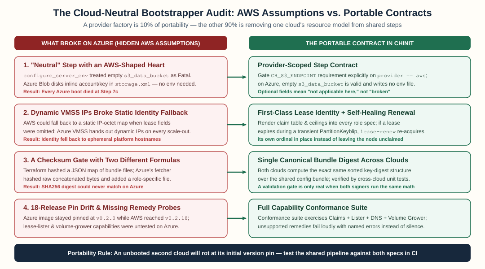
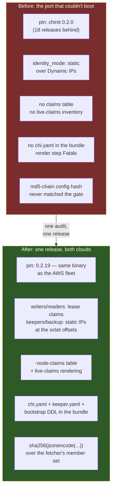

We wrote about [chinit](/blog/chinit-one-binary-node-bootstrap/) as
the one-binary answer to a 3,600-line bash boot script, and about the
[provider factory](/blog/chinit-dissolve-second-binary/) that was
supposed to make a second cloud "one constructor plus one
infrastructure package." This post is the audit that tested that
claim — pointing the bootstrapper at the Azure port of the same
ClickHouse stack and finding everything between the claim and reality.

The short version: the factory was real, the pipeline around it was
not neutral, and the gap had been invisible for eighteen releases
because the port it affected had never fully booted. Closing that gap
made chinit better on *both* clouds — which is the actual lesson, and
the reason this post is not titled "adding Azure support."

## The setup: two ports of one stack

The fleet runs
[self-managed ClickHouse](/blog/clickhouse-ec2-vs-k8s-mermaid-data-flow/)
— writers, readers, keepers, a backup replica — with a golden-image
boot pipeline: packer bakes the node image with a pinned chinit
binary, Terraform renders a small YAML spec per role, and a
user-data wrapper execs `chinit boot`. The AWS port is the production
one, live through the [incident](/blog/fleet-that-could-not-heal-itself/)
and the [self-healing](/blog/clickhouse-effective-disk-headroom-self-healing/)
work. The Azure port exists as a full Terraform tree — VMSS writers
and readers, fixed keeper VMs, Blob Storage, Key Vault, Private DNS —
cut over from its own 2,400-line bash script at chinit 0.2.0.

"Cut over" turned out to be generous. What had really happened: the
Azure port's *wrapper* was calling chinit, and its image pinned
chinit 0.2.0 — the release where the port was first wired. AWS was on
0.2.18. Eighteen releases of live findings — the
[lease identity](/blog/chinit-lease-identity-ephemeral-fleet/), the
[hosts convergence](/blog/fleet-that-could-not-heal-itself/), the
remote_servers filters, the drain protocol — had never reached the
Azure image, because nobody could verify a bump on a port that
couldn't boot.

The audit question was simple: *what does chinit 0.2.18 actually do
on an Azure node?* The answer was four Fatal steps and a checksum
that could never pass. None of them were in the provider package.



*A provider factory is only ten percent of cloud portability; the other ninety percent is removing one cloud's resource assumptions from shared pipeline steps, identity fallbacks, checksum math, and conformance tests.*

## Finding one: a "neutral" step with an AWS-shaped heart

The pipeline's `configure_server_env` step writes the server's
environment file — on AWS, the `CH_S3_ENDPOINT` variable that
storage.xml's `<endpoint from_env>` requires at server start. The
step's code was in the *shared* domain layer, and its first line was:

```go
if b.Spec.S3DataBucket == "" {
    return Fatal(fmt.Errorf("spec s3_data_bucket is empty — " +
        "storage.xml's endpoint env cannot be set (Code 36 at server start)"))
}
```

That gate is correct on AWS — an unset endpoint is a guaranteed
start failure we had hit live. But on Azure, the storage disk is
`azure_blob_storage` with the account name and key *inline in the
storage XML*. There is no endpoint environment variable. The Azure
spec template never rendered an `s3_data_bucket` field at all —
because the field is meaningless there — so every Azure boot died at
step 7c with a spec error that was not an error.

The fix looks almost embarrassingly small:

```go
if b.Spec.S3DataBucket == "" && b.Provider.Name() == "aws" {
    return Fatal(...)
}
```

The lesson is not the two-line diff. It is that the step's *name* —
configure server env — was neutral while its *contract* — "every
node needs an S3 endpoint" — was AWS-shaped all the way down. We had
put the cloud seam at the provider factory and then quietly built a
cloud assumption into a domain step. The audit found three more of
these (see below); the pattern is the finding, not the gate.

## Finding two: dynamic IPs turn a fallback into the only path

Our [lease identity](/blog/chinit-lease-identity-ephemeral-fleet/)
protocol was born on AWS where the fleet *also* had a static
identity fallback: Terraform allocates fixed private IPs at known
octet offsets (writers at +10..19, keepers at +20..29, backup at
+30), and chinit's static mode maps an IP's last octet straight to a
hostname. Keepers and backup still use it — raft members should not
be leasing names.

The Azure port's Terraform rendered `identity_mode: static` for
*every* role. And the Azure scale sets' NICs were — correctly, per the
module's own comments — allocated `Dynamic`. Static identity over a
dynamic address is a coin flip: `StaticHostname(10.0.1.37)` returns
writer-7, but a replaced VM gets a different address and the map
Fatals with "does not map to a static role offset," or worse, maps to
a *different* node's name.

On Azure the lease table is not an optimization. It is the only
identity a scale-set member can have. So the port needed what AWS
already had — a claims table — and Azure has the exact right
primitive for it: **Table Storage**, whose conditional
`If-None-Match` insert and ETag-guarded MERGE give the same
claim/renew/release semantics the DynamoDB path implements. The
provider already had the claimer; what it lacked was the *listing*
half — `ListActiveClaims`, which renders remote_servers from live
claims instead of static reserved lists.

That listing half is the difference between the two remote_servers
generations we lived through on AWS: the
[vacant-slot DNS storms](/blog/fleet-that-could-not-heal-itself/)
(688 error events per 10 minutes, 92% of them DNS resolution against
reserved-but-empty slots) were exactly the failure a claims-listing
inventory prevents. Porting the capability was cheaper than the first
finding was: one file, the same lease-row shape, a server-side
`$filter` on `lease_until`, and the code-side expiry guard the AWS
lister taught us to keep.

## Finding three: a checksum contract with one signer

The config bundle arrives at boot with a SHA256 gate: Terraform
computes a digest over the bundle's members, renders it into the spec,
and chinit recomputes the same digest over what it fetched — mismatch
is Fatal, because a drifted bundle means the release does not vouch
for what the node is about to install.

That contract is only as good as *both sides computing it
identically*. On AWS we had verified the shape byte-for-byte:
`sha256(jsonencode(map))` — Terraform's `jsonencode` and Go's
`json.Marshal` produce identical bytes for the same string map, and
the parity test pins it. The Azure fetcher, written on an earlier
understanding, hashed *raw concatenated bytes* and included
`keeper.yaml` in the digest — a role-dependent member Terraform's
hash never included.

Which means: no Terraform value, ever, could match what the Azure
fetcher computed. The gate would refuse every bundle on every boot,
forever, with an error that looks like a stale tfvars problem. A
validation contract nobody exercises on both sides is a contract with
one signer.

The fix mirrors the AWS implementation exactly: the same closed
member list, the same `configs/`-prefixed keys, `keeper.yaml` fetched
but excluded from the digest, and the jsonencode digest shape. And the
Terraform side now computes its `config_files_hash` with the same
formula over the same members — which is also why the Azure
`config_files_hash` changed from an md5-chain (which had never
matched anything) to `sha256(jsonencode(...))`.

## Finding four: the remedy gap

The [self-healing](/blog/clickhouse-effective-disk-headroom-self-healing/)
work gave chinit a disk-autoscale job: when ClickHouse's *effective*
free space (the `keep_free_space`-aware number, not `df`) drops below
a floor, the job grows the node's own data volume and the ext4
filesystem online. On AWS that is an EBS `ModifyVolume`. The port
exists as a capability — `AsVolumeGrower(provider)` returns the
cloud's implementation or nil, and the job fails loudly when the
remedy is absent.

Loud failure is better than silence, but on Azure the answer was
always nil. Pressure found, remedy absent, every five minutes. So the
Azure provider grew a grower: the ARM managed-disk resize — a PATCH
on `diskSizeGB`, no detach, no downtime — with `DescribeOwnVolume`
resolving the VM's data disk by LUN and `WaitForModification` polling
the disk's provisioning state until the resize lands.

What made this worth doing is the seam. The job's logic did not
change by one line to gain a second cloud's remedy — the capability
pattern absorbed it. This is the part of the original chinit design
that the audit *confirmed*: where the seams were real, adding Azure
was genuinely one package. Where they weren't, the pipeline had
already encroached.

## What the Azure port's Terraform was missing (and got)

The binary was half the gap; the IaC around it was the rest. If you
run the same audit on a port of your own, this is the checklist shape
of what we found:



Three details worth pulling out of that diagram:

**The keepers kept static identity — and now it actually works.** The
octet-offset map requires the Terraform to *allocate* those offsets.
The AWS module always did (`cidrhost(subnet, 20 + i)` for keepers,
+30 for backup). The Azure module's keeper and backup NICs were
`Dynamic` — the same coin-flip identity problem the scale sets had,
on the nodes where identity matters most (raft server IDs). They now
allocate static addresses at the same offsets, and the map is
deterministic on both clouds.

**The schema ships with the bundle on both clouds.** The
[full-churn finding](/blog/fleet-that-could-not-heal-itself/) — every
peer replaced within one refresh leaves schema-sync with no peer to
propagate from — got its durable fix on AWS first: a
`bootstrap-ddl.sql` in the config bundle, executed idempotently by a
boot step. The Azure port got the same file and the same upload in
the same release. A fleet that cannot re-materialize its own tables
after full churn is not a portable design; it's two ports, each one
incident away from a manual DDL session.

**Environment variables are the provider's config surface.** The
spec stays provider-neutral — names, secrets, topology — and the
cloud-specific coordinates the binary needs (which storage account,
which subscription, which resource group, which VM am I) ride as
`CHINIT_AZURE_*` exports in the wrapper, the same pattern the AWS
wrapper uses for its region and table. One quirk worth writing down:
keeper VMs are *fixed* resources with per-ordinal names
(`clickhouse-keeper-0/1/2`), so their wrapper derives the VM name
from the hostname the platform already assigned, while scale-set
roles use the rendered resource name. The env pin is data; it can
vary per role without forking the wrapper.

## The uncomfortable lessons

**"Cloud-neutral" is a discipline, not an architecture.** The provider
factory, the capability probes, the conformance suite — all real, all
necessary, all *insufficient*. Every pipeline step is a place where
one cloud's resource model can masquerade as a universal truth. We
found ours by pointing the binary at a port that had never worked;
you can find yours the same way, or by asking a sharper question in
review: *for this step, what does the other cloud's equivalent look
like?* If the answer is "there isn't one," the step needs a gate, not
a comment.

**Capability absence must be loud and named.** The volume-grower gap
was harmless *because* the job failed loudly with the provider's name
in the error. That failure shape — pressure reported, remedy named
as missing — is what turns a capability gap into a work item instead
of a silent degradation. The [keeper-silence
incident](/blog/clickhouse-keeper-silence-alarm-design/) was the
same lesson from the other side: the cost of a gap is the time it
stays invisible.

**Drift is a symptom, not a cause.** Eighteen releases of pin drift
wasn't carelessness — it was a rational response to a port nobody
could verify. You cannot keep a pin current on a path you cannot
test. The audit's biggest single deliverable wasn't any fix; it was
that the Azure port could finally run the *current* binary, which
means the next bump is a one-line diff someone can actually verify.

**The conformance suite is where portability lives or dies.** Both
providers run the same contract scenarios against fake IMDS and
canned bundles — deterministic, no cloud credentials, minutes to
run. Every capability the audit added (claims listing, volume
growing, the server-env gate) grew a spec in that suite. The suite
is the only reason "one constructor plus one package" is a claim you
can test rather than a hope you hold.

## The checklist, if you audit your own

1. **Point your newest binary at your oldest port.** Whatever the
   docs promise, the oldest port tells you what the shared pipeline
   actually assumes. Expect Fatal steps, not feature gaps —
   unbootable before unusable.
2. **Read every shared step for a resource model.** An S3 endpoint, a
   device name, a subnet octet, a tag key — anything one cloud's
   Terraform owns by convention. Gate it on the provider's name and
   write down the other cloud's answer, even if the answer is "this
   step is a no-op there."
3. **Verify contracts on both sides or not at all.** A checksum, a
   validation order, a field format — anything computed
   independently by two codebases is two implementations of one
   spec. Pin them to each other with a parity test, and make the
   test compute the expected value independently (ours builds the
   Terraform-side digest in Go and refuses a one-bit change).
4. **Make capability absence an error with a name.** "Provider X
   cannot grow volumes" at the failure site beats a TODO in a
   design doc — and it makes the gap show up in logs, alarms, and
   audits where humans actually look.
5. **Bump the pin on the port you just fixed, in the same release.**
   A fix that ships without its pin bump is a fix that exists only
   on the cloud that already worked.

The Azure port now runs the same chinit the production fleet runs —
one release train, one conformance suite, two providers — and the
next cloud that gets a constructor will inherit the audit instead of
relearning it.
