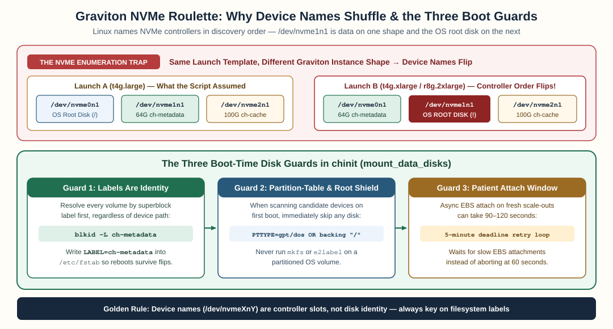
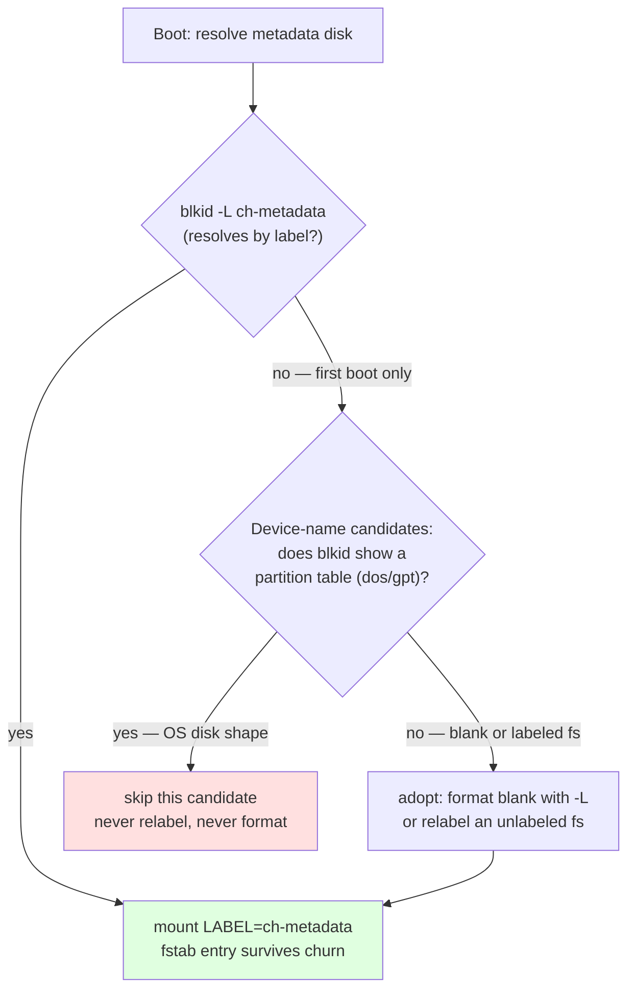

Here is a sentence you never want to read in a boot log:

```
ERROR: critical step mount_data_disks failed: fatal: metadata disk: relabel
/dev/nvme1n1 to ch-metadata: e2label: Bad magic number in super-block while
trying to open /dev/nvme1n1
Found a gpt partition table in /dev/nvme1n1 — boot aborted
```

Read it again with the context that matters: on this instance,
`/dev/nvme1n1` was the **root disk**. The bootstrapper had picked the root
disk as the metadata volume, resolved it by candidate device name, and was
one `e2label` away from writing a filesystem label onto the disk that holds
the operating system. The only thing that saved the node was an accident:
the root disk carries a GPT partition table, `e2label` refused the
non-ext4 magic number, and the step aborted loudly instead of corrupting
`/`.

This post is about how that happened, why Graviton made it likely, and the
three guards a boot-time disk step needs so the *next* enumeration flip is
a non-event.

**Key takeaways**

- Graviton's NVMe enumeration order is not stable across instance types.
  `/dev/nvme1n1` can be your data volume on one shape and the root disk on
  the next launch of another. Device names are not identity.
- Resolve disks by **filesystem label** (`blkid -L`), never by device name.
  Labels live in the superblock and survive any re-enumeration; fstab should
  mount `LABEL=` entries for the same reason.
- Device-name candidates are only a first-boot fallback — and they must skip
  any device whose `blkid` signature is a partition table (`TYPE=dos` or
  `TYPE=gpt`). That signature is the shape of an OS disk.
- Async EBS attach can take minutes on fresh launches with large volumes. A
  mount step needs a patient, deadline-bounded retry window — a 60-second
  budget aborts boots that would have succeeded at minute two.
{: .key-takeaways}

## How EBS becomes NVMe, and why the names shuffle



*NVMe device names (`/dev/nvme0n1`, `/dev/nvme1n1`) depend on controller discovery timing rather than volume role; `chinit` guards root by resolving superblock labels first, rejecting partitioned or root-backing devices, and waiting up to five minutes for async EBS attachment.*

On modern EC2, every EBS volume shows up as an NVMe device. The Linux NVMe
driver names them in the order it discovers them — `nvme0n1`, `nvme1n1`,
`nvme2n1` — and that order is a function of controller enumeration timing,
not of anything you configured in the volume.

For a long time our stack got away with the assumption
"`/dev/nvme1n1` is the 64 GiB metadata volume":

```
t4g.large launch:   nvme0n1 (root)      nvme1n1 (metadata)   nvme2n1 (cache)
t4g.xlarge launch:  nvme0n1 (metadata)  nvme1n1 (root!)       nvme2n1 (cache)
r8g.2xlarge launch: nvme0n1 (metadata)  nvme1n1 (root!)       nvme2n1 (cache)
```

The same launch template, three different disks answering to the same name.
Nothing was wrong with any volume — the *name* simply did not survive the
instance-type change. The assumption baked into the bootstrap broke the
moment the fleet moved to a shape whose controllers enumerate differently.

The first symptom was confusing rather than catastrophic: on some launches
the "metadata disk not found" error, because the candidate list no longer
pointed at the metadata volume and the label lookup found nothing. The
second symptom was the near-miss at the top of this post: the candidate
list pointed at *root*, and the step tried to relabel it.

## The three guards

### Guard one: labels are identity

The metadata volume is created with a filesystem label at format time.
That label lives in the superblock — it is written to the volume's bytes,
not to its device name. So the resolution order on every boot is:



`blkid -L ch-metadata` returns the right device whatever the enumeration
did. Repeat boots never even look at candidate names. Device-name
candidates exist solely for the first-boot case — the volume is blank, no
label to resolve — and that is where the second guard lives.

### Guard two: partition tables are hands-off

A `blkid` probe of the root disk returns a signature like:

```
/dev/nvme1n1: PTUUID="a3187faf-..." PTTYPE="gpt"
```

`PTTYPE` — a partition table type — is the tell. It means the first bytes
of this disk are a *partition map*, not a filesystem. That is the shape of
an operating system disk or a volume from a prior tenant. The bootstrap's
candidate loop now skips any device whose probe answers `TYPE=dos` or
`TYPE=gpt`, and only ever adopts blank devices (safe to `mkfs`) or
unlabeled-but-formatted ones (safe to `e2label`).

The failure this guard replaced was silent in the other direction: a
blank probe on the root disk would have meant `mkfs.ext4 -F` — a
*forced* format — straight over the operating system. The GPT refusal was
luck. The guard makes it policy.

### Guard three: patience for async attach

The third failure mode needs no enumeration flip at all. EBS volumes attach
asynchronously after instance launch, and on fresh scale-outs with large
volumes, attach can take minutes. We watched a 64 GiB metadata volume
surface at minute two — comfortably after a mount step whose retry budget
was sixty seconds. The step gave up, the boot aborted, cloud-init recorded
an error, and the node sat half-booted until a human re-ran the bootstrap.

The fix is a patient policy: a five-minute, deadline-bounded wait on the
mount step (sixty attempts with capped backoff). That is long enough to
outlast real attach latency, short enough not to wedge an autoscaling
group's instance refresh (whose warmup is 300 seconds anyway). And it keeps
the classification honest: a *missing* volume is retryable — it may still be
attaching — while a present-but-unmountable volume (corrupt filesystem,
device error) is fatal, because no retry cures that.

## Why fstab should mount LABEL= too

The same reasoning applies after the mount. An fstab entry like:

```
LABEL=ch-metadata /var/lib/clickhouse ext4 defaults,nofail 0 2
```

finds the volume at *any* device name on *any* instance type. A
`/dev/nvme1n1` fstab entry works until the day the enumeration flips —
then silently fails to mount on the next boot, or worse, mounts the wrong
volume at your data path. `nofail` keeps a missing volume from blocking
boot entirely, which is the right failure mode for an optional cache and
the wrong one for metadata — so classify them: metadata is required, cache
degrades to a subdirectory, and neither should ever name a device.

## The general rule

Device names are an accident of enumeration. Filesystem labels are a fact of
the volume. The hierarchy every boot-time disk step should follow:

1. **Resolve by label** — the only identity that survives instance-type
   changes, reboots, and controller quirks.
2. **Fall back to candidates only for blank disks** — and then skip
   anything carrying a partition-table signature, because that disk belongs
   to an OS or a prior tenant, and neither should be in your blast radius.
3. **Wait longer than attach** — a deadline-bounded retry on the mount step
   turns "volume not there yet" from a wedged boot into a one-minute
   patient pause.

The day after the guards shipped, the fleet rolled through the same
instance-type change that produced the root-disk near-miss — and the boot
log's most interesting line was `disk candidates: skipped 1 partitioned
device`. That is what the fix looks like in production: the dangerous case
became a log line nobody needed to read.
