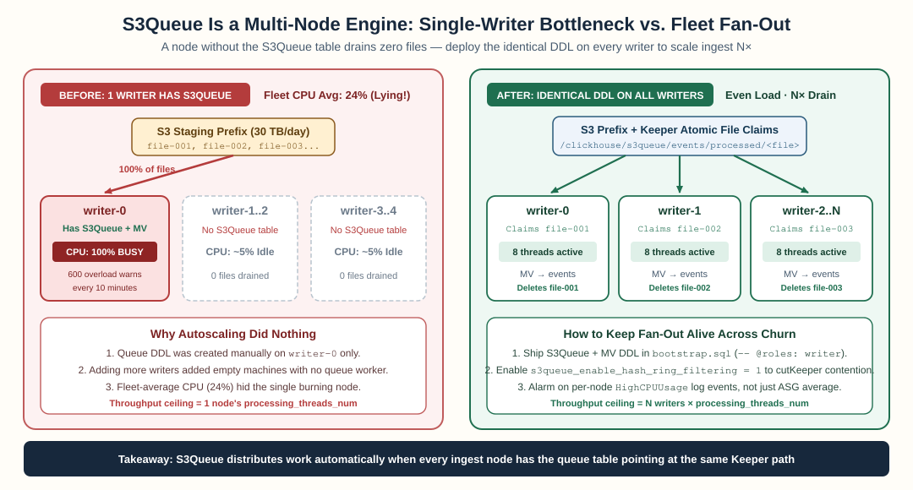
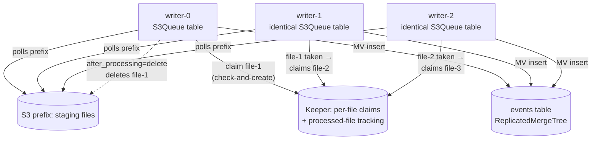

We ran a four-hour soak at 30 TB/day and found the most expensive bug in
the fleet hiding behind a healthy dashboard: **the ingest was running on
exactly one node.**

Fleet CPU looked fine — 24% average. The internal monitor disagreed in the
only way it could: 600 "High CPU usage: 100% busy" warnings every ten
minutes, all from one writer. Five writers were being paid for; one was
doing the work. The autoscaler kept scaling the fleet out, and the fleet
kept being exactly as slow, because the thing that needed to scale — the
queue — was a table on one machine.

This post is about the bottleneck, the one-paragraph fix, and the
ClickHouse source that makes the fix safe.

> **New to S3Queue entirely?** The whole argument below turns on one
> mechanism — nodes claiming files through Keeper — and assumes you
> know why the pipeline stages files in S3 at all. For the missing
> background, read [The Loading Dock and the
> Clipboard](/blog/clickhouse-s3queue-loading-dock-fundamentals/)
> first: it walks the same claim mechanism this post relies on, from
> zero.

**Key takeaways**

- S3Queue is a **multi-node engine by design**. Every node with the
  identical table polls the same S3 prefix and claims files through
  Keeper; a file claimed by one node is skipped by all others. Exactly-once
  across the fleet, no coordinator process.
- The bottleneck was our own: the queue table existed on one writer. The
  other writers *could not* drain — a node without the queue table is not
  a slow drain node, it is a *no* drain node.
- Deploy the identical `CREATE TABLE IF NOT EXISTS` on every ingest node
  (boot bundle or schema sync). Per-node settings — threads, commit caps —
  scale with the node count. N nodes ≈ N× the single-node drain ceiling.
- Fleet-average CPU hides a single-node bottleneck by construction. Watch
  per-node CPU and the engine's own overload warnings if you want to find
  the queue node that is quietly dying.
{: .key-takeaways}

## How S3Queue distributes work

*When the S3Queue table exists on only one writer, four peers idle while fleet-average CPU hides the hotspot; deploying the identical DDL on every writer lets Keeper distribute file claims across the fleet.*

The mental model most people carry for S3Queue — including us, until the
soak — is "one table drains a prefix." The accurate model is:

Every node independently lists the prefix. Before processing a file, the
node claims it — in unordered mode through a **check-and-create on a
per-file znode**: the first node to create the znode for a file owns it,
and every other node's claim on the same file fails silently and moves on
to the next listing. The znode set doubles as the processed-file record,
which is why keeper health matters at backlog scale (the tracking TTL and
limit settings are keeper hygiene, not just bookkeeping).

The exactly-once property falls out of the claim protocol, not from any
coordinator: two nodes cannot both hold a file's znode. And the fan-out
needs *no* partitioning scheme — the same glob prefix on every node, the
same claim namespace, work distributes itself by racing.

## The bottleneck we built ourselves

The one-paragraph diagnosis, from the soak's own data:

> One writer held the queue table and its materialized view; the others
> held neither. Ingest was single-node bound at the queue node's commit
> pace while four writers idled. The fix: deploy the identical queue table
> and view on every writer. Keeper claims make it safe. Each node's
> commit caps apply per node.

The evidence was in the numbers. The queue node: 100% internal CPU,
warning every 30 seconds, drain rate capped by one node's
`processing_threads_num`. The fleet: 24% average — because four idle
writers dilute one saturated node. And the scaling behavior that finally
gave it away: scaling the writers *out* changed nothing. Adding nodes to
an autoscaling group does not scale a table that exists on one of them.

After the fan-out: both writers processing in parallel — measured
independently, each in the tens of millions of rows within minutes — and
fleet CPU in single digits at the same ingest rate. Same instance count,
same total files, the work just spread.

## What scales with node count (and what doesn't)

The useful mental split for tuning a fan-out:

| Setting | Scope | Effect of N nodes |
|---|---|---|
| `processing_threads_num` | per node | N× the claim/insert pipeline |
| `max_processed_rows_before_commit` / `..._bytes_...` | per node | each node commits its own blocks; the memory ceiling is per node too |
| `list_objects_batch_size`, polling intervals | per node | more list calls against the same prefix — cheap; claims serialize, lists don't |
| `tracked_files_limit`, `tracked_file_ttl_sec` | shared (keeper) | the tracking znode set is fleet-wide; these bound keeper state for the whole fleet |
| `after_processing` | shared (semantics) | whichever node processes a file deletes it |

The one thing to watch when fanning out: **keeper znode count scales with
files processed per unit time fleet-wide**, not per node. The tracking
limit and TTL are the bounds — and the mntr latencies tell you if the
keeper is keeping up. Our keeper sat at a few milliseconds with two nodes
claiming at full rate; if it climbs, the claim round-trips are the
pressure point, not S3.

## Keeping the fan-out across churn

A node without the queue table is a no-drain node, so the fan-out is only
as durable as the *deployment* of the table. Two paths that compose:

1. **Ship the DDL in the boot bundle.** The queue's `CREATE TABLE IF NOT
   EXISTS` rides with the node's other bootstrap config, executed at boot.
   A churned node re-creates its table before the first drain poll — it
   joins the fan-out by itself.
2. **Schema sync from a peer.** The periodic schema-propagation job copies
   peer tables to new nodes — it covers the queue table the same way it
   covers the base tables.

One per-table footnote from the field: our queue needed
`s3_allow_server_credentials_in_user_queries` at table *create* time —
26.8 refuses S3 access with server-own credentials in user queries unless
the setting allows it
([the restriction and its setting live in Context.cpp](https://github.com/ClickHouse/ClickHouse/blob/master/src/Interpreters/Context.cpp#L9215-L9220)).
If create works but the *background workers* hit `403 AccessDenied` on
list, the credential path is the suspect — either thread the setting
through the profile or ensure it rides the session that creates the
table.

## The dashboard that would have caught it

Fleet-average CPU is a seductive lie when your bottleneck is one node.
The two views that caught ours:

- **Per-node CPU** — the queue node pegged at 100% against idle peers is
  unambiguous. Fleet-average divided it into harmlessness.
- **The engine's own warnings** — ClickHouse's internal overload monitor
  ([AsynchronousMetrics.cpp](https://github.com/ClickHouse/ClickHouse/blob/master/src/Common/AsynchronousMetrics.cpp#L1398-L1405))
  was telling the truth every thirty seconds. We just had no alarm on
  the log line. Once a log filter fed it into an alarm, the bottleneck
  announced itself.

If you run a queue-based ingest on a fleet, ask this today: **which nodes
hold the queue table, and how does a newly launched one get it?** The
answer is either "every node, from the boot bundle or schema sync" — or
you are paying for a fleet to idle behind one node's commit pace, and
your dashboards are averaging the evidence away.
