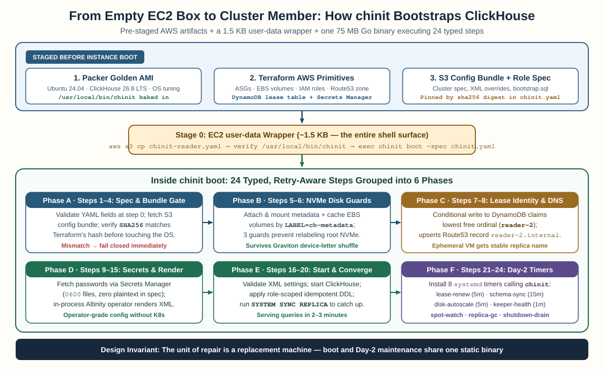
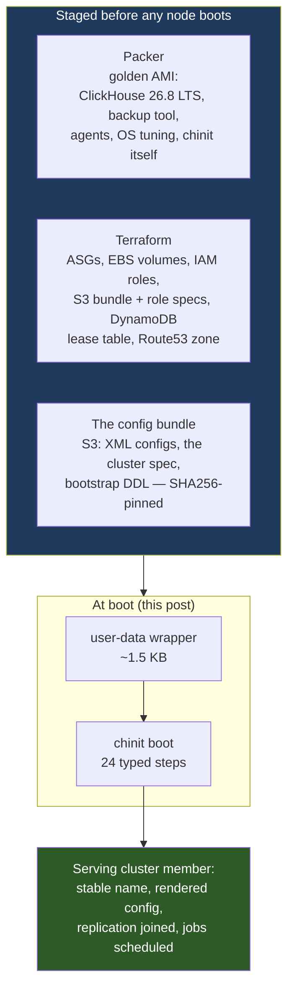
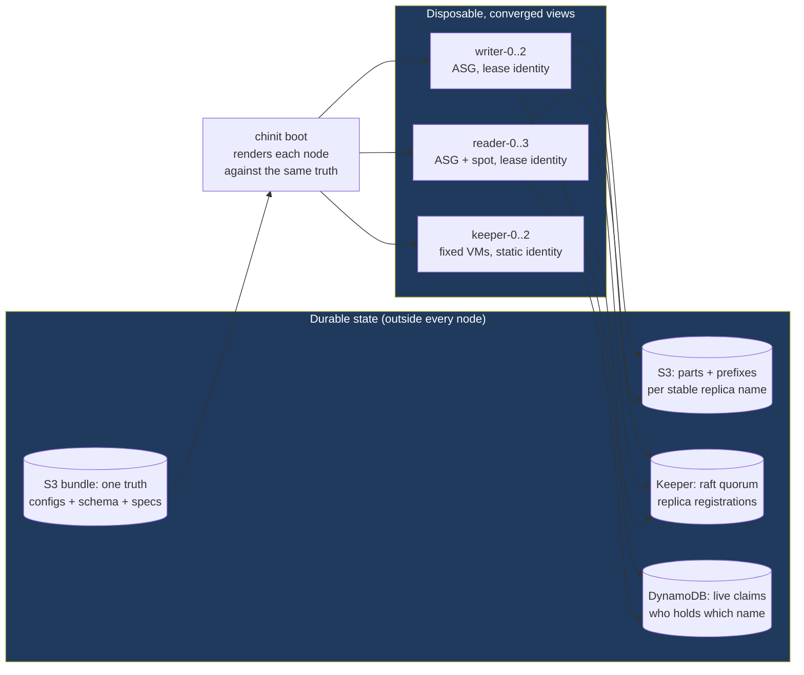

Two words do a lot of hiding in the phrase "bootstrap the cluster."
Behind them is everything between *a cloud provider hands you an empty
machine* and *that machine is serving queries as a trusted member of a
replicated database* — and behind that, on AWS specifically, a dozen
services that each own a piece of the story.

This post is the complete walkthrough. It is the post I wished existed
when we started the
[self-managed ClickHouse](/blog/clickhouse-ec2-vs-k8s-mermaid-data-flow/)
migration: what each AWS primitive actually does here, what the
[chinit](/blog/chinit-one-binary-node-bootstrap/) bootstrapper does at
each of its steps, and why the whole thing is designed so that a
machine can die at any moment and the cluster barely notices. Every
term is defined at first use. If you have read the
[design post](/blog/chinit-one-binary-node-bootstrap/) and the
[boot-sequence contract](/blog/clickhouse-boot-sequence-contract/),
this is the same system with the covers off — and if you haven't, this
one works standalone.

## What "bootstrapping a database cluster" has to mean

Bootstrapping a *single* database server is a solved problem: install
the package, write a config file, start the service. A *cluster* raises
the bar in four ways, and every one of them shows up in the pipeline:

1. **Identity must be stable while hardware is disposable.** ClickHouse
   replication registers each replica under a name — in
   [Keeper](/blog/clickhouse-cluster-topology-keeper/) (ClickHouse's
   coordination service, a ZooKeeper-compatible raft ensemble) paths
   like `/clickhouse/tables/{shard}/events/replicas/writer-2`, and in
   per-replica prefixes in S3 (Amazon Simple Storage Service — AWS's
   object store). If a replacement machine comes up under a fresh
   platform hostname, data filed under the old name is orphaned.
2. **Every node needs the same truth.** Configuration must arrive from
   one versioned place, not from a hand-edited file per machine, or the
   fleet drifts into disagreement about what the cluster even is.
3. **Secrets must move without transiting anything readable.** Passwords
   and TLS (Transport Layer Security — the encryption layer) keys are
   needed by the database, but they may not sit in the IaC
   (infrastructure-as-code) state, the startup script, or the logs.
4. **The failure mode must be replacement, not repair.** On spot
   instances (AWS's cheap, reclaimable machines — the fleet's readers
   run 50% on them) and Auto Scaling Groups (ASGs — AWS's machinery
   that maintains a target count of machines), the unit of repair is
   *a new machine*. The bootstrap must be so reliable that launching a
   fresh node is the remediation for almost anything.

That last point is the design driver. A boot that works 90% of the
time is worthless here — the ASG will replace every failed node with
another failed node, forever. The bootstrap is the fleet's
self-healing loop, which means it must be *deterministic, testable,
and idempotent* — three things a shell script cannot be at 3,600
lines, which is why it became
[chinit](https://github.com/stackgenhq/chinit): a single
open-source Go binary.

## The cast: what exists before chinit runs anything

Nothing in the walkthrough below is improvised at boot. Everything
chinit touches was staged earlier, by three tools, each owning one
layer:



*Staged AWS primitives (Packer AMI, Terraform resources, SHA256-pinned S3 bundle) feed a 1.5 KB user-data wrapper that execs `chinit boot` through 24 typed steps across six phases.*



**The golden AMI.** An AMI (Amazon Machine Image) is AWS's term for a
disk template — boot a new EC2 (Elastic Compute Cloud — AWS's virtual
machines) instance from an AMI and it starts with whatever was on that
disk. [Packer](https://developer.hashicorp.com/packer/docs) builds
hours before launch: Ubuntu 24.04 LTS, ClickHouse 26.8 LTS pinned to
the exact version, [clickhouse-backup](https://github.com/Altinity/clickhouse-backup),
the AWS CLI (command-line interface), the CloudWatch agent (AWS's
metrics/logs shipper), OpenTelemetry Collector and Fluent Bit (open-source
log shippers, configured only if a remote endpoint exists), OS tuning
(THP off — transparent huge pages, a kernel feature whose page-gluing
work adds foreground latency to allocators; `ulimit -n` raised), and
chinit itself, downloaded at image-build time from its GitHub release
and checksum-gated. Baking all this is why a node goes from launch to
serving in two to three minutes instead of eight to twelve: the room
is pre-set; the guest only checks in.

**The Terraform-staged runtime.** [Terraform](https://www.terraform.io/)
(the open-source IaC tool; we run its drop-in fork
[OpenTofu](https://opentofu.org/)) creates: the writer and reader ASGs
with their launch templates (the machine definition an ASG copies per
instance), the EBS (Elastic Block Store — AWS's network-attached disks)
volumes, the IAM (Identity and Access Management — AWS's permission
system) instance roles, the S3 config bundle, the DynamoDB (AWS's
key-value table store) lease table, and the Route53 (AWS's DNS service)
private zone. It also *renders the role specs* — the small YAML
documents chinit consumes — and uploads them.

**The config bundle.** Everything the node must read at boot lives in
one S3 prefix, versioned by content, with a SHA256 (a cryptographic
digest — any byte change changes it) that Terraform computes and
renders *into the spec*. That one number is the contract between the
IaC and the boot: the node refuses a bundle whose digest does not
match, so a stale tfvars file or an accidentally overwritten bucket
fails loudly at step 1 instead of poisoning the fleet with a config
the release does not vouch for.

## Stage 0: the wrapper, deliberately boring

EC2 gives every instance a `user-data` script it runs at first boot —
capped at 16 KiB, which is far too small for any real bootstrap, and
far too unstructured to want one there anyway. The wrapper we ship is
about 1.5 KB and does exactly three things:

1. **Seeds the role spec.** `aws s3 cp` the node's
   `chinit-<role>.yaml` from the bundle prefix to a local path — using
   the instance role, no credentials anywhere. The spec's blob name
   embeds a hash of its own content, so a spec edit repoints the
   wrapper's source and rolls the fleet.
2. **Verifies the image contract.** Checks `/usr/local/bin/chinit`
   exists and is executable. A missing binary is an image-build
   failure, not something to work around at 3 a.m.
3. **Execs the binary.** One line: `exec chinit boot -spec
   chinit.yaml -cloud aws`.

That is the entire shell surface of the system. If you are reading
this with a 60 KB cloud-init script of your own, the single hardest
question worth asking is: *what in here is a one-time machine concern
(the wrapper), and what is actually a typed, ordered pipeline (the
binary)?*

## The spec: intent as data

The wrapper hands chinit a YAML document per role. A reader's spec,
abbreviated from the real one:

```yaml
role: reader
identity_mode: lease
reader_hostname_prefix: reader-
reader_max: 4             # the ASG max — the claim ceiling
claimer_table_name: ch-node-claims
cluster_name: ch-cluster
dns_zone_name: ch-cluster.internal
config_bundle:
  bucket: ch-config-bucket
  prefix: bootstrap
  sha256: 6f02a9...       # Terraform's config_files_hash
disks:
  metadata_label: ch-metadata
  cache_label: ch-cache
secrets:
  default_password: ch-default-password   # NAMES, never values
  admin_password: ch-admin-password
network:
  subnet_cidr: 10.0.1.0/24
  admin_allowed_networks: ["10.0.0.0/16"]
```

Three properties make this the heart of the design:

- **It is validated on load.** Unknown role, missing table name, absent
  disk label, empty bucket — the boot fails at step 0 with the field
  *named*, not three minutes later as a database parse error.
- **It carries secret *names*.** The values are resolved at runtime
  through the provider (below); plaintext never rides in the spec,
  the Terraform state, or any template.
- **The claim ceiling is the ASG max, not the live count.** `reader_max`
  is the largest the fleet can *ever* be. Render today's count and a
  scaled-out node has no identity to claim.

## What chinit actually does: the twenty-four steps

Now the walkthrough — every step, what it does on AWS, and what
happens when it fails. Two failure classes exist throughout: **critical**
steps abort the boot (the ASG replaces the node — correct, because a
node that cannot mount its metadata disk cannot self-heal) and
**best-effort** steps log a loud warning and continue (the boot
*should* complete; a peer being down mid-roll is normal fleet life).

Phase 1 runs its four poles *in parallel* — they are independent and
IO (input/output) -bound, and the claim sweep can legally wait out a
dead predecessor's lease for many minutes, so paying the max of the
poles instead of the sum matters.

**1. `fetch_config_bundle` (critical).** Downloads the bundle from S3
using the instance role's IAM permission: the static XML configs
(network, TLS, storage), the cluster specification, the bootstrap DDL
(data definition language — the `CREATE TABLE` statements; see step
15), and re-installs the role spec alongside them. Then the gate:
recompute the SHA256 the way Terraform does and compare against the
spec's pinned value. Mismatch is fatal without retry — a drifted
bundle is a release problem, not a transient one.

**2. `os_optimizations` (critical).** Re-applies the kernel settings
the image already baked: THP off, file-descriptor limits, a systemd
( Linux's service manager) drop-in raising the server's `LimitNOFILE`.
Idempotent — a second run is a no-op.

**3. `require_binaries` (critical).** Asserts the golden-image
contract: `clickhouse-server`, `clickhouse-client`, `chinit` — and on
AWS, the `aws` CLI. A missing binary means the wrong image booted, and
the node must be replaced, not patched.

**4. `mount_data_disks` (critical).** EBS volumes attach
asynchronously — a volume can be *attached* in the API and *invisible*
to the OS for another minute, and large volumes on fresh launches have
taken more than a minute to appear. This step resolves each volume by
its **filesystem label** (a name written into the disk's superblock
when it was formatted — stable across the NVMe (Non-Volatile Memory
Express — the modern storage protocol EC2 exposes volumes as) device
renaming that burned us on
[Graviton](/blog/gravitron-nvme-enumeration-boot-disk-guard/)), mounts
the metadata disk, and best-effort mounts cache/keeper disks. A blank
volume gets formatted; a volume carrying a partition-table signature is
never touched.

**5. `settle_identity` (critical).** The step that makes replacement
work. The node claims a stable name — `reader-2` — from the DynamoDB
lease table with one conditional write ("this name is absent, or its
lease expired"), sweeping the ordinal range under a deadline. It sets
the hostname (static and transient), upserts a Route53 A record in the
private zone, and persists the identity to the state file *immediately*
— later steps read it from there, never re-deriving. Keepers and the
backup replica instead derive identity from their static IP's octet
(raft members should not lease names). The full protocol has its own
[post](/blog/chinit-lease-identity-ephemeral-fleet/).

**6. `retrieve_passwords` (critical).** Resolves each secret *name*
from the spec against AWS Secrets Manager (AWS's managed secret store)
via the instance role, writing each value to a mode-0600 file. The
render step will read those files; nothing else ever sees the values.

**7. `configure_tls` (critical).** Places the TLS certificate, key,
and CA (certificate authority) chain — themselves secrets resolved in
step 6 — into the server's TLS directory with correct ownership.

**8. `install_static_configs` (critical).** Validates and installs the
bundle's static XMLs into `/etc/clickhouse-server/config.d/` — and
*retires* files earlier generations shipped by hand. A config
directory is a derived artifact: a stale overlay from a previous
software generation merges with the new render and crashes the server,
so the boot treats drift as its own bug and deletes it.

**9. `configure_peer_hosts` (critical).** Writes `/etc/hosts` entries
for the *live* cluster members (from the lease table's active claims —
not the reserved slots), because systemd-resolved's stub resolver
mangles short names and replication addresses peers by theirs.

**10. `configure_server_env` (critical).** Writes the server's
environment file: the S3 disk's endpoint (from the spec's data-bucket
field — an unset `from_env` URL is a guaranteed start failure, Code 36)
and timezone. One AWS-shaped note from the
[portability audit](/blog/chinit-azure-portability-audit/): this gate
is provider-aware — the endpoint is an S3-disk requirement, and on a
cloud whose disk config carries its endpoint inline, the step correctly
writes nothing.

**11. `render_node_config` (critical).** The step that replaces the
60 KB of hand-templated XML. chinit calls the *operator's own
rendering library* — the same in-process code the
[Altinity operator](https://github.com/Altinity/clickhouse-operator)
uses on Kubernetes — to render the node's full configuration from the
cluster specification: the macros (name substitutions like
`{replica}` that expand to the node's settled identity), the
`remote_servers` cluster inventory (live claims only — a
reserved-but-vacant slot would put an unreachable peer in every
distributed query), users and profiles, and per-node settings. This is
why order is load-bearing: identity (step 5) must settle before
anything renders, or the macros bake in an ephemeral `ip-*` name and
every part the node registers is filed under a stranger's identity.

**12. `configure_keeper` (critical, keepers only).** Renders the
single-file Keeper configuration (raft ports, log and snapshot paths)
from the bundle's keeper spec and clears stale coordination state —
a leftover raft log from a previous instance is a split-brain
invitation. Other roles no-op.

**13. `write_node_env` (best-effort).** Snapshots the settled identity
into an environment contract file for legacy consumers; chinit's own
subcommands read the JSON state file instead.

**14. `start_clickhouse` (critical).** Enables and starts the server,
waits for its HTTP ping. Keepers skip — they run clickhouse-keeper,
not the server. A crash loop here is a config problem, and the boot
log names the step that produced each file — exit code 347 is a
config-merge poison, 36 is a parse failure; triage is a two-minute
read.

**15. `bootstrap_schema` (best-effort).** Executes the bundle's
bootstrap DDL — every `CREATE TABLE IF NOT EXISTS` with the node's own
macros — so a fleet that churned *completely* still re-materializes
its own tables. Best-effort by design: an existing-table conflict is
the normal convergence case (log and continue), and schema sync (step
18's unit) remains the heal path.

**16. `health_gate` (best-effort — deliberately).** Fans a health
check across the live-claims inventory and *logs the verdict, never
blocking*. A reader booting mid-roll while a peer is down must still
join; a fatal gate here wedges the ASG in a boot-replace-boot loop.
This one flag cost a live wedged fleet to learn.

**17. `prometheus_reload` (best-effort).** `SYSTEM RELOAD CONFIG`,
then verifies the server's Prometheus (the open-source metrics
exposition format) endpoint answers on localhost:9363 — with a
service-restart fallback.

**18. `install_units` (critical).** Installs the recurring jobs as
systemd units whose ExecStart lines are chinit subcommands — the
maintenance jobs are the *same binary*, so there is no second script
to drift:

| Unit | Cadence | What it does |
|---|---|---|
| `replica-sync.service` | per boot | `SYSTEM SYNC REPLICA` on every replicated table |
| `schema-sync` | hourly | propagate table definitions from peers, prune stale self-registrations |
| `lease-renew` | every 5 min | renew the identity lease (a failed renewal re-claims its own ordinal — the replacement-race self-heal) |
| `disk-autoscale` | every 5 min | grow the EBS data volume + ext4 filesystem online when *effective* free space (the `keep_free_space`-aware number, not `df`) drops below the floor |
| `keeper-health` | every minute | keeper nodes: probe the ensemble, publish `keeper_up` |
| dead-replica / orphaned-data GC | weekly | the writer holding ordinal 0 drops registrations and data for names gone from the live-claims set |

**19. `configure_backup` (critical).** Writes the clickhouse-backup
configuration against the backup S3 bucket; the backup replica (a
cheap, query-excluded node) additionally gets the daily backup timer.

**20. `configure_monitoring` / **21. `configure_cloudwatch`**
(best-effort).** OTEL/Fluent Bit configs when a remote log endpoint is
configured; on AWS, the CloudWatch agent config — node metrics plus
the `:9363` Prometheus bridge that turns the server's own metrics
into CloudWatch datapoints, with role-split namespaces (ClickHouse/Server
vs ClickHouse/Keeper). A node invisible to alarms is a node whose
outage you learn about from users; this step exists because we
learned that with a full-day outage whose 2,328 errors existed only
on disk.

**22. `install_spot_watch` (best-effort, readers).** Installs the
interruption watcher: poll EC2's metadata endpoint for the
spot-reclaim notice (a 2-minute warning), and on receipt run the
time-budgeted drain — stop replication queues, stop distributed
sends, release the lease, release DNS.

**23. `install_shutdown_drain` (critical).** The belt to the
suspender above: a systemd unit whose ExecStop runs the drain on
*every* shutdown path — ASG scale-in, EC2 health replacement, operator
stop — because instance termination without the ASG hook otherwise
leaves stale DNS records and leases behind. A reboot guard declines
the drain: identity survives a reboot.

**24. `boot_finished` (critical).** Writes the marker file and the
`[TIMING]` summary line — the exact format the fleet's health
verification greps. The node is now a serving member: stable name,
rendered config, replication joined, maintenance scheduled.

## What the cluster *is*, once four roles have done this

Walk the whole thing end to end and the definition lands: a
bootstrapped cluster is one where **the state that matters lives
outside every machine** — the parts in S3, the schema in the bundle
and Keeper, the membership in the lease table, the config in one
versioned prefix — and each machine is a converged, disposable
*view* over that state. That is what makes replacement the remediation:
a dead node is not a loss, it is a cache miss.



And the payoff is operational, not aesthetic. A spot reader is
reclaimed: the watcher drains it, its lease expires, the ASG launches
a replacement, chinit boots it, it re-claims its old name, re-renders,
re-syncs its catalog from peers — minutes, no human. A tfvars edit
rolls the bundle hash, the fleet's user-data changes, Terraform
replaces instances deliberately, and the new nodes refuse nothing
because the bundle they fetch is exactly the one the release pins. The
bootstrap is no longer a script you hope works; it is a contract the
fleet enforces.

## If you are building this yourself

The pieces, in the order that avoids relearning our findings:

1. **Bake before you boot.** A golden image with the database pinned
   is the difference between 2-minute and 10-minute replacement — and
   on a churning fleet, that is query capacity.
2. **Make user-data a wrapper, and make it boring.** If your bootstrap
   is a big script in user-data, it will be the least-reviewed code
   you own. Move the pipeline into something typed and testable; the
   16 KiB cap is doing you a favor by forcing the boundary.
3. **Settle identity before anything renders it.** The
   `{replica}`-macro class of bug — an ephemeral hostname baked into
   durable paths — is silent and expensive; the ordering is the fix.
4. **Gate your configuration delivery on a digest both sides
   compute.** One number in the spec, recomputed at fetch, and a
   drifted bundle becomes a step-1 failure with a named error.
5. **Treat the config directory as derived.** Whatever renders node
   config must also prune what past generations left there.
6. **Make maintenance jobs the same binary.** The instant the
   recurring jobs fork from the boot logic, they drift — and the
   [self-healing arc](/blog/clickhouse-effective-disk-headroom-self-healing/)
   is largely the story of closing that gap.

The pattern is not ClickHouse-specific and not AWS-specific: any
stateful fleet on replaceable machines needs exactly this — a spec,
a checksum-gated bundle, a lease on identity, a render from one
truth, and recurring convergence. chinit is that pattern, open source,
with the scars included.
