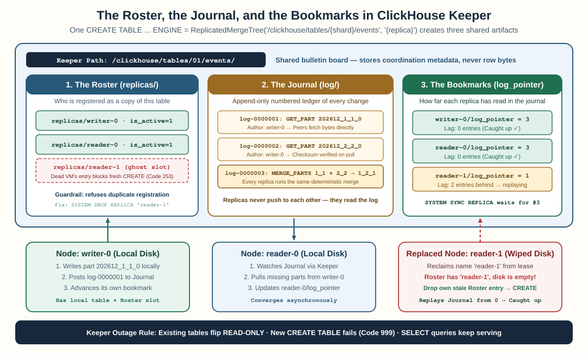
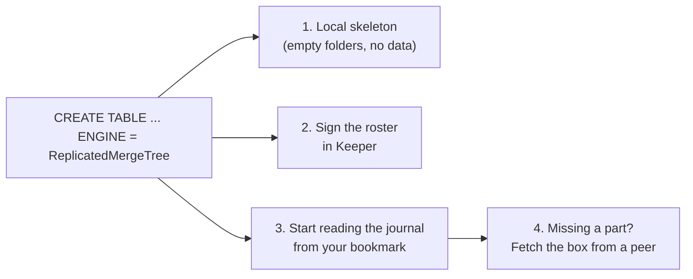
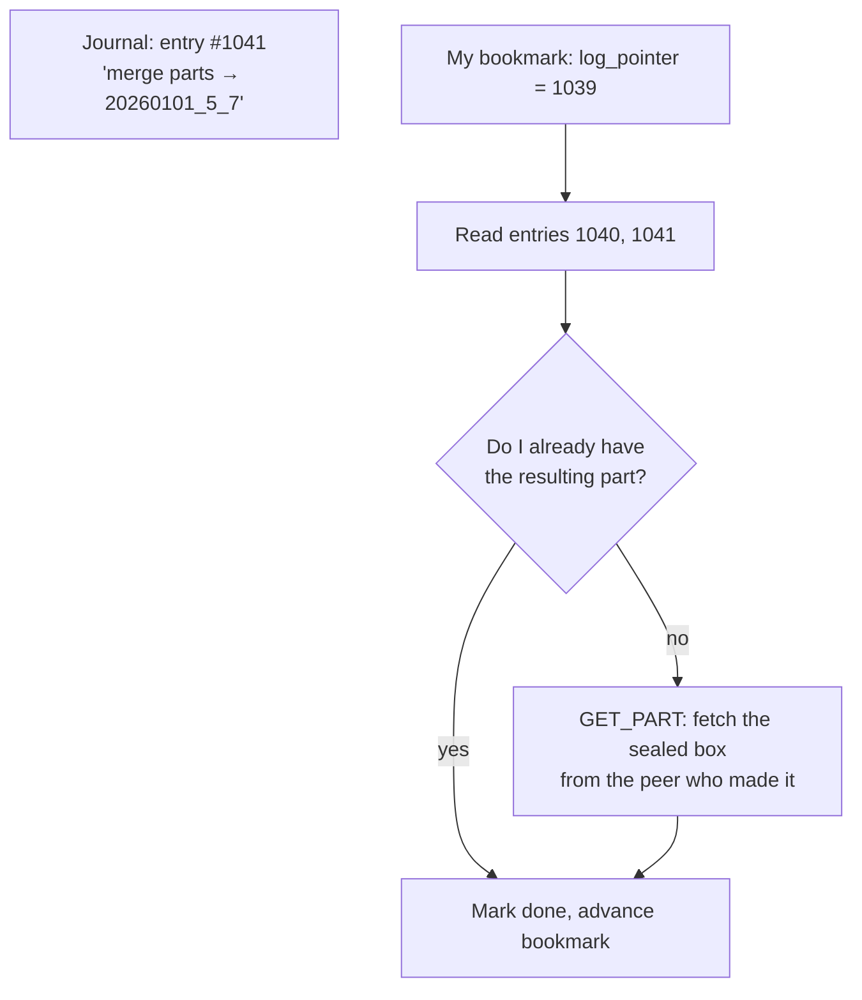
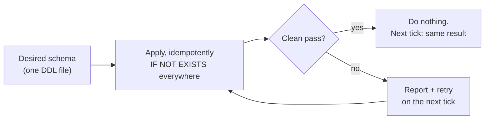

A confession: the last debugging story I published — [five rounds of
trying to make schema setup
automatic](/blog/clickhouse-schema-convergence-five-rounds/) — is only
tough to read if you're missing one thing. Not experience, not
 ClickHouse trivia. One *picture*.

The story is full of sentences like "the CREATE refused because a
registration for that name already exists in Keeper" and "the
recovery command rejected the macro" and "a re-run converges instead
of double-applying." If you can already see what those mean, the story
is just a good yarn. If you can't, every paragraph is a new thing to
take on faith.

So this is the picture. Not another war story — the five minutes of
fundamentals that make the war stories *read themselves*. Three
objects, one habit, and you'll have the mental model for most of what
goes wrong with replicated ClickHouse tables.

The three objects:

1. **A roster** — who's a member of this table
2. **A journal** — what operations members are supposed to have done
3. **A bookmark** — how far each member has read

And the habit: **make every change repeatable, then repeat it
forever.**



*Inside Keeper's `/clickhouse/tables/01/events/` folder: the Roster (`replicas/`) guards membership, the Journal (`log/`) orders every part and merge, and the Bookmarks (`log_pointer`) track each replica's progress.*



Let's build each one from a single CREATE statement, because — and this
is the fun part — one line of SQL creates all three.

## One CREATE, three artifacts

Here's a replicated table definition. This exact shape shows up in
every ClickHouse cluster:

```sql
CREATE TABLE IF NOT EXISTS events
(
    timestamp DateTime64(9),
    ...
)
ENGINE = ReplicatedMergeTree(
    '/clickhouse/tables/{shard}/events',  -- the shared path
    '{replica}'                           -- my name
);
```

Two strings in the engine arguments do all the work. The first is a
**path** — where this table lives in the coordination service. The
second is a **name** — who *this* copy of the table is. Run this on two
machines and you don't get two unrelated tables; you get two members of
*one* table, because they share the path and use different names.

What does "share the path" mean concretely? Time for object one.

## Object 1: the roster (or: why "already exists" is the system *working*)

ClickHouse's coordination service — ClickHouse Keeper, a
ZooKeeper-compatible quorum of nodes — is a shared tree of small
record-files called znodes. It behaves like a filing cabinet every
database node can see: drawers, folders, one-page files, and — this is
the important part — *strictly one writer per name*. Create a file that
already exists, and the cabinet says no.

The moment your CREATE runs, the server reaches into the cabinet and
writes a folder structure like this:

```
/clickhouse/tables/01/events/            ← the table's drawer
├── replicas/                            ← the roster
│   ├── reader-0/                        ← one member: me
│   │   ├── host          (which machine)
│   │   ├── log_pointer   (bookmark — object 3)
│   │   ├── parts/        (which boxes I hold)
│   │   ├── queue/        (my to-do list of journal entries)
│   │   └── ...
└── log/                                 ← the journal — object 2
    ├── 0000000001   (operation)
    ├── 0000000002   (operation)
    └── ...
```

The `replicas/` folder is the roster. Each subfolder is one member's
membership record, keyed by the name from the engine argument. And the
cabinet's one-writer-per-name rule becomes a *feature*: **a name can
only appear on the roster once, which is exactly what stops a second
node from silently replacing a live one.**

Now — the single most common replicated-ClickHouse confusion, decoded.
An ephemeral fleet (autoscaling, spot, whatever) reuses names: a
replacement machine boots as `reader-0` because the *previous*
`reader-0` died. The new machine finds the old roster entry still
sitting there — dead nodes don't file paperwork on their way out — and
the cabinet refuses the new registration:

```
Code: 253. DB::Exception: Replica /clickhouse/tables/01/events/replicas/reader-0
already exists
```

This is not corruption. It's the protection working on the wrong
timeline. The roster is *supposed* to refuse duplicate names — it's
just that the name's real owner is dead, so the entry pointing at it is
garbage. The sanctioned cleanup is to remove **your own** entry —

```sql
SYSTEM DROP REPLICA 'reader-0' FROM ZKPATH '/clickhouse/tables/01/events';
```

— and retry the CREATE. Drop your own name, never anyone else's, and
the refusal pattern becomes a non-event. (Who does this cleanup, and
when, is precisely the thing my earlier post spent five rounds
automating.)

## Object 2: the journal (or: how replicas copy each other without talking)

So we have a roster. But how does the *second* node get the *first*
node's data? You never copy a bucket over; nobody streams a database
dump. The answer is the `log/` folder — the journal.

Every operation that changes the table gets appended to the journal as
an entry: *merge parts A and B into C*, *drop this expired range*,
*fetch part D from replica reader-0*. The journal is the table's
official minutes book. And each replica works through it like a clerk
works through a to-do pile:



This is why a fresh node with an empty disk converges at all: it
doesn't "sync" in any bulk sense. It starts reading the journal from
the beginning, and every time an entry says *merge parts 1..200 into
one*, it skips the merging (someone did that already) and simply
**fetches the finished part** — a sealed, compressed, sorted box of rows
— from a peer that holds it. The journal tells you what should exist;
parts move peer-to-peer; the bookmark records your progress.

Which is object three, and the last one:

## Object 3: the bookmark (or: what "replication delay" actually measures)

Each replica's `log_pointer` — you saw it in the roster tree — is the
journal position it has processed through. It's a bookmark. And almost
every "is replication healthy?" number derives from it:

- **Behind the journal head?** The gap in entries is your replication
  queue.
- **The oldest unfetched entry is from forty minutes ago?** Your
  *absolute delay* is forty minutes — that's the number people put on
  dashboards.
- **Can't reach the cabinet at all?** You can't prove you're current,
  so (for quorum-safety reasons) the table flips read-only — this is
  the famous "keeper down → inserts fail" behavior, and it's the
  bookmark system being *pessimistic on purpose*, not a crash.

When my debugging story said "the CREATEs failed because the
coordination service was restarting," the concrete failure was: *the
new node tried to reach the cabinet, the cabinet was closed for
renovation, and both signing the roster and reading the journal were
impossible.* Everything in that story is one of the three objects
misbehaving — nothing else.

## Two fine prints worth carrying

**Fine print one: the macros.** That CREATE statement contains
`{shard}` and `{replica}` — squiggly-brace placeholders. The server
substitutes them *at execution time*, using the `<macros>` section of
*that node's* configuration: `{shard}` → `01`, `{replica}` → whatever
name this node carries. That's how one statement, shipped to every
machine, registers every machine under its own identity: each node
reads the same text and resolves it *as itself*. Macros are the
mechanism behind the roster's per-name uniqueness.

The catch: macros are resolved **at statement time, only**. Some
commands want a literal path — the roster-cleanup command above is one
— and if you feed them the unresolved macro text, they reject it
outright ("does not look like a table path"). If you're ever
automating a recovery command, resolve the macros yourself first,
exactly as the server would. This exact trap cost us a day once; now
you know it exists.

**Fine print two: the IF NOT EXISTS.** Every statement in our shipped
DDL ends with `IF NOT EXISTS`. That's not decoration — it's what makes
the DDL *idempotent*: running it twice behaves exactly like running it
once, the way pressing a light **switch** that's already on does
nothing, unlike shouting a **toggle** command twice and undoing
yourself. `CREATE IF NOT EXISTS` on an existing table: no-op.
Registration conflict: a defined remedy. Nothing in the sequence
misbehaves under repetition.

## The habit: describe, then repeat forever

Take the three objects plus idempotent DDL, and the punchline of the
whole mental model falls out for free.

If the schema is described **once** — a file of `CREATE ... IF NOT
EXISTS` statements that travels with every machine's configuration —
and applying that file is **safe to repeat**, then you no longer have
to answer "when should the schema be applied?" You apply it:

- at boot (the obvious time),
- when a replacement node arrives (churn happens at its own schedule),
- when a coordination outage made the last pass fail (it came back;
  retry),
- and, simplest of all, **on a timer, forever**.

A clean pass changes nothing. A failed pass reports. A node that
missed its moment heals on the next tick. This is *convergence*: the
schema stops being an event you deploy and becomes a steady state you
maintain by construction. It's the same idea as Kubernetes controllers,
 Terraform, or a thermostat — describe the desired state, apply the
delta, repeat — except the delta here is "run the DDL file," and the
repetition is a systemd timer rather than a control loop.



## Why the debugging stories read easier now

Go back and skim the five rounds with these three objects in hand:

- **Round 2** ("CREATE refuses, by design") is the *roster* refusing a
  recycled name, and the remedy is roster cleanup for your own entry.
- **Round 3** ("failure dressed as success") is the *journal and
  roster* being unreachable — nothing could be signed or read — while
  one non-replicated statement sneaked through and let the step report
  health.
- **Round 4** ("the recovery command broke on a macro") is *fine print
  one*: the cleanup command got the unresolved placeholder instead of
  the literal path.
- **Round 5** ("converge forever") is the habit: stop treating the
  apply as a boot moment; timer it.

Four of five rounds, decoded by three objects and one habit. The fifth
round — which tables belong on which nodes at all — is the same
question one level up: *the roster of the whole fleet*, not just the
table. That's a story for another day.

If you carry away only one sentence: **a replicated table is a shared
folder in a filing cabinet (roster + journal) that each member works
through from their own bookmark, and everything you ship to the fleet
should be a light switch, never a toggle.** The rest — the error
codes, the drop commands, the timers — is just the cabinet's paperwork.
