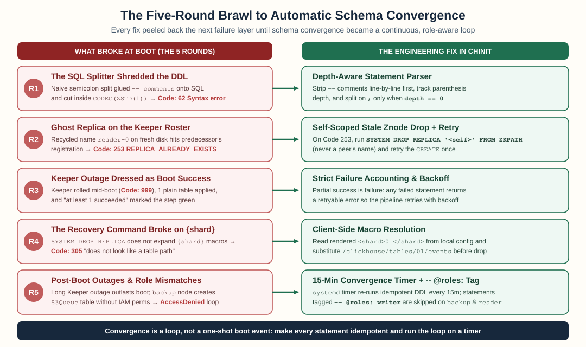
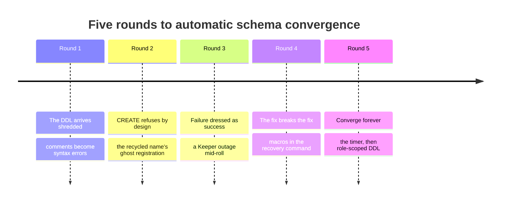
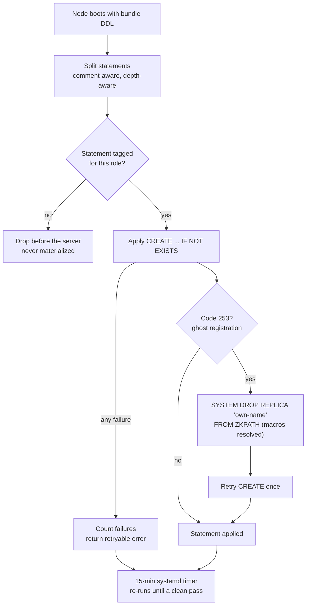

The promise of a self-managing cluster is that you never think about
its schema. Nodes churn, replacements boot, tables appear, replication
catches up. The reality we lived through last month was five straight
days of *a fleet boots with no tables, and every fix reveals the next
layer of why*.

This is the anatomy of that saga — not because the individual bugs are
exotic (they aren't), but because together they explain what
"convergence" actually has to mean when the thing converging is a
schema, the actors are ephemeral machines reusing each other's names,
and the coordinator itself is being restarted underneath you.

> **Reading this story cold?** It leans on one mental model throughout:
> a replicated table is a *roster* (membership in Keeper), a *journal*
> (the shared operations log), and a per-replica *bookmark* — plus the
> habit of shipping idempotent DDL. If any of that is new, spend five
> minutes with [the primer: the Roster, the Journal, and the
> Bookmarks](/blog/clickhouse-replicated-table-roster-journal-bookmarks/)
> first; every round below then reads as one of those three objects
> misbehaving, and the story gets a lot shorter.

Round by round. Each one fixed something real, and each one uncovered
the next.



*Five layers of schema bootstrap failure across ephemeral ClickHouse nodes — and the parser, self-drop, strict accounting, macro resolution, and timer/role-tag fixes that made convergence automatic.*



## The setup: one DDL file, one promise

The design is simple enough to fit in a sentence: *ship the cluster's
CREATE TABLE statements alongside the configuration bundle, and have
every server node apply them idempotently at boot.* Every statement is
`IF NOT EXISTS`. Tables that exist are untouched; tables that don't,
appear. Replication does the rest.

Why ship the DDL at all? Because of a failure we hit during a full
fleet replacement: when *every* peer churns at once, there is no peer
to learn the schema from. ClickHouse nodes can propagate DDL to each
other, but that's a pull from *someone who knows* — and in a rolling
restart that someone may be nobody. The schema has to travel with the
machines, the same way their configuration does.

So far, so reasonable. Then the fleet rolled, and the boot logs said
things like:

```
schema bootstrap: 1 statement(s) applied
```

...while nine tables were expected and one table existed. Round one.

## Round 1: the DDL that shredded itself

The first suspect was the code that split the DDL file into
statements. It split on semicolons. And the DDL file — like any DDL
file written by humans — contained semicolons in places that are *not*
statement terminators:

- Every explanatory comment before a table ended in prose, and the
  splitter didn't strip comments first — so a phrase like
  `-- this step executes it idempotently` glued itself onto the front
  of a CREATE statement and arrived at the server as part of the SQL.
- Column defaults like `CODEC(ZSTD(1))` and
  `TTL timestamp + toIntervalDay(7)` contain semicolons' neighbors —
  parentheses — and naive splitting happily cut *inside* expressions.

The server's response to SQL that starts with English prose is exactly
what you'd expect:

```
Code: 62. DB::Exception: Syntax error: failed at position 1
```

Five of nine statements failed this way. The boot printed "1
applied," which was *true* and *useless*.

The fix is a splitting function that behaves like a parser instead of
like `grep`: strip `--` comments line by line *first*, then track
parenthesis depth and only treat a semicolon as a terminator when the
depth is zero. Comments can no longer contain SQL, and expressions
with parens can no longer be severed. Boring, correct, and the kind
of function you should absolutely have in whatever applies DDL on your
fleet — because the failure it prevents is invisible right up until
you count tables.

## Round 2: CREATE refuses, by design

With statements arriving intact, the fleet rolled again — and again
booted mostly schemaless. But the error had changed character:

```
Code: 253. DB::Exception: Replica /clickhouse/tables/01/events/replicas/reader-0
already exists
```

This is my favorite ClickHouse error, because it is the system
*working as designed* while your fleet *fails anyway*.

Replicated tables register themselves in Keeper under a path that
includes the replica's name. An autoscaling fleet reuses names — that's
the point of stable identity, and we've written before about
[how a node claims its name](/blog/chinit-lease-identity-ephemeral-fleet/).
When a replacement node boots as `reader-0` and runs `CREATE
REPLICATED MERGE TREE ... ('...', 'reader-0')`, Keeper sees a
registration for `reader-0` already sitting there — left behind by the
*previous* `reader-0`, which died without draining.

And so the create refuses. This is not a bug: refusing to stack a
second replica onto an existing registration protects real replicas
from being clobbered. But the calling code treated "refused" as
"skip this statement," and skipped is how you get nine expected tables
and two actual ones.

The remedy is the one an operator types by hand in this situation:
drop *your own* stale registration, then retry.

```sql
SYSTEM DROP REPLICA 'reader-0' FROM ZKPATH '/clickhouse/tables/01/events';
-- then: the same CREATE, retried once
```

Two properties make this safe to automate. First, you only ever drop
the name **this node claims** — never a peer's, never a pattern, just
the identity the boot already settled. Second, a fresh disk has no
parts, so the ghost registration points at nothing; clearing it costs
nothing but the log entry. (On a disk *with* parts you must think
harder — that's a different recovery.) The drop-and-retry lives in the
bootstrap step now, and the boot log says
`re-created after dropping stale znode`, which is the exact sentence
you want to see at 3 a.m.

## Round 3: failure dressed as success

Round three didn't announce itself in the logs at all. That was the
problem.

During a rolling restart, the coordination quorum (Keeper) was being
replaced in the same wave as the data nodes. A fresh writer would apply
its DDL, and every replicated CREATE would fail:

```
Code: 999. DB::Exception: All connection tries failed while connecting
to ZooKeeper
```

Except — one statement in the bundle doesn't need Keeper: a plain
MergeTree or an S3Queue table. *That one applied.* And the step's code
returned success if *any* statement applied, because the step was
written to be best-effort: a schema conflict shouldn't kill a boot.

Best-effort, meet your blind spot. The step reported success, the boot
reported healthy, and the node sat there schemaless — with a Keeper
that came back thirty seconds later and a schema step that had *already
decided it was done.*

The fix is unglamorous accounting: count the failures. Any statement
that failed makes the step return a retryable error; the statement set
is idempotent, so a retry converges instead of double-applying. The
final "best-effort" classification stays — one exhausted retry pass
still doesn't kill the boot — but the *retry* now happens, and the
pass that gave up says so loudly in the log instead of whispering
success.

The general lesson deserves bold text: **when a multi-item operation
can be partially successful, "at least one worked" is not a success
signal.** Partial success is a *shape* of failure with better
manners. Count, and report the count.

## Round 4: the recovery command broke on a macro

Now the drop-and-retry from round two was in place, the failure count
from round three was in place, and we watched a reader boot against a
Keeper full of its own ghosts. The step tried the drop — and the drop
itself failed:

```
Code: 305. DB::Exception: Specified path /clickhouse/tables/{shard}/events
does not look like a table path
```

Look closely at the path: it still contains the literal text
`{shard}`.

Here's the trap. The DDL's engine arguments are written with
ClickHouse macros — `ReplicatedMergeTree('/clickhouse/tables/{shard}/events',
'{replica}')` — and *the server substitutes those macros at statement
execution time*. That's why the CREATE works with macros in it. But
`SYSTEM DROP REPLICA ... FROM ZKPATH` takes a **literal path**. The
recovery code extracted the path straight from the CREATE text, where
it was still `{shard}`, and handed a macro to a command that accepts
none.

The result: the drop failed with a path-format error, the retry never
happened, and the Code 253 conflict stayed — the *remedy* for round two
silently no-op'd against any DDL written in the idiomatic macro style.

The fix is to resolve the macros client-side, the way the server
would: read the node's rendered `<shard>` macro from its own macros
configuration and substitute it into the path before building the drop
command. (`{replica}` is easier — it's the node's own name, which the
bootstrapper already knows.) It's a two-line fix. It took a
production error to find, because in every hand-typed recovery, the
operator naturally writes the resolved path — the un-resolved form
only exists in the code path that feeds an automated command.

Automation lesson, also bold: **automated recovery must reproduce the
operator's implicit normalization steps.** Anything a human does
without thinking — resolving a variable, trimming a space, picking the
resolved path — is a step your code doesn't have yet.

## Round 5: converge forever, then scope by role

Two rounds closed the loop.

**The timer.** Everything above fixed *the boot*. But a boot is one
moment, and the failure shapes in rounds 1–4 are precisely the ones
that strike *during* fleet churn — when a node boots mid-rollback,
against a Keeper that's itself mid-restart. If the boot's DDL pass
exhausts its retries, nothing else ran the DDL again — and we watched
a reader serve reads for hours with an empty database because of
exactly that.

The answer is to stop treating the schema apply as a boot-time event
at all. The same idempotent pass now runs on a systemd timer every
fifteen minutes: every pass either converges or reports, a clean pass
changes nothing, and a node that lost the Keeper race at boot heals
itself on the next tick. Convergence stopped being a moment; it's a
steady state.

**The role scope.** The last surprise came from the opposite
direction: a table that converged *too eagerly*. The bundle's DDL
included the S3Queue ingest table — the one that drains a staging
prefix into the main log table, claiming files through Keeper so
several nodes can share the drain. Every node applied every
statement. Including the node whose IAM role holds *no read
permissions at all* on the staging bucket: a dedicated backup replica,
deliberately data-empty by security design.

Its queue table materialized, its poll loop started, and every poll
cycle threw `AccessDenied` into the logs, forever. Nothing was wrong
with the node; the *object* simply had no business existing there.
The ingest queue is an ingest-node object, by IAM design and by its
own DDL comment.

The fix moved the decision into the DDL itself — role-scoped
statements:

```sql
--    chinit:roles=writer,reader
CREATE TABLE IF NOT EXISTS staging_synth (...)
```

A marker comment tags the statements that follow as belonging to
certain roles; the bootstrapper drops statements this node doesn't
hold *before they reach the server*. The replicated tables stay
role-universal (everyone needs them), the ingest pipeline is
writer/reader-only, and the backup boots with exactly the seven
tables it can actually serve. The error class doesn't just get
handled — it stops being constructible.

## What would have prevented three of the five rounds

Rounds two, four, and five share a shape: *invalid input reached the
database, and the database's only complaint mechanism was to fail.*

Round two fed a CREATE onto an existing registration — the server
refused. Round four fed a macro path to a literal-path command — the
server refused. Round five fed an object to a node that couldn't serve
it — the server *didn't even refuse*, it just ran the poll loop into a
permission wall every thirty seconds. And a sibling failure from the
same week — a config fragment with a server-level setting nested in
the wrong section, or a pool-size threshold above the pool itself —
made the server refuse to *start*, which is crash-loop-shaped, which
is the worst shape of all: the same error, at machine speed, until a
human reads it.

The prevention shape is an install-time validator: before any config
fragment or DDL statement reaches the database, check the placement
rules the database will check anyway —

- user-level settings must not sit at the top level of a server config
  fragment (they belong in profile sections);
- server-level pool settings must not sit inside merge-tree sections;
- free-entry thresholds must stay *below* the pool they gate;
- a recovery command must not carry unresolved macros;
- an object must not materialize on a role that cannot serve it.

None of this is exotic knowledge. It's exactly what the error messages
taught us — captured once, as rules, so the next bad template fails
**one boot with a pointed message** instead of a restart storm or an
error-spam loop. And the rule set applies to the bootstrapper's own
built-in defaults too: the built-in backup-replica configuration must
pass every rule the validator enforces on everything else. The day it
doesn't, a test fails, not a fleet.

## The whole chain, in one picture



Every arrow in that diagram is a scar from a specific afternoon. The
timer is the outer loop that makes the whole thing a steady state
instead of a lucky boot. And the validator is the layer that — we
hope — makes the next round of this particular brawl never start.

## The takeaways, stripped of ClickHouse

1. **A multi-item apply is successful when zero items failed** — not
   when at least one succeeded. Count and report the count.
2. **Refusals by design still need a convergence path.** If a system
   legitimately rejects a state you need, your automation needs the
   *sanctioned* way to clear it — restricted to your own resources.
3. **Automated recovery must reproduce the operator's implicit
   normalizations.** Macros, defaults, paths — resolve them exactly as
   the human would, or the remedy no-ops.
4. **Boot-time convergence isn't enough.** Anything that can fail
   because of a transient dependency (a coordinator restarting, a peer
   mid-roll) needs a periodic re-convergence, and the pass must be
   idempotent so the loop can run forever.
5. **Validate placement before the system does.** The server's
   "unknown setting" and "wrong section" errors are documentation —
   encode them as install-time rules so the failure is one loud boot,
   not a crash loop or an error fountain.
6. **Converge only what the node can serve.** Schema, config, and
   permissions are three views of one contract; apply objects where
   the IAM/policy side of the contract holds, and nowhere else.

The schema now converges the way it should have from the start:
machines churn, tables appear, nobody pages. Getting there was five
rounds. Making it durable was the sixth — writing the whole chain
down, with the error codes in it, so the next person (probably me)
starts at round zero with the scars pre-installed.
