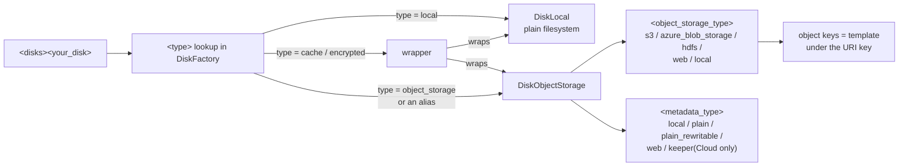

Two posts ago I wrote about the config element that parses, validates, and does
nothing: `<key_prefix>` on an Amazon Simple Storage Service (S3) disk, silently ignored, every tenant's parts
landing in the bucket root under flat three-character prefixes. I fixed it by
reading the bucket, not the docs. That fix worked, but I was left with a
question I didn't have a clean answer to: if `key_prefix` isn't real, what
exactly *are* the fields ClickHouse's storage configuration accepts — and how
does the server turn the `<disks>` section into something it can read and
write?

So this time I read the registry itself. Not the documentation pages, the
actual registration code, at
[commit `bb6fa8b5d156`](https://github.com/ClickHouse/ClickHouse/commit/bb6fa8b5d1561b9928db573fc73d98cb16673c08)
of the ClickHouse source. My fleet runs 26.8.36.3 and every behavior cited here
matches what it does live; the links below are pinned to the master tree I
read, and where the two could diverge I say so.

The result is a much smaller system than the documentation implies. Four
families get registered. Everything else — `s3`, `web`, `hdfs`,
`azure_blob_storage`, `s3_plain`, the lot — is an alias. And the mystery of the
flat bucket-root keys turns out to be, literally, a one-line default template
in the source: `[a-z]{3}/[a-z]{29}`.

**Key takeaways**

- Start a ClickHouse server and the disk registry contains exactly three
  unconditional families: local, cache, object-storage — plus `encrypted` when
  built with Secure Sockets Layer (SSL). Every other disk name is a compatibility alias of the
  object-storage family.
- A "disk" in the config is really three choices stacked: a wrapper chain
  (`cache`, `encrypted`), an object storage type (S3, Azure, Hadoop Distributed File System (HDFS), Web, local
  blob storage), and a metadata storage type (Local, Plain, PlainRewritable,
  Keeper). The legacy aliases imply a metadata type for free.
- The default S3 key layout is
  `[a-z]{3}/[a-z]{29}`
  appended to whatever survived the uniform resource locator (URL) parsing. The bucket-root 3-character
  directories from the previous post are this template with an empty prefix.
  `key_prefix` is never read; `endpoint_subpath` and `key_template` are.
- `perform_ttl_move_on_insert` **defaults to true** — my tiered policy's
  `false` on the cold volume is load-bearing. `move_factor` defaults to 0.1 but
  only exists when a policy has more than one volume, and it gates only the
  disk-pressure move, never the time-to-live (TTL) move.
- Zero-copy replication is still not a viable escape from per-replica S3
  prefixes: the capability flag exists, the gate that would use it defaults to
  false and is documented upstream as "not ready."

---

## The registry is smaller than the docs suggest

Everything starts in
[`src/Disks/registerDisks.cpp`](https://github.com/ClickHouse/ClickHouse/blob/bb6fa8b5d1561b9928db573fc73d98cb16673c08/src/Disks/registerDisks.cpp#L22-L36).
At server startup the disk factory is populated by exactly four calls: local,
cache, object-storage, and — behind an `#if USE_SSL` — encrypted.
[Web, HDFS, and Azure are not separate families](https://github.com/ClickHouse/ClickHouse/blob/bb6fa8b5d1561b9928db573fc73d98cb16673c08/src/Disks/DiskObjectStorage/ObjectStorages/ObjectStorageFactory.cpp#L398-L416);
they enter the world as object-storage backends registered inside the same
factory that knows `s3`.

When the server walks
[`<storage_configuration><disks>`](https://github.com/ClickHouse/ClickHouse/blob/bb6fa8b5d1561b9928db573fc73d98cb16673c08/src/Disks/DiskSelector.cpp#L90-L119),
each child element is checked for one thing hard: the disk **name** must be
alphanumeric plus underscore. Everything else about the disk is deferred to
[`DiskFactory::create`](https://github.com/ClickHouse/ClickHouse/blob/bb6fa8b5d1561b9928db573fc73d98cb16673c08/src/Disks/DiskFactory.cpp#L73-L88),
which reads `<type>` and looks it up in the registry — with `local` as the
default, which is why my `<default>` disk entry consisting of nothing but
`<keep_free_space_bytes>` is a plain `DiskLocal` without saying so. An unknown
*type* throws:

```
DiskFactory: the disk '...' has unknown disk type: ...
```

An unknown *child element* throws nothing, ever — the factory only reads the
keys it knows about, and nothing enumerates what it didn't read. That silence
is precisely the hole `key_prefix` fell through two posts ago.

## A disk is three choices, not one

The actual classification lives in one header,
[`src/Disks/DiskType.h`](https://github.com/ClickHouse/ClickHouse/blob/bb6fa8b5d1561b9928db573fc73d98cb16673c08/src/Disks/DiskType.h#L16-L36):

- `ObjectStorageType`: `S3`, `Azure`, `HDFS`, `Web`, `Local` — *where the bytes go.*
- `MetadataStorageType`: `Local`, `Keeper`, `Plain`, `PlainRewritable`,
  `StaticWeb`, `WebIndex`, `Memory` — *where the list of parts goes.*
- `DataSourceType`: `Local`, `RAM`, `ObjectStorage` — the coarse family.

And on top of any of these, two wrapper disks: `cache` and `encrypted`. So the
honest mental model:



A local disk is one choice. An object-storage disk is two. A wrapper is a disk
plus a chain. That's the whole classification — and the config grammar in the
source makes it explicit: the canonical form registered in
[`RegisterDiskObjectStorage.cpp`](https://github.com/ClickHouse/ClickHouse/blob/bb6fa8b5d1561b9928db573fc73d98cb16673c08/src/Disks/DiskObjectStorage/RegisterDiskObjectStorage.cpp#L121-L124)
is

```
disk(type = object_storage, object_storage_type = s3, metadata_type = local, endpoint = '...')
```

`object_storage_type` and `metadata_type` are real, orthogonal config elements.
The familiar names are shortcuts.

## The aliases: why your `s3` disk is secretly `object_storage`

Here's a detail I got wrong in my head for a long time. The registration block
at
[`RegisterDiskObjectStorage.cpp#L126-L165`](https://github.com/ClickHouse/ClickHouse/blob/bb6fa8b5d1561b9928db573fc73d98cb16673c08/src/Disks/DiskObjectStorage/RegisterDiskObjectStorage.cpp#L126-L165)
registers `s3`, `s3_plain`, `s3_with_keeper`, `s3_plain_rewritable`, `hdfs`,
`azure_blob_storage`, `local_blob_storage`, and `web` as separate *disk type*
names — but every single one points at the **same creator lambda** as
`object_storage`. Each alias exists so that two resolution steps can be
short-circuited:

1. **Backend resolution.** In
   [`ObjectStorageFactory::create`](https://github.com/ClickHouse/ClickHouse/blob/bb6fa8b5d1561b9928db573fc73d98cb16673c08/src/Disks/DiskObjectStorage/ObjectStorages/ObjectStorageFactory.cpp#L94-L101),
   `<object_storage_type>` wins if present, otherwise **`<type>` is re-read**.
   Your `type = s3` inside a disk section therefore does double duty: it
   picks the object-storage creator at the top level, and the same string picks
   the S3 backend inside it.

2. **Metadata inference.** If the config omits `<metadata_type>` entirely,
   [`RegisterDiskObjectStorage.cpp#L82-L98`](https://github.com/ClickHouse/ClickHouse/blob/bb6fa8b5d1561b9928db573fc73d98cb16673c08/src/Disks/DiskObjectStorage/RegisterDiskObjectStorage.cpp#L82-L98)
   derives a hint by substrings: a type containing `with_keeper` hints
   `keeper`, something containing `plain` and `rewritable` hints
   `plain_rewritable`, `plain` hints `plain`. Anything else falls through to
   [asking the object storage type](https://github.com/ClickHouse/ClickHouse/blob/bb6fa8b5d1561b9928db573fc73d98cb16673c08/src/Disks/DiskObjectStorage/MetadataStorages/MetadataStorageFactory.cpp#L79-L97):
   S3, HDFS, local, or Azure answer `local`; Web answers `web`.

So the shorthand names map to the real matrix like this:

| you write | object storage | metadata (inferred) |
|---|---|---|
| `s3` | S3 | `local` |
| `s3_plain` | S3 | `plain` |
| `s3_plain_rewritable` | S3 | `plain_rewritable` |
| `s3_with_keeper` | S3 | `keeper` — Cloud-only |
| `azure_blob_storage` | Azure | `local` |
| `hdfs` | HDFS | `local` (endpoint must end in `/` — enforced, [throw otherwise](https://github.com/ClickHouse/ClickHouse/blob/bb6fa8b5d1561b9928db573fc73d98cb16673c08/src/Disks/DiskObjectStorage/ObjectStorages/ObjectStorageFactory.cpp#L236-L239)) |
| `web` | Web | `web` (read-only static site of parts) |
| `local_blob_storage` | Local | `local` |

The `s3_with_keeper` row is worth pausing on. Its [registration
description](https://github.com/ClickHouse/ClickHouse/blob/bb6fa8b5d1561b9928db573fc73d98cb16673c08/src/Disks/DiskObjectStorage/RegisterDiskObjectStorage.cpp#L134-L139)
says it outright: the `keeper` metadata storage is registered only in
ClickHouse Cloud builds — the registration is behind
[`#if CLICKHOUSE_CLOUD`](https://github.com/ClickHouse/ClickHouse/blob/bb6fa8b5d1561b9928db573fc73d98cb16673c08/src/Disks/DiskObjectStorage/MetadataStorages/MetadataStorageFactory.cpp#L162-L165)
— and an open-source server attempting it fails with
`unknown metadata storage type: keeper` (the factory's
[registry-miss throw](https://github.com/ClickHouse/ClickHouse/blob/bb6fa8b5d1561b9928db573fc73d98cb16673c08/src/Disks/DiskObjectStorage/MetadataStorages/MetadataStorageFactory.cpp#L125)).
If you've ever wondered why self-managed ClickHouse can't keep S3 disk
metadata in the Keeper it already runs: the answer is that the code path is
compiled out of the open-source build. My Keeper member is load-bearing for
replicated-table state, but the *disk* metadata lives on Elastic Block Store (EBS) next to the
parts, exactly as the matrix predicts.

One more silent-empty-prefix incident in the same family — different backend:
the Azure factory carries
[a comment](https://github.com/ClickHouse/ClickHouse/blob/bb6fa8b5d1561b9928db573fc73d98cb16673c08/src/Disks/DiskObjectStorage/ObjectStorages/ObjectStorageFactory.cpp#L265-L268)
confessing that `getCommonKeyPrefix()` "was not implemented previously by
mistake and was always returning an empty string," so every
azure-with-keeper instance shared one root path until a
`common_key_prefix_for_azure` escape hatch was added. Silent empty prefixes
bugging people is apparently a genre.

## Where the bytes actually land: uniform resource identifier (URI) key plus one-line default template

For an S3 disk, the object key starts from the URL. The factory builds it in
[`getS3URI`](https://github.com/ClickHouse/ClickHouse/blob/bb6fa8b5d1561b9928db573fc73d98cb16673c08/src/Disks/DiskObjectStorage/ObjectStorages/ObjectStorageFactory.cpp#L144-L157):
it reads `endpoint`, macro-expands `endpoint_subpath`, joins them, and then
enforces one thing — **the key must end in `/`** — appending the slash if you
forgot. Whatever survives that is `uri.key`. That is the *only* path element
S3 disks have; `key_prefix` is never in the read list.

The key generator then comes from
[`DiskS3Utils.cpp#L18-L52`](https://github.com/ClickHouse/ClickHouse/blob/bb6fa8b5d1561b9928db573fc73d98cb16673c08/src/Disks/DiskObjectStorage/ObjectStorages/S3/DiskS3Utils.cpp#L18-L52)
and it has exactly three branches:

1. **`key_template` set** → template generator, and a hard error if the URI
   key is non-empty (the two are mutually exclusive by design).
2. **`key_compatibility_prefix` without `key_template`** → hard error.
3. **Neither** →
   [`createObjectStorageKeyGeneratorByPrefix(uri.key)`](https://github.com/ClickHouse/ClickHouse/blob/bb6fa8b5d1561b9928db573fc73d98cb16673c08/src/Disks/DiskObjectStorage/ObjectStorages/S3/DiskS3Utils.cpp#L40).

And that third branch lands in
[`src/Common/ObjectStorageKeyGenerator.cpp#L36-L40`](https://github.com/ClickHouse/ClickHouse/blob/bb6fa8b5d1561b9928db573fc73d98cb16673c08/src/Common/ObjectStorageKeyGenerator.cpp#L36-L40):

```cpp
ObjectStorageKeyGeneratorPtr createObjectStorageKeyGeneratorByPrefix(String key_prefix)
{
    return std::make_shared<GeneratorWithTemplate>(std::filesystem::path(RE2::QuoteMeta(key_prefix)) / "[a-z]{3}/[a-z]{29}");
}
```

There it is. The flat bucket-root layout from the previous post was never a
mystery at the storage layer — it's this default template, with an empty
prefix. `<uri.key><3 random chars>/<29 random chars>`, one directory per part.
With my old broken config the URI key was empty, so parts landed at the root
as `abc/defghij...` exactly, and with the fixed config the URI key is
`data/<tenant>/{replica}/`, so they land at
`data/tenant_a/writer-0/abc/defghij...`. Same template, different prefix. When
I listed the bucket and saw two-then-three-character directories, I was
looking at this regex rendered in S3.

Two macro notes, both confirmed in the source:

- `endpoint_subpath` goes through the standard
  [macro expansion](https://github.com/ClickHouse/ClickHouse/blob/bb6fa8b5d1561b9928db573fc73d98cb16673c08/src/Disks/DiskObjectStorage/ObjectStorages/ObjectStorageFactory.cpp#L147-L149),
  which is how `{replica}` resolves per node from `macros.xml` in my fleet.
- `key_template` expands macros too, but through a *restricted* expansion mode
  ([special macros + `{replica}` only,
  `info.ignore_unknown = true`](https://github.com/ClickHouse/ClickHouse/blob/bb6fa8b5d1561b9928db573fc73d98cb16673c08/src/Disks/DiskObjectStorage/ObjectStorages/S3/DiskS3Utils.cpp#L28-L33)).

## The metadata half: where the parts list lives

If the object storage is *where bytes live*, the metadata storage is *what the
server believes lives there*. Four registered types in the open-source tree
(`local`, `plain`, `plain_rewritable`, plus the Cloud-only `keeper`; `web` and
`web_index` round out the
[registry](https://github.com/ClickHouse/ClickHouse/blob/bb6fa8b5d1561b9928db573fc73d98cb16673c08/src/Disks/DiskObjectStorage/MetadataStorages/MetadataStorageFactory.cpp#L133-L266)):

- **`local`** (the default for S3 disks, via the hint above) — the parts list
  is a small
  [`DiskLocal`](https://github.com/ClickHouse/ClickHouse/blob/bb6fa8b5d1561b9928db573fc73d98cb16673c08/src/Disks/DiskObjectStorage/MetadataStorages/MetadataStorageFactory.cpp#L133-L163)
  next to your data (default path:
  `<ch-data>/disks/<disk-name>/`). It's also where the crash-safety story for
  S3 deletes lives: blobs pending removal are journaled to
  [`.metadata/blobs_to_remove.log`](https://github.com/ClickHouse/ClickHouse/blob/bb6fa8b5d1561b9928db573fc73d98cb16673c08/src/Disks/DiskObjectStorage/MetadataStorages/Local/MetadataStorageFromDisk.h#L37)
  on that local disk, so a server between "metadata says deleted" and "S3
  object deleted" resumes the deletion queue on boot instead of orphaning.
  This is a concrete reason the metadata EBS volume on my writer is
  `delete_on_termination=false` — it *is* the disk's state.

- **`plain`** — the bucket *is* the filesystem. The class comment says it
  plainly: object storage is used as a filesystem "in a limited form — no
  directory concept, files only… no move… excessive application programming interface (API) calls," intended so
  [BACKUP/RESTORE works against the same
  structure](https://github.com/ClickHouse/ClickHouse/blob/bb6fa8b5d1561b9928db573fc73d98cb16673c08/src/Disks/DiskObjectStorage/MetadataStorages/Plain/MetadataStorageFromPlainObjectStorage.h#L25-L34)
  as on-disk MergeTree. Mostly read-only in practice.

- **`plain_rewritable`** — same idea, but with
  [rewrite transactions and
  snapshots](https://github.com/ClickHouse/ClickHouse/blob/bb6fa8b5d1561b9928db573fc73d98cb16673c08/src/Disks/DiskObjectStorage/MetadataStorages/MetadataStorageFactory.cpp#L212-L243)
  (and a toggle for the hard links that make metadata unreadable to servers
  older than 26.10). This is the direction the whole "metadata in object
  storage" project is heading for open source.

- **`keeper`** — Cloud-only, as covered above; in a non-Cloud build the name
  resolves to the registry-miss throw.

One honest update to an earlier post in this series: my [Content-Addressed Storage (CAS) post](/blog/clickhouse-whats-next-cas-iceberg/) speculated about content-addressable
metadata as the future. In this tree there is **no CAS metadata type
registered yet** — the names above are the entire registry. When the
content-addressable work lands, it will appear as exactly one more
`registerMetadataStorageType` call in this factory, and I'll write the
follow-up from that diff.

## Wrappers: cache and encrypted

The cache wrapper is registered in
[`RegisterDiskCache.cpp#L164-L167`](https://github.com/ClickHouse/ClickHouse/blob/bb6fa8b5d1561b9928db573fc73d98cb16673c08/src/Disks/DiskObjectStorage/RegisterDiskCache.cpp#L164-L167)
with one hard constraint, enforced with a throw:
[cached disk is allowed only on top of object
storage](https://github.com/ClickHouse/ClickHouse/blob/bb6fa8b5d1561b9928db573fc73d98cb16673c08/src/Disks/DiskObjectStorage/RegisterDiskCache.cpp#L150-L151).
You can't put a cache wrapper on a plain local disk — it would be a cache of
itself.

The knobs come from `FileCacheSettings`, loaded straight out of the cache
disk's own section:

- [`max_size`](https://github.com/ClickHouse/ClickHouse/blob/bb6fa8b5d1561b9928db573fc73d98cb16673c08/src/Interpreters/FileCache/FileCacheSettings.cpp#L37-L44)
  or `max_size_ratio_to_total_space` — and the
  [validation](https://github.com/ClickHouse/ClickHouse/blob/bb6fa8b5d1561b9928db573fc73d98cb16673c08/src/Interpreters/FileCache/FileCacheSettings.cpp#L269-L274)
  requires **exactly one** of the two: both unset throws, both set throws.
- [`max_elements`](https://github.com/ClickHouse/ClickHouse/blob/bb6fa8b5d1561b9928db573fc73d98cb16673c08/src/Interpreters/FileCache/FileCache_fwd.h#L16-L36),
  default 10,000,000 file segments — this is the per-file overhead bound that
  matters more than bytes once parts get small.
- eviction policy, default **Segmented Least Recently Used (SLRU)** with `slru_size_ratio` 0.6 (protected
  segment vs probationary). My earlier comment in our storage.xml claiming
  "26.8 default policy SLRU" was correct; this is the line that says so.
- [`cache_on_write_operations`](https://github.com/ClickHouse/ClickHouse/blob/bb6fa8b5d1561b9928db573fc73d98cb16673c08/src/Disks/DiskObjectStorage/ObjectStorages/Cached/CachedObjectStorage.cpp#L130-L131)
  — write-through. Our `s3_cache` sets this true because TTL-moved parts are
  uploaded through the wrapper and I don't want the first query after a move
  to re-download from S3; the SLRU eviction then ages never-read bytes out
  naturally.

The encrypted wrapper is the other half of the same idea, registered in
[`DiskEncrypted.cpp#L636-L639`](https://github.com/ClickHouse/ClickHouse/blob/bb6fa8b5d1561b9928db573fc73d98cb16673c08/src/Disks/DiskEncrypted.cpp#L636-L639):
wrap any disk, transparently encrypt on the way down. The default algorithm is
[`AES_128_CTR`](https://github.com/ClickHouse/ClickHouse/blob/bb6fa8b5d1561b9928db573fc73d98cb16673c08/src/Disks/DiskEncrypted.cpp#L45).
I don't run it — my cluster's at-rest story is S3 server-side encryption (SSE) — but it matters for the
classification because it means wrapper chains compose: `cache` over
`encrypted` over S3 is a legal stack, with the cache seeing plaintext.

## Policies tie the matrix to tables

Disks on their own do nothing for a table; storage policies bind volumes of
disks into tiers, and this is where the source settles three defaults I'd been
treating as folklore.

**Priority validation is strict.** If any volume in a policy sets
`volume_priority`, then
[all must be unique and cover exactly `1..N` with no gaps](https://github.com/ClickHouse/ClickHouse/blob/bb6fa8b5d1561b9928db573fc73d98cb16673c08/src/Disks/StoragePolicy.cpp#L78-L96)
— the exact "26.8 validates" behavior one of my config comments asserts.
Leaving priorities out is fine; setting one of three is an error.

**`perform_ttl_move_on_insert` defaults to true.**
[`VolumeJBOD.cpp#L80`](https://github.com/ClickHouse/ClickHouse/blob/bb6fa8b5d1561b9928db573fc73d98cb16673c08/src/Disks/VolumeJBOD.cpp#L80-L82)
is the line. This is the load-bearing setting in my tiered policy: with the
default, a table with a `TTL ... TO VOLUME cold` would try to reserve space in
S3 **during the insert itself** and make every insert wait on a move; the
cold volume's explicit `false` is what keeps inserts local-only. The
`prefer_not_to_merge` knob on the same volume defaults to false and only
discourages (never forbids) merges — the user override wins, which the class
makes explicit via its atomics.

**`move_factor` gates pressure moves only.** The default is
[0.1 *when the policy has more than one volume*, 0 otherwise](https://github.com/ClickHouse/ClickHouse/blob/bb6fa8b5d1561b9928db573fc73d98cb16673c08/src/Disks/StoragePolicy.cpp#L116-L122)
— and the trigger in
[`MergeTreePartsMover.cpp#L129-L145`](https://github.com/ClickHouse/ClickHouse/blob/bb6fa8b5d1561b9928db573fc73d98cb16673c08/src/Storages/MergeTree/MergeTreePartsMover.cpp#L129-L145)
is `unreserved_space < total_space * move_factor` per disk. Read that twice,
because for my cluster it flips a naive reading: `move_factor` is the
*disk-pressure escape hatch*, not the TTL scheduler. The same mover run
short-circuits to TTL-rule-only when there's no pressure: if nothing needs to
move and the table has
[no move TTLs](https://github.com/ClickHouse/ClickHouse/blob/bb6fa8b5d1561b9928db573fc73d98cb16673c08/src/Storages/MergeTree/MergeTreePartsMover.cpp#L145),
it returns immediately. TTL moves fire on their own schedule through
[`getDestinationForMoveTTL`](https://github.com/ClickHouse/ClickHouse/blob/bb6fa8b5d1561b9928db573fc73d98cb16673c08/src/Storages/MergeTree/MergeTreeData.cpp#L12776-L12784),
resolving `TO VOLUME <name>` / `TO DISK <name>` against the policy
independently of how full the hot disk is. In my setup both run — pressure
moves at 10% free space, TTL moves of merged parts to `s3_cache`/`s3` — and
[inserts only ever
block](https://github.com/ClickHouse/ClickHouse/blob/bb6fa8b5d1561b9928db573fc73d98cb16673c08/src/Storages/MergeTree/MergeTreeData.cpp#L12705-L12709)
if the *destination* volume says `perform_ttl_move_on_insert`, which mine
never does.

(One adjacent knob worth a sentence: `max_data_part_size_bytes` and
`max_data_part_size_ratio` are also
[mutually exclusive at parse time](https://github.com/ClickHouse/ClickHouse/blob/bb6fa8b5d1561b9928db573fc73d98cb16673c08/src/Disks/VolumeJBOD.cpp#L30-L41),
same pattern as the cache size pair. ClickHouse has a consistent taste for
"exactly one of these two sizes.").

## Zero-copy, one paragraph, for completeness

Since the previous post leaned on zero-copy deprecation to justify
per-replica prefixes, here's the source-truth version. `DiskObjectStorage`
[reports](https://github.com/ClickHouse/ClickHouse/blob/bb6fa8b5d1561b9928db573fc73d98cb16673c08/src/Disks/DiskObjectStorage/DiskObjectStorage.h#L57-L61)
`supportZeroCopyReplication() == true` as long as its metadata is *not*
 Keeper or Memory — so the capability flag survives. But the only consumer
gates on
[`allow_remote_fs_zero_copy_replication`](https://github.com/ClickHouse/ClickHouse/blob/bb6fa8b5d1561b9928db573fc73d98cb16673c08/src/Storages/MergeTree/MergeTreeSettings.cpp#L2674-L2676),
which defaults to **false** and carries this documentation, in full:

> Don't use this setting in production, because it is not ready.

Per-replica prefixes with physical re-copying remains the designed path for
open source. My `endpoint_subpath`s stay.

## How my fleet maps onto the taxonomy

Because this series exists to keep an actual cluster honest, here is the
`<disks>` section I run, expressed in the registry's terms — this table is the
compressed version of `DATA_STORAGE.md`
in the infra repo (private kitchensink monorepo, `clickhouse/aws/docs/`):

| config name | written as | = in registry terms |
|---|---|---|
| `default` | `<default>` + `keep_free_space_bytes` | `DiskLocal` (`type` defaults to local) |
| `s3` | `type=s3`, `endpoint_subpath=…tiered/{replica}/` | S3 object storage + `metadata_type=local` (inferred) |
| `s3_cache` | `type=cache`, `disk=s3`, `max_size=…`, `cache_on_write_operations=true` | cache wrapper over S3 disk, SLRU 0.6 by default |
| `disk_<tenant>` | `type=s3`, `endpoint_subpath=data/<tenant>/{replica}/` | S3 + local metadata, one disk per tenant |
| `cache_<tenant>` | `type=cache`, `disk=disk_<tenant>` | per-tenant cache wrapper, isolated eviction domains |

None of my `s3` disks set `key_template`, so every one of them writes
`<endpoint_subpath>` + `<3 chars>/<29 chars>`. The template is doing the
per-part sharding for me as a free default, correctly, under the prefix I now
control.

## What I'd tell the next person

- **Read the registry before the docs.** The registration files are the only
  complete list of what a config section can contain. Documentation pages
  lag; `Documentation{...}` structs in the source are written by the people
  who compiled the flags.
- **Silence in disk config is a design position, not an accident.** Unknown
  child elements are skipped because the reader only enumerates what it
  needs. If an element you set doesn't appear inside the server, it's not
  being parsed, full stop. The bucket is the witness.
- **The 3-character directories are normal.** If you see flat
  three-character directories at your bucket root, that's the default key
  template with an empty URI key — look at your `endpoint`/`endpoint_subpath`,
  not for a hidden prefix option.
- **Defaults I verified that you'll likely want to override on a tiered
  policy:** `perform_ttl_move_on_insert` (default true — set false on the
  cold volume), and know that `move_factor` governs only the pressure move.
- **Aliases are fine to write**, and their implied metadata type is exactly
  what you'd guess from the name — but writing the canonical
  `object_storage + object_storage_type + metadata_type` form when you're
  scripting fleet config with
  [chctl](https://github.com/Altinity/clickhouse-operator) makes the rendered
  config self-describing, which pays for itself the first time you diff it.

Every link in this post is a permalink into the ClickHouse source at commit
`bb6fa8b5d156`. If a future post contradicts one of them, the diff will say
why — that's the entire point of pinning them.
