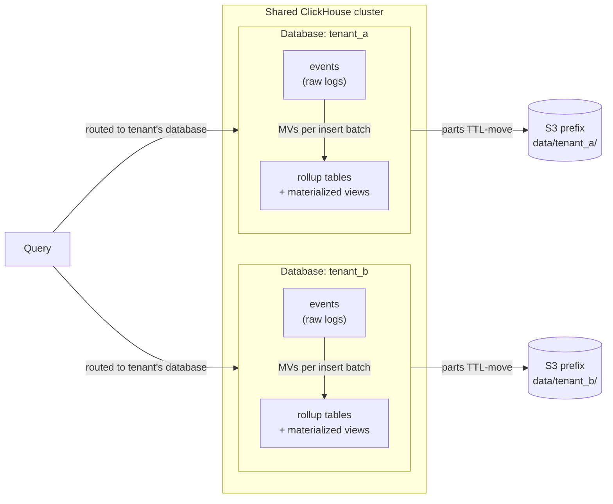
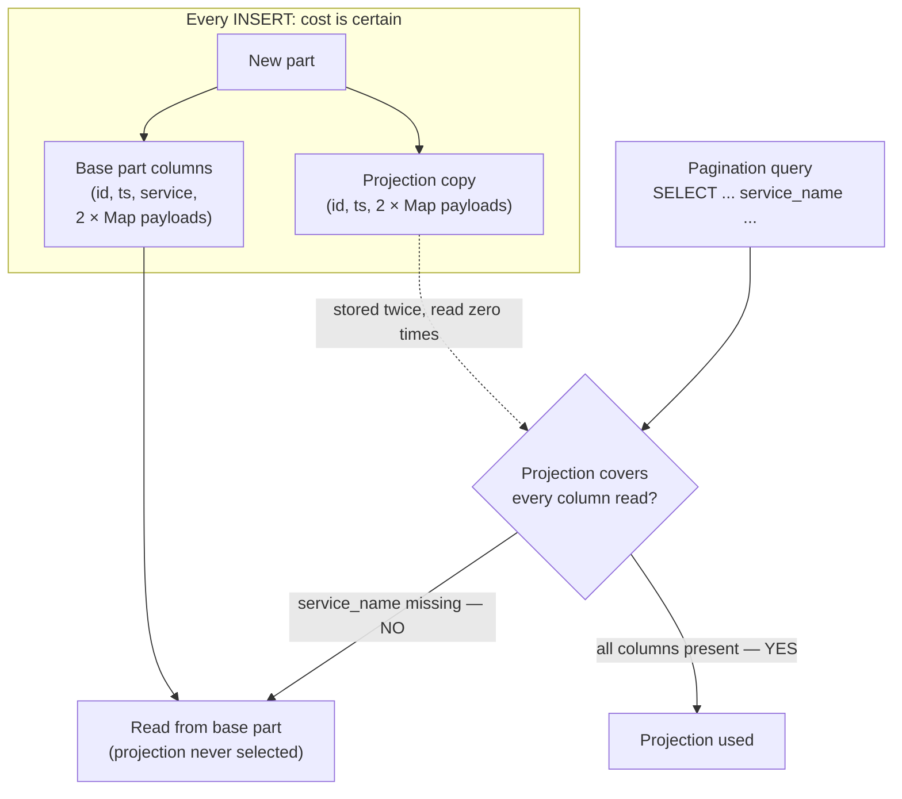
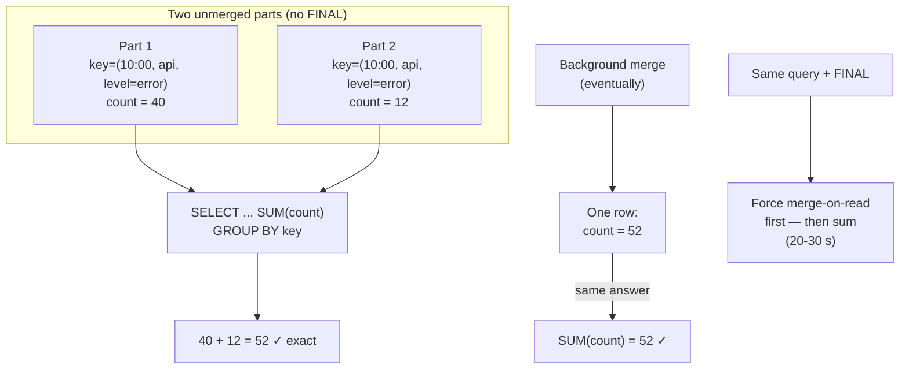
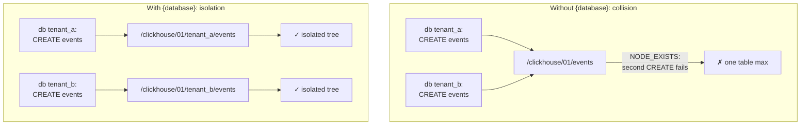
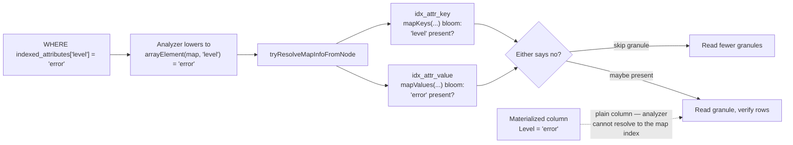
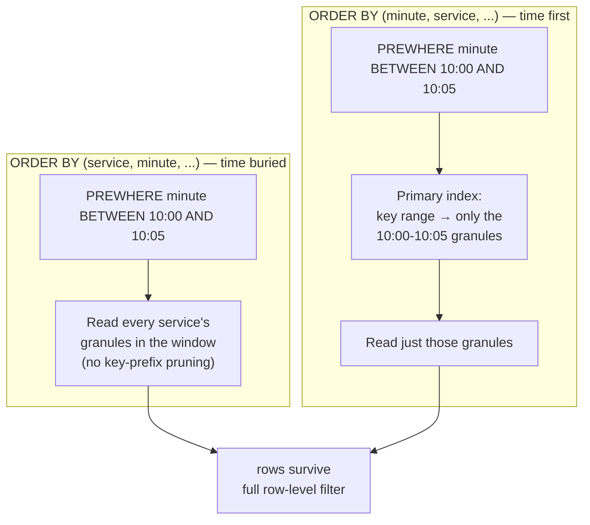
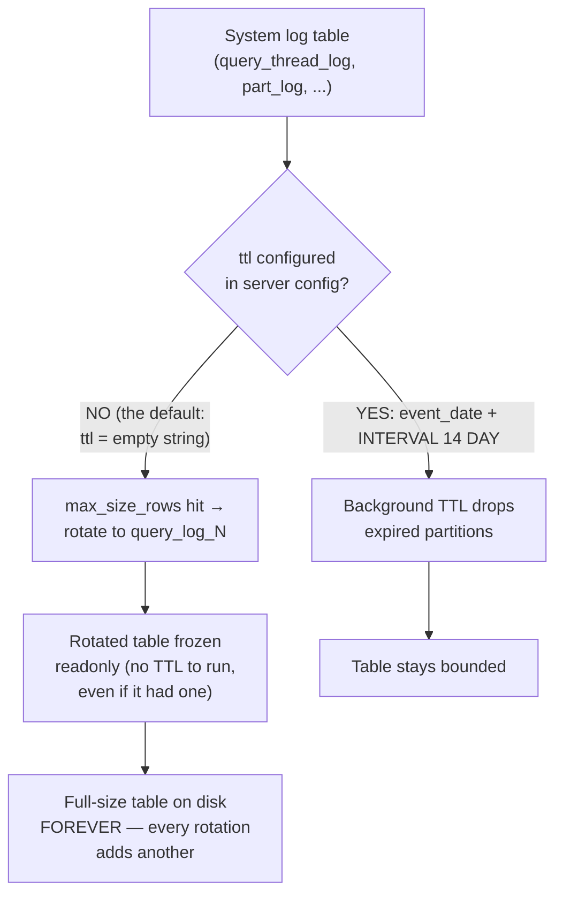
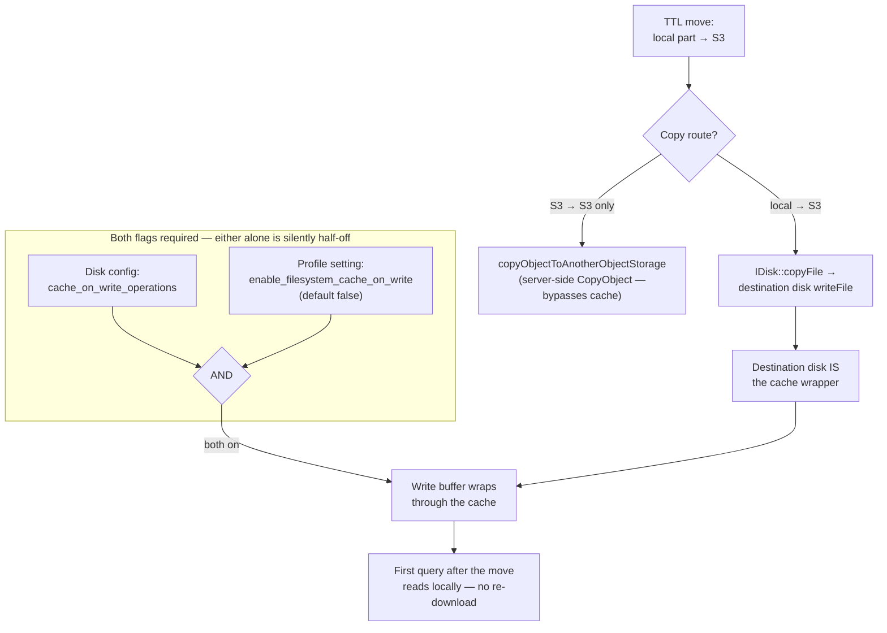

Every ClickHouse tuning article you have ever read has a version it was
true for and a workload it was measured on. Most of them don't say which.
So when a fresh cluster install gave me a clean slate to fix the schema
of a multi-tenant log analytics platform — one ClickHouse database per
tenant, on the shared EC2 cluster this series has been building — I did
the pass differently: every candidate optimization had to be verified in
the ClickHouse 26.8 source tree before it shipped. Not the docs. The
source.

That discipline saved the schema twice — once from folklore being wrong,
and once from *me* being wrong. This post is the seven findings that
survived the source walk: a projection that doubled a table's storage
while being structurally unable to serve a single query, a `FINAL` that
turned facet panels into 20-second merge jobs, the one-line keeper path
detail that decides whether tenant databases can coexist at all, and
four more.

**Key takeaways**

- A projection the planner can never pick is pure storage tax. Mine stored
  the two heaviest payload columns a second time for every part — and
  missed one column the query reads, so it was never selected once.
- `SUM(count)` over SummingMergeTree is exact across unmerged parts.
  `FINAL` is only for reading non-summed columns of specific rows. My
  facet queries dropped from 20-30 seconds to sub-second when it went.
- The implicit `{database}` macro in replicated keeper paths
  ([Macros.cpp](https://github.com/ClickHouse/ClickHouse/blob/b47359294fe0f498ee19c5e31f18a9155b6dedae/src/Common/Macros.cpp#L99))
  is what makes one DDL file serve N tenant databases. Without it,
  same-named tables in different databases collide in Keeper.
- Bloom indexes on `mapKeys()`/`mapValues()` *do* accelerate
  `attributes['k'] = v` predicates in 26.8 — the analyzer resolves
  `arrayElement(map, key)` against the index
  ([MergeTreeIndexBloomFilter.cpp](https://github.com/ClickHouse/ClickHouse/blob/b47359294fe0f498ee19c5e31f18a9155b6dedae/src/Storages/MergeTree/MergeTreeIndexBloomFilter.cpp#L1239)).
  I nearly deleted working indexes on the folklore that they don't.
- System log tables have no default TTL — the config read for
  `<log>/ttl` falls back to an empty string
  ([SystemLog.cpp](https://github.com/ClickHouse/ClickHouse/blob/b47359294fe0f498ee19c5e31f18a9155b6dedae/src/Interpreters/SystemLog.cpp#L205))
  — and rotated log tables without one are frozen readonly
  ([SystemLog.cpp](https://github.com/ClickHouse/ClickHouse/blob/b47359294fe0f498ee19c5e31f18a9155b6dedae/src/Interpreters/SystemLog.cpp#L913)),
  so they are never reclaimed. Configure `partition_by` and `ttl` for
  every log you run.
- The read path decides column order: every stats query arrives as
  `PREWHERE time BETWEEN ...`, so the time column leads the sorting key.
- Write-through caching needs two flags — one on the cache disk, one in
  the default profile — and TTL moves local→S3 do pass through the
  destination disk's write path, so they populate the cache.
{: .key-takeaways}

---

## The setup: one database per tenant

The platform is multi-tenant the simple way: each tenant gets its own
ClickHouse *database* on a shared cluster, and every query is routed
against the tenant's database. No shared-table row filters, no
per-tenant columns — an entire database boundary per tenant. Storage
tiering is the shape this series built: inserts land on local disks,
merged parts TTL-move to per-tenant S3 prefixes, reads go through local
cache disks.

That fresh-install moment is when schema mistakes are cheapest to fix.
The schema is one idempotent SQL file: a raw log table, a chain of
rollup tables fed by materialized views, all `Replicated*` engines with
`ON CLUSTER`. The question I took into the source was simple: what in
this DDL is costing storage or latency that the source says it
shouldn't?



One DDL file, one Keeper cluster, one S3 bucket — N isolated tenant
databases on top. Everything below is about what that one file should
contain.

## A projection that could never run

The log table's DDL carried a pagination projection:

```sql
ALTER TABLE events ADD PROJECTION p_pagination
(
    SELECT id, timestamp, attributes_json, indexed_attributes
    ORDER BY timestamp, id
);
```

The intent was sound: the UI's dominant query is cursor-paginated —
`WHERE timestamp BETWEEN ... ORDER BY timestamp, id LIMIT n`, resuming
from `(timestamp, id) > (previous)`. The base table's key led with a
different column, so the projection gave that access shape its own
storage layout.

Except the query also reads `service_name`:

```sql
SELECT id, timestamp, service_name, attributes_json, indexed_attributes
FROM events
WHERE timestamp BETWEEN ... ORDER BY timestamp, id LIMIT 1000;
```

And a projection is only ever picked when its stored columns cover
everything the query reads. One missing column and the planner cannot
select it — not for this query, not for any query, ever. Meanwhile the
projection is materialized into every part the table writes. In a log
table, the two `Map(String, String)` payload columns are the bulk of the
bytes (this series' measured example: a 182 MiB table shrinks to 78 MiB
with codecs — nearly all of it in the payload). A projection that stores
both payload columns a second time *doubles* the table's footprint to
serve zero queries.

That's the failure mode worth naming: **a projection's cost is certain
and its benefit is conditional.** It pays on every insert, every part,
whether or not the planner ever picks it. The condition is easy to
check and easy to get wrong — one `SELECT` list mismatch disqualifies it
forever, silently. Nothing warns you. `system.query_log` will show the
projection never appearing in a single plan.



There were three ways out:

1. **Fix the projection's column list** — add `service_name`. Now it
   gets picked, but the payloads are still stored twice.
2. **Slim the projection to keys only** — `(id, timestamp)` — and fetch
   payloads in a second query by `id IN (...)`. Halves the duplicate, adds
   an application round-trip.
3. **Drop the projection and give the base table the access shape.**

Option three is the one the source walk made obvious, because of what
the base key was doing: `ORDER BY (toStartOfHour(timestamp),
service_name, timestamp, id)` — an hour-bucket-first layout from an era
when the queries bucketed by hour. For a cursor query over a raw time
range, that key buys nothing: the cursor comparison `(timestamp, id) >
(ts, id)` doesn't match the key prefix, so every part needs sorting at
read time. Re-keying the base table:

```sql
ORDER BY (timestamp, id)
```

makes the pagination query stream by exact key prefix — no projection,
no duplicate bytes, no per-part sort. The materialized-view chain is
unaffected: MVs process the inserted *block*, not the table's stored
layout, so the ORDER BY is invisible to them.

The honest cost: `service_name` left the sorting key, so
service-filtered scans can't prune by key anymore. The fix is a skip
index:

```sql
INDEX idx_service service_name TYPE bloom_filter(0.01) GRANULARITY 1
```

A trade made in the open beats a projection that silently never ran.

## The FINAL that wasn't doing correctness any favors

The rollup tables are `SummingMergeTree` — rows keyed by `(hour,
service, attribute)`, a `count` column, inserted by materialized views
per batch. Every consumer of those tables is an aggregate:

```sql
SELECT attribute_value, SUM(count) AS count
FROM hourly_log_summary
WHERE attribute_key = 'level' AND hour BETWEEN ...
GROUP BY attribute_value;
```

And every one of those queries ended in `FINAL`. The folklore says
SummingMergeTree rows aren't merged until background merges run, so
without FINAL you read partial rows and get wrong counts.

Read the merge algorithm instead
([SummingSortedAlgorithm.cpp](https://github.com/ClickHouse/ClickHouse/blob/b47359294fe0f498ee19c5e31f18a9155b6dedae/src/Processors/Merges/Algorithms/SummingSortedAlgorithm.cpp#L473)):
rows with an equal sorting key collapse; *numeric* non-key columns are
summed; every other column keeps the last value. Two partial rows for
the same key — sitting in two unmerged parts — each carry a partial
count that adds to exactly what the merge would have produced. So:

- `SUM(count)` over unmerged parts equals `SUM(count)` over merged
  parts. The aggregation at query time performs the merge's arithmetic.
- `DISTINCT` over the key columns yields the same set merged or
  unmerged — collapse only ever combines keys, it never introduces or
  removes distinct ones.

`FINAL` was paying full merge-on-read per query — and the price was
known: 20-30 seconds on these tables at this scale, with a thread-limit
setting (`max_final_threads`) that existed purely to manage the damage.
The facet panels issued these queries in bursts.

When *does* a SummingMergeTree query need FINAL? When you read a
non-summed column of a specific row — the merge keeps the last value,
so unmerged parts show multiple candidates and only FINAL collapses
them. `SELECT attribute_value, count FROM ... WHERE key = X` without
aggregation is that pattern. My consumers never do it; they aggregate or
deduplicate. The fix was deleting `FINAL` — and the helper that decided
when to apply it, which had no remaining callers.



The general rule the source hands you: **FINAL is a ReplacingMergeTree
problem.** It exists to collapse versioned duplicates. On SummingMergeTree
your aggregations already are the merge.

## One line that decides whether tenants can coexist

The replicated engines take a Keeper path: the table's identity in the
coordination tree.

```sql
ENGINE = ReplicatedMergeTree('/clickhouse/tables/{shard}/events', '{replica}')
```

Run that same DDL in a second database — tenant B after tenant A — and
the second `CREATE` fails in Keeper: the path is a literal string, and
`{shard}` expands the same in both databases. Two databases, one table
name, one Keeper node. The collision is structural, not a tuning
problem.

The fix is an implicit macro most DDL never uses:

```sql
ENGINE = ReplicatedMergeTree('/clickhouse/tables/{shard}/{database}/events', '{replica}')
```

In [Macros.cpp](https://github.com/ClickHouse/ClickHouse/blob/b47359294fe0f498ee19c5e31f18a9155b6dedae/src/Common/Macros.cpp#L99),
when a macro named `database`, `table`, or `uuid` isn't defined in the
server's `<macros>` config, it expands from the table's own identity —
the database the CREATE runs in. Each tenant database resolves the path
to its own tree in Keeper. One DDL file, N isolated tenants, no
per-tenant templating.

Three caveats the source also teaches:

- Defining a macro literally named `database` in your server config
  *disables* the implicit expansion — the config loader logs a warning
  when it sees one
  ([Macros.cpp](https://github.com/ClickHouse/ClickHouse/blob/b47359294fe0f498ee19c5e31f18a9155b6dedae/src/Common/Macros.cpp#L33)).
- Replicated tables whose paths contain the implicit `{database}` or
  `{table}` refuse to be renamed — the storage checks and declines
  ([StorageReplicatedMergeTree.cpp](https://github.com/ClickHouse/ClickHouse/blob/b47359294fe0f498ee19c5e31f18a9155b6dedae/src/Storages/StorageReplicatedMergeTree.cpp#L7569)).
  The path is the identity; renames would re-key it.
- `ON CLUSTER` DDL executes per database context — each replica expands
  `{database}` against the database it's creating in, which is the
  tenant's. The macro and the DDL queue agree.



## The index claim I got backwards

Mid-pass I nearly committed a "cleanup": the log table carried bloom
filter indexes over the attribute map:

```sql
INDEX idx_attr_key   mapKeys(indexed_attributes)   TYPE bloom_filter(0.01) GRANULARITY 1,
INDEX idx_attr_value mapValues(indexed_attributes) TYPE bloom_filter(0.01) GRANULARITY 1
```

Folklore says these only accelerate `has()`/`mapExists()`-style
predicates, and my queries filter with subscripts —
`indexed_attributes['level'] = 'error'`. Dead weight, I thought. Write
cost on every part, zero read benefit. Delete.

Then I read the bloom filter's condition analyzer
([MergeTreeIndexBloomFilter.cpp](https://github.com/ClickHouse/ClickHouse/blob/b47359294fe0f498ee19c5e31f18a9155b6dedae/src/Storages/MergeTree/MergeTreeIndexBloomFilter.cpp#L1239))
and it explicitly handles `arrayElement(map, 'key') = value` — the lowered
form of every `map['key'] = value` predicate — resolving the map column
and the key against the indexed `mapKeys()`/`mapValues()` expressions,
hashing the key into the keys index and the value into the values
index. `IN (set)` too
([same file, the IN branch](https://github.com/ClickHouse/ClickHouse/blob/b47359294fe0f498ee19c5e31f18a9155b6dedae/src/Storages/MergeTree/MergeTreeIndexBloomFilter.cpp#L708)).
The indexes I was about to delete were accelerating the exact predicate
shape my queries use.

One genuine dead end the source did confirm: the rollup tables
materialize common facet keys as real columns, and a predicate on a
*materialized* column is invisible to the map index — the analyzer only
resolves `arrayElement()` calls and generated map subcolumns
([tryResolveMapInfoFromNode](https://github.com/ClickHouse/ClickHouse/blob/b47359294fe0f498ee19c5e31f18a9155b6dedae/src/Storages/MergeTree/MergeTreeIndexBloomFilter.cpp#L293));
a plain materialized column is neither, so those predicates are on
their own.

The lesson isn't about bloom filters. It's that **"this index is dead
weight" is a source-verifiable claim, and I was about to ship it on
hearsay.** `EXPLAIN indexes = 1` names which indexes a plan actually
uses — cheaper than being wrong in production either direction.



## The time column goes first

The rollup tables were keyed service-first:

```sql
ORDER BY (service_name, minute, attributes)
```

Every stats query arrives time-bounded:

```sql
SELECT toStartOfInterval(minute, INTERVAL 5 MINUTE, 'UTC') AS window_start,
       SUM(count) AS log_count
FROM minutes_log_index_summary
PREWHERE minute BETWEEN '...' AND '...'
GROUP BY window_start;
```

With the service column leading the key, the time predicate can't prune
by key prefix — the scan walks every service's granules in the window.
Re-keying time-first:

```sql
ORDER BY (minute, service_name, attributes)
```

puts the dominant predicate on the leading column, where MergeTree's
granule skipping actually works. `PREWHERE` keeps the payload columns
untouched until the filtered rows are known — the key order is what
decides how many granules survive.



The SummingMergeTree semantics are untouched by the re-keying: collapse
happens on *full* sorting-key equality, which is order-independent.
`(minute, service, attributes)` merges exactly the same rows
`(service, minute, attributes)` does. Only the read path changes.

Two more TTL details from the same pass, both from the source's
behavior rather than any doc:

- **`ttl_only_drop_parts = 1` everywhere.** A part whose rows are all
  past the TTL is dropped as an object; with day partitions and
  day-bounded retention, expiry becomes one metadata-only DELETE per
  part instead of a row rewrite. My rollups were partitioned weekly
  with daily TTL and missing the setting — the worst case: a part almost
  always contains some live rows, so every expiry rewrites.
- **Align retention across the chain.** The minute rollup expired a day
  *before* the raw table. Stats silently cover less history than the raw
  logs users can still pull. Align them or explain the gap.

## The system log that never expires

Not a tenant table, but the same disk: ClickHouse's own log tables.
The spec configured `query_log` with a TTL — 14 days, partitioned
monthly — and configured `query_thread_log`, `part_log`, and
`metric_log` with sizes and flush intervals but no TTL at all.

The base class says why that's a leak — the config read for a system
log's `ttl` defaults to an empty string, which builds the table with no
TTL clause at all
([SystemLog.cpp](https://github.com/ClickHouse/ClickHouse/blob/b47359294fe0f498ee19c5e31f18a9155b6dedae/src/Interpreters/SystemLog.cpp#L205)):

```cpp
/// TTL expr is not necessary.
String ttl = config.getString(config_prefix + ".ttl", "");
if (!ttl.empty())
    log_settings.engine += " TTL " + ttl;
```

Most system logs are created with **no TTL**. Unbounded is bad enough —
but the rotation logic in
[SystemLog.cpp](https://github.com/ClickHouse/ClickHouse/blob/b47359294fe0f498ee19c5e31f18a9155b6dedae/src/Interpreters/SystemLog.cpp#L913)
makes it permanent: when a log hits `max_size_rows`, the existing table
is renamed (`query_log_0`, `query_log_1`, …) and the rotated table is
frozen **readonly** as an optimization, so it wastes no CPU on
background work. Readonly tables don't run TTL drops. The comment in
the source is explicit: only the logs configured *with* a TTL stay
writable and reclaimed. Every TTL-less rotation leaves a frozen,
full-sized table on disk forever.

`query_thread_log` is the fastest grower of the family — one row per
*thread* per query, so a 32-thread query logs 32 rows. `part_log` is the
one you want kept for diagnosing hot→S3 part moves, which makes it the
one you'll miss if it rotates into a readonly brick. The fix is
mechanical:



```yaml
part_log/partition_by: "toYYYYMM(event_date)"
part_log/ttl: "event_date + INTERVAL 14 DAY DELETE"
query_thread_log/partition_by: "toYYYYMM(event_date)"
query_thread_log/ttl: "event_date + INTERVAL 14 DAY DELETE"
```

…for every log the cluster runs.

## Write-through caching is two flags, and TTL moves do populate the cache

Last one, from the storage side of the tiering setup. A cache disk
(`type=cache`) wrapping an S3 disk can write-through — caching bytes as
they're written, not just as they're read back — but only if *both* of
these are set:

- `cache_on_write_operations` on the cache disk in the storage config,
- `enable_filesystem_cache_on_write_operations` in the default profile —
  **default `false`**, and the setting's own documentation names the
  pairing: write-through is enabled "as long as `cache_on_write_operations`
  is turned on in the server config's cache disk configuration section"
  ([Settings.cpp](https://github.com/ClickHouse/ClickHouse/blob/b47359294fe0f498ee19c5e31f18a9155b6dedae/src/Core/Settings.cpp#L7263)).

The write path checks both before wrapping the write buffer
([CachedObjectStorage.cpp](https://github.com/ClickHouse/ClickHouse/blob/b47359294fe0f498ee19c5e31f18a9155b6dedae/src/Disks/DiskObjectStorage/ObjectStorages/Cached/CachedObjectStorage.cpp#L125)).
One flag without the other is silently half-on.

The subtler question was whether TTL moves — local disk → S3, the tiering
heartbeat — even pass through the cache. The copy shortcut that would
bypass it is the S3 server-side `CopyObject` (`copyObjectToAnotherObjectStorage`),
but that path only applies S3→S3. A local→S3 move goes
`copyDirectoryContent` → `copyFile` → the *destination* disk's
`writeFile`
([IDisk.cpp](https://github.com/ClickHouse/ClickHouse/blob/b47359294fe0f498ee19c5e31f18a9155b6dedae/src/Disks/IDisk.cpp#L63))
— and the destination disk is the cache wrapper. So with both flags set,
a part TTL-moved to S3 is written through the cache on its way up, and
the first query after the move reads it locally instead of
re-downloading it.

That's a paragraph you can only write by reading the copy path. No doc
I've found states whether moves populate the cache; the source does.



## What transfers

The fixes are tenant-database-specific in their details. The method is
the transferable part:

- **Pin the version you run, read the source at that version.** Every
  claim here was checked against the 26.8 tree this cluster runs.
  Folklore has a version it was true for; the source has yours.
- **Costs are certain, benefits are conditional.** Projections, skip
  indexes, TTL rules — they all pay on write. Verify the condition
  (`EXPLAIN`, `system.query_log`) before paying, and again before
  *removing* one that looks dead.
- **Let the read path pick the key.** Time-bounded queries want the
  time column leading. Cursor queries want the cursor tuple to match the
  key prefix. The engine family's collapse semantics are
  order-independent — the read path is the only thing your key order
  decides.
- **The merge math is knowable.** SummingMergeTree sums numeric
  non-key columns at merge; your `SUM()` does the same arithmetic at
  query time. FINAL is for ReplacingMergeTree-shaped problems, not
  aggregation-shaped ones.

The multi-tenant schema is now one idempotent file — replicated engines,
`{database}` in every keeper path, time-first keys, TTLs aligned with
the partition grain — and it applies cleanly to every tenant database
the cluster adds.

Previous: [The S3 Path Bug Nobody Sees: Silent Config, Shattered Tenants, and a CAS-Ready Fix](/blog/clickhouse-s3-key-prefix-silent-config-bug/).

Series index: [ClickHouse on AWS: Self-Managed from First Principles](/series/clickhouse-on-aws/).
