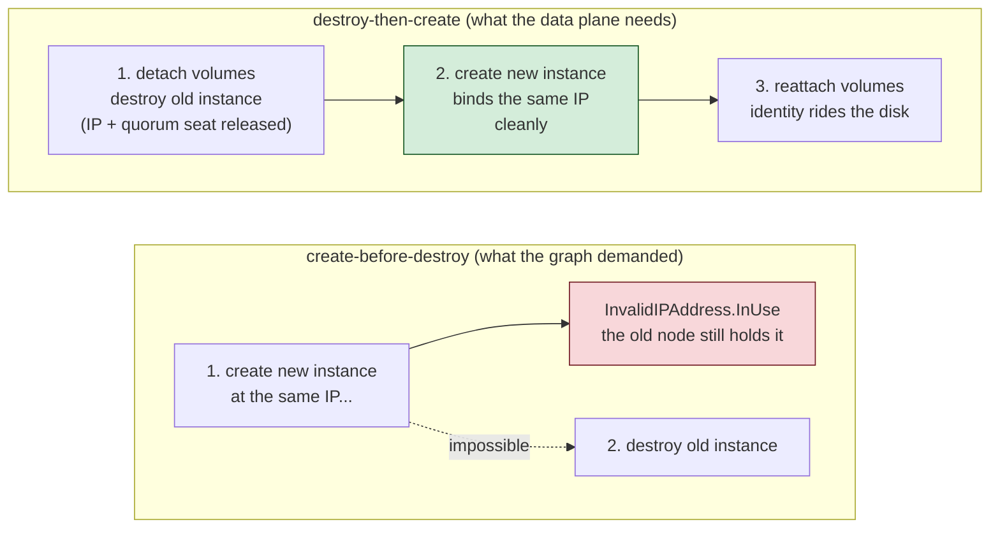

The error message was almost polite:

```
Error: creating EC2 Instance: ... api error InvalidIPAddress.InUse:
Address 10.0.1.10 is in use.
```

The apply was a routine one: roll the [golden
image](https://www.packer.io/docs/concepts/builders/amazon/image) on the
ClickHouse writer and keeper — two machines that, between them, hold every
ingested row and the coordination state that keeps the replicas honest.
A new image had been built; the instances needed to be replaced; the
plan said two resources would be
`replaced`. It did not say the apply would fail before touching either
node, then fail the same way an hour later after I "fixed" it.

This post is about what `InvalidIPAddress.InUse` was really telling me:
the replacement was being run in the wrong *order*. Not the wrong
*plan* — the ordering rule buried in it. Getting there meant reading
Terraform's dependency graph the way the graph itself reads it, which
is a genuinely entertaining place to spend an afternoon. Along the way
we'll meet the `ForcedCBDTransformer` (real name, [real
code](https://github.com/opentofu/opentofu/blob/main/internal/tofu/transform_destroy_cbd.go)),
learn why a `create_before_destroy` flag on a resource that *did not
exist* could still break a database rollout, and pin down exactly when
destroy-then-create is a design decision rather than a default.

**Key takeaways**

- Replacement ordering — destroy-then-create (D-T-C) vs
  create-before-destroy (CBD) — is a **data-plane decision with
  correctness consequences**, not a style preference. Exclusive
  resources (static IPs, EBS attachments, quorum seats) require D-T-C.
- Terraform **propagates CBD through the dependency graph**: a flag on
  one resource flips the ordering of every resource it (transitively)
  depends on — [by
  design](https://developer.hashicorp.com/terraform/language/meta-arguments/lifecycle#create_before_destroy-and-resource-dependencies),
  because mixed ordering would cycle the graph.
- A CBD flag poisons the graph **even when the flagged resource has
  `count = 0`** and never exists at runtime. The plan graph keeps the
  expand node; the transformer keeps the flag.
- You can read the intended ordering **before applying**: in the plan
  JSON, `["delete","create"]` is D-T-C and `["create","delete"]` is
  CBD. When it's wrong, `TF_LOG=TRACE` shows the transformer naming
  its reasons, one line per flip.
{: .key-takeaways}

## The anatomy of a replaceable node

First, why these nodes are different from the average web server.

In a self-managed ClickHouse cluster on EC2, the writer and the keepers
are *fixed-identity* machines. Each one gets a static private IP
carved out of the node subnet — the writer at `10.0.1.10`, the first
keeper at `10.0.1.20`. The address is not a convenience. It is wired
into everything:

- **DNS** — Route 53 private-zone A records map `writer-0` to the
  address; the cluster's `remote_servers` config resolves peers by name
  into those records.
- **Replication** — nodes fetch parts from each other over the
  interserver port at those addresses.
- **Coordination** — [ClickHouse
  Keeper](https://clickhouse.com/docs/en/guides/sre/keeper-and-zookeeper),
  the ZooKeeper-compatible coordination service, runs a raft
  configuration whose members address each other by exactly these
  names.
- **Volume identity** — each node's EBS volumes (the S3 metadata
  catalog for the writer, the raft log for the keeper) reattach to
  whatever instance claims the static identity after a swap.

So an image roll means: destroy the old instance, and create its
successor *at the same address*, with the same volumes, taking over the
same name. The stack even documents the discipline, in a comment:

```hcl
# NOTE: replacements are destroy-then-create (no create_before_destroy):
# the static private_ip cannot be bound while the old instance holds it,
# so CBD would always fail with InvalidIPAddress.InUse.
resource "aws_instance" "writer" {
  # ...
  private_ip = local.writer_ips[count.index]
}
```

That comment had been true for months. Then one day the plan quietly
stopped honoring it.

## The tell is in the plan JSON

After the first failed apply, I did what the error suggested: waited,
retried. Second apply, same error. The old instances were still
running, still holding their addresses — both failed applies had
*created nothing and destroyed nothing*, which was the first real clue:
Terraform was trying to make the new nodes **before** retiring the old
ones.

You can see replacement ordering explicitly in the plan's JSON form.
Save a plan and inspect it:

```console
$ tofu plan -out=roll.tfplan
$ tofu show -json roll.tfplan | jq -r '.resource_changes[]
    | select(.address | contains("aws_instance"))
    | "\(.address) \(.change.actions)"'
module.compute.aws_instance.writer[0]  ["create","delete"]
module.compute.aws_instance.keeper[0]  ["create","delete"]
```

That array is the ordering. Two actions, two possible sequences:

| Actions array | Ordering | Meaning |
|---|---|---|
| `["delete","create"]` | destroy-then-create | default; old node dies, then the replacement is made |
| `["create","delete"]` | create-before-destroy | the replacement is made first, then the old node dies |

My instances — the ones whose config *said* "no create_before_destroy"
— were planning `["create","delete"]`. The writer and keeper had been
silently upgraded to CBD, and every apply was dying on the one
guaranteed consequence of it: two instances contending for one IP.

The plan doesn't print *why*. For that, you go to the trace log.

## The transformer that decides, in its own words

Terraform's plan phase builds a graph of every resource and edge, then
runs a series of transformers over it. One of them exists purely to
decide this question. From
[`internal/tofu/transform_destroy_cbd.go`](https://github.com/opentofu/opentofu/blob/main/internal/tofu/transform_destroy_cbd.go)
(same file in [Terraform
itself](https://github.com/hashicorp/terraform/blob/main/internal/terraform/transform_destroy_cbd.go)):

```go
// ForcedCBDTransformer detects when a particular CBD-able graph node has
// dependencies with another that has create_before_destroy set that require
// it to be forced on, and forces it on.
func (t *ForcedCBDTransformer) Transform(_ context.Context, g *Graph) error {
	for _, v := range g.Vertices() {
		// ...
		if !dn.CreateBeforeDestroy() {
			// If there are no CBD descendent (dependent nodes), then we
			// do nothing here.
			if !t.hasCBDDescendent(g, v) {
				continue
			}
			// ... we need to auto-upgrade this node to CBD.
			if err := dn.ModifyCreateBeforeDestroy(true); err != nil {
```

Read the shape of that walk: for every node, look at everything that
*depends on it* (the code calls them descendants). If any descendant is
CBD, flip this node to CBD too. And the reason is not a heuristic about
what's safer — it's graph theory. If node B depends on node A, B's
replacement cannot be created *before* A's while also being destroyed
*after* A's — mixed orderings between a node and its dependencies
produce cycles. The transformer's cure for the cycle is to make the
flag uniform across the chain.

The [official lifecycle
reference](https://developer.hashicorp.com/terraform/language/meta-arguments/lifecycle#create_before_destroy-and-resource-dependencies)
says the same thing in one sentence, in a section literally titled
"*`create_before_destroy` and resource dependencies*":

> Terraform propagates and applies `create_before_destroy` behavior to
> all resource dependencies.

Now run the plan with the trace enabled and let the transformer confess:

```console
$ TF_LOG=TRACE tofu plan -out=roll.tfplan 2>&1 | grep ForcedCBD
... ForcedCBDTransformer: "module.compute.aws_instance.writer (expand)"
    has CBD descendent "module.dns_tls.aws_acm_certificate.nlb (expand)"
... ForcedCBDTransformer: forcing create_before_destroy on for
    "module.compute.aws_instance.writer (expand)"
... ForcedCBDTransformer: "module.compute.aws_instance.keeper (expand)"
    has CBD descendent "module.compute.aws_volume_attachment.keeper_raft (expand)"
... ForcedCBDTransformer: forcing create_before_destroy on for
    "module.compute.aws_instance.keeper (expand)"
```

Two different descendants, two different vectors, one broken roll.

## Vector one: a certificate that wasn't even there

The writer's CBD descendant was an ACM certificate:

```hcl
resource "aws_acm_certificate" "nlb" {
  count = var.nlb_tls_mode == "acm" && var.acm_certificate_arn == null ? 1 : 0
  # ...
  lifecycle {
    create_before_destroy = true
  }
}
```

Look at that `count`. In this cluster's current mode, a pre-provisioned
certificate ARN is passed in, so the expression evaluates to zero. The
certificate **does not exist**. No ACM resource is created, renewed, or
destroyed by any apply.

It doesn't matter. The plan graph contains the expand node for
`count = 0` resources — the node exists, carrying its lifecycle flag,
with edges to the rest of the stack. The transformer walks it, sees CBD
on it, and everything upstream — through the DNS/TLS module, through
the load balancer records, all the way to the database instance — gets
"auto-upgraded" to a replacement ordering that cannot work.

That's the part I'd gotten wrong for months of reading that lifecycle
block: I evaluated it as *runtime* config. It's *graph* config. A flag
you never "use" still gets a vote.

## Vector two: the volume that must not be in two places

The keeper's descendant was its own raft volume attachment:

```hcl
resource "aws_volume_attachment" "keeper_raft" {
  device_name = "/dev/sdf"
  volume_id   = aws_ebs_volume.keeper_raft[count.index].id
  instance_id = aws_instance.keeper[count.index].id
}
```

This one has no `lifecycle` block at all — which meant it inherited a
provider default of create-before-destroy (sensible for the AWS
provider's own reasons), and the transformer enforced the same
uniformity upward: an attachment being CBD implies the keeper instance
is CBD.

Here the domain stakes are the clearest, because an EBS volume is the
definition of an exclusive resource. A volume may briefly be attached
to *no one* — that's a normal moment during a node swap. It may never
be attached to *two* instances; the API will not allow it, and even if
it did, two writers on one raft log is the definition of split-brain.
The keeper's whole identity — its `server_id`, its log entries, the
raft term history — lives on that volume
([the myid file](https://clickhouse.com/docs/en/guides/sre/keeper-and-zookeeper#understanding-raft-configuration),
then the log itself). The only sane choreography is:

1. detach the volume from the old keeper,
2. destroy the old keeper (releasing its IP and its quorum seat),
3. create the new keeper at the same IP,
4. attach the volume — identity rides the disk into the new instance.

Each of those steps must strictly follow the previous one. That is
destroy-then-create, four times in a row.

## The fix is subtraction

Here's the part that makes this a good story: both bugs were **removed
lines**.

For the ACM certificate, the flag went away entirely. Certificates are
ARN-addressed — a replacement has no name collision to avoid, so there
is nothing CBD is *for* there:

```hcl
resource "aws_acm_certificate" "nlb" {
  count = var.nlb_tls_mode == "acm" && var.acm_certificate_arn == null ? 1 : 0
  # ...
  # NO create_before_destroy here, deliberately: the ForcedCBDTransformer
  # propagates the flag to every transitive dependency, and this node's
  # flag poisons the graph even when count = 0.
}
```

For the attachments, the fix was the explicit negative:

```hcl
resource "aws_volume_attachment" "keeper_raft" {
  # ...
  lifecycle {
    create_before_destroy = false
  }
}
```

And for the writer there was a third, sneakier subtraction. Somewhere
in the stack the instance block carried:

```hcl
depends_on = [aws_lb.writers]
```

The load balancer in front of the writers *is* legitimately CBD — it's
renamed per generation to dodge the region-unique name collision, the
classic pattern the lifecycle docs recommend CBD for. But `depends_on`
is an edge, and an edge is all the transformer needs: writer depends on
LB, LB is CBD, therefore writer is CBD. The edge had been added years
back for a greenfield-ordering concern that had long since been
solved another way (target registration goes through the *static IPs*,
not the instance IDs). Deleting the `depends_on` removed the last edge
the poison could travel on.

After the three changes:

```console
$ tofu plan -out=roll.tfplan
$ tofu show -json roll.tfplan | jq -r '.resource_changes[]
    | select(.address | contains("aws_instance"))
    | "\(.address) \(.change.actions)"'
module.compute.aws_instance.writer[0]  ["delete","create"]
module.compute.aws_instance.keeper[0]  ["delete","create"]
```

`["delete","create"]`. The apply rolled: attachments detached and
destroyed, both instances destroyed, both replacements created at
their addresses on the first attempt, volumes reattached, keeper
rejoined its own raft log, writer re-registered under its existing
replica name. No address contention, because contention had become
impossible.



## Why ClickHouse makes you care

None of this is ClickHouse-specific — any quorum member, any
static-IP service, any reattachable volume hits the same wall. But
ClickHouse concentrates all three exclusivities into one replacement
window:

- **The address is identity.** Everything from `remote_servers` to the
  keeper's raft configuration resolves the node by its address. An
  address held by two instances during a swap isn't downtime; it's
  ambiguous identity, which is how you get parts fetched from a node
  that believes it's someone else.
- **The volume is memory.** The raft log *is* the keeper's continuity
  — its term history, its membership. The myid file on it pins the
  server ID; a keeper that boots with the right disk is the same
  member it always was, and a keeper that boots without it is a
  stranger the ensemble will refuse to re-admit.
- **The quorum seat is shared state.** Replace a keeper in a
  three-node ensemble with CBD and for the duration you have four
  members; replace it D-T-C and you briefly have two — under quorum,
  by design, for seconds, the way every rolling restart of every
  distributed system works.

So the "default" ordering — destroy, then create — isn't a fallback
you tolerate. For this class of resource it's the *specification*,
and the graph's job is to keep from overriding it.

## A checklist for the next static-IP rollout

1. **Read ordering, not just actions.** When a plan says `must be
   replaced` for anything with an exclusive resource inside it, check
   the JSON's actions array. `["create","delete"]` on a fixed-address
   node is a stopped-clock finding.
2. **Give CBD a job description.** The flag earns its keep exactly when
   the old and new object must briefly coexist to hand off something
   *the platform* tracks — name-based DNS cutover, a load balancer's
   target list. It has no business on resources that are themselves
   exclusive.
3. **Audit `depends_on` like it's a security group rule.** Every edge
   is a path the transformer can propagate flags along. Edges added
   for ordering reasons years ago are the usual culprits.
4. **Remember `count = 0` is not `absent`.** The node is in the graph;
   its flags vote. If a mode toggle disables a resource entirely, ask
   whether its lifecycle block should be behind the same toggle.
5. **When confused, read the engine's trace.** `TF_LOG=TRACE` on a
   plan costs minutes and prints the transformer's decisions with
   each descendant named. It is the most underused debugging tool in
   the Terraform ecosystem.
6. **Let failed CBD applies teach you.** The failure mode is clean:
   creates fail, destroys never run, old nodes keep serving. That's
   why this story ends well — the data plane was never actually at
   risk, only the rollout was. Fix the graph, re-plan, re-apply.

Destroy, then create. For exclusive resources it's not the default
because it's easy — it's the default because it's the only sequence the
resources themselves will permit. The graph is powerful; the data plane
is honest; and every so often the two of them disagree in a log line
that names exactly where.

---

*Related in this series: [why replica identity must survive instance
replacement](/blog/clickhouse-spot-readers-stable-identity/), [what a
config re-render can silently re-key](/blog/clickhouse-replica-identity-config-render/),
and [treating the boot sequence as a contract](/blog/clickhouse-boot-sequence-contract/).*
