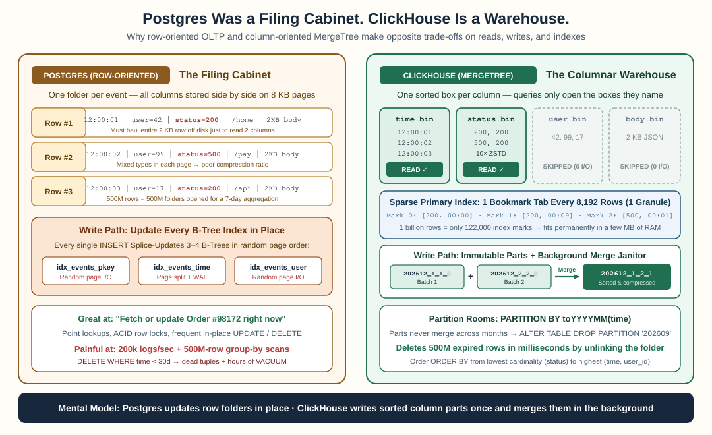
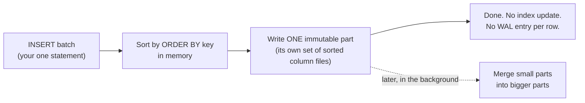
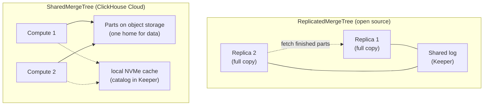
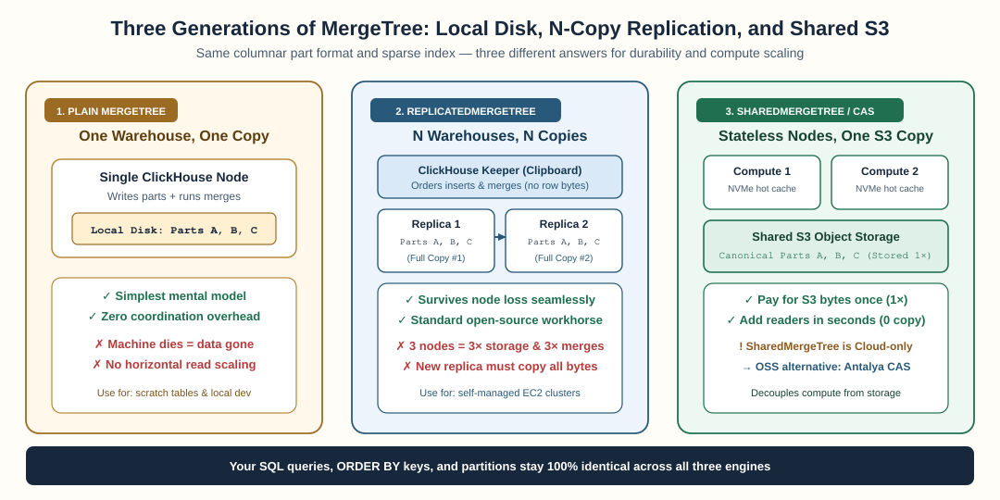

If you already write SQL, you are 30 minutes away from understanding
ClickHouse. Not because it's small — because almost everything about it
is a *rational answer to one question*, and once you know the question,
the weird parts stop being weird.

The question: **what does storage look like when reads are a thousand
times rarer than writes, each read touches a billion rows, and the data
never changes once it lands?**

Postgres answers a different question — "what does storage look like
when any row might be fetched or updated at any moment?" — and answers
it brilliantly. This post walks from zero to ClickHouse's answer, with
a Postgres translator at every step, and ends at the design that
ClickHouse Cloud runs: SharedMergeTree.

## Step 0: the five-year-old's question

Before any SQL, one picture — the one that survives even after you
forget everything else.

> **ELI5:** Imagine you write down every event that happens in your
> day, each on its own card. A Postgres database is a **filing
> cabinet**: each drawer is a row, holding that event's time, its
> name, and everything about it, all together in one folder. To ask
> "how many events happened before noon?" you must open *every folder*
> and check.
>
> A ClickHouse database is a **warehouse**: every piece of information
> goes into its own labeled box. All the *times* in one box, sorted.
> All the *names* in another box, sorted. To ask "how many before
> noon?" you open only the *time* box, run your finger down the sorted
> stack, and stop when you pass noon. You never touched the other
> boxes.

That's the whole religion: **store by column so reading less means
opening less.** Everything else in this post is machinery to make that
warehouse stay fast while trucks dump a million cards per second at
the loading dock.



*Postgres stores all columns of a row in one folder and updates B-Tree indexes on every write; ClickHouse stores each column in its own sorted box with a sparse 8,192-row granule index and merges immutable parts in the background.*

## Step 1: the read-side difference (why columns at all)

You know this SQL:

```sql
SELECT status, count(*)
FROM events
WHERE timestamp >= now() - INTERVAL 1 DAY
GROUP BY status;
```

In Postgres, even with an index on `timestamp`, the executor fetches
**rows** — every matching row's full heap tuple (all 40 columns)
or at minimum index-then-heap lookups for the two columns you named.
In ClickHouse, that query opens **two column files** — `timestamp` and
`status` — inside each data block it can't skip. The other 38 columns
are never read from disk at all. On a billion-row day, that's the
difference between "read everything" and "read ~5% of the bytes."

**The Postgres translator:** a heap page stores rows together; a
column file stores one field of many rows together. Postgres does have
columnar options (the `zed` extension), but the point stands — Postgres
chose row layout for point-lookups and writes; ClickHouse chose column
layout for scans and compression. Sorted, similar values next to each
other also compress ~10× better, which compounds: less disk, less
bandwidth, faster scans.

When is the row layout *right*? When you need `WHERE id = 42` to return
one row in a millisecond, and you want to `UPDATE` it a moment later.
Keep Postgres for that. These systems are not enemies; most real
architectures run both.

## Step 2: the write-side trick — there is no index to update

Here's the first thing that feels *wrong* to a Postgres person, and
it's actually the source of ClickHouse's insert speed.

In Postgres, an INSERT touches: the heap page, **every** index on the
table (b-tree insert with possible page splits), the WAL, and MVCC
bookkeeping. Write amplification: one logical insert, maybe a dozen
physical writes. You pay this because a moment later someone might
`SELECT` by any indexed column and must find the row instantly.

ClickHouse's bet: **nobody is going to fetch this row by ID in a
millisecond. They're going to aggregate it next week.** So an INSERT
pays *zero* index maintenance:



Each INSERT writes a self-contained mini-table — a **part** — with
every column sorted by the table's ORDER BY key inside it. No part is
ever modified after it's written. That's the whole write path.

**The Postgres translator:** a part is like a frozen, perfectly sorted
slice of the heap plus its own tiny index — written in one burst, never
vacuumed in place. Write amplification: one.

## Step 3: the index — ORDER BY, and "the table IS the index"

In Postgres you declare a PRIMARY KEY and the engine builds a b-tree
pointing into the heap. Index and table are separate things.

In ClickHouse you declare an ORDER BY and the *data itself* is sorted
by it — the index isn't beside the table, the table **is** the index.
How can you search sorted data without a per-row index? The **sparse
index**: rows are grouped into blocks (**granules**) of 8,192 rows, and
ClickHouse records only each granule's key range.

> **ELI5:** a phone book doesn't have an index card for every name.
> It has tab labels every ~50 pages: "K–M starts here." To find
> "Kumar," you jump to the K–M tab, then flip through a handful of
> pages. One tab per 50 pages instead of one card per name — that's
> why the index is a few kilobytes per million rows and lives entirely
> in RAM.

```sql
CREATE TABLE events
(
    timestamp DateTime64(9),
    service   LowCardinality(String),
    status    LowCardinality(String),
    ...
)
ENGINE = MergeTree
PARTITION BY toYYYYMMDD(timestamp)
ORDER BY (timestamp, service);
```

- `WHERE timestamp BETWEEN ...` — granule skipping kicks in, reads a
  fraction of the table. Fast.
- `WHERE service = 'auth'` (no timestamp) — can't use the sort order
  of a `(timestamp, service)` key any more than Postgres can use a
  composite b-tree's second column without the first. You scan.

**The Postgres translator:** ORDER BY's prefix rule is exactly a
composite b-tree's leftmost-prefix rule. And the ClickHouse fix for
"query a non-leading column" is the same shape as a secondary index,
but built for the block world: a **bloom-filter skip index** — a
per-granule checklist that says "trace IDs starting with `4a` are
definitely not in this block." It can't point to rows; it only lets
scans *skip blocks*. That's the entire index vocabulary.

## Step 4: partitions — the DROP PARTITION superpower

```sql
PARTITION BY toYYYYMMDD(timestamp)
```

Partitions are like Postgres' declarative partitioning (each is a
separate directory tree), but they interact with the immutable-part
design in a way that gives you two superpowers:

1. **DROP PARTITION is instant.** Deleting yesterday is one metadata
   operation, not a query that marks rows dead and vacuums later.
2. **TTL is a first-class rule.** `TTL timestamp + INTERVAL 30 DAY`
   makes retention part of the table definition — background merges
   drop expired partitions without any cron job.

> **ELI5:** retention in Postgres is shredding old documents out of
> folders, page by page, then paying someone (autovacuum) to sweep the
> shreds. Retention in ClickHouse is wheeling yesterday's whole cabinet
> out of the warehouse in one trip.

## Step 5: merges — the background janitor (and the one way to break it)

Immutable sorted parts are great until you have a million of them. So
a background worker continuously folds small parts into bigger ones:
**merges**. Merges never change contents — same rows, same sort order,
just repackaged into fewer, larger parts.

- **The Postgres translator:** merges are ClickHouse's autovacuum —
  a background process that keeps storage healthy, whose failure mode
  is a count you can watch. Except the metric isn't dead tuples, it's
  **parts per partition**: at 1,000 active parts per partition inserts
  start being *delayed* (the server protects itself); at 3,000 they're
  *rejected* with "Too many parts."

The cause is always the same: **tiny inserts**. Each INSERT = one part,
so 10 inserts/second = 36,000 parts/hour — the janitor can't keep up.
This is the one failure mode every new ClickHouse operator personally
triggers, and it's why the culture says *never insert row-by-row*:

- Batch in the app (aim for at most ~1 insert per second per table,
  as large as you can), or
- turn on **asynchronous inserts**
  (`async_insert = 1`): the server buffers small sends from many
  clients and makes one part per flush — the loading dock consolidates
  many small trucks into one pallet before shelving.

## Step 6: mutations — the honest "UPDATE"

So rows are immutable. What about `UPDATE` and `DELETE`?

- **UPDATE in ClickHouse is a batch job.** A
  `ALTER TABLE ... UPDATE` (a *mutation*) rewrites the affected parts —
  new versions of the files, old ones dropped after. Right tool:
  backfilling a column for a million rows. Wrong tool: changing one
  user's email — that's a full-part rewrite for a one-row change.
- **DELETE** is the same: batch mutations, or lightweight *deletes*
  (tombstones — small markers that hide rows; the underlying data is
  cleaned up by later merges).
- **ReplacingMergeTree** is the idiomatic "upsert": insert the new
  version as a new row, and merges eventually keep only the highest
  version per key. The catch — and this is *the* cultural adjustment:
  **merges are eventual.** Until a merge happens, two versions coexist,
  so queries must `GROUP BY` (pick the winner themselves) or use
  `FINAL`.

> **ELI5:** Postgres edits the card in the folder. ClickHouse writes
> a new card, drops it in the "newer" tray, and the janitor eventually
> files it over the old one. Your queries have to know there may be a
> moment when both cards exist.

If your workload is *transactional* (read-modify-write, single-row
consistency), that's Postgres' job, full stop. The standard production
shape is both: mutable state in Postgres, immutable events in
ClickHouse.

## Step 7: replication — two ways to copy a warehouse

You now hold the whole single-node model: sorted column files in
immutable parts, sparse index, background merges. Both production
replication designs build directly on it.

**ReplicatedMergeTree (open source).** Every node holds a full copy of
the data. A shared log (in Keeper, the coordination service) records
operations — "insert this part," "merge those parts" — and each replica
executes them; a replica that fell behind fetches finished parts from
a peer instead of redoing merges.

> **ELI5:** three warehouses keep identical stock, and they share a
> bulletin board. Every delivery gets posted to the board; each
> warehouse packs the same boxes. A warehouse that was closed for a
> day doesn't re-pack anything — it just *collects the finished boxes*
> its neighbors already made.

**The Postgres translator:** the log is logical replication; part
fetching is physical; and each node is its own independent copy, so
you pay `replicas × data` in storage and each copy merges locally.

**SharedMergeTree (ClickHouse Cloud).** The design asks: why copy at
all? Put the parts themselves on object storage (S3) and let compute
nodes read/write them *directly*, using a Keeper-tracked catalog of
who holds which block in local NVMe cache. Now compute is stateless —
you can scale it to zero and pay only for storage when idle.



**The Postgres translator:** ReplicatedMergeTree is like streaming
replication with N independent standby copies; SharedMergeTree is more
like a shared-disk architecture — except the "disk" is S3, so there's
no SAN's single-point-of-failure or IO bottleneck, and scale-to-zero
becomes an economic feature instead of an impossibility.



*From one local disk (MergeTree) to N copies coordinated by Keeper (ReplicatedMergeTree) to one canonical copy in S3 with stateless compute caches (SharedMergeTree and Antalya CAS).*

This engine is **not in open-source `clickhouse-server`** — running its
DDL fails with `Unknown table engine SharedMergeTree`. The
self-managed world runs ReplicatedMergeTree, which is exactly why the
comparison matters when you're deciding between Cloud and self-managed:
you're choosing between *N copies with peer fetch* and *one copy with a
shared catalog*. (The deeper tradeoffs — consistency, cost at different
replica counts, the zero-copy replication deprecation — deserve their
own post: [the engine
choice](/blog/clickhouse-cloud-vs-self-managed-engines/).)

## The whole model in one table

| Postgres concept | ClickHouse counterpart | The twist |
|---|---|---|
| Heap (rows together) | Column files per part | Reading 2 columns never touches the other 38 |
| PRIMARY KEY b-tree | `ORDER BY` + sparse index | The table IS the index; 1 entry per 8,192 rows |
| Composite index prefix | ORDER BY prefix rule | Same leftmost-prefix logic |
| Secondary index | Bloom-filter skip index | Can only skip blocks, never locate rows |
| Declarative partitions | `PARTITION BY` | `DROP PARTITION` is metadata-instant |
| `DELETE ... WHERE` + vacuum | Mutations / lightweight deletes | Batch-shaped; tombstones hide rows until merge |
| `INSERT` + index maintenance + WAL | One INSERT → one immutable part | Zero index maintenance at write time |
| autovacuum | Background merges | Health metric = parts per partition (1,000/3,000) |
| MVCC (rows can change) | Eventual consistency + `GROUP BY` | Merges collapse versions; queries express intent |
| Streaming/logical replication | ReplicatedMergeTree | Log in Keeper; parts fetched peer-to-peer |
| Shared-disk cluster | SharedMergeTree (Cloud-only) | Parts on S3; stateless compute; scale-to-zero |

If you made it this far, the
[deeper MergeTree walkthrough](/blog/clickhouse-mergetree-mental-model/)
(part 1 of this series, written before this gentler on-ramp existed)
covers the same machinery with more operational depth — part
explosions, TTL mechanics, async-insert tuning. And when you're ready
for the fleet-level picture — how a *billion*-row warehouse gets
copied and coordinated across machines — the
[roster, journal, and bookmarks
post](/blog/clickhouse-replicated-table-roster-journal-bookmarks/)
picks up exactly where this one ends.

---

**The one-sentence model:** ClickHouse trades "edit any row at any
time" for "sort everything once, never touch it again, and read only
the columns you asked for" — and every strange behavior is a
consequence of honoring that trade.
