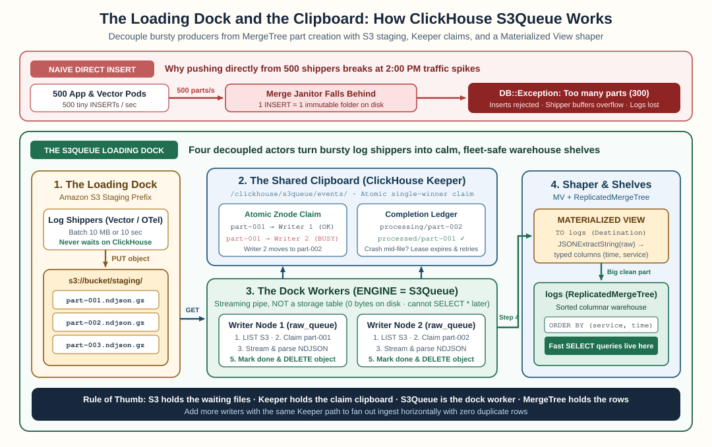
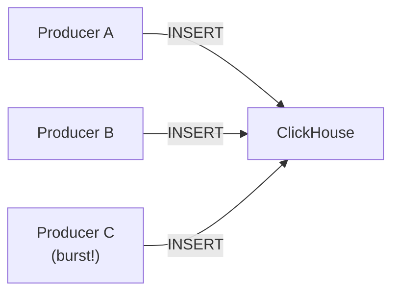
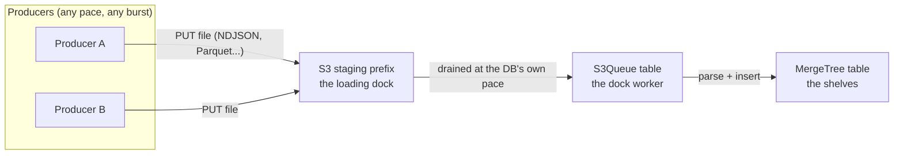
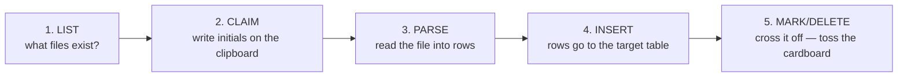
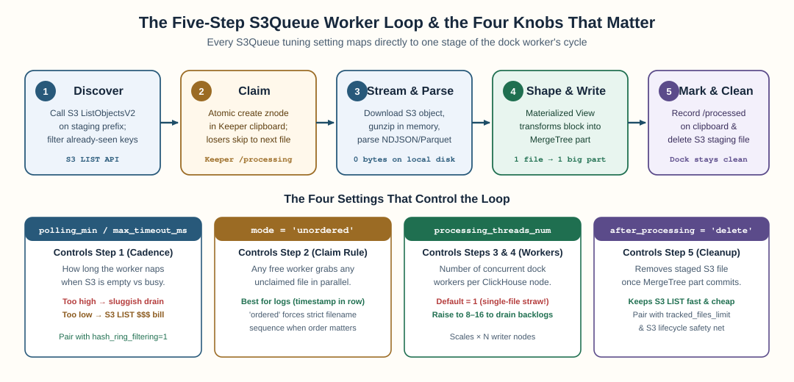

Two of the most-read posts in this series are about the same table
engine and assume the same background. One
[drains a 29,000-file
backlog](/blog/clickhouse-s3queue-backlog-drain-optimizations/) and
tunes every setting that governs the drain; the other
[discovers the whole ingest running on one
node](/blog/s3queue-multi-node-ingest-fanout/) and fixes it by putting
the same table on every writer. Both start in the middle: *you already
have files landing in S3, you already have a queue table watching
them.* Neither explains why there's a staging prefix at all, what the
queue is actually doing to a file, or what the coordination service
has to do with it.

This is that missing starting point. Five minutes, one picture, and
both of those posts get much shorter.

## Step 0: the five-year-old's question

> **ELI5:** You run a warehouse (the database). Trucks full of boxes
> (log data) arrive all day. If every truck backs up to the warehouse
> door and waits for workers to unload it straight onto the shelves,
> then one slow afternoon at the warehouse means a traffic jam of
> trucks — and one extra-busy day of trucks means boxes pile up in the
> doorway.
>
> So you build a **loading dock** (an S3 bucket): trucks drop their
> boxes on the dock and drive away. The warehouse picks up boxes at
> whatever pace it can handle. A slow afternoon at the warehouse just
> means the dock pile grows a little; a burst of trucks means nothing
> at all, because dropping a box on the dock takes seconds.
>
> The **S3Queue table** is the warehouse's clipboard-carrying dock
> worker: she looks at the pile, writes her initials next to a box on
> the shared clipboard (so the other workers leave that one alone),
> opens it, shelves the contents, and throws away the cardboard.

Everything else in this post is that worker's job description, written
down carefully.



*Direct inserts tie producer bursts to MergeTree part creation; the S3Queue pattern decouples them into a loading dock (S3), a shared clipboard (Keeper), streaming dock workers (S3Queue), and a shaper (Materialized View).*

## Step 1: the naive architecture, and the day it stops working

Start from the design everyone writes first, because it's the design
that explains the problem:



Producers INSERT directly. It works on day one. Then three things
happen, one per failure mode:

**Failure mode 1: database-side backpressure becomes the producers'
problem.** ClickHouse throttles inserts when a partition has too many
unmerged parts (you know this from [the MergeTree
model](/blog/clickhouse-mergetree-mental-model/) — parts pile up
faster than the background janitor can fold them). During a merge
backlog or a restart, direct inserts slow down or fail. Now every
producer needs retry logic, every team's dashboard shows errors during
*your* database's bad afternoon, and the blast radius of database
health is the whole producer fleet.

**Failure mode 2: bursts couple through.** One team ships a loop that
inserts row-by-row. Parts explode, the throttle trips, and — because
the throttle is per-partition — *everyone* inserting into that
partition slows down. One producer's bug is every producer's incident.

**Failure mode 3: a failed batch is gone.** A direct insert that fails
mid-flight has to be retried by the producer, from its own buffer,
with its own bookkeeping. Producers are bad at this. "Did it commit?
Half of it? Retry the whole batch or just the failed rows?" is a
distributed-systems question you've now delegated to whichever
service logs fastest.

**The SQL-person summary:** direct inserts are synchronous remote
procedure calls into your database's health. Staging files is an
asynchronous queue with S3 as the buffer — and S3 is a spectacularly
durable buffer.

## Step 2: the staging pattern (the loading dock)

The fix decouples producer from consumer with one move:



Producers write whole files — NDJSON, CSV, Parquet, whatever the
format — to a prefix like `s3://bucket/staging/2026/11/`. A `PUT` is a
single atomic operation: it either landed or it didn't, and if it
didn't the producer just... puts it again. A failed batch isn't a lost
batch; it's a file that's still sitting there.

For the Postgres-minded: this is the same move as writing to a queue
table or an outbox that a background worker drains — the
[transactional
outbox](https://microservices.io/patterns/data/transactional-outbox.html)
pattern's cousin — except the "outbox" is an entire S3 bucket, which
means it holds *any* volume forever, costs cents when idle, and
survives the database being rebuilt.

The trade: files that land but haven't been read are invisible to
queries. The dock has a pile; the shelves don't know about it yet. So
the pattern needs a worker — something that reads the pile, shelves
the contents, and tracks what's been done. That worker is the queue
table.

## Step 3: the queue table — a mailbox you can SELECT from

Here's the engine in one CREATE:

```sql
CREATE TABLE staging_events
(
    timestamp String,
    service   String,
    message   String
    -- ...raw file columns, string-typed: the queue parses, it
    -- doesn't validate. Shaping happens in the view (step 5).
)
ENGINE = S3Queue(
    'https://bucket.s3.us-west-2.amazonaws.com/staging/*',
    'NDJSON',
    'auto'          -- the credentials mode: use the node's IAM role
)
SETTINGS
    mode = 'unordered',
    after_processing = 'delete';
```

From SQL's point of view, this is a *table*: `SELECT count() FROM
staging_events` works — it reads whatever files the queue currently
has in view. From the pipeline's point of view, it's a **background
worker with a checklist**, continuously running a five-beat loop over
the prefix:



Walk one file through it, from the worker's perspective:

1. **Discover.** The engine lists the prefix. (Listing is *the* hidden
   cost of the whole design — S3 lists 1,000 keys at a time, and the
   drain posts in this series are largely about tuning this stage.)
2. **Claim.** Before doing anything, the worker writes a marker —
   "staging/2026/11/file-42.ndjson is mine" — to the coordination
   service. This is the clipboard, and it's the entire subject of
   step 4.
3. **Parse.** The file's bytes become rows of the queue table's
   schema. Note the schema is deliberately raw: strings, mostly.
   The queue's job is transport, not validation.
4. **Insert.** The parsed rows flow to the target table — in practice
   through a materialized view (step 5). If this step fails, the
   marker makes the file come back for another attempt (or, in
   ordered mode, lands it in a recovery buffer).
5. **Finish.** `after_processing = 'delete'`: the S3 object itself is
   deleted. The staging prefix stays small, listing stays cheap, and
   the bucket holding your queue costs about nothing — the cardboard
   gets tossed once the contents are shelved.

## Step 4: the clipboard — claims, and why this is fleet-safe

Here's the question that makes the clipboard necessary: *what happens
when you run this same table on five nodes?* All five poll the same
prefix. All five see `file-42.ndjson`. Without coordination, all five
parse it and insert it — five copies of every event.

The claim marker fixes it, and the mechanism is worth understanding
precisely because it's the same one ClickHouse replication uses
elsewhere (see [the roster, the journal, and the
bookmarks](/blog/clickhouse-replicated-table-roster-journal-bookmarks/)
for the full model):

- The coordination service (ClickHouse Keeper) is a shared tree of
  small records with one rule: **only one writer can create a given
  path.** Create-something-that-exists = refused, atomically.
- Before processing, a node creates
  `.../processed/file-42.ndjson` — a marker naming that exact file.
- Two nodes race: exactly one create succeeds. The loser sees the
  marker exists, shrugs, and moves to the next file.

> **ELI5:** five dock workers share one clipboard hung by the door.
> Before picking up a box, a worker writes her initials and the box's
> number on it. Two workers reach for the same box: the one whose pen
> touched paper first has it written down; the other sees the
> initials and picks a different box. Nobody talks to anybody; the
> clipboard *is* the conversation.

That single atomic-create rule is why
[the fan-out post](/blog/s3queue-multi-node-ingest-fanout/) could fix
a one-node bottleneck by simply creating the same table on every
writer — the fleet shares the ingest *by construction*, with no
coordinator process, no lock service, nothing to deploy but the DDL.
It's also the exact mechanism behind the modes:

- **Unordered mode** (the common choice for logs): every file is
  independent; the marker is the dedup record. Any node, any order,
  maximum concurrency. If a file fails, only that file retries.
- **Ordered mode**: files must be processed in name order — like a
  queue where parcel #6 waits for #5 — for pipelines where later
  files carry deltas on earlier ones. The price is sequencing
  overhead and a dedicated recovery path for failed files.

And `after_processing` is the other half of the ledger:
`'delete'` removes the file from S3 when done (the usual choice —
staging is garbage once consumed), while `'keep'` leaves it in place
and trusts the marker forever (which makes the prefix listing grow —
one of several reasons 'delete' is the default idiom for staging
prefixes).

One operational note that will save you an afternoon: the markers are
*state*. Rebuild the coordination service from scratch (or point a
fresh cluster at an old prefix) and the clipboard is blank — with
`'delete'`, consumed files are long gone and nothing re-reads; with
`'keep'`, everything re-reads. Neither is wrong, but you should know
which contract you chose.

## Step 5: the pair — queue table + materialized view

Notice step 3's schema was all strings. Where do `DateTime` columns,
generated IDs, and parsed attributes come from? From the *other* half
of the idiom — a materialized view:

```sql
CREATE MATERIALIZED VIEW events_shaper TO events AS
SELECT
    parseDateTime64BestEffortOrZero(timestamp, 9) AS timestamp,
    service,
    JSONExtract(message, 'status') AS status
    -- ...the shaping lives HERE, not in the queue table
FROM staging_events;
```

The view selects from the queue table and writes into the real
MergeTree table. The division of labor is clean and worth stating
because it's the difference between a debuggable pipeline and a
mystery:

- **The queue table owns the file lifecycle** — discover, claim,
  parse, delete. It never sees your business logic.
- **The view owns the data shaping** — types, parsing, enrichment. It
  never sees S3.

When a file lands wrong, you query the queue table (`SELECT` from it —
it's a table!). When a row lands wrong, you fix the view. Two jobs,
two objects, no overlap — which is exactly why both drain posts could
tune one half without touching the other.



*Each S3Queue tuning knob maps to one stage of the dock worker's five-step cycle: discovery cadence, claim ordering, worker thread count, and post-processing cleanup.*

## When *not* to reach for this

The pattern costs complexity, so it should buy something real. Skip
the staging prefix when:

- **Volume is modest and steady.** Direct batched inserts (or
  [asynchronous
  inserts](https://clickhouse.com/docs/en/optimize/asynchronous-inserts),
  which buffer server-side) are simpler and entirely healthy at the
  right scale.
- **You need query-fresh data in seconds.** The dock adds the
  poll-and-claim interval between "file landed" and "rows queryable."
  A pipeline measured in seconds of freshness is fighting the design.
- **You already run a real streaming system well.** Kafka (and
  friends) give you ordering and replay guarantees with their own
  operational weight; adding an S3 dock on top of a working stream is
  duplication.

Reach for it when producers outnumber and out-burst your database's
comfort zone, when "the file *is* the record" (audit logs, export
pipelines, third-party dumps), or when you want the buffer to be
cheap, effectively infinite, and impossible to lose.

## Now read the war stories again

With the dock, the worker, and the clipboard in hand:

- [**Draining 29,000 S3Queue files
  fast**](/blog/clickhouse-s3queue-backlog-drain-optimizations/) is
  step 1 and step 3 of the loop — discovery cadence and claim
  concurrency — when the pile gets big enough that the worker's *own*
  checklist pace, not the warehouse's, is the bottleneck.
- [**S3Queue is a multi-node
  engine**](/blog/s3queue-multi-node-ingest-fanout/) is step 2 — the
  clipboard — proving that "deploy the same table everywhere" is not
  just safe but the design's intended scaling story.

Both posts were tuning manuals for a machine this one never
introduced. If you read them before and bounced off, this was the
missing page.

---

**The one-sentence model:** stage the trucks on the dock (S3), let the
worker with the clipboard (the queue table, claiming through Keeper)
shelve boxes at the warehouse's own pace — and the clipboard makes it
safe to hire as many workers as you like.
