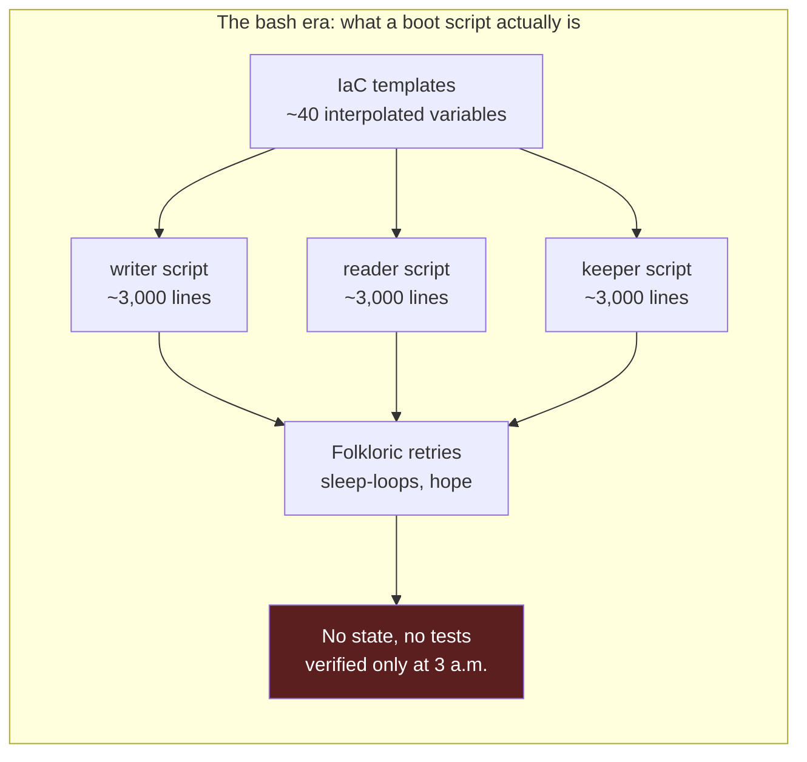
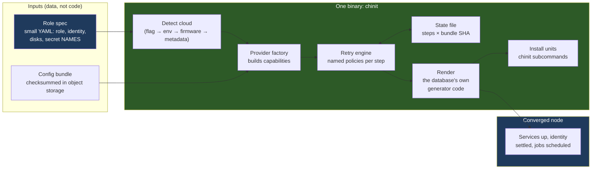

This is a story about the least-reviewed production code in any
self-managed fleet. The data definition language (DDL) gets reviewed. The dashboards get reviewed. The
thing that runs between an instance launching and the first successful
query — the boot script — gets templated by the infrastructure-as-code
(IaC) tool, grown to three thousand lines, and read by no one until
it fails at 3 a.m.

We ended up with one, like everyone does. And then we replaced it with
[chinit](https://github.com/sks/clickhouse-operator) — a single Go
binary that treats node bootstrap as a typed spec, a state file, and a
retry engine. This post is about why that boundary — bash to binary —
was the single highest-leverage change in the whole
[self-managed ClickHouse](/blog/clickhouse-ec2-vs-k8s-mermaid-data-flow/)
migration, and how to know when your fleet is ready for the same move.

The series has walked the pieces before:
[the boot sequence as a contract](/blog/clickhouse-boot-sequence-contract/),
[the operator's brain reused off Kubernetes](/blog/clickhouse-operate-without-kubernetes/).
This post is the design view: what chinit is, the problem class it
exists to kill, and the shape of the solution — written so you can
apply the pattern to any self-managed fleet, on any cloud.

## The problem nobody owns

A self-managed database node's boot is not one job. It is about
twenty: fetch configuration, detect the platform, mount and label
disks, derive identity, resolve secrets, render configuration, start
the database, verify health, install recurring maintenance. The bash
implementation of those twenty jobs converges on the same shape
everywhere:

- **The IaC tool templates the script.** Every cluster variable arrives
  as an interpolated string. The script's real type system is the
  template's escape discipline.
- **Each role gets its own copy.** Writer, reader, keeper — three
  scripts, ninety percent shared, drifting independently. A fix lands
  in one; the others learn about it in production.
- **Retry policy is folklore.** One step sleeps ten seconds and hopes;
  the next polls with a timeout; the third has no loop at all because
  "it always works." Transient cloud API failures behave differently
  in each.
- **There is no state.** A script that crashes at step fourteen of
  twenty has no idea, on re-run, what it already did. The safe move is
  to make every step idempotent by hand — which works until a step is
  only *mostly* idempotent.
- **It cannot be tested.** The only way to exercise the script is to
  launch a node. So nobody exercises it until a node launches.

None of this is a bash *bug*. Bash is a fine shell and a poor state
machine. The problem is that boot is a state machine — steps with
ordering constraints, retry policies, and failure semantics — expressed
in a language whose unit of composition is a string.

The deepest issue is the last one. An untestable boot path means every
fleet roll is a live experiment — and the fixes are written in the same
untestable medium that failed.

## The shape of the solution

The fix is not "write the bash in Go." The fix is to recognize what the
boot actually is and give each part its natural representation:

**The spec is data.** One YAML Ain't Markup Language (YAML) document per
role, declaring intent: the role, how identity is derived, which disk
labels to mount, which secret *names* to resolve, where the config
bundle lives. The same binary serves every role because the role is a
field, not a fork. The same binary serves every cloud because the cloud
is detected and dispatched through a factory.

**Secrets stay references.** The spec names secrets; the boot resolves
them through the provider's secret capability and writes values to
0600 files. Plaintext never enters the spec, the IaC state, the
rendered config, or the log.

**Steps carry their failure semantics.** Each step declares whether it
is critical (abort the boot — let the fleet's own replacement machinery
handle it) or best-effort (log loudly, continue). The health gate is
deliberately best-effort: a reader booting mid-fleet-roll with a peer
down must still join, or the boot loop wedges the whole
Auto Scaling Group (ASG).

**Retry is a policy, not folklore.** Four named policies — fast for
transient API calls, patient for waiting on disks and services, one
shot for config-class failures where a retry masks a bug, and a
sweep bounded by one lease window for identity claims.

**State makes re-runs safe.** Every completed step is recorded with the
config-bundle checksum it ran against. Re-run with the same hash:
done steps skip. Crash mid-pipeline: resume where you stopped. New
bundle hash: prior records are invalidated and the pipeline re-runs —
deliberately, because the installed configs are not what the new
release vouches for.

**The maintenance jobs are the same binary.** The recurring work —
schema propagation, replica sync, lease renewal — are subcommands.
The systemd unit's entire content is one ExecStart line. There is no
second script to drift.

The payoff isn't elegance; it is the failure classes that vanish:

| Bash era | chinit |
|---|---|
| Spec arrives as ~40 template variables | One typed, validated spec file |
| Three role scripts, shared by copy-paste | One binary; roles are data |
| Per-step ad-hoc retry loops | Four named policies, applied per step |
| No memory between runs | State file keyed to the bundle checksum |
| Untestable without a live node | A unit-testable engine; spec logic is Go |
| Secrets interpolated into templates | References resolved at runtime, to files |
| Job scripts drift from boot scripts | Jobs are the same binary's subcommands |

## What live cutovers taught us

We ran the cutover the honest way: bake the binary into the golden
image, roll real nodes, and let production findings drive the design.
Three findings shaped it more than any plan:

**1. Identity must settle before anything renders.** The first reader
cut over booted, rendered its configuration, and registered itself
under the platform-assigned hostname — an ephemeral `ip-*` name. The
replication paths and macros had the *instance's* identity baked into
them, and every subsequent replacement inherited a stranger's state.
The fix was structural: the identity step (claim or derive the node's
stable name) became a hard prerequisite of the render step. Order is
load-bearing.

**2. A spec is not converged until a node can crash mid-boot.** The
first version of the state file recorded identity but not steps. A node
that crashed after claiming identity but before rendering left
orphaned leases and half-configured services. The fix: persist the
settled identity *immediately* — later steps, not the pipeline's
conclusion — and record each step as it completes.

**3. The health gate must never be fatal.** The first fleet roll with
a fatal health check wedged: node boots, peer is mid-replacement,
health fails, boot aborts, fleet replaces the node, the new node sees
the same peer down, loop. The gate is a warning now — loud in the log,
never blocking the boot-finished marker.

Each of these is a general lesson about state machines at boot, and
each cost less than it would have in the bash era, because the fix was
a change to a typed step in a reviewable pipeline — not a sed across
three three-thousand-line scripts.

## How to know you are ready for this move

The migration is worth it when the boot script is doing real work —
identity, secrets, platform detection, service orchestration — not
just apt installs. The signals we would look for in any fleet:

1. **The script has branches per role.** Role-forked scripts are the
   clearest tell: the design wants roles to be data.
2. **You template the script from your IaC tool.** The moment the IaC
   tool is writing your runtime logic, the boundary has blurred.
3. **A fleet roll has ever failed on a boot-script bug** and the fix
   shipped in the same untestable medium.
4. **You have steps that only sometimes need retries** — cloud API
   calls next to disk waits — and the retry discipline is inconsistent
   between them.
5. **You cannot answer "what does a re-run do?"** in one sentence.

If three of five are true, the boot path has crossed from setup
script into state machine — and state machines want types, policies,
and state files.

The next post in this arc walks the hardest boundary we crossed after
the bash cutover: [the second binary](/blog/chinit-dissolve-second-binary/)
that chinit originally shipped beside — and why dissolving it made the
whole system smaller.

---

*Related in this series: [the boot sequence as a contract](/blog/clickhouse-boot-sequence-contract/),
[teaching an operator's code to work without Kubernetes](/blog/clickhouse-operate-without-kubernetes/),
and [stable identity for ephemeral readers](/blog/clickhouse-spot-readers-stable-identity/).*
