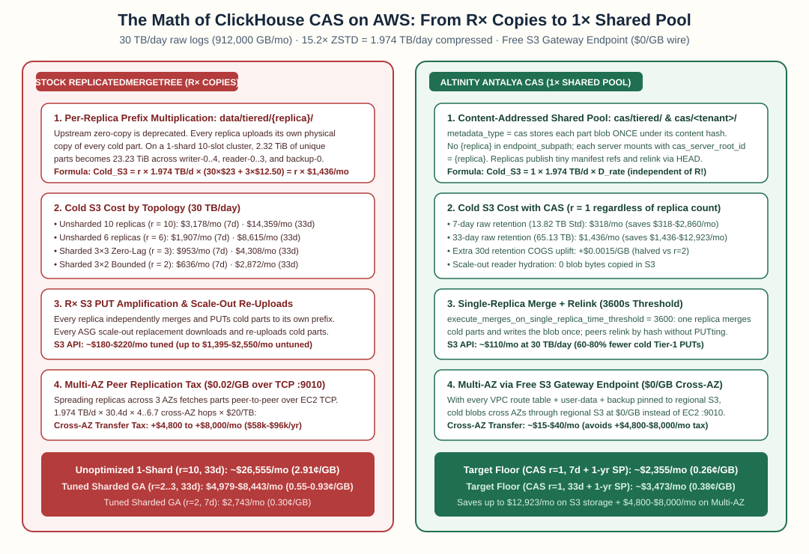
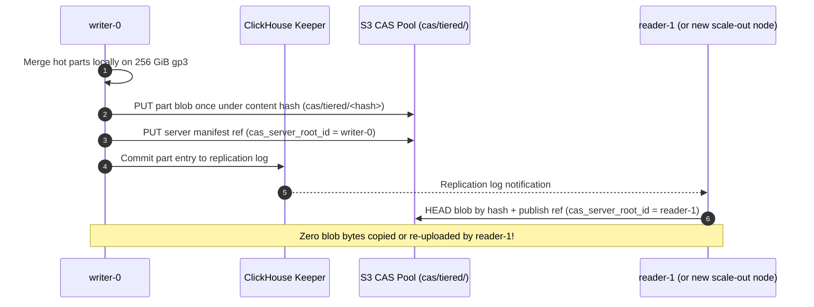

When teams first wire self-managed ClickHouse to Amazon S3, there is a
very common misconception: *"We attached an S3 Gateway VPC Endpoint, so
S3 traffic is free — why is S3 still our biggest bill?"*

The answer comes down to separating **the wire** from **the warehouse**
— and making sure nothing on your fleet is secretly bypassing the wire
in the first place.

In [Free Is a Route, Not a Setting](/blog/s3-gateway-endpoint-30tb-day/),
we showed why an S3 Gateway Endpoint (`com.amazonaws.<region>.s3`) is
mandatory at 30 TB/day: it keeps VPC-to-S3 bytes off the `$0.045/GB` NAT
Gateway, saving `~$2,700–$9,300/month`.

But even when every byte rides the free S3 Gateway Endpoint at `$0.00/GB`,
**stock open-source ClickHouse (`ReplicatedMergeTree`) has a structural
multiplier**: because upstream zero-copy replication
([`allow_remote_fs_zero_copy_replication`](/blog/clickhouse-zero-copy-replication-dead/))
was deprecated, **every replica writes its own physical copy of every
cold part to S3**.

This post lays out the exact mathematics of that multiplier at **30 TB/day
(`912,000 GB/month`)**, first closes the remaining places where S3 calls
can still leak past the Gateway Endpoint or multiply S3 API charges in a
real stack, and then walks through how **Altinity Antalya's
Content-Addressed Storage (CAS, `metadata_type = cas`)** collapses cold
storage from `R×` to `1×` — taking our end-to-end log platform
COGS down to **`$0.0026/GB` (`0.26¢/GB`)** at 7-day retention and
**`$0.0038/GB` (`0.38¢/GB`)** at 33-day retention.



---

## 1. First: If S3 Is Still Costing You on the Wire, Fix the Silent Leaks

Before you optimize storage copies, verify that your S3 Gateway Endpoint
is actually catching **100%** of your S3 traffic. An S3 Gateway Endpoint
injects a regional prefix-list route (for example, the regional S3 prefix
list for `com.amazonaws.<region>.s3`) into the route tables you attach it to:

```text
Destination          Target                   Cost
pl-xxxxxxxx (S3)     vpce-xxxxxxxxxxxxxxxxx   $0.00/hr, $0.00/GB (Gateway Endpoint)
0.0.0.0/0            nat-xxxxxxxxxxxxxxxxx    $0.045/hr + $0.045/GB processed
```

If an S3 request targets **any IP outside the regional S3 prefix list**, or
originates from **any subnet whose route table lacks that entry**, it falls
through to `0.0.0.0/0` and bills `$0.045/GB` on the NAT Gateway with zero
errors. When we audited our bootstrapper ([chinit](https://github.com/stackgenhq/chinit)),
our Terraform modules, and our live VPC route tables, we found three subtle
leaks:

1. **Region-less `aws s3 cp` in stage-0 `user-data.sh`**:
   In `chinit`'s stage-0 cloud-init wrapper (`user-data.sh.tftpl`), the
   node fetches its role spec before `chinit` starts:
   ```bash
   # BEFORE: no --region and no AWS_REGION in cloud-init's root env!
   aws s3 cp "s3://${bundle_bucket}/${bundle_prefix}/$CHINIT_SPEC_KEY" "$CHINIT_SPEC_PATH"
   ```
   When `AWS_REGION` and `AWS_DEFAULT_REGION` are unset in `user-data`,
   AWS CLI v2 defaults to the global `s3.amazonaws.com` (`us-east-1`)
   endpoint first. Because `us-east-1` S3 IPs are not in a `us-west-2`
   endpoint's prefix list, the lookup exits via the NAT Gateway (and fails
   outright in air-gapped NAT-less VPCs). Exporting `AWS_REGION="${region}"`
   and passing `aws s3 cp --region "${region}"` pins stage-0 to
   `s3.<region>.amazonaws.com` on the free Gateway Endpoint.
2. **Region fallback in `clickhouse-backup`'s `config.yml`**:
   `chinit`'s `configureBackup` rendered `region:` from `b.Identity.Region`
   alone; if identity metadata hadn't populated the field, `region:`
   rendered blank and `clickhouse-backup` defaulted to `us-east-1`.
   Falling back across `b.Identity.Region → b.Spec.Region → b.Meta.Region`
   guarantees `clickhouse-backup` always hits the regional S3 endpoint.
3. **Sibling VPCs & VPC-attached Ingest Lambdas missing the Gateway Endpoint**:
   Our dedicated ClickHouse VPC had the S3 Gateway Endpoint attached,
   but a sibling workload VPC had **no S3 Gateway Endpoint attached to its
   private route table**, sending every S3 byte through its NAT Gateway.
   Similarly, our optional `lambda_vpc_config` module for VPC-attached
   Ingest Lambdas previously documented using NAT or paid Interface
   Endpoints for S3 instead of attaching a free `Gateway` endpoint to the
   Lambda's route tables.

### What the S3 Gateway Endpoint Does *Not* Make Free

Once those leaks are closed, **network transport to S3 is `$0.00/GB`**.
What remains on the S3 bill are the two things a Gateway Endpoint never
discounts:

1. **Physical S3 Storage (`TimedStorage-ByteHrs`)**:
   - **S3 Standard**: **`$0.023 / GB-month`** (`$23.00 / TB-month`)
   - **S3 Standard-IA** (after 30 days): **`$0.0125 / GB-month`** (`$12.50 / TB-month`)
2. **S3 API Requests (`Requests-Tier1` & `Requests-Tier2`)**:
   - **Tier-1 (`PUT`, `COPY`, `POST`, `LIST`)**: **`$5.00 per 1,000,000 requests`** (`$0.005 / 1,000`)
   - **Tier-2 (`GET`, `HEAD`, `SELECT`)**: **`$0.40 per 1,000,000 requests`** (`$0.0004 / 1,000`)
   - **S3 `DELETE`**: **`$0.00` (Free)**

And that is where ClickHouse's cold-tier replication architecture
determines whether your S3 bill is **`$318/month`** or **`$14,359/month`**.

---

## 2. The `R×` Cold-Storage Problem in Stock ClickHouse

In our [tiered storage layout](/blog/clickhouse-s3-tiered-storage/), new
inserts land on the local hot `gp3` volume (`default`, `256 GiB`), merge
locally in the background, and move to the S3 cold volume after the hot
TTL window (or when disk pressure trips `move_factor = 0.1`).

In stock ClickHouse 26.8 LTS, each replica must isolate its S3 objects
under its own `{replica}` prefix:

```xml
<s3>
    <type>s3</type>
    <endpoint from_env="CH_S3_ENDPOINT" />
    <endpoint_subpath>data/tiered/{replica}/</endpoint_subpath>
</s3>
```

Why? Because without a content-addressed shared metadata layer, two
replicas pointing at the same S3 path will collide on part names and
delete objects out from under each other during background merges and
garbage collection.

The consequence is brutal: **every data-bearing replica slot stores a
complete, independent physical copy of the cold dataset in S3.**

During our 30 TB/day and 60 TB/day soak tests on a 1-shard cluster
with `writer_max = 5`, `max_readers = 4`, and `backup = 1` (**10 replica
slots**), we ran a full `list-objects-v2` aggregation across
`s3://<clickhouse-data-bucket>/data/tiered/`:

| Replica Prefix (`data/tiered/<replica>/`) | Stored Cold Bytes | S3 Object Count |
|---|---|---|
| `writer-0` | `3.08 TiB` | `1,700,000` |
| `writer-1` | `3.40 TiB` | `2,570,000` |
| `writer-2` | `2.98 TiB` | `2,140,000` |
| `writer-3` | `2.74 TiB` | `2,130,000` |
| `writer-4` | `3.33 TiB` | `2,690,000` |
| `reader-0` | `1.70 TiB` | `815,563` |
| `reader-1` | `2.19 TiB` | `~1,100,000` |
| `reader-2` | `2.39 TiB` | `~1,200,000` |
| `reader-3` | `1.04 TiB` | `~520,000` |
| `backup-0` | `0.38 TiB` | `363,896` |
| **Total Across 10 Replica Prefixes** | **`23.23 TiB`** | **`~15.23M objects`** |

Even though S3 Standard is **already 3-AZ durable (99.999999999%
eleven-nines durability)**, stock ClickHouse stored **10 physical copies**
of the same compressed log parts in the same S3 bucket. Those extra 9
copies buy **zero** additional durability — they are pure storage waste.

---

## 3. The Exact Cost Math: Stock `R×` vs. Sharding vs. CAS `1×`

Let's write down the exact equations from our verified `us-west-2` billing
model so you can plug in your own daily volume `V`, compression ratio `c`,
retention days `D`, shard count `S`, and total data-bearing nodes `R`.

### Step 1: Daily Compressed Volume Entering ClickHouse

Let:
- `V = 30 TB/day` (`912,000 GB/month` over a `30.4`-day month) of raw uncompressed normalized logs.
- `c = 15.2×` measured ClickHouse ZSTD compression ratio (`Delta(8) + ZSTD(1)` on timestamps, `ZSTD(3)` on `Map(String, String)` attributes).

Then the compressed volume written per day for **one** complete copy of
the dataset is:

<div class="pn-formula-card" role="math" aria-label="Compressed TB per day equals V divided by c equals 30 TB per day divided by 15.2 equals 1.974 TB per day">
  <div class="pn-formula-eq">
    <span>comp_tb_day</span>
    <span>=</span>
    <span class="pn-frac"><span class="pn-frac__num">V</span><span class="pn-frac__den">c</span></span>
    <span>=</span>
    <span class="pn-frac"><span class="pn-frac__num">30 TB/day</span><span class="pn-frac__den">15.2</span></span>
    <span>=</span>
    <span>1.974 TB/day</span>
  </div>
</div>

### Step 2: How Many Physical Copies (`r`) Land in S3?

In a cluster with `S` shards and `R` total data-bearing nodes
(`r = R / S` replicas per shard):
- Each shard holds `1 / S` of the dataset, replicated across `r = R / S` replicas.
- Therefore, total cold S3 storage across all `S` shards is:

<div class="pn-formula-card" role="math" aria-label="Total S3 copies equals S times 1 over S times r equals r equals R over S">
  <div class="pn-formula-eq">
    <span>Total S3 Copies</span>
    <span>=</span>
    <span>S × (1 / S × r)</span>
    <span>=</span>
    <span>r</span>
    <span>=</span>
    <span class="pn-frac"><span class="pn-frac__num">R</span><span class="pn-frac__den">S</span></span>
  </div>
</div>

- **Unsharded (`S = 1`) without CAS**: `r = R` full copies (`10×` when `R = 10`).
- **Sharded (`S = 3`) without CAS**:
  - Zero-lag (`6 writers + 3 readers` = 3 replicas/shard): `r = 3` full copies (`3×`).
  - Bounded-lag (`3 writers + 3 readers` = 2 replicas/shard): `r = 2` full copies (`2×`).
- **With Altinity Antalya CAS (`metadata_type = cas`)**:
  Every replica of a shard publishes references into **one shared
  content-addressed pool** (`cas/tiered/` or `cas/<tenant>/`), where each
  blob is stored under its content hash:

<div class="pn-formula-card" role="math" aria-label="r sub CAS equals 1 independent of replica count R">
  <div class="pn-formula-eq">
    <span>r<sub>CAS</sub> = 1</span>
    <span>(independent of replica count R!)</span>
  </div>
</div>

### Step 3: Cold S3 Monthly Cost Equation

With S3 Standard priced at `$23.00/TB-month` for days `1–30`
and S3 Standard-IA priced at `$12.50/TB-month` for days `>30`:

<div class="pn-formula-card" role="math" aria-label="Cold S3 monthly cost equals r times V over c times min of D and 30 times 23 dollars plus max of 0 and D minus 30 times 12.50 dollars">
  <div class="pn-formula-eq">
    <span>Cold S3 $/mo(r, D)</span>
    <span>=</span>
    <span>r ×</span>
    <span class="pn-frac"><span class="pn-frac__num">V</span><span class="pn-frac__den">c</span></span>
    <span>× [ min(D, 30) × $23.00 + max(0, D − 30) × $12.50 ]</span>
  </div>
</div>

Evaluating at `V = 30 TB/day` (`V / c = 1.974 TB/day`):

1. **For `D = 7` days raw retention** (`min(7, 30) = 7`, `max(0, −23) = 0`; `lifecycle_days_to_ia = 0` to avoid the 30-day Standard-IA minimum duration charge):
   <div class="pn-formula-card"><div class="pn-formula-eq"><span>Cost per copy (7d) = 1.974 TB/day × 7 days × $23.00/TB = 13.82 TB × $23.00 = <strong>$317.76/month</strong></span></div></div>
2. **For `D = 33` days raw retention** (`30` days Standard + `3` days Standard-IA):
   <div class="pn-formula-card"><div class="pn-formula-eq"><span>Cost per copy (33d) = 1.974 TB/day × (30 × $23.00 + 3 × $12.50) = 1.974 × $727.50 = <strong>$1,435.86/month</strong></span></div></div>

Multiply by `r` across the five real cluster topologies:

| Cluster Topology (@ 30 TB/day) | S3 Copies (`r`) | **7-Day Cold S3 $/mo** | **33-Day Cold S3 $/mo** | **CAS Savings @ 7d** | **CAS Savings @ 33d** |
|---|---|---|---|---|---|
| **Unsharded 10-Slot (`6W+3R+1B`, no CAS)** | **`10×`** | `$3,178/mo` | `$14,359/mo` | **`-$2,860/mo` (`-90%`)** | **`-$12,923/mo` (`-90%`)** |
| **Unsharded Bounded-Lag (`3W+2R+1B`, no CAS)** | **`6×`** | `$1,907/mo` | `$8,615/mo` | **`-$1,589/mo` (`-83%`)** | **`-$7,179/mo` (`-83%`)** |
| **Sharded GA Zero-Lag (`3 shards × 3 replicas`)** | **`3×`** | `$953/mo` | `$4,308/mo` | **`-$635/mo` (`-67%`)** | **`-$2,872/mo` (`-67%`)** |
| **Sharded GA Bounded-Lag (`3 shards × 2 replicas`)** | **`2×`** | `$636/mo` | `$2,872/mo` | **`-$318/mo` (`-50%`)** | **`-$1,436/mo` (`-50%`)** |
| **Altinity Antalya CAS (`cas_config.enabled = true`)** | **`1×`** | **`$318/mo`** | **`$1,436/mo`** | *Baseline (`1×`)* | *Baseline (`1×`)* |

> **Want to model your own daily TB, retention window, and replica count?** Try the live [Interactive Non-CAS vs. CAS Cold-Storage Calculator](/blog/clickhouse-fleet-evolution-non-cas-to-cas-blueprint/#interactive-non-cas-vs-cas-cold-storage-calculator) in Part 44.

---

## 4. Three More Cost Wins CAS Unlocks Beyond Storage Bytes

### A. S3 API Request Reduction (`PUT` Once, Relink `R − 1` Times)

Even after applying our [five S3 API storm fixes](/blog/stopping-s3-api-storm-clickhouse-fleet/)
(`256 GiB` hot `gp3`, `min_bytes_for_wide_part = 1 GiB` cutting objects
per part from `~35` to `~11`, `ttl_only_drop_parts = 1`, shared S3Queue
`keeper_path`, and `enable_hash_ring_filtering = 1`), non-CAS replicas
still pay:

<div class="pn-formula-card">
  <div class="pn-formula-eq">
    <span>Cold Tier-1 PUTs/day = (parts moved to cold/day) × (~11 objects/part) × r</span>
  </div>
</div>

Plus, every time an Auto Scaling Group scales out a fresh reader or
replaces a spot instance, a non-CAS replica must download all cold parts
and **re-`PUT` them into its own `{replica}` prefix**.

With CAS enabled alongside single-replica merge coordination
(`execute_merges_on_single_replica_time_threshold = 3600`):



Our empirical S3 API formula at `V TB/day` (assuming `≥ 150 MB`
staged files and `≥ 256 GiB` hot disks):

<div class="pn-formula-card">
  <div class="pn-formula-eq">
    <span>S3 API $/mo ≈ $60 + V × $4.00/TB (non-CAS, r &gt; 1: $180–$220/mo @ 30 TB/d)</span>
  </div>
  <p class="pn-formula-legend">
    <strong>With CAS (r = 1):</strong> S3 API $/mo ≈ $60 + V × $2.00/TB = <strong>$110–$120/mo @ 30 TB/day</strong>
  </p>
</div>

### B. Eliminating the `$4,800–$8,000/month` Multi-AZ Cross-AZ Transfer Tax

Why can ClickHouse Cloud run across 3 Availability Zones without a massive
AWS cross-AZ data-transfer bill, while stock self-managed
`ReplicatedMergeTree` gets crushed if you spread a shard across `us-west-2a`,
`2b`, and `2c`?

- **Stock `ReplicatedMergeTree` across 3 AZs**: Replicas fetch parts
  peer-to-peer over EC2 TCP port `9010`. AWS charges **`$0.02/GB`
  (`$20/TB`)** for every byte crossing an AZ boundary:
  <div class="pn-formula-card"><div class="pn-formula-eq"><span>Cross-AZ Tax = 1.974 TB/day × 30.4 days × (4…6.7 cross-AZ hops) × $20/TB = <strong>$4,800 to $8,000/month</strong></span></div></div>
- **Antalya CAS across 3 AZs (`multi_az_config.enabled = true`)**:
  Cold parts are written **once** to regional S3 via the **free S3 Gateway
  Endpoint (`$0/GB`)**, and replicas in other AZs relink the S3 blob via
  `HEAD` and read through the regional S3 Gateway Endpoint at **`$0.00/GB`
  cross-AZ transfer**!
  That is why our Terraform root module enforces a plan-time guard in
  `variables.tf`:
  ```hcl
  validation {
    condition     = !var.multi_az_config.enabled || var.cas_config.enabled
    error_message = "multi_az_config.enabled requires cas_config.enabled = true (Altinity Antalya CAS). Stock ReplicatedMergeTree replicas fetch parts peer-to-peer, so multi-AZ placement bills $0.02/GB cross-AZ on every part fetch (+$4,800–$8,000/mo at 30 TB/day)."
  }
  ```

### C. Halving Customer Retention Add-On COGS (Protecting Gross Margin on Low-Compressibility Logs)

When pricing a log analytics SaaS product, every extra 30 days of raw log
retention adds cold S3 cost proportional to `r / c`:

<div class="pn-formula-card">
  <div class="pn-formula-eq">
    <span>Extra 30-Day Retention COGS per Raw GB</span>
    <span>=</span>
    <span class="pn-frac"><span class="pn-frac__num">r</span><span class="pn-frac__den">c</span></span>
    <span>× $0.023/GB-month</span>
  </div>
</div>

| Log Payload Profile | Compression Ratio (`c`) | Non-CAS Unsharded (`r = 10`) | Non-CAS Sharded (`r = 2`) | **Antalya CAS (`r = 1`)** |
|---|---|---|---|---|
| **ALB / NLB / Structured NDJSON** | `15.2×` | `+$0.0151 / GB` | `+$0.0030 / GB` | **`+$0.0015 / GB`** |
| **Kubernetes / Microservice JSON** | `8.0×` | `+$0.0288 / GB` | `+$0.0058 / GB` | **`+$0.0029 / GB`** |
| **High-Entropy / UUID / Security Traces** | `5.0×` | `+$0.0460 / GB` | `+$0.0092 / GB` | **`+$0.0046 / GB`** |

On high-entropy security logs (`c = 5×`) retained for 90 days (3 × 30d
windows), non-CAS even at `r = 2` costs `$0.0276/GB` in S3 alone —
whereas CAS (`r = 1`) cuts that in half to `$0.0138/GB`.

---

## 4.1 Measured vs. Modeled: What the `83.85 TB/day` 10-Minute Burst Confirmed (2026-11-18)

After the post above landed, a controlled burst on the internal 30 TB/day validation fleet (`2,987` files,
`287,257,259` rows, `476,598 rec/s`, `10m 03s`) produced the following against the model:

| Metric | Modeled in this post | Measured (10-min burst) |
|---|---|---|
| Writers at saturation | 3 × `m8g.4xlarge` at 60–90% CPU | `92–99%` CPU, `13–21 GiB` RAM (fits) |
| Reader behavior | "Readers fetch finished parts, never re-merge" | **Held only for `≥16 GiB` readers.** An `8 GiB` `c8g.xlarge` hit `Code: 241` with `32` concurrent merges (`8 × concurrency 4`); fixed by `concurrencyRatio = 2` at `≤12 GiB` RAM and by requiring `≥16 GiB` readers. |
| Cold-tier S3 API `$/day` (CAS) | `$/TB × V × r` with `r = 1` | **`$0.25–0.36/hr` (`$6–9/day`)** — consistent with the `~$161/mo` figure measured during the 1-hour soak |
| `cas/` bucket growth during burst | near-zero (hot parts) | `3.95 GB` (unchanged; `41.8 GiB` stayed in hot `gp3`) |
| S3 API spend for entire burst | n/a | **`$0.0694` total** (`Tier1=8,005`, `Tier2=71,125`) |
| Staging backlog behavior | "grows then drains" | **Drained to zero** before the generator stopped; 186 staging objects at burst end |

Two deltas are worth acting on in future post revisions:

1. **Readers are not free.** The model treats readers as negligible in RAM terms; the
   burst OOM shows the binding constraint is merge concurrency headroom, not CPU. Size
   readers at `≥16 GiB` and cap `concurrencyRatio` by physical RAM, not vCPU.
2. **Burst > soak for cost validation.** A 7-day soak at `30 TB/day` never stressed the
   same code paths as `83.85 TB/day` for 10 minutes (which hit RAM and Keeper DDL-znode
   paths the steady state never touched). Include burst tests in the model's validation
   checklist for future quarterly refreshes.

## 5. End-to-End 30 TB/day Company COGS: All Four Operating Postures

Putting upstream ingest (`Lambda + SQS + 3-day raw S3 backstop = $708/mo`),
Graviton4 compute (`m8g.2xlarge` writers at `$262/mo` OD / `$162/mo` 1-yr
SP, `c7g.xlarge` readers, `3× t4g.large` Keepers), EBS, S3 API, network,
and cold S3 together:

| Operating Posture (`30 TB/day = 912,000 GB/mo`) | Cold S3 Copies (`r`) | ClickHouse Cluster $/mo (7d / 33d) | Upstream Ingest $/mo | **Total Company COGS $/mo (7d / 33d)** | **Unit COGS per GB (7d / 33d)** |
|---|---|---|---|---|---|
| **A. Unoptimized Defaults** *(1-shard `r = 10`, 45d raw S3, CW `info`, PUT storm)* | `10×` | `~$21,017` | `~$5,538` | **~$26,555/mo** *(+$6.5k if 3-AZ)* | **`2.91¢ / GB`** |
| **B. Prod GA · Zero-Lag On-Demand** *(3 shards × 3 replicas, On-Demand)* | `3×` | `$4,380` / `$7,735` | `$708` | **`$5,088/mo`** / **`$8,443/mo`** | **`0.56¢`** / **`0.93¢ / GB`** |
| **C. Prod GA · Bounded-Lag + 1-yr SP** *(3 shards × 2 replicas, `3W m8g.2xl + 3R + 3K`)* | `2×` | `$2,035` / `$4,271` | `$708` | **`$2,743/mo`** / **`$4,979/mo`** | **`0.30¢`** / **`0.55¢ / GB`** |
| **D. Target Floor · Antalya CAS + 1-yr SP** *(`metadata_type = cas` shared pool, `m8g.2xl`)* | **`1×`** | **`$1,647`** / **`$2,765`** | **`$708`** | **`$2,355/mo`** / **`$3,473/mo`** | **`0.26¢`** / **`0.38¢ / GB`** |

---

## 6. What It Actually Took to Enable CAS in `dev.tfvars` (Four Real-World Traps)

In theory, enabling CAS in our Terraform stack looks like a three-line
addition to `vars/dev.tfvars`:

```hcl
cas_config = {
  enabled = true
  prefix  = "cas"
}
```

In practice, when we traced the entire chain from GitHub Actions Packer
builds to S3 bucket lifecycles and `bootstrap-ddl.sql`, we hit **four
real traps** that anyone enabling CAS on AWS needs to know.

### Trap 1: Building Upstream and Antalya Golden AMIs in Parallel (Without Killing Each Other)

Upstream ClickHouse (`26.8.36.3`) does not include the `metadata_type = cas`
disk driver — it lives only in the Apache-2.0 **Altinity Antalya** build
(`26.6.8.20004.altinityantalya`). If you flip `cas_config.enabled = true`
while your nodes still boot an upstream AMI, `clickhouse-server` fails on
startup when mounting `<cas>`.

We updated `build-golden-ami.yml` in `stackgenhq/chinit` to build **both**
flavors (`upstream` and `antalya`) + `chinit` in parallel on every release.
Doing that exposed three subtle CI traps:

1. **GitHub Actions `matrix` context in job-level `if:`**: Referencing
   `matrix.flavor` inside `jobs.build-ami.if` causes GitHub Actions to
   fail the workflow in `0s` at parse time (`context "matrix" is not
   allowed here`), because job-level `if:` evaluates *before* matrix
   expansion. Instead, dynamically filter `strategy.matrix.flavor` using
   `fromJSON(...)`:
   ```yaml
   strategy:
     fail-fast: false
     matrix:
       flavor: >-
         ${{
           fromJSON(
             github.event_name == 'workflow_dispatch' && inputs.build_flavor == 'upstream' && '["upstream"]' ||
             github.event_name == 'workflow_dispatch' && inputs.build_flavor == 'antalya' && '["antalya"]' ||
             '["upstream", "antalya"]'
           )
         }}
   ```
2. **Packer `-var-file` precedence**: In Packer HCL2, later arguments
   override earlier ones. Passing `-var-file=defaults.pkrvars.hcl`
   (which sets `clickhouse_version = "26.8.36.3"`) *after*
   `-var clickhouse_version=26.6.8.20004.altinityantalya` silently
   overwrites the Antalya version with `26.8.36.3`! Always pass
   `-var-file` **first** and explicit `-var` overrides **after**.
3. **Per-flavor `BUILD_ID` and `Flavor` tag isolation**: Our workflow has
   an `if: always()` cleanup step that sweeps any EC2 builder instance,
   key pair, or security group tagged with `BuildId`. When `upstream` and
   `antalya` run in parallel, sharing `BUILD_ID: ${{ github.run_id }}-${{ github.run_attempt }}`
   means whichever job finishes first **terminates the other job's running
   Packer builder**! Scoping `BUILD_ID` to `${{ github.run_id }}-${{ github.run_attempt }}-${{ matrix.flavor }}`
   and stamping `Flavor = var.build_flavor` on the AMI tags lets both
   builders run concurrently and retain `KEEP_GENERATIONS = 3` per flavor.

### Trap 2: S3 Lifecycle Rules Scoped Only to `data/` Miss `cas/`

In `modules/storage/main.tf`, our data bucket lifecycle rule
(`tier-cold-parts-to-ia`) was filtered on `prefix = "data/"`.
When CAS is enabled, cold blobs are written under `cas/tiered/` and
`cas/<tenant>/` — outside `data/`. And as covered in the
[CAS staging walkthrough](/blog/clickhouse-cas-on-aws-walkthrough/), a
7-day `AbortIncompleteMultipartUpload` rule on the CAS prefix is a
mandatory precondition so interrupted multipart uploads from spot/ASG
churn never accumulate orphan fragments. Adding a dynamic `tier-cas-parts-to-ia`
lifecycle rule scoped to `local.cas_prefix_normalized` (`cas/`) closed the
gap.

### Trap 3: Doubling Cache Wrappers Halves Local Cache Size (`32 GiB → 64 GiB`)

In `modules/clickhouse/locals.tf`, total local cache disk capacity
(`0.9 × cache_disk_size_gb`) is divided across all configured cache
wrappers:

```hcl
cache_wrapper_count = 1 + length(var.tenants) + (var.cas_enabled ? length(var.tenants) + 1 : 0)
```

With 1 tenant (`default`):
- **CAS off**: `cache_wrapper_count = 2` (`s3_cache` + `cache_default`). On a `32 GiB` cache volume, each wrapper gets `⌊32 × 0.9 / 2⌋ = ` **`14 GiB`**.
- **CAS on**: `cache_wrapper_count = 4` (`s3_cache`, `cache_default`, `cas_cache`, `cas_cache_default`). On the same `32 GiB` volume, each wrapper drops to `⌊32 × 0.9 / 4⌋ = ` **`7 GiB`**!

Bumping `instance_config.cache_disk_size_gb` from `32` to **`64`** in
`dev.tfvars` costs **`+$2.56/month` per node** (`32 GiB × $0.08/GiB-mo`)
and restores the full `14 GiB` per cache wrapper.

### Trap 4: Table-Level DDL Overrides (`storage_policy` and `execute_merges_on_single_replica_time_threshold`)

Turning on `cas_config.enabled = true` renders the `tiered_cas` policy
into `storage.xml` and sets `merge_tree/execute_merges_on_single_replica_time_threshold: "3600"`
in `chi-spec.yaml`. **Neither takes effect on `default.events` if your
bootstrap DDL hardcodes the non-CAS values**:

1. `bootstrap-ddl.sql` hardcoded `SETTINGS storage_policy = 'tiered'`.
   And ClickHouse's `StoragePolicy::checkCompatibleWith` rejects
   `ALTER TABLE default.events MODIFY SETTING storage_policy = 'tiered_cas'`
   on an existing table because `tiered_cas` does not include the old
   `s3_cache` disk.
2. `bootstrap-ddl.sql` hardcoded `execute_merges_on_single_replica_time_threshold = 0`
   and `remote_fs_execute_merges_on_single_replica_time_threshold = 0` in
   the `SETTINGS` clause of `default.events` and the three summary tables
   — **silently overriding** the server-level `3600` in `chi-spec.yaml`!

Parameterizing `bootstrap-ddl.sql` from `modules/clickhouse/locals.tf` so
`storage_policy` renders `${storage_policy}` (`tiered_cas` when
`cas_enabled = true`) and both `CREATE TABLE` and the idempotent
`ALTER TABLE ... MODIFY SETTING` convergence block render
`${single_replica_merge_threshold}` (`3600` when `cas_enabled = true`, `0`
otherwise) ensures new tables and converged settings align automatically.

---

## 7. Honest Trade-Offs: When to Use CAS vs. When Sharding Is Enough

CAS is the most powerful storage cost lever in open-source ClickHouse,
but it is not a free lunch:

| Dimension | Sharded Stock ClickHouse (`26.8 LTS`, `S = 3, r = 2`) | Altinity Antalya CAS (`26.6.8+`, `r = 1`) |
|---|---|---|
| **Cold S3 Copies (`r`)** | `2×` (`$636/mo` @ 7d · `$2,872/mo` @ 33d) | **`1×` (`$318/mo` @ 7d · `$1,436/mo` @ 33d)** |
| **Single-Shard High Replica Count (`S = 1, R = 10`)** | Expensive (`10×` S3 = `$14,359/mo` @ 33d) | **Cheap (`1×` S3 = `$1,436/mo` @ 33d)** |
| **Multi-AZ Compute Placement** | Prohibitive (`+$4,800–$8,000/mo` cross-AZ TCP) | **Viable (`~$15–$40/mo` via free S3 Gateway Endpoint)** |
| **Build Maturity** | Upstream LTS GA | **Experimental** (Apache-2.0 Altinity Antalya fork; pin exact versions) |
| **Cold-Tier Blast Radius** | Per-replica (`data/tiered/writer-0/` loss affects 1 node) | **Shared pool** (`cas/tiered/` corruption affects all replicas; nightly `clickhouse-backup` to a separate versioned/object-locked bucket is mandatory) |

### Summary Checklist for Anyone Running ClickHouse on AWS

1. **Lock down the S3 Gateway Endpoint first**: Attach `com.amazonaws.<region>.s3`
   to *every* private route table (ClickHouse nodes, EKS pods, and
   VPC-attached Lambdas), pass `--region` on every `aws s3` CLI call in
   `user-data`, and enforce same-region bucket checks at `tofu plan` time.
2. **Fix part shape before blaming S3 pricing**: Use `256+ GiB` hot `gp3`
   volumes, `min_bytes_for_wide_part = 1073741824` (1 GiB),
   `ttl_only_drop_parts = 1`, and a shared S3Queue `keeper_path` with
   `enable_hash_ring_filtering = 1`.
3. **Eliminate the `R×` cold-storage multiplier**: Either shard the
   cluster (`S = 3, r = 2`) on stock ClickHouse LTS, or deploy the Altinity
   Antalya Golden AMI with `cas_config.enabled = true` to get a true
   **`1×` content-addressed S3 cold pool** and **`0.26¢–0.38¢/GB`**
   end-to-end unit economics.
