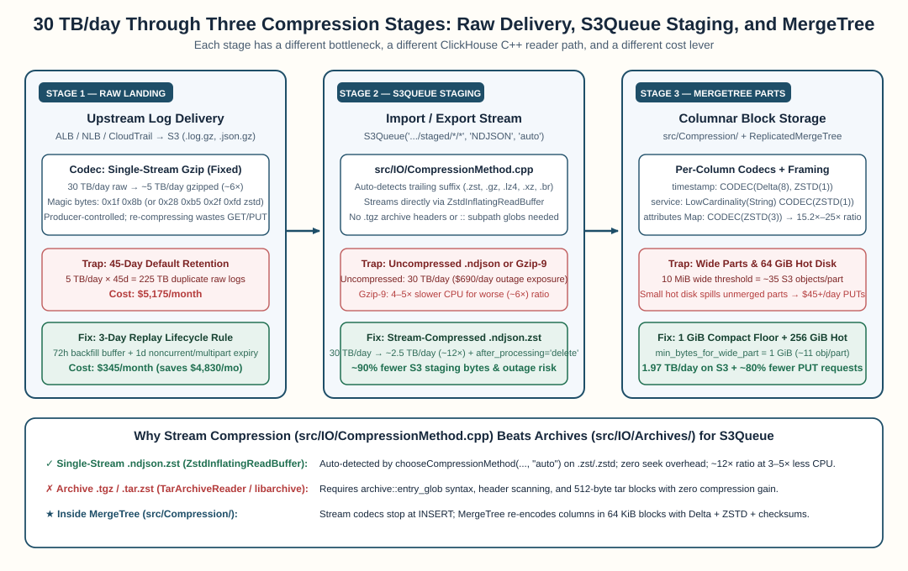
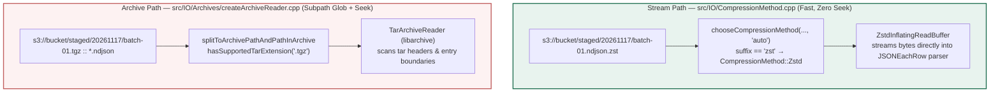

When a cost audit on a **30 TB/day** log pipeline flags a line item like:

| Line Item | Basis (30 TB/day = 912 TB/mo uncompressed) | 3-Day Buffer | 45-Day Default |
|---|---|---|---|
| **Raw `.log.gz` S3 retention** | `~5 TB/day` gzipped (`~6×` ratio) × `$23/TB-mo` | **$345/mo** | **$5,175/mo** |

the immediate engineering instinct is to ask: *"Can we use a better compression format than `.tgz` or `.gz` that ClickHouse understands natively?"*

The answer is **yes** — switching from gzip to **Zstandard (`.zst`)** typically doubles compression on structured logs (`~6×` → `~12–15×`) while using a fraction of the CPU.

But if you open the ClickHouse source tree and trace how a byte actually travels from an S3 landing bucket into a `ReplicatedMergeTree` part, you quickly realize there isn't *one* compression boundary in a ClickHouse pipeline. There are **three**. Confusing them is how teams end up wrapping single files in `.tgz` tarballs, burning serverless CPU on `gzip -9`, leaving staging buckets completely uncompressed, or wondering why a `15×`-compressed table is still generating `$1,400/month` in S3 `PUT` requests.

Here is the anatomy of all three compression stages, straight from the ClickHouse C++ source.



---

## Stage 1: Raw Delivery in S3 (`.log.gz`) — Don't Re-Compress What You Can Expire

In most cloud log pipelines, the first S3 prefix is an immutable landing zone written by someone else's service principal — AWS ALB/NLB access logs, CloudTrail trails, CDN logs, or third-party forwarders.

Two facts govern this layer:

1. **Managed cloud producers hardcode single-stream `.gz`.** AWS load balancers and CloudTrail deliver `.log.gz` and `.json.gz` files at roughly a `6×` compression ratio (`30 TB/day` raw → `~5 TB/day` gzipped). You cannot configure ALB to emit `.zst`.
2. **Re-compressing raw landing files in place is a negative-ROI trap.** Transcoding `5 TB/day` of `.log.gz` into `~2.5 TB/day` of `.log.zst` just to hold it in S3 requires reading `5 TB/day`, burning compute to gunzip + zstd, and paying Tier-1 S3 `PUT` fees *(S3 Standard `PUT`/`COPY`/`LIST` API tier at `$0.005` per 1,000 requests)* on every object.

Once your ingest pipeline normalizes those logs into ClickHouse (and `clickhouse-backup` snapshots the table nightly), the raw landing zone has only one job: **a 72-hour replay buffer** in case a parser rule has a bug.

- At **45 days** of retention, `5 TB/day × 45 × $23/TB-mo` is **$5,175/month** of duplicate data.
- At **3 days** of retention (plus a 1-day `noncurrent_version_expiration` and `abort_incomplete_multipart_upload` rule on versioned buckets), that same replay safety costs **$345/month** — saving **$4,830/month** with a one-line S3 lifecycle change.

Where codec choice *does* matter in Stage 1 is when your own collectors or agents write raw files, or when your normalizer reads them. Instead of trusting file extensions (`.gz` vs `.zst` vs `.lz4`), a resilient streaming reader peeks up to the first four magic bytes of the buffered stream (2 bytes for gzip, 4 bytes for Zstd and LZ4):

| Codec | Magic Bytes (Hex) | Go / C++ Streaming Reader |
|---|---|---|
| **Gzip** (`.gz`, `.gzip`) | `1F 8B` | `pgzip.NewReader` / `LibdeflateInflatingReadBuffer` |
| **Zstandard** (`.zst`, `.zstd`) | `28 B5 2F FD` | `zstd.NewReader` / `ZstdInflatingReadBuffer` |
| **LZ4 Frame** (`.lz4`) | `04 22 4D 18` | `lz4.NewReader` / `Lz4InflatingReadBuffer` |

Peeking the stream header lets the same normalizer unwrap gzipped CloudTrail envelopes (`{"Records":[...]}`) and Zstd-compressed custom log streams without buffering the file in memory or relying on the filename.

---

## Stage 2: Staged Files for `S3Queue` and `s3()` — Why `.ndjson.zst` Beats `.tgz` and `.gz`

In a decoupled ingest architecture, your normalizer parses raw logs into structured `NDJSON` (`JSONEachRow`) batches (`150–200 MB` uncompressed per batch) and writes them to a staging prefix that ClickHouse's `S3Queue` engine drains. The running example for the rest of this post is a CDN edge access-log pipeline — one staging queue table per environment:

```sql
CREATE TABLE default.edge_staging
(
    `id` String,
    `timestamp` String,
    `pop` String,
    `payload` String,
    `logset` String
)
ENGINE = S3Queue(
    'https://my-staging-bucket.s3.us-west-2.amazonaws.com/staged-logs/*/*',
    'NDJSON',
    'auto'
)
SETTINGS
    mode = 'unordered',
    after_processing = 'delete';
```

That third argument — `'auto'` — is passed directly to `chooseCompressionMethod` in [`src/IO/CompressionMethod.cpp`](https://github.com/ClickHouse/ClickHouse/blob/master/src/IO/CompressionMethod.cpp).

### What ClickHouse's `chooseCompressionMethod` Actually Supports

In [`src/IO/CompressionMethod.h`](https://github.com/ClickHouse/ClickHouse/blob/master/src/IO/CompressionMethod.h) and [`src/IO/CompressionMethod.cpp`](https://github.com/ClickHouse/ClickHouse/blob/master/src/IO/CompressionMethod.cpp), ClickHouse defines the import/export stream codecs and the exact file extensions that `'auto'` recognizes:

```cpp
// src/IO/CompressionMethod.cpp
std::span<const std::string_view> getFileSuffixesForCompressionMethod(CompressionMethod method)
{
    static constexpr std::string_view gzip[] = {"gz", "gzip"};
    static constexpr std::string_view zlib[] = {"deflate"};
    static constexpr std::string_view brotli[] = {"br", "brotli"};
    static constexpr std::string_view xz[] = {"xz", "lzma"};
    static constexpr std::string_view zstd[] = {"zst", "zstd"};
    static constexpr std::string_view lz4[] = {"lz4"};
    static constexpr std::string_view bz2[] = {"bz2"};
    static constexpr std::string_view snappy[] = {"snappy"};
    // ...
}
```

Even ClickHouse's own HTTP content-negotiation preference order in `chooseHTTPCompressionMethod` (`CompressionMethod.cpp`) ranks them in order of practical efficiency:

1. **`zstd`** (`.zst`, `.zstd`) → `ZstdInflatingReadBuffer` (levels `1..22`)
2. **`br`** (`.br`, `.brotli`) → `BrotliReadBuffer`
3. **`lz4`** (`.lz4`) → `Lz4InflatingReadBuffer` (levels `1..12`)
4. **`snappy`** (`.snappy`) → `HadoopSnappyReadBuffer` / `SnappyFramedReadBuffer`
5. **`gzip`** / **`deflate`** (`.gz`, `.gzip`, `.deflate`) → `LibdeflateInflatingReadBuffer` (levels `1..12`)
6. **`xz`** (`.xz`, `.lzma`) → `LZMAInflatingReadBuffer`
7. **`bz2`** (`.bz2`) → `Bzip2ReadBuffer`

Here is how the main contenders behave on `30 TB/day` of normalized NDJSON logs:

| Codec | Extension | Typical NDJSON Ratio | Staged Volume @ 30 TB/day | Write CPU (Producer) | Read CPU (ClickHouse) | Verdict |
|---|---|---|---|---|---|---|
| **Uncompressed** | `.ndjson` | `1.0×` | `30.0 TB/day` | Zero | Zero decompression, **12× network/S3 I/O** | ❌ Dangerous during drain lag (`$690/day` S3 accumulation) |
| **Gzip (Level 9)** | `.ndjson.gz` | `~6–7×` | `~4.5–5.0 TB/day` | **High** (slow deflate window) | Fast (`libdeflate`) | ⚠️ Burns 3–5× more producer CPU for half the compression of Zstd |
| **LZ4** | `.ndjson.lz4` | `~3.5–4.5×` | `~7.0–8.5 TB/day` | Ultra-fast | Ultra-fast | 🟡 Good only when producer CPU is extreme bottleneck and S3 is free |
| **XZ / LZMA2** | `.ndjson.xz` | `~13–16×` | `~1.9–2.3 TB/day` | **10–20× slower** than Zstd | Slow | ❌ Compute bill dwarfs the marginal S3 savings |
| **Zstandard (Level 3)** | **`.ndjson.zst`** | **`~10–15×`** | **`~2.0–3.0 TB/day`** | **Fast (~300–500 MB/s/core)** | **Very fast (~1+ GB/s/core)** | ✅ **Best overall for S3 staging & `S3Queue`** |

### Why `.tgz` (Tar + Gzip) Is the Wrong Abstraction for ClickHouse

People often say "`.tgz`" as shorthand for `.gz`, but in ClickHouse's I/O layer, **an archive (`.tgz`, `.tar.gz`, `.tar.zst`, `.zip`, `.7z`) and a compressed stream (`.ndjson.gz`, `.ndjson.zst`) take completely different code paths**:



In [`src/IO/Archives/ArchiveUtils.cpp`](https://github.com/ClickHouse/ClickHouse/blob/master/src/IO/Archives/ArchiveUtils.cpp) and [`src/IO/Archives/createArchiveReader.cpp`](https://github.com/ClickHouse/ClickHouse/blob/master/src/IO/Archives/createArchiveReader.cpp), ClickHouse does support `.tar`, `.tar.gz`, `.tgz`, `.tar.zst`, `.tzst`, `.tar.xz`, `.tar.bz2`, `.zip`, and `.7z` via `libarchive` and `minizip`.

However, `tar` is a **multi-file container**, not a compressor. Wrapping a single NDJSON batch inside a `.tgz` or `.tar.zst`:
1. Adds 512-byte POSIX tar header blocks around the file;
2. Requires ClickHouse's `::` archive-glob syntax (`s3('...batch.tgz :: *.ndjson')`) via `splitToArchivePathAndPathInArchive`; and
3. Forces `TarArchiveReader` to parse archive entry headers instead of streaming raw bytes straight into `ZstdInflatingReadBuffer`.

When one S3 object contains one logical batch of rows, always write a **plain stream-compressed `.ndjson.zst`** file.

### Two Subtle Staging Bugs Worth Avoiding

When wiring `.ndjson.zst` into a producer-to-`S3Queue` pipeline, watch out for two classic bugs:

1. **The zero-value uncompressed default.** If your pipeline's configuration struct uses `0` (`iota`) for `CompressionNone` and your staging uploader forgets to set `OutputCompression`, the pipeline works with zero errors — it just uploads **uncompressed `.ndjson`** to S3. During normal operation `after_processing = 'delete'` hides the mistake because files live for seconds; the day a schema mismatch pauses the drain for 48 hours, `60 TB` of uncompressed NDJSON piles up in S3 instead of `4–5 TB` of `.ndjson.zst`.
2. **The `filepath.Ext` compound-extension trap.** In Go, `filepath.Ext("batch-001.ndjson.zst")` returns `".zst"`, not `".ndjson.zst"`. If your S3 key builder constructs keys with `fmt.Sprintf("%s/%d%s", prefix, ts, filepath.Ext(localFile))`, it strips `.ndjson` from the object name. While ClickHouse's `chooseCompressionMethod` only inspects the substring after the *last* dot (`path.find_last_of('.')` → `"zst"`), preserving the full `.ndjson.zst` suffix keeps bucket listings and debugging self-describing.

---

## Stage 3: Inside MergeTree (`src/Compression/`) — Column Codecs + Part Shape

What happens after `S3Queue` decompresses your `.ndjson.zst` file? A Materialized View bridges the streaming queue table to the destination `ReplicatedMergeTree` table, shaping the JSON fields and forwarding ClickHouse's virtual object-storage columns (`_path`, `_file`, `_size`) for source lineage:

```sql
CREATE MATERIALIZED VIEW default.edge_staging_mv TO default.edge_requests
AS SELECT
    parseDateTime64BestEffortOrZero(timestamp, 9, 'UTC') AS timestamp,
    pop,
    id                                                  AS request_id,
    JSONExtract(payload, 'headers', 'Map(String, String)') AS http_headers,
    JSONExtract(payload, 'waf', 'Map(String, String)')     AS waf_flags,
    _path,
    _file,
    _size
FROM default.edge_staging;
```

Look at the warning comment at the top of [`src/IO/CompressionMethod.h`](https://github.com/ClickHouse/ClickHouse/blob/master/src/IO/CompressionMethod.h):

```cpp
/** These are "generally recognizable" compression methods for data import/export.
  * Do not mess with more efficient compression methods used by ClickHouse internally
  *  (they use non-standard framing, indexes, checksums...)
  */
```

External stream compression stops at the `INSERT` boundary. Once rows are parsed, ClickHouse pivots them from row-oriented JSON into **columnar MergeTree parts**, and applies its internal block compression (`src/Compression/`, framed in 64 KiB+ blocks with CityHash128 checksums).

### 1. Per-Column Codecs: Why MergeTree Beats Raw Zstd (`15.2×–25×`)

In row-oriented `.ndjson.zst`, timestamps, UUIDs, service names, and JSON maps are interleaved on every line. In MergeTree, each column lives in its own stream (`data.bin`), so you can pair specialized pre-conditioners with `ZSTD`:

```sql
CREATE TABLE default.edge_requests
(
    `timestamp`    DateTime64(9, 'UTC')   CODEC(Delta(8), ZSTD(1)),
    `pop`          LowCardinality(String) CODEC(ZSTD(1)),
    `request_id`   String                 CODEC(ZSTD(1)),
    `http_headers` Map(String, String)    CODEC(ZSTD(3)),
    `waf_flags`    Map(String, String)    CODEC(ZSTD(3)),
    `_path`        LowCardinality(String) CODEC(ZSTD(1)),
    `_file`        LowCardinality(String) CODEC(ZSTD(1)),
    `_size`        UInt64                 CODEC(T64, ZSTD(1))
)
ENGINE = ReplicatedMergeTree('/clickhouse/tables/{shard}/edge_requests', '{replica}')
PARTITION BY toDate(timestamp)
ORDER BY (pop, timestamp, request_id)
TTL toDateTime(timestamp) + INTERVAL 14 DAY TO VOLUME 'cold',
    toDateTime(timestamp) + INTERVAL 90 DAY
SETTINGS
    storage_policy = 'tiered',
    min_bytes_for_wide_part = 1073741824,
    ttl_only_drop_parts = 1;
```

- **`ORDER BY (pop, timestamp, request_id)` + `Delta(8), ZSTD(1)`**: Because rows are sorted by `pop` and then `timestamp`, consecutive 8-byte nanosecond timestamps differ by milliseconds. `Delta(8)` turns 64-bit integers into tiny deltas that `ZSTD(1)` compresses to less than 1 bit per row.
- **`LowCardinality(String)` on `pop`, `_path`, `_file`**: Replaces repeated strings with dictionary indices before `ZSTD(1)` runs, eliminating both storage bloat and wire-conversion overhead during inserts.
- **`CODEC(ZSTD(3))` on `Map(String, String)` payloads**: Without an explicit `CODEC`, ClickHouse falls back to `lz4` (`compression/case/method: lz4`). Putting `ZSTD(3)` on the two heavy `Map` columns (`http_headers`, `waf_flags`) shrinks on-disk part sizes by **2.3×** over `LZ4` (`15.2×` to `~20–25×` total compression versus raw uncompressed JSON).

### 2. The S3 Request Blind Spot: Compression Shrinks Bytes, Not Object Counts

At `15.2×` compression, `30 TB/day` of raw logs becomes **`1.974 TB/day`** of cold MergeTree parts in S3 (`~$45/day` per replica copy per retained month).

Yet in our first 30 TB/day soak test, S3 billed **`$45.89 to $84.05 per day` in S3 API request fees alone** — up to `16.8 million` Tier-1 `PUT`/`COPY`/`LIST` requests per day at `$0.005` per thousand.

Why? Because **compression ratio controls bytes; part shape controls object count**:

1. **Wide parts explode S3 object counts (`min_bytes_for_wide_part`).** Open-source ClickHouse defaults `min_bytes_for_wide_part` to `10 MiB` (`src/Storages/MergeTree/MergeTreeSettings.cpp`). Any part over `10 MiB` is written in **Wide** format — one separate S3 object per column and mark file (`~35 S3 objects per part`). Raising `min_bytes_for_wide_part = 1073741824` (**1 GiB**, which ClickHouse Cloud uses by default) keeps parts under 1 GiB in **Compact** format (`data.bin` + `data.mrk3` → `~11 S3 objects per part`), immediately cutting S3 `PUT` counts by **~3.2×**.
2. **Small hot disks force premature S3 spills (`move_factor = 0.1`).** With a `64 GiB` local `gp3` *(AWS EBS general-purpose SSD)* hot disk, 30 TB/day fills 90% of local disk in two hours. ClickHouse's `move_factor` emergency valve then pushes unmerged `150–500 MB` parts straight to S3, where background merges have to download, merge, and re-upload them 3–5 times. Sizing the hot `gp3` volume to **`256–384 GiB`** (with `<prefer_not_to_merge>true</prefer_not_to_merge>` on the cold S3 volume) lets merges finish locally on SSD so each `1–150 GiB` part is uploaded to S3 **once**.
3. **Partial TTL expiry rewrites parts (`ttl_only_drop_parts = 1`).** With `PARTITION BY toDate(timestamp)` and `ttl_only_drop_parts = 1`, expired daily partitions are removed via free S3 `DELETE` calls (`$0`) instead of `GET` + `PUT` part rewrites.

---

## Summary Checklist: End-to-End Compression Hygiene

If you are running an S3-backed ClickHouse pipeline at multi-TB/day scale, check all three boundaries:

| Boundary | What to Configure | What It Saves |
|---|---|---|
| **1. Raw S3 Landing (`AWSLogs/`)** | Keep producer `.log.gz` as-is; set S3 lifecycle expiration to **3 days** (`+1d` noncurrent/incomplete multipart cleanup) | **−$4,830/mo** at 30 TB/day (vs 45-day default) |
| **2. Staged Ingest (`S3Queue`)** | Emit stream-compressed **`.ndjson.zst`** (`Zstd` level 3, not `.tgz` and not uncompressed `.ndjson`) + `after_processing = 'delete'` | **~10–15× smaller** staging S3 footprint & 3–5× less producer CPU than `gzip -9` |
| **3. MergeTree Columns** | `Delta(8) + ZSTD(1)` on timestamps, `LowCardinality` on repeated strings, `ZSTD(3)` on `Map`/JSON columns | **`15.2×–25×`** cold S3 & cache compression (`30 TB/d → 1.97 TB/d`) |
| **4. MergeTree Part Shape on S3** | `min_bytes_for_wide_part = 1073741824` (1 GiB), `ttl_only_drop_parts = 1`, `≥256 GiB` hot `gp3` disk | **−80% to −90%** S3 Tier-1 `PUT` request amplification (`$1,395/mo → ~$120/mo`) |
