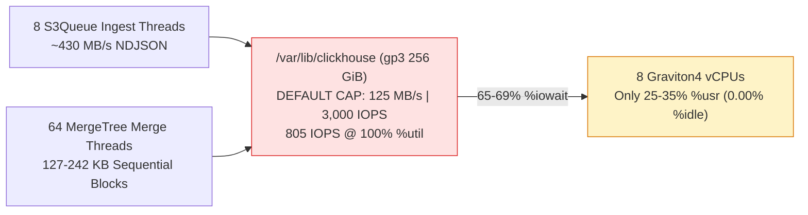

Nothing misleads a capacity review faster than a CPU graph hovering at **30%** while your database falls behind on background work.

During a **30 TB/day** synthetic log ingestion soak (`6` generator workers, `200 MB` NDJSON batches, `~217k records/s`, `~37.5 TB/day` instantaneous pace) against a two-writer `r8g.2xlarge` ClickHouse cluster in `us-west-2`, our CloudWatch fleet health dashboard showed an apparent paradox:

- `ClickHouseMetrics_Merge` sat pinned at **`64`** (every slot in `BackgroundMergesAndMutationsPoolTask` occupied).
- `ClickHouseMetrics_DelayedInserts` and `DistributedFilesToInsert` were **`0.0`**.
- Meanwhile, user-space CPU looked remarkably relaxed at **25–35%**.

If ClickHouse had **64 merges in flight** and **65%+ unused CPU headroom**, why wasn't it using those 8 Graviton4 vCPUs to drain merges faster?

---

## The Illusion: `cpu_usage_idle = 0%`, Yet `%usr = 30%`

When we SSH'd (via SSM) into `writer-4` and `writer-2` and ran `mpstat -P ALL 1 1` alongside `iostat -xz 1 2`, the "unused CPU" vanished immediately:

```text
avg-cpu:  %user   %nice %system %iowait  %steal   %idle
          25.61    0.00    5.61   68.79    0.00    0.00

Device      r/s     rkB/s   rareq-sz     w/s     wkB/s   wareq-sz  aqu-sz  %util
nvme1n1  582.00  73956.00     127.07  223.00  54048.00     242.37    5.50 100.00
```

Every single assumption we had about CPU headroom was backwards:

1. **`%idle` was `0.00%`** (not `70%`!).
2. **`%iowait` was `68.79%`** on `writer-4` (`58.73%–65.53%` across all cores on `writer-2` and `writer-4`).
3. **`nvme1n1` (`/var/lib/clickhouse`, a `256 GiB` `gp3` volume) was at `100.00% %util`**.
4. **Total disk bandwidth was `73,956 + 54,048 = 128,004 KB/s` = `125.0 MB/s` exact.**

Even more telling: look at the IOPS column.

- Read IOPS: **`582 r/s`** (average request size **`127.07 KB`**)
- Write IOPS: **`223 w/s`** (average request size **`242.37 KB`**)
- **Total IOPS: `805 IOPS`** — barely **27%** of `gp3`'s free `3,000 IOPS` baseline!

ClickHouse MergeTree background merges are **purely sequential large-block streaming**. At `127–242 KB` per IO, it takes only ~800 IOPS to hit the **`125 MB/s` default `gp3` throughput ceiling**. Once `nvme1n1` hit `125 MB/s`, all `64` merge threads plus `8` `S3Queue` ingest threads queued behind `aqu-sz = 5.50` disk requests, leaving ~65% of every vCPU stalled waiting on EBS.



Because `AWS/EC2` `CPUUtilization` excludes `%iowait`, horizontal target-tracking autoscaling saw `~35%` CPU and assumed the writers were under-utilized—actually threatening to scale *in* while the writers were choking at `100%` disk utilization.

---

## Why Scaling EC2 Is the Wrong Fix (and How EBS Bandwidth Math Works)

When disk throughput caps out, teams often reach for one of two expensive options: adding more writer nodes, or switching to `io2` Block Express. Neither is cost-effective here.

First, look at the EBS bandwidth envelope of the Graviton4 instance types we checked in `us-west-2` (`aws ec2 describe-instance-types`):

| Instance Type | vCPUs | RAM | EBS Baseline Bandwidth | EBS Max Burst Bandwidth | Max IOPS | On-Demand $/mo (`us-west-2`) |
|---|---|---|---|---|---|---|
| `m8g.2xlarge` | 8 | 32 GiB | `2,500 Mbps` (**`312.5 MB/s`**) | `10,000 Mbps` (**`1,250 MB/s`**) | 40,000 | ~$262/mo |
| `r8g.2xlarge` | 8 | 64 GiB | `2,500 Mbps` (**`312.5 MB/s`**) | `10,000 Mbps` (**`1,250 MB/s`**) | 40,000 | ~$344/mo |
| `m8g.4xlarge` | 16 | 64 GiB | `5,000 Mbps` (**`625.0 MB/s`**) | `10,000 Mbps` (**`1,250 MB/s`**) | 40,000 | ~$524/mo |

Our `2xlarge` writers already have **`312.5 MB/s` sustained** and **`1,250 MB/s` burst** EBS bandwidth sitting completely unused behind a `125 MB/s` `gp3` volume configuration!

Second, compare the `us-west-2` monthly cost of **fixing the volume** versus **adding compute**:

| Lever | Disk Bandwidth / Writer | Monthly Cost Delta (2 Writers) | Cost per +100 MB/s/node |
|---|---|---|---|
| **Baseline `gp3` (`125 MB/s`, `3,000 IOPS`)** | `125 MB/s` | `$0` (choked at 69% `iowait`) | — |
| **Add 1 extra `r8g.2xlarge` writer** | Still `125 MB/s` per node | **+$344/mo** (+$20 EBS) | `~$290/mo` (plus 1× extra S3 replica copy!) |
| **Provision `gp3` `500 MB/s` + `4,000 IOPS`** | **`500 MB/s` (`4×`!)** | **+$40/mo total** (`+$20/mo` per writer) | **`$5.33/mo`** |

The pricing math on `gp3` (`us-west-2`) is lopsided in your favor:
- Extra `gp3` throughput above `125 MB/s` is **`$0.04 / MB/s-month`**: raising `125 → 500 MB/s` (`+375 MB/s`) is **$15.00/month** per writer.
- Extra `gp3` IOPS above `3,000` is **`$0.005 / IOPS-month`**: raising `3,000 → 4,000 IOPS` (`+1,000 IOPS`, keeping generous headroom above `gp3`'s 0.25 MB/s-per-IOPS ratio) is **$5.00/month** per writer.

For **$20/month per writer** (`6–7%` of a node's cost), you get **4× the local disk throughput**—matching `2xlarge`'s `312.5 MB/s` sustained EBS envelope with burst headroom up to `500 MB/s` during heavy merge waves, without adding another ClickHouse replica (which in non-CAS clusters also adds another full cold-tier S3 copy!).

*(Note: Why not ephemeral NVMe instance store like `m8gd`/`r8gd` for `/var/lib/clickhouse`? Instance-store NVMe is great for ClickHouse's re-derivable S3 read cache on `/dev/sdc`, which we support via `cache_on_nvme_instance_store`, but metadata and hot parts live on persistent EBS so an instance stop or host maintenance never wipes un-tiered state.)*

---

## Live Proof: Modifying the Running Volumes Online

Because `ModifyVolume` on EBS `gp3` takes effect online without restarting ClickHouse or detaching disks, we upgraded the live `256 GiB` `/dev/sdb` volumes on both running writers during the active 30 TB/day soak:

```bash
aws ec2 modify-volume --region us-west-2 \
  --volume-id vol-03df61b84c2cd1e62 \
  --iops 4000 --throughput 500
```

**Twenty seconds later**, we ran `iostat -xz 1 2` again on the exact same instances:

| Node | Metric | Before (`125 MB/s` / `3k IOPS`) | After (`500 MB/s` / `4k IOPS`) | Change |
|---|---|---|---|---|
| **`writer-4`** | `%user` CPU | `25.61%` | **`89.38%`** | **`+3.5×` real compute** |
| **`writer-4`** | `%iowait` | `68.79%` | **`0.00%`** | **Stall eliminated** |
| **`writer-4`** | Disk read await | `6.43 ms` | **`1.01 ms`** | **`6.4×` lower latency** |
| **`writer-4`** | Disk `%util` | `100.00%` | **`67.00%`** | **`33%` headroom** |
| **`writer-2`** | `%iowait` | `58.73%` | **`0.38%`** | **Stall eliminated** |
| **`writer-2`** | Disk bandwidth (`r+w`) | `125.0 MB/s` | **`494.5 MB/s`** (`506,388 KB/s`) | **`3.96×` throughput** |

Within seconds, `%iowait` collapsed from **68.8% to 0.00%**, `%user` jumped from **25.6% to 89.4%**, read latency fell **6.4×**, and `writer-2` immediately streamed **494.5 MB/s** through its merge pool.

---

## Locking It into Terraform (and Fixing the Dashboard Blind Spot)

Two changes prevent this from ever creeping back into a new cluster:

### 1. Explicit `gp3` IOPS & Throughput in the Launch Templates

We added `metadata_disk_iops` (`4000`) and `metadata_disk_throughput_mbps` (`500`) to `instance_config` and wired them directly into `aws_launch_template.writer` and `aws_launch_template.reader`:

```hcl
block_device_mappings {
  device_name = "/dev/sdb"
  ebs {
    encrypted             = true
    volume_size           = var.metadata_disk_size_gb
    volume_type           = "gp3"
    iops                  = var.metadata_disk_iops
    throughput            = var.metadata_disk_throughput_mbps
    delete_on_termination = true
  }
}
```

And combined `m8g.2xlarge` (`$262/mo`, 32 GiB RAM) with `500 MB/s` / `4,000 IOPS` (`+$20/mo`) = **`$282/mo`** — cheaper than an `r8g.2xlarge` (`$344/mo`) with `125 MB/s` storage, while delivering **4× the disk bandwidth**.

### 2. Surface `cpu_usage_iowait` on the Fleet Health Dashboard

Our CloudWatch dashboard had two subtle blind spots that hid this bottleneck:
1. `"busiest writer (min idle)"` used `MAX(SEARCH(... cpu_usage_idle ...))` instead of `MIN(...)`, plotting the *least* busy writer instead of the *most* busy one.
2. It plotted `cpu_usage_idle` on writers without `cpu_usage_iowait`, so a disk-stalled node looked identical to a CPU-saturated node (and EC2 `CPUUtilization` looked deceptively low).

Adding `MAX(SEARCH('{ClickHouse/Node,host,cpu} host="writer-*" MetricName="cpu_usage_iowait" cpu="cpu-total"', 'Average', 60))` right next to `cpu_usage_idle` makes an EBS throughput wall unmistakable at a glance.

---

## Key Takeaways

- **Low `%usr` + `0%` `%idle` = I/O bottleneck, not CPU headroom**: Never trust `CPUUtilization` alone without checking `%iowait`.
- **ClickHouse merges are bandwidth-bound, not IOPS-bound**: With `127–242 KB` sequential blocks, `805` IOPS already hits `gp3`'s `125 MB/s` cap.
- **Upgrade the `gp3` pipe before scaling EC2**: Spending `$20/mo` for `500 MB/s` `gp3` throughput unlocks the `312.5–1,250 MB/s` EBS pipe you already paid for on your Graviton instances—delivering `4×` disk speed at `6%` of the cost of adding another writer.
