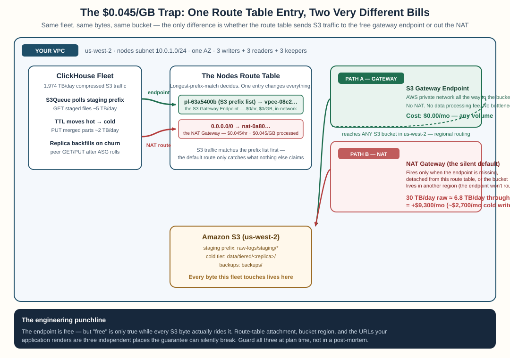
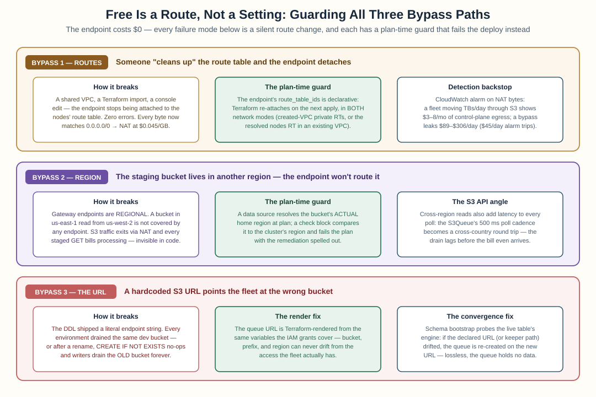
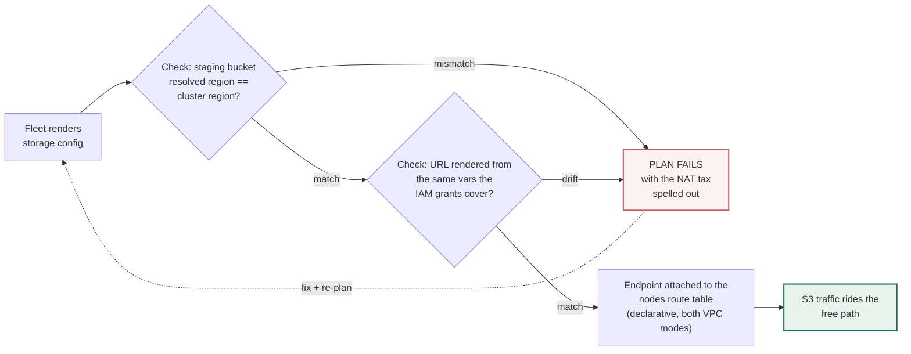

The most expensive line item in my November AWS bill was one
I never configured. It was a default.

A ClickHouse log fleet — three writers, three readers, three
keepers — ingesting 30 TB/day of logs into S3-backed storage
should have a network bill of roughly **$70/month**: two NLBs,
one NAT gateway for control-plane egress, three public IPv4
addresses, a Route 53 zone. That's what the cost model said.
What the actual account showed, once the fleet ran its first
real soak, was a network path quietly moving terabytes a day
through a component priced at **$0.045 per GB**.

The S3 Gateway Endpoint is the difference between those two
bills. It costs nothing. It takes fifteen minutes to create.
And at this scale, whether traffic rides it or bypasses it is
the difference between **~$70/month and ~$2,700–$9,300/month** — with
no error message, no alarm, and no functional difference
whatsoever on either path. The pipeline works identically both
ways. That's what makes it dangerous.



## The arithmetic that makes it invisible

Start with what the fleet actually does with S3 in a day. At
30 TB/day of uncompressed logs, ClickHouse's ~15× ZSTD
compression puts **~1.97 TB/day** of merged parts into the
cold tier. The ingest path reads **~5 TB/day** of staged
NDJSON files out of the raw-logs bucket. Replica backfills
after ASG churn re-fetch the recent window across nodes. Add
nightly backups. Round to **6–7 TB/day of S3 traffic** on a
calm day.

Now price two network paths for that traffic:

| Path | Rate | Monthly cost @ ~6.8 TB/day (~207 TB/mo) |
|---|---|---|
| S3 Gateway Endpoint | **$0/hr + $0/GB** | **$0.00** |
| NAT Gateway fallback | $0.045/hr + **$0.045/GB processed** | **~$9,300/mo** (~$306/day across all ~6.8 TB/day; **~$2,700/mo** on the ~1.97 TB/day cold-tier writes alone) |

The NAT gateway is not a mistake. It exists for the fleet's
control plane — SSM agents, Secrets Manager, apt packages,
the odd outbound API call. Priced for that job, it's $32.85
of hourly time plus **$3–8 of data processing per month**.
Priced for the fleet's entire S3 diet, it's a second storage
bill. The same resource. The only variable is which route
the bytes take.

## Why "used it" and "created it" are different guarantees

A gateway endpoint is not an appliance — it's a **route
table attachment**. You create the endpoint, AWS gives you
the S3 prefix list for your region, and you attach the
endpoint to a route table. The route table then carries two
entries:

```text
pl-63a5400b (S3 prefix list) → the endpoint   ← more specific
0.0.0.0/0                   → the NAT        ← the default
```

S3 traffic matches the prefix-list route first, rides the
free path, and never reaches the NAT. This works with zero
application changes: ClickHouse's S3 disks, the S3Queue
engine, and `clickhouse-backup` all open ordinary HTTPS
sessions to regional bucket endpoints; the route table
decides the network those requests travel.

The trap is that "attached" is a state, not a property. And
there are three completely different ways for the state to
be wrong while everything continues to work:



**Bypass 1 — the route table.** A shared VPC gets
reorganized. Someone imports the route table into another
Terraform state, or "cleans up" the endpoint attachment in
the console. The nodes keep their default route. Every byte
of S3 traffic now matches `0.0.0.0/0` instead of the prefix
list. No errors, no latency spike worth noticing — just a
bill that quietly grows 40–130×.

**Bypass 2 — the region.** Gateway endpoints are regional.
The endpoint in `us-west-2` routes to S3 in `us-west-2` and
nothing else. Point your ingest at a staging bucket in
`us-east-1` — because that's where the producers live, say —
and the endpoint is useless for that traffic: cross-region
S3 rides the NAT, billed at $0.045/GB plus inter-region
transfer, and the S3Queue's 500 ms poll cadence becomes a
cross-country round trip before the bill even arrives.

**Bypass 3 — the URL.** The nastiest one, because it's pure
config drift. Our ClickHouse bootstrap DDL declared the
S3Queue's drain URL as a literal string:
`https://acme-edge-dev-raw-logs.s3.us-west-2...`.
Every environment that DDL shipped to would drain the dev
bucket. And the deeper version of the same bug: after a
bucket rename, the declared URL changes but the live table's
`CREATE IF NOT EXISTS` silently no-ops — writers keep
draining the old bucket forever, IAM grants pointing one way,
traffic flowing another.

## Turning free into an invariant

The endpoint itself is a five-line Terraform resource. What
makes it trustworthy is guarding all three bypass paths at
**plan time** — so a silent route change becomes a loud
failed plan instead of a line-item surprise:



1. **The attachment is declarative.** The endpoint's
   `route_table_ids` covers the nodes' route tables in both
   network modes — the created-VPC mode attaches to the
   private route tables, and the existing-VPC mode resolves
   the nodes' route table (caller-specified, the subnet's, or
   the VPC main). A hand-edit survives exactly until the next
   apply.

2. **A plan-time check resolves the bucket's real region.**
   The staging bucket is just a string in tfvars — it could
   live anywhere. A `data "aws_s3_bucket"` lookup resolves
   its actual home region, and a `check` block compares it to
   the cluster's region. A cross-region bucket fails the plan
   with the remediation in the error message, not the
   invoice.

3. **The URL renders from configuration.** The S3Queue's
   drain URL is now `templatefile`-rendered from the same
   `storage_config` variables the IAM grants cover — bucket,
   prefix, and region can never drift from the access the
   fleet actually has. And the schema bootstrap pass probes
   the live table: if the declared URL drifted from what the
   running queue polls, the queue is re-created on the new
   URL — lossless, because a queue table holds no data under
   `after_processing = 'delete'`.

Then one detection backstop for whatever a human does by
hand anyway: **a CloudWatch alarm on NAT bytes**. A healthy
fleet shows single-digit dollars a month of NAT processing;
a bypass leaks ~$89/day (~$2,700/month) on cold-tier writes
alone and ~$306/day (~$9,300/month) across the full S3 path,
so a $45/day (~1 TB/day) alarm trips on the first day. The
alarm is a smoke detector — everything above is the fire
code.

## The request-cost blind spot the endpoint doesn't cover

One clarification worth making, because the audit that
started all this conflated two things: the gateway endpoint
covers the **network path**, not the **API pricing**. S3
still bills PUT/COPY/LIST at $0.005 per thousand and GET at
$0.0004 per thousand — and at 30 TB/day, those requests are
their own blind spot.

The Cost Explorer numbers from the soak: **$45.89/day of S3
API charges** ($40.31 of Tier-1 PUT/LIST + $5.58 of Tier-2
GET) against a model that had penciled in $45/month. The
amplifiers were all part-shape problems — small 64 GiB hot
disks hitting `move_factor = 0.1` within hours and pushing
unmerged small parts to S3, wide parts storing one S3 object
per column (~35 objects per part where ~11 would do), TTL
expiry rewriting parts instead of dropping them whole, and
per-replica claim-tree duplication before the shared
`keeper_path` fix. The collapse levers are the mirrors of
each amplifier: hot disks big enough that merges complete
locally, `min_bytes_for_wide_part = 1 GiB` (the ClickHouse
Cloud default, for exactly this reason), whole-part TTL
drops on day-partitioned data, and one shared claim tree.

That story — the API amplifiers and their fixes — is its own
post. The point here is the division of labor: **the
endpoint makes the bytes free; part shape makes the requests
cheap.** You need both, and neither substitutes for the
other.

## The punchline

There's a genre of cloud cost advice that stops at "create
the gateway endpoint, it's free." That advice is correct and
insufficient. At 30 TB/day the endpoint is not a checkbox —
it's a **structural assumption** that three independent
things can silently invalidate, and the difference between
honored and violated is a 40–130× swing on a bill with no
accompanying failure.

Free, in infrastructure, is a property of a route — not of a
resource. Treat it like one: make the attachment
declarative, resolve the bucket's real region at plan, render
the URLs your data planes call, and keep a smoke detector on
the NAT. The fifteen minutes it takes to guard is the
cheapest engineering in the whole pipeline.
