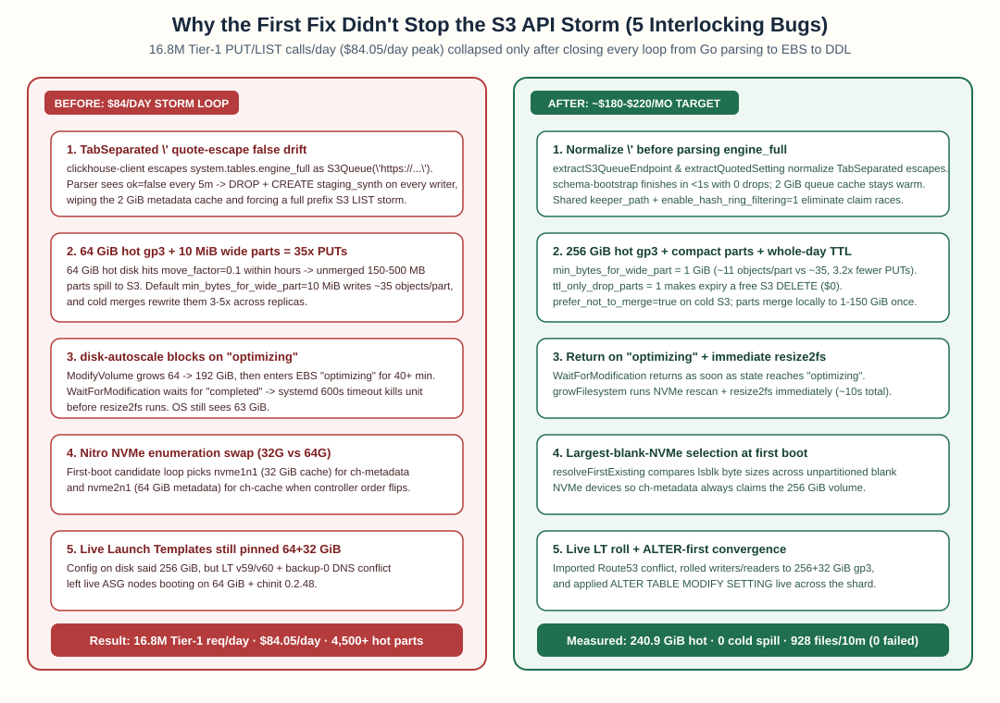

There is a specific kind of production humility that only arrives when
you look at a billing dashboard after you think you fixed the bug.

Earlier that day, we had shipped what looked like a complete fix for our
S3 API request storm: a shared S3Queue `keeper_path`,
`enable_hash_ring_filtering = 1` to stop writers from racing each other
for every file, a 15-minute `persistent_processing_node_ttl_seconds`, and
an automated `disk-autoscale` timer in [chinit](https://github.com/stackgenhq/chinit).
On paper, Tier-1 S3 requests (`PUT`/`COPY`/`LIST` at `$0.005` per 1,000)
should have fallen from `$45/day` toward `$6–$7/day` (`~$180–$220/month`).

Then we queried Cost Explorer. In a single partial day, Tier-1 S3
requests hit **$84.05 (`16.8 million` requests)** — an annualized pace
north of **$2,500/month**.

So we stopped reading commit logs and probed the live AWS fleet
instance-by-instance: Launch Templates, attached EBS volumes, systemd
journals, `lsblk`, DynamoDB claims, and `system.tables` inside
ClickHouse. What we found wasn't one broken flag. It was **five
interlocking bugs** across our Go bootstrapper, EBS lifecycle handling,
ClickHouse table settings, and Terraform rollout state — each hiding the
others.



## Bug 1: The false-drift loop dropping `S3Queue` every five minutes

When we tailed `journalctl -u schema-bootstrap.service` on the writers,
every single node was printing the exact same warning every five
minutes:

```json
{"level":"WARN","msg":"schema bootstrap: S3Queue keeper_path/endpoint drift — re-creating the queue table on the declared URL and shared claim path","table":"staging_synth"}
```

Why? Earlier we had added endpoint-URL drift convergence to
`chinit`'s `ApplyBootstrapDDL` (`s3QueueDrift` in
[render.go](https://github.com/stackgenhq/chinit/blob/main/pkg/chinit/domain/service/render.go))
so changing the staging bucket in Terraform would automatically drop and
re-create the `S3Queue` table instead of silently no-oping behind
`CREATE TABLE IF NOT EXISTS`.

To detect drift, `chinit` ran:

```sql
SELECT engine_full FROM system.tables WHERE database = 'default' AND name = 'staging_synth'
```

And here is what non-interactive `clickhouse-client` actually printed in
`TabSeparated` format (its default output format):

```text
S3Queue(\'https://example-raw-logs.s3.us-west-2.amazonaws.com/staging-synth/*/*\', \'NDJSON\', \'auto\') SETTINGS keeper_path = \'/clickhouse/s3queue/staging_synth\', ...
```

Notice the `\'` backslashes. `TabSeparated` escapes single quotes inside
column values. Meanwhile, `extractS3QueueEndpoint` checked
`strings.HasPrefix(rest, "'")` — saw `\`, returned `liveURLOk = false`,
and `if !liveURLOk || liveURL != declaredURL` treated a parse failure as
endpoint drift!

**Every five minutes, on every writer, `chinit` dropped `staging_synth`
and re-created it.** That wiped the engine's 2 GiB in-memory metadata
cache, aborted in-flight file processing, and forced every writer to
re-`LIST` the entire staging prefix from scratch.

The fix in `render.go` was two lines plus a regression test with real
`TabSeparated` `\'`-escaped output in `applyddl_test.go`:

```go
func extractS3QueueEndpoint(stmt string) (string, bool) {
	stmt = strings.ReplaceAll(stmt, `\'`, `'`)
	idx := strings.Index(stmt, "S3Queue(")
    ...
```

Once deployed, `schema-bootstrap.service` went from taking 8–10 seconds
to drop and rebuild the queue every 5 minutes to finishing in **under
one second with zero drops**.

## Bug 2: `64 GiB` hot `gp3` + `10 MiB` wide parts = `35×` S3 `PUT` amplification

Even without the 5-minute `LIST` storm, the writers' `system.parts`
revealed the second half of the bill: the live Launch Template still
pinned `64 GiB` for `/dev/sdb` (hot `default` disk) + `32 GiB` for
`/dev/sdc` (`s3_cache`), and `default.edge_requests` had `active_parts`
climbing past `4,500`.

Why does a small hot disk blow up S3 API costs?

1. **Premature `move_factor = 0.1` spill**: With `<keep_free_space_bytes>10 GiB</keep_free_space_bytes>`
   on a `64 GiB` volume, `move_factor = 0.1` triggers the moment free
   space dips under ~16 GiB. Under 30–60 TB/day of ingest, writers hit
   that threshold in a couple of hours and spill small, unmerged
   `150–500 MB` parts straight to S3 — where background merges then have
   to `GET` and `PUT` them across S3 3–5 times.
2. **Wide-part file explosion**: Open-source ClickHouse defaults
   `min_bytes_for_wide_part` to `10 MiB`. Any part larger than `10 MiB`
   is written in **wide** format — one separate S3 object per column and
   mark file (~35 S3 objects per part on our log schema, instead of ~11
   in compact format).
3. **Cold-tier merge churn and partial TTL rewrites**: Without
   `<prefer_not_to_merge>true</prefer_not_to_merge>` on the cold volume
   and `ttl_only_drop_parts = 1`, ClickHouse both re-merged cold parts on
   S3 and rewrote partially expired parts on TTL expiry (`GET` + `PUT`)
   instead of dropping whole daily partitions (`DELETE`, which is free
   on S3).

The four-part fix:

- Resize hot `gp3` from `64 GiB` to **`256 GiB`** (`~$15/mo` per node in
  EBS, saving `~$1,000+/mo` in S3 Tier-1 API calls).
- Set `min_bytes_for_wide_part = 1073741824` (**1 GiB**, the ClickHouse
  Cloud default) and `ttl_only_drop_parts = 1` on `default.edge_requests` (both
  `ALTER`-first on the live cluster and in `bootstrap-ddl.sql`).
- Set `<prefer_not_to_merge>false</prefer_not_to_merge>` on `<hot>` and
  `<prefer_not_to_merge>true</prefer_not_to_merge>` on `<cold>` in
  `storage.xml`, so merges consolidate locally up to 1–150 GiB before
  parts TTL-move to S3 once.

## Bug 3: `disk-autoscale` timed out waiting for EBS `"completed"`

If the live fleet still had `64 GiB` hot disks, why hadn't `chinit`'s
`disk-autoscale` timer rescued them cleanly?

Checking `journalctl -u disk-autoscale.service` on `writer-1` and
`writer-4` answered that in three lines:

```text
Nov 17 22:10:29 writer-1 chinit[4764]: disk-autoscale: effective disk headroom probed unreserved_gib=4.47 floor_gib=12
Nov 17 22:20:29 writer-1 systemd[1]: disk-autoscale.service: start operation timed out. Terminating.
Nov 17 22:20:29 writer-1 systemd[1]: disk-autoscale.service: Failed with result 'timeout'.
```

`ModifyVolume` *did* grow the underlying EBS volume from `64 GiB` to
`192 GiB` (`3×`). Then `VolumeGrower.WaitForModification` polled EC2
every 10 seconds waiting for `ModificationState == "completed"`.

On AWS EBS, `ModifyVolume` transitions from `"modifying"` to
**`"optimizing"`** in ~5–10 seconds — at which point the new `192 GiB`
capacity is **already exposed to the guest kernel and ready for
`resize2fs`**. The `"optimizing"` phase is background block migration and
routinely takes 30–60+ minutes. Waiting for `"completed"` guaranteed that
every grow hit systemd's `TimeoutStartSec=600` (10 minutes) and was
killed with `SIGTERM` before `resize2fs` could run.

In `pkg/chinit/infra/aws/volumes.go` and `pkg/chinit/app/diskautoscale.go`,
the fix was straightforward:

```go
switch string(out.VolumesModifications[len(out.VolumesModifications)-1].ModificationState) {
case "completed", "optimizing":
    // New capacity is live for resize2fs once EBS enters optimizing.
    return nil
case "failed":
    return fmt.Errorf("volume modification failed for %s", volumeID)
}
```

Followed immediately by `growFilesystem(ctx, cfg)` in the same tick, so
volume growth and ext4 expansion finish in ~10 seconds instead of timing
out at 10 minutes.

## Bug 4: Nitro NVMe order roulette swapped `32 GiB` and `64 GiB`

When we ran `lsblk` across every writer and reader, one freshly launched
reader (`reader-2`) showed something sneaky:

```text
nvme0n1   50G   (root, GPT)
nvme1n1   32G   ch-metadata   /var/lib/clickhouse
nvme2n1   64G   ch-cache      /var/lib/clickhouse/disks
```

We had already added a partition-table guard in an earlier incident so
`ch-metadata` could never touch the `50G` GPT root disk. But on
`reader-2`, Nitro enumerated the `32 GiB` cache volume as `nvme1n1` and
the `64 GiB` metadata volume as `nvme2n1`. Because `awsMetadataCandidates`
checked `/dev/nvme0n1` then `/dev/nvme1n1`, the first blank unpartitioned
candidate happened to be the `32 GiB` cache disk — and `ch-metadata`
formatted and mounted it, leaving the `64 GiB` metadata disk to
`ch-cache`.

On a `256 GiB` metadata + `32 GiB` cache fleet, that same flip would
quietly shrink the hot tier `8×`.

In `pkg/chinit/infra/system/disks.go`, when `resolveFirstExisting` lands
on a blank unpartitioned NVMe disk on first boot, it now probes the full
blank NVMe pool (`nvme0n1..nvme3n1`) via `lsblk -b -d -n -o SIZE` and
picks the **largest** blank unpartitioned NVMe volume for `ch-metadata`
(leaving the smaller blank one for `ch-cache`).

## Bug 5: The Terraform changes weren't live in the Launch Templates

The final discovery was the simplest: `vars/dev.tfvars` in git said
`256 GiB` and `c8g.xlarge` readers, but `aws ec2 describe-launch-template-versions`
showed the live ASGs still pointing at `v59` (`64+32 GiB`, `r8g.2xlarge`)
and `v60` (`64+32 GiB`, `t4g.xlarge`). And when we ran `tofu apply`, it
tripped on a pre-existing `backup-0` private Route 53 `A` record that
had been left in the zone when the backup replica was toggled earlier.

Importing that `aws_route53_record` into state let `tofu apply` complete
cleanly, bump the Launch Templates to `256+32 GiB` (`c8g.xlarge` readers,
`warning` CloudWatch log level, 7-day log retention), and roll both ASGs
onto fresh instances.

## What the live fleet looks like after all five fixes

Once `chinit` (`v0.2.50`) and the `256 GiB` Launch Templates rolled across
every writer and reader, the live telemetry flipped immediately:

```text
host      total_gib  unres_gib  ro  active_rep  active_parts  cold_parts
writer-0  240.9      189.8      0   5           1215          0
writer-2  240.9      190.3      0   5           1215          0
reader-0  240.9      203.8      0   5           152           0
reader-3  240.9      203.8      0   5           153           0
```

- **Hot `gp3` headroom**: Every writer and reader sits at `240.9 GiB`
  usable (`~190–204 GiB` unreserved) with **`cold_parts = 0`** — active
  ingest consolidates locally on `gp3` instead of spilling small parts
  to S3.
- **Zero false S3Queue drops**: `schema-bootstrap.service` completes in
  `<1s` with zero `DROP`s.
- **Clean S3Queue drain**: Over a 10-minute window, `writer-0` alone
  processed **`928 files` (`89.2M rows`) with `0 Failed`**, and the
  `staging-synth/` backlog drained continuously (`75,434 -> 73,074`
  objects during verification).
- **Table settings verified live**: `default.edge_requests` carries
  `min_bytes_for_wide_part = 1073741824`, `ttl_only_drop_parts = 1`, and
  `max_parts_to_merge_at_once = 100`.

## The operational checklist

When a "fixed" cost storm keeps billing, check the gap between your PR
and the running machines in this order:

1. **Query the live artifact, not the git repo.** Check the actual Launch
   Template versions, EBS volume sizes (`DescribeVolumes`), `lsblk` on
   the host, and `SHOW CREATE TABLE` on the database.
2. **Watch for periodic drop/recreate loops in bootstrap timers.**
   Non-interactive CLI output formats (`TabSeparated` `\'` escaping) can
   turn a drift detector into a 5-minute wrecking ball.
3. **Never wait on EBS `"completed"` for online resize.** `"optimizing"`
   is already resizable; waiting for `"completed"` will time out your
   healer every single time.
4. **Never trust Nitro NVMe order on multi-volume first boot.** Skip
   partitioned disks *and* disambiguate blank data disks by byte size.
5. **Pair `256+ GiB` hot disks with `min_bytes_for_wide_part = 1 GiB` and
   `ttl_only_drop_parts = 1`.** Big hot disks stop premature spills;
   compact parts and whole-partition drops cut the S3 request multiplier
   once parts actually move.
