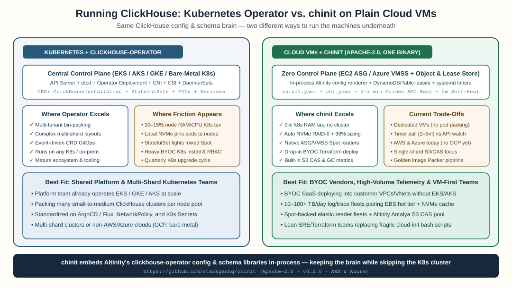
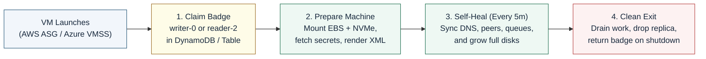

If you want to run open-source ClickHouse in production today, you usually end up choosing between two headaches:

1. **Plain virtual machines (VMs) with a bash boot script.** Simple on day one. Painful six weeks later at 2 a.m., when a Spot instance disappears and leaves stale Domain Name System (`DNS`) records, orphaned Keeper entries, and wedged queries behind.
2. **A full Kubernetes cluster running [`clickhouse-operator`](https://github.com/Altinity/clickhouse-operator).** You get safe config updates and automatic cleanup — but now you own a Kubernetes cluster, give up 10–15% of every database machine's memory to cluster agents, and fight Kubernetes storage rules whenever you want local Non-Volatile Memory Express (`NVMe`) scratch drives or Spot instances.

While building the log analytics platform behind [this series](/series/clickhouse-on-aws/), we wanted a third option: **keep the smarts of a Kubernetes operator, but run directly on plain cloud VMs.**

Today, we are open-sourcing that tool under the Apache-2.0 license: **[`stackgenhq/chinit`](https://github.com/stackgenhq/chinit)** (with **[`v0.2.4`](https://github.com/stackgenhq/chinit/releases/tag/v0.2.4)** out now).

`chinit` (pronounced *"c-h-init"*, short for **ClickHouse init**) is a single Go binary, shipped alongside ready-to-run AWS and Azure Terraform modules and Packer machine-image templates. You launch a VM, `chinit` boots it into a healthy ClickHouse cluster member in **2–3 minutes**, and built-in background timers keep the cluster clean when machines scale out, scale in, or die abruptly.

Whenever someone releases a new infrastructure tool, the fair question is: *"Should I actually use this instead of `clickhouse-operator`, or is this just Not-Invented-Here syndrome?"*

Let's walk through how `chinit` works in plain English, where it genuinely beats `clickhouse-operator`, where `clickhouse-operator` is still the better choice, and who benefits most.

**Key takeaways**

- **One binary instead of bash soup — or a Kubernetes cluster.** `chinit` handles node identity, disk formatting, secret fetching, config generation, schema sync, and graceful shutdown directly on AWS Elastic Compute Cloud (`EC2`) and Azure Virtual Machine Scale Sets (`VMSS`).
- **It reuses the operator's brain.** Instead of reinventing ClickHouse Extensible Markup Language (`XML`) configs with `sed`, `chinit` embeds the Altinity `clickhouse-operator`'s Go config generator and schema libraries directly inside the binary.
- **Where `chinit` wins:** disposable local NVMe caching, mixed Spot + On-Demand reader fleets, lightweight customer-account (`BYOC`) installs, and zero Kubernetes memory tax.
- **Where `clickhouse-operator` still wins:** packing lots of small databases onto an existing Kubernetes cluster, multi-shard clusters, instant GitOps watchers, and running on Google Cloud Platform (`GCP`) or bare metal.
{: .key-takeaways}

---

## How `chinit` Works: The Numbered-Badge Picture



*`clickhouse-operator` manages ClickHouse through Kubernetes pods and persistent volume claims; `chinit` embeds the same ClickHouse config and schema libraries inside a single binary on cloud VMs.*

Why is ClickHouse hard to run in a cloud Auto Scaling Group (`ASG`) in the first place?

Because **Auto Scaling Groups treat servers like nameless cattle, while ClickHouse treats servers like named teammates.**

When AWS replaces a dead VM, the new machine wakes up with a random name like `ip-10-0-1-147`. ClickHouse Keeper — the coordination service that tracks which replica owns which data — doesn't know who `ip-10-0-1-147` is. It expects `reader-2` to come back as `reader-2`.

Think of an office with **numbered name badges** hanging on a board at the front desk:

1. **Check-in at boot (`chinit boot`):** When a fresh VM launches, it walks up to the badge board — a tiny serverless table in Amazon DynamoDB or Azure Table Storage — and grabs the lowest free badge (say, `reader-2`). Only *after* it owns that badge does `chinit` mount its disks, fetch passwords from the cloud secret store, generate ClickHouse's XML files, and join the cluster. From empty VM to serving queries takes **2–3 minutes**.
2. **Checking in every 5 minutes (`chinit lease-renew`):** Every 5 minutes, each live VM taps the board to say *"I still hold `reader-2`"* and refreshes its local address book (`/etc/hosts`, Private DNS, and ClickHouse's peer list). If a machine loses power instantly and never says goodbye, its badge expires after 15 minutes — and the surviving nodes automatically erase its dead DNS record, clean up its old Keeper entries, and move on.
3. **Handing the badge back on shutdown (`chinit drain-shutdown`):** When an ASG scales in or AWS sends a 2-minute Spot warning, `chinit` pauses replication queues, stops ClickHouse cleanly so its Keeper session closes first, asks a healthy neighbor to unregister the replica, deletes its DNS record, and puts `reader-2` back on the board. (And if a node crashes mid-boot, `v0.2.4` reloads its settled badge straight from `state.json` on resume instead of starting blind.)



Best of all, `chinit` doesn't invent its own half-baked XML templates. Because both projects are written in Go, `chinit` imports the configuration generator and schema syncer straight from Altinity's [`clickhouse-operator`](https://github.com/Altinity/clickhouse-operator). You get the same battle-tested ClickHouse configs without running Kubernetes underneath.

---

## Where `chinit` Beats `clickhouse-operator`

First, credit where it's due: Altinity's `clickhouse-operator` (and ClickHouse Inc.'s operator) are great pieces of software. If Kubernetes is already the air your company breathes, they work well.

Where teams run into friction isn't the operator itself — it's **what Kubernetes forces you to do** when ClickHouse is heavy, cost-sensitive, or deployed outside your own cluster. Here are the four places where `chinit` on plain VMs comes out ahead.

### 1. Fast Local NVMe Cache + Safe EBS Storage (Without Node-Pinning Headaches)

When you store ClickHouse data in Amazon Simple Storage Service (`S3`) or Azure Blob Storage, the sweet spot for speed and safety uses two local drives per machine:

- **A small, safe network disk** (like AWS Elastic Block Store (`EBS`) `gp3`) for your table catalog and the newest few minutes of un-merged writes.
- **A fast, disposable local NVMe SSD** (the drives bundled with `r8gd`, `c8gd`, `i4g`, or Azure `Lsv3` VMs) as a giant read/write cache in front of S3. If a VM dies, the replacement starts with an empty cache and zero data loss.

On Kubernetes, mixing persistent `EBS` volumes with disposable node-local `NVMe` drives is surprisingly clunky. Standard Kubernetes `StatefulSet` storage templates expect network disks that follow a pod from host to host. Using a physical host's local NVMe requires `hostPath` mounts or extra local-storage drivers that glue pods to specific physical machines — and if you scale up to a bigger VM with a larger NVMe drive, hardcoded cache sizes in your XML either waste space or crash ClickHouse at startup.

In `chinit` (`v0.2.4`), this works out of the box:
- **It checks the actual hardware label and model.** Even if AWS enumerates a `474 GB` disposable NVMe drive ahead of your `64 GB` EBS disk, `chinit` recognizes the hardware model (`Amazon EC2 NVMe Instance Storage` / `Microsoft NVMe Direct Disk`) and **never** puts your table metadata or Keeper logs on a drive that vanishes on stop.
- **It stripes multiple NVMe drives automatically.** Boot a larger VM with two or four local NVMe drives and `chinit` merges them into one fast `RAID-0` cache volume automatically.
- **It sizes the cache to the machine.** At boot, `chinit` measures the mounted cache disk and sets ClickHouse's cache ceiling to 90% of that drive automatically — so scaling from a `2xlarge` to a `4xlarge` requires zero config edits.

### 2. Cheap Spot Readers Without Fighting `StatefulSet` Rules

Query traffic is spiky: engineers and alerting dashboards hammer ClickHouse during business hours and incidents, while nights are quiet. Running stateless-ish **read replicas on Spot instances** cuts reader compute bills by 60–70%.

A Kubernetes `StatefulSet` wasn't designed for mixed Spot fleets. All pods in a `StatefulSet` share one template, get numbered `0, 1, 2…`, and scale down strictly from the highest number downward — even if pod `0` is the one sitting on a Spot VM that AWS is reclaiming in two minutes. (ClickHouse Cloud's own team [wrote a great post](https://clickhouse.com/blog/make-before-break-faster-scaling-mechanics-for-clickhouse-cloud) on why they eventually had to break up single `StatefulSet`s into one-`StatefulSet`-per-replica plus custom controllers.)

With `chinit`, writers live in an On-Demand group and readers live in a native cloud Spot Auto Scaling Group. AWS or Azure picks from multiple cheap Spot instance families, replaces whichever VM gets reclaimed, and `chinit`'s badge table hands the replacement its identity cleanly.

### 3. No "Kubernetes Tax" — Especially for BYOC (Customer Cloud Accounts)

Running Kubernetes just to host ClickHouse carries two real costs:

- **Lost RAM on every database machine:** Between `kubelet` eviction buffers, networking agents, storage plugins, and monitoring `DaemonSet`s, Kubernetes typically reserves **10–15% of each node's RAM and CPU**. On a `64 GB` or `128 GB` ClickHouse server, that's `6–16 GB` of memory taken away from ClickHouse's caches and background merges — on top of the control-plane fee and quarterly Kubernetes upgrades.
- **Customer security friction (`BYOC`):** If your product deploys into your customers' AWS or Azure accounts, asking their security team to approve an Elastic Kubernetes Service (`EKS`) or Azure Kubernetes Service (`AKS`) cluster, cluster-wide permissions, and half a dozen cluster add-ons slows deals to a crawl. Shipping a standard Terraform module that boots locked-down VMs from a checksum-verified image + S3 + DynamoDB is dramatically easier to review, deploy, and support.

### 4. Built-In Self-Healing and `1×` Shared S3 Storage (`CAS`)

Historically, skipping Kubernetes meant giving up self-healing. `chinit` builds those safety nets into its 5-minute background timers:

- **Automatic disk growth:** Before ClickHouse runs out of merge headroom, `chinit` expands the EBS volume and resizes the filesystem online with zero downtime (or moves older partitions to S3 if the disk hits your size cap).
- **No stuck `ON CLUSTER` queries or blocked syncs:** When higher-numbered nodes scale in, `chinit` sweeps their leftover DNS records, prunes dead entries from Keeper's distributed query queue, and runs lightweight replica syncs (`SYSTEM SYNC REPLICA ... LIGHTWEIGHT`) so healing never times out behind a heavy background merge.
- **Shared S3 cold storage (`CAS`) that survives fresh disks:** Out of the box, `chinit` (`v0.2.4`) supports Altinity Antalya's Content-Addressed Storage (`cas_enabled = true`), keeping **one shared copy** of cold data in S3 across all replicas instead of `N` duplicates. Even when an ASG replaces a VM with a brand-new EBS disk, `chinit` pins a deterministic server UUID and CAS root identity from the node's badge so CAS mounts cleanly without ownership collisions — while tuning smaller Spot readers to fetch already-merged parts instead of burning CPU re-merging locally, and exposing Prometheus health metrics for the CAS garbage collector.

---

## The Honest Flip Side: Where `clickhouse-operator` Still Wins

No tool wins everywhere. Here is where **`clickhouse-operator` on Kubernetes is clearly the better choice**, and you should stick with it:

1. **Packing lots of small clusters onto shared hardware:** If your company already has a Kubernetes platform team and you run 30 small ClickHouse clusters (`20–200 GB` each) for different teams or small tenants, Kubernetes lets you pack many pods onto a few big machines. `chinit` runs one ClickHouse role per VM — dedicating four VMs to a tiny database wastes money.
2. **Multi-shard clusters:** `chinit` keeps things simple by running a single shard (`01`) and scaling out with separate writers and readers over S3. For 90% of log, trace, and telemetry workloads (even at tens of terabytes a day), one shard backed by S3 is plenty. But if your workload splits writes across 8 or 16 shards, `clickhouse-operator` handles multi-shard layouts natively.
3. **Instant GitOps pushes:** Kubernetes controllers watch the API server and react in under a second when ArgoCD or Flux updates a YAML manifest. Because `chinit` has no central control server, VMs check for updates on short background timers (every 2–10 minutes), unless you trigger an immediate refresh (`chinit boot --refresh`).
4. **GCP, bare metal, and local laptops:** `clickhouse-operator` runs anywhere Kubernetes runs — AWS, Azure, GCP, bare-metal racks, or `kind` on your laptop. `chinit` `v0.2.4` ships with AWS and Azure support out of the box; GCP and bare metal require writing a small Go provider adapter.

### Side-by-Side Scorecard

| What Matters to You | `clickhouse-operator` (Kubernetes) | `chinit` (Cloud VMs) | Better Fit |
|---|---|---|---|
| **Extra control plane to run & upgrade** | Full K8s cluster + CNI + CSI + add-ons | **None** (uses S3/Blob + DynamoDB/Table) | `chinit` |
| **Memory available to ClickHouse** | Loses ~10–15% to K8s node reservations | **~100% of VM RAM goes to ClickHouse** | `chinit` |
| **Local NVMe SSD cache + safe EBS** | Needs `hostPath`/node-pinning or local CSI | **Auto-detected, RAID-0 striped, auto-sized** | `chinit` |
| **Spot-instance read replicas** | Awkward inside a single `StatefulSet` | **Native ASG / VMSS Spot pools** | `chinit` |
| **Deploying into customer VPCs (BYOC)** | Heavy setup & quarterly K8s upgrades | **One `tofu apply`, ~2–3 min boot** | `chinit` |
| **Hosting 20+ small DBs cheaply** | **Packs many small pods onto shared nodes** | One VM per role (overkill for tiny DBs) | `clickhouse-operator` |
| **Multi-shard clusters (e.g. 16 shards)** | **Built-in CRD shard × replica matrix** | Focused on single-shard S3/CAS scale-out | `clickhouse-operator` |
| **Running on GCP or on-prem bare metal** | **Works on any Kubernetes cluster** | AWS & Azure today (Go interface for others) | `clickhouse-operator` |
| **ClickHouse XML & schema generation** | Altinity generator & `ClusterSchemer` | **Same Altinity libraries compiled in** | Tie |

---

## Who Benefits Most from `chinit`?

To make the decision easy, here is who gets the biggest win from `chinit`:

- **SaaS teams doing BYOC (Bring Your Own Cloud):** If you deploy an observability, security, or analytics engine inside your customers' AWS or Azure accounts, `chinit` lets you ship a rock-solid, auto-healing ClickHouse cluster with plain Terraform — zero customer-side Kubernetes clusters to install, debug, or upgrade.
- **High-volume log, trace, and telemetry teams (`10–100+ TB/day`):** When ClickHouse is big enough to own whole VMs, getting 100% of the machine's RAM, effortless NVMe caching, Spot query readers, and `1×` shared S3 cold storage directly lowers your monthly cloud bill.
- **Terraform-first / lean SRE teams:** If your stack runs on EC2 or Azure VMs without a dedicated Kubernetes platform team — and you currently rely on a giant `cloud-init` bash script nobody wants to touch on Friday afternoon — `chinit` gives you tested, compiled guardrails.

**And who should skip it?**
- If your team **already lives happily on Kubernetes** and runs small-to-medium ClickHouse clusters on shared node pools, keep using **`clickhouse-operator`**.
- If you **don't want to manage ClickHouse at all** and your budget allows it, buy **ClickHouse Cloud** or **Altinity.Cloud**.

---

## Try It Out in 5 Minutes

Everything is open source under Apache-2.0 at **[github.com/stackgenhq/chinit](https://github.com/stackgenhq/chinit)**:

- **Single Go binary (`v0.2.4`):** Prebuilt static binaries for Linux and macOS (`arm64` and `amd64`) with `SHA256SUMS`.
- **Packer Golden Images:** Ready-to-build templates in [`images/aws`](https://github.com/stackgenhq/chinit/tree/main/images/aws) and [`images/azure`](https://github.com/stackgenhq/chinit/tree/main/images/azure) (for both upstream ClickHouse LTS and Altinity Antalya `CAS`).
- **Turnkey Terraform Modules:** Drop [`terraform/aws`](https://github.com/stackgenhq/chinit/tree/main/terraform/aws) or [`terraform/azure`](https://github.com/stackgenhq/chinit/tree/main/terraform/azure) into a VPC and `apply`:

```hcl
module "clickhouse" {
  source = "github.com/stackgenhq/chinit//terraform/aws"

  cluster_name  = "telemetry-prod"
  region        = "us-west-2"
  golden_ami_id = "ami-0f8511dd30c68ca21" # Pre-baked Golden AMI (or build from images/aws)

  writer_max     = 4
  writer_desired = 2
  reader_max     = 8
  reader_desired = 2
  reader_spot    = true
  keeper_count   = 3

  cas_enabled   = true # Optional: keep 1 shared copy of cold data in S3
  dns_zone_name = "clickhouse.internal"
  subnet_cidr   = "10.42.0.0/24"
}
```

If you run ClickHouse on VMs — or have been wondering whether you *really* need to stand up an EKS cluster just to keep ClickHouse healthy — give [`stackgenhq/chinit`](https://github.com/stackgenhq/chinit) a look, try the Terraform example in a test VPC, and let us know what breaks or what you'd like to see next.

---

*Related in this series: [One Binary to Bootstrap a Node: Why chinit Replaced 3,600 Lines of Bash](/blog/chinit-one-binary-node-bootstrap/), [Teaching an Operator Without Kubernetes](/blog/clickhouse-operate-without-kubernetes/), [Graviton Roulette: The Day NVMe Device Names Broke Our Boot](/blog/gravitron-nvme-enumeration-boot-disk-guard/), and [The Math of ClickHouse CAS on AWS](/blog/clickhouse-cas-cost-math-s3-deduplication/).*
