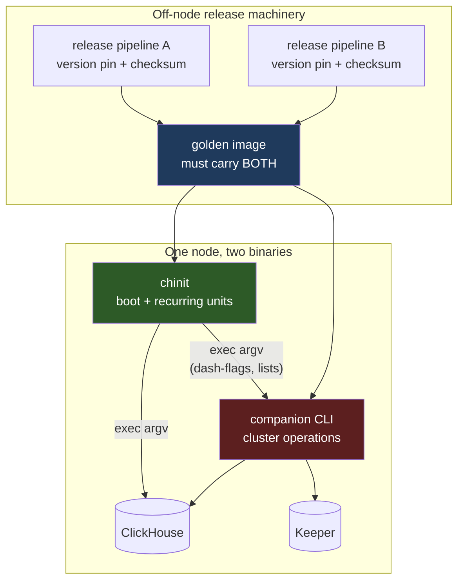
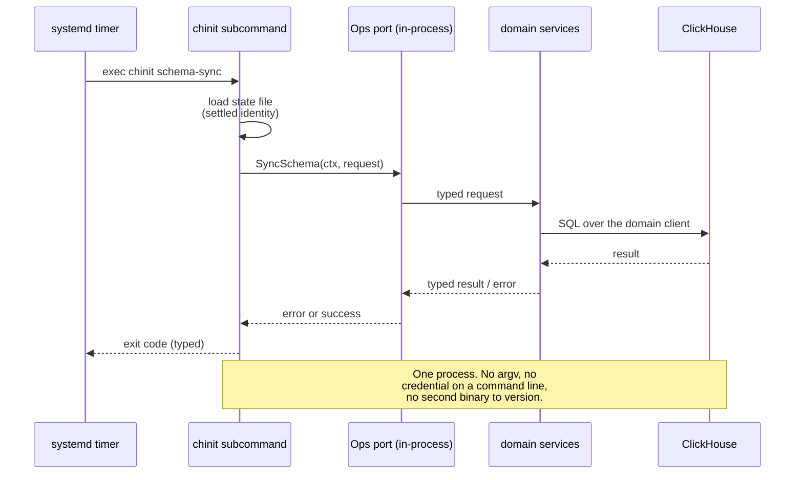
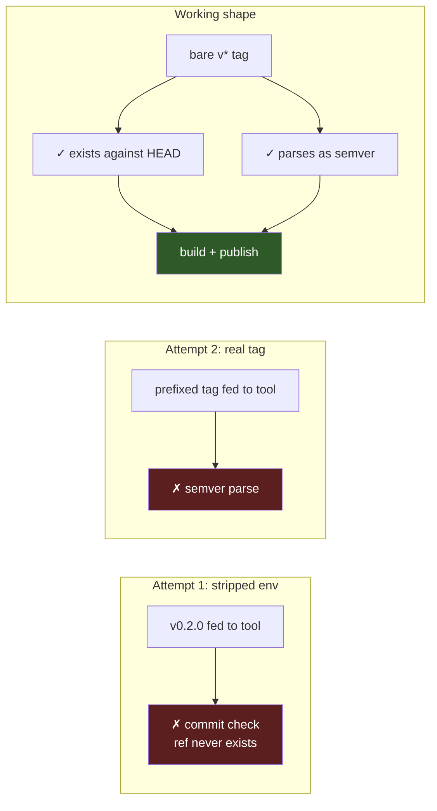

Every tool that solves a hard problem grows a second tool to solve the
first tool's leftovers. [chinit](/blog/chinit-one-binary-node-bootstrap/)
was no exception: alongside the bootstrapper we shipped a companion
command-line interface (CLI) — built from the database operator's own
domain packages — that ran the cluster's recurring operations. chinit
booted the node; the CLI did the maintenance. Two binaries, one node.

This is the story of getting to one — dissolving the second binary
into the first, the seam that made it safe, and the release-pipeline
lessons that cost us two failed gates to learn. It is also a general
argument: **when the only caller of a tool is another tool you own, the
process boundary is a liability.** The pattern applies to any fleet
where a daemon schedules jobs that do real work.

## Two binaries, and where they actually touch

The companion CLI — [chctl](/blog/clickhouse-operate-without-kubernetes/)
in our case — existed for good reasons. The cluster operations it
carried (schema propagation, replica sync and cleanup, keeper health,
configuration rendering) were the operator's domain code, and a CLI
was the fastest way to make that code callable from systemd units,
shell scripts, and a terminal. Every recurring job became one
ExecStart line:

```
chctl schema sync -spec ... -cluster ... -host name=address ...
```

The problem was never the CLI's existence. It was the
**direction of the calls**:



Four costs lived in that graph, each small and each compounding:

**Argv plumbing.** The typed inventory inside chinit — a list of
slot-to-address pairs — had to be flattened into repeated `-host`
flags for the CLI to parse it back into the same list. Lists,
credentials, patterns: everything crossed the boundary twice, once as
a string and once as a parse.

**Credentials on the command line.** The Structured Query Language (SQL)
operations authenticate, and the password rode an argv flag — because
that was the CLI's only input channel. argv is the easiest place in a
system to leak: error messages echo it, process listings show it.

**Duplicated validation and error shapes.** Flag validation at the CLI
boundary, argument re-validation in the domain layer, and a combined
output string back. Every error path formatted twice, with the
invariants enforced in neither place authoritatively.

**Two release pipelines.** Two artifacts to version, tag, checksum,
stage into the image, and version-gate. The image contract grew a
second knob, the bootstrap grew a second download path, and every
image build could ship a version mismatch nobody would notice until
the calls crossed.

None of these kills a system. All of them tax every change — and the
tax is paid in the least-tested medium on the node: string assembly.

## The seam that made dissolution safe

The rewrite did not start with "delete the CLI." It started with a
seam — a typed interface over the operations the CLI exposed:

```go
// The port: typed requests, no argv, no process.
type Ops interface {
    SyncSchema(ctx, SyncSchemaRequest) error
    SyncReplica(ctx, SyncReplicaRequest) error
    DropReplica(ctx, DropReplicaRequest) error
    GcReplica(ctx, GcReplicaRequest) (*GcResult, error)
    KeeperMntr(ctx, MntrRequest) (string, error)
    Health(ctx, HealthRequest) (*HealthReport, error)
}

// A request is data; credentials ride the struct, not a flag.
type ClusterRequest struct {
    ClusterName string
    SpecPath    string   // the CR spec the loader reads
    Hosts       []Host   // inventory: slot-to-address pairs
    Credentials Credentials
}
```

Production binds the real services over that interface — the same
operator domain packages the CLI had called, now linked directly.
Tests substitute a recorder implementing the same interface. The
subcommands' systemd lines do not change at all: `chinit schema-sync`
is still what the timer runs. Only the interior changed, from exec to
call:



The interesting part is what the seam did to **tests**. The old suite
recorded argv — a fake runner captured
`["replica","gc","-on","writer-0","-name-pattern","reader-*",...]` and
asserted on dash-flag strings. Reverse-engineering a flag back into
intent is archaeology. The new fakes assert **typed requests**: "the
writer pass ran with these hosts excluded, this pattern, these
credentials." The failure modes the fake simulates match production
exactly, because both implement the same interface.

That is the general argument, in one place: a process boundary is a
contract you maintain. Maintain it for humans; do not maintain it for
yourself. When the caller is your own binary on the same node, replace
the boundary with an interface and keep the CLI only where a human
still types.

## The release pipeline: two failures that taught one lesson

Dissolving the binary halved the release surface, but getting the
*remaining* release right broke twice in public, and both failures are
worth keeping.

The releases build through standard Go release automation: a tag
triggers the build, the build validates the tag against the checked-out
commit, and the artifacts publish under the tag's name. Our tags
carried a prefix — the tool's name, to namespace it away from the
repository's other releases. Two consecutive gates failed:

1. **The stripped form**: a fix fed the release tool the tag *without*
   the prefix so it would parse as a semantic version. The tool then
   validated that a tag by that exact name existed against the
   checked-out commit — it didn't, and never would. `git tag v0.2.0
   was not made against commit`.
2. **The real form**: pointing the tool back at the actual prefixed tag
   fixed the commit check and failed the version parse instead.
   `failed to parse tag 'chinit-v0.2.0' as semver`.

The working shape, which the tool's own documentation states plainly:
the tag must **both exist in the repository state** (the commit check)
**and parse as a semantic version** (the parse check). A prefixed tag
cannot satisfy both, no matter which form you feed the tool. The fix
was to stop prefixing: bare `v0.2.0` tags, one trigger, one consumer
of the artifact URL updated in lockstep.



The transferable lessons from those two failures:

1. **Read the tool's validation order before working around one error.**
   Both errors named the same constraint from opposite sides; either
   failure alone invites a "clever" fix that guarantees the other.
2. **A naming convention is a release interface.** The prefix existed
   for namespace hygiene; downstream consumers (image builds staging
   artifacts by URL) encode it. Changing the convention means changing
   every consumer in the same change set — ours was one URL template,
   and that is the *small* version of this lesson.
3. **Let the gate fail loudly.** The failed gates produced no release,
   no artifacts, no half-state. A tag that fails its suite is worse
   than no tag — these binaries run as root on every node — and the
   pipeline enforced that correctly both times it failed.

## The end state, and the rule it teaches

One binary. One release pipeline, one version gate, one place where a
missing artifact means a broken image. The maintenance jobs are
subcommands of the thing they maintain. Credentials ride typed
structs, never argv. The only CLI left on the node is the one a human
uses, and it calls the same interface the subcommands do.

The rule this arc left me with, worth more than either post:

> **A boundary between two things you own is not isolation; it is
> maintenance.** Process boundaries, tag-prefix conventions, argv
> contracts — each is a promise you have to keep forever, and the
> only buyer is you. Delete the ones nobody else depends on.

The next post takes the identity question this arc kept deferring:
[what a node is called, and who decides, when the instance is
ephemeral](/blog/chinit-lease-identity-ephemeral-fleet/) — the lease
pattern that made a horizontally scaled fleet of stateful replicas
possible.

---

*Related in this series: [why chinit exists](/blog/chinit-one-binary-node-bootstrap/),
[the boot sequence as a contract](/blog/clickhouse-boot-sequence-contract/),
and [teaching an operator without Kubernetes](/blog/clickhouse-operate-without-kubernetes/).*
