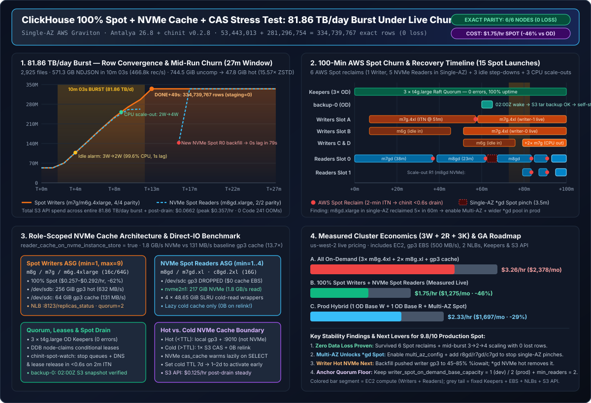

Static architecture diagrams hide the thing engineers actually need to reason about: **continuous motion across roles**. At **100 TB/day (`3,040,000 GB/month`)**, four coupled roles run simultaneously every second—**`writer-0` On-Demand + Spot `writer-1..9`** ingesting and compacting parts on local **NVMe hot disks**, a Keeper Raft quorum ordering metadata, cold blobs deduplicating into a shared content-addressed S3 pool, and **100% Spot readers** serving queries straight off local NVMe SSDs.

While **`writer-0` stays pinned On-Demand** (`on_demand_base_capacity = 1`) because it triggers nightly `backup-wake` for `backup-0` and coordinates cluster maintenance, **`writer-1..9` and all readers run on Spot instances** and can be reclaimed by EC2 at any given time. Below is an interactive, color-coded D3 simulation grounded in our production-validated AWS architecture (with all internal cluster names, account IDs, and private domains abstracted). Every role streams continuously in parallel—or you can isolate any section, switch between **7-day** and **33-day** retention costs, and click **Reclaim Spot Writer** or **Reclaim Spot Reader** to watch how NLB drain, DynamoDB leases, local NVMe disks, and zero-byte CAS relinks recover in seconds.

**Key takeaways**

- **`writer-0` stays On-Demand (starts nightly backup); `writer-1..9` & all readers run 100% Spot**: `writer-0` is pinned On-Demand (`writer_spot_on_demand_base_capacity >= 1` in Terraform) so `chinit backup-wake` (`02:00 UTC`), dead-replica GC, and orphan sweeps are never interrupted by Spot preemption, while **9 Spot writers** and **6 Spot NVMe readers** absorb scale-out at Spot pricing.
- **Spot `writer-1..9` & `reader-0..5` can be reclaimed at any time without losing data**: On a 2-minute EC2 Spot notice, NLB `/replicas_status` drains traffic to surviving nodes (`writer-0` stays live), already-committed hot parts are safe on peer replicas via `:9010`, cold parts are durable in `1×` S3 CAS, and the replacement Spot instance claims its DynamoDB lease, attaches `1×` CAS in `~2.4s`, and syncs recent hot deltas.
- **NVMe instance-store disks accelerate the hot path and eliminate EBS bottlenecks**: Bundled `*gd` NVMe SSDs deliver multi-GB/s throughput (`~2–4×` `gp3`) at `$0` extra EBS cost—eliminating `%iowait` disk-bandwidth stalls during `~1 GiB` MergeTree compactions on writers, keeping write-through hot reads off S3, and leaving zero orphan EBS volumes when a Spot node terminates.
- **100 TB/day ClickHouse + CAS cost drops to `$0.0015/GB` (`7d`) and `$0.0028/GB` (`33d`)**: Combining On-Demand `writer-0` with diversified Graviton `*gd` Spot `writer-1..9` and readers, NVMe hot & cache disks, the free S3 Gateway Endpoint, and `1×` CAS cold storage saves **`$44,941/month` (`~$539k/year`)** at 33-day retention compared to `10×` per-replica S3 copies.
{: .key-takeaways}

---

## Live 100 TB/Day Architecture Simulation

Use the color-coded tabs to inspect each subsystem, toggle **7d / 33d Retention** to see the live monthly cost shift, or click **Reclaim Spot Writer** / **Reclaim Spot Reader** to trace a 2-minute Spot interruption and zero-byte CAS recovery.

---

## 1. Color-Coded Walkthrough: What Happens in Each Role

### 1. Writers Fleet · On-Demand `writer-0` + Spot `writer-1..9` & NVMe Hot Path (Orange)

- **On-Demand `writer-0` + Spot `writer-1..9` (`writer_spot_on_demand_base_capacity = 1`)**: The 10-writer fleet runs `16-vCPU / 64 GiB *gd` Graviton instances behind `ingest.clickhouse.example:8443` (ACM TLS terminated at the NLB). **`writer-0` stays pinned On-Demand** in the writers ASG `mixed_instances_policy` because it acts as the ordinal-0 coordinator responsible for starting `backup-0` (`chinit backup-wake` at `02:00 UTC`), running `dead-replica-gc`/`orphaned-gc`, and driving vertical autoscale steps. Above that 1-node floor, **`writer-1..9` run 100% Spot** across 3 `*gd` families (`capacity-optimized`, reclaimable anytime) — on a 2-min notice, `/replicas_status` drains new inserts in `30s` to `writer-0` and surviving Spot writers.
- **How the NVMe disk assists the hot path**: In load tests at high ingest rates, MergeTree background merges (`127–242 KB` sequential blocks) saturated standard `gp3` EBS bandwidth (`125 MB/s`) and stalled vCPUs at **`>65% %iowait`** long before hitting IOPS limits. Putting the hot-path buffer and write-through `cas_cache` on the writer's bundled local **NVMe SSD (`~950 GB` on `16-vCPU *gd`, `$0` extra EBS)** provides **`~2–4×` `gp3` sequential bandwidth**, absorbing `100 TB/day` burst inserts, `3` synchronous Materialized Views, and `~1 GiB` wide-part ZSTD compactions with virtually zero `%iowait` stalls.
- **Metadata safety & intra-AZ `:9010` sync**: Only a small `128 GB gp3` volume (`delete_on_termination = true`) holds the parts catalog/metadata (`$102/mo` total across 10 writers). ZSTD compacts `100 TB/day` raw down to **`6.58 TB/day` (`15.2×`)**, and committed hot parts replicate immediately between writers and readers over interserver TLS (`:9010`) inside a single AZ at **`$0.00/GB`** so an abrupt Spot reclaim never loses committed blocks.

### 2. Keeper Quorum, DynamoDB Spot Leases & Backup (Emerald)

- **3-Node On-Demand Keeper quorum (`:9181`)**: Unlike writers and readers, Keepers never run on Spot. Three 2-vCPU / 8 GiB nodes on dedicated `gp3` Raft volumes survive a rolling node replacement without losing write quorum.
- **DynamoDB node claims (`ch-node-claims`)**: When any Spot writer or reader terminates and a replacement boots, `chinit` executes a conditional DynamoDB write to claim an ordinal slot (`writer-N` / `reader-N`) and writes a deterministic server UUID so CAS mount ownership never hits `Code: 246` conflicts.
- **Nightly isolated backup (`writer-0` → `backup-0`)**: On-Demand `writer-0` invokes `chinit backup-wake` at `02:00 UTC` to wake the stopped `backup-0` EC2 instance, which syncs metadata, writes tar snapshots to a separate versioned/object-locked backup bucket, and self-stops.

### 3. CAS Cold Pool & Lifecycle (Purple) — 1× Storage + Zero-Byte Relink

- **Free S3 Gateway Endpoint (`$0.00/GB`)**: All ClickHouse-to-S3 traffic rides the regional VPC Gateway Endpoint, avoiding **`$18,000+/month`** in `$0.045/GB` NAT Gateway data-processing charges.
- **1× Shared XXH3-128 Pool**: Under `tiered_cas` (`perform_ttl_move_on_insert = false`), merged `~1 GiB` wide parts age off the NVMe hot path (`TTL +1–7d` or `move_factor = 0.1` pressure spill), hash into `XXH3-128` blobs, and upload **once** (`1×`) into an unversioned S3 CAS bucket (`s3://org-ch-cas-cold-pool/cas/`) with **no `{replica}` segment** in the path.
- **Zero-byte relink (`CA_RELINK_COOKIE`)**: Replacement Spot writers and Spot readers never copy gigabytes of cold history over `:9010`. They verify `HEAD` on S3 and attach the manifest in **`~2–3 seconds`** with **`0 bytes`** transferred; writers then pull only recent un-aged hot delta parts over `:9010`.
- **GC & Avoiding the S3 Standard-IA Early-Deletion Trap**: An elected CAS GC leader folds ref-logs every `300s` (`cas_gc_interval_sec = 300`) using S3 `If-Match` conditional writes. **Crucial FinOps fix**: for `7d–33d` retention windows, we set `lifecycle_days_to_ia = 0` and keep cold parts in **S3 Standard (`$0.023/GB-mo`)**. Transitioning to S3 Standard-IA at day `30` when ClickHouse TTL drops parts at day `31–33` triggers AWS's **30-day minimum storage duration early-deletion fee**—making those final 3 days cost `~$2,467/mo` instead of `~$454/mo` in S3 Standard (`>5×` more expensive). Standard-IA only pays off for longer retention (`≥ 60–90+` days) where objects stay in IA well past the 30-day floor.

### 4. Readers Fleet · 100% Spot Replicas & NVMe Instance-Store Cache (Sky Blue)

- **Read-only Spot fleet behind `/replicas_status`**: Query clients (`query.clickhouse.example:8443`) hit an NLB target group gated by `HTTP :8123/replicas_status`, ensuring newly booted Spot readers finish relinking and hot backfill before serving traffic.
- **Why NVMe instance store is ideal here (`1.8 GB/s` vs. `131–149 MB/s` `gp3`)**: Readers run `6×` 4-vCPU / 16 GiB Graviton NVMe Spot instances (`*gd` pool). With a role-scoped Terraform flag (`reader_cache_on_nvme_instance_store = true` gated on `alltrue` `*gd` pool membership so EBS-only roles never lose their `gp3` cache), Terraform drops `/dev/sdc` completely (`$0` cache EBS) and `chinit` formats and mounts `/dev/nvme2n1` (`217 GiB` usable on `m8gd.xlarge`, `4 × 48.65 GiB` wrappers = **`3.4×` larger** than a `64 GiB` `gp3`). Direct-IO `dd` benchmarks on the live reader measured **`1.8 GB/s` sequential read** (`287 MB/s` write) vs. **`131–149 MB/s`** on the baseline `64 GiB` `gp3` cache volume (**`~13×` faster**).
- **Answering the architectural question — *"Do replicas still pull the same hot parts into their own NVMe cache?"***: **No.** Under `tiered_cas`, hot parts and the NVMe cache are distinct layers, and replicas **never eagerly pull the shared S3 pool onto NVMe**:
  1. **Hot parts (`< cold move TTL`)** live on each replica's `<hot>` volume (`default` disk) and replicate peer-to-peer over `:9010` — they never enter `cas_cache`.
  2. **Cold parts (`> cold move TTL`)** live **once (`1.00×`)** in S3 CAS and attach on peers via `CA_RELINK_COOKIE` with **`0` bytes downloaded** (`FilesystemCacheBytes = 0` after relink; only the single replica that ran the TTL move warms bytes via `cache_on_write_operations = 1`).
  3. **NVMe `cas_cache` is strictly a lazy `SLRU` byte-range cache for cold S3**: a reader only populates `4 MiB–32 MiB` segments of the exact cold columns/granules scanned by live `SELECT` queries. Consequently, **if your cold-move TTL is `7 DAY`, `cas_cache` stays `0 B` idle for the first 7 days!** Tightening the move rule to `TTL timestamp + INTERVAL 1 DAY TO VOLUME 'cold'` shrinks per-replica hot storage by `~75–85%` (cutting Spot reader hot-backfill time from `79s` to `<15s`) and puts days `2–33` directly onto `1×` S3 CAS + `1.8 GB/s` local NVMe cache.

---

## 2. Live Chaos Validation: `81.86 TB/day` Burst Across 100% Spot + NVMe Readers

Before relying on modeled numbers, we parked a live dev/staging cluster on **100% Spot Writers** (`m8g/m7g/m6g.4xlarge`, `writer_min = 1`) + **100% NVMe Spot Readers** (`m8gd/m7gd.xlarge` + `c8gd.2xlarge`, `reader_cache_on_nvme_instance_store = true`) and fired an **`81.86 TB/day` (`466,820 rec/s`)** 10-minute `S3Queue` burst (`2,925` files, `571.3 GB` raw NDJSON = `625.6 GiB` uncompressed columnar) right through an active AWS Spot capacity squeeze:

*Measured telemetry from our `81.86 TB/day` 100% Spot + NVMe reader stress test: `334,739,767` exact rows across all `6/6` Spot replicas (`0` data loss), `49s` S3 staging drain, `15` Spot launches / `6` real AWS Spot reclaims survived in `100` minutes, and a `46%` live run-rate cost drop (`$3.26/hr → $1.75/hr`).*

Four concrete operational findings emerged from that 100-minute Spot churn window:

1. **Zero data loss across `6` AWS Spot reclaims and a mid-burst `3 → 2 → 4` writer swing**: Pre-burst baseline (`53,443,013` rows) + `281,296,754` generated rows converged to **`334,739,767` exact rows** (`744.47 GiB` uncompressed → `47.81 GiB` compressed = `15.57×` ZSTD) on all `6/6` replicas, with `staging` drained to `0` objects **`49 seconds`** after the generator finished and **`$0.0662` total S3 API cost** (`0` `Code: 241` OOMs). Even when a pre-burst idle alarm stepped writers down `3 → 2` 90 seconds into the burst, **2 Spot writers solo-absorbed `81.86 TB/day`** at `99.6%` CPU (`0–1s` lag) until CPU TargetTracking scaled `2 → 4`.
2. **Single-AZ `*gd` NVMe Spot pools are shallow — Multi-AZ + CAS fixes it**: Pinning `m8gd/m7gd.xlarge` Spot readers to a single AZ triggered **5 reader Spot reclaims in 60 minutes** (including a `3.5m` `UnfulfillableCapacity` pinch). Because **CAS cold parts relink across AZs via S3 at `$0.00/GB`**, enabling `multi_az_config` across 3 AZs and adding `r8gd.xlarge` / `r7gd.xlarge` / `c7gd.2xlarge` expands Spot pool diversity `6×` (`18` pools) while `min_readers >= 2` (or `reader_spot_ratio = 0.5`) eliminates `0-reader` windows.
3. **`HTTP :8123/replicas_status` prevented every cold-reader query blackhole**: On every Spot replacement (`128s` `chinit` boot + `79s` `:9010` hot backfill for `334.74M` rows), `/replicas_status` held the fresh reader `unhealthy` on the NLB until `lag = 0s`, then flipped it `healthy` automatically.
4. **Simultaneous hot backfill proved why writer hot NVMe (`*gd`) is critical at 100 TB/day**: Steady `81.86 TB/day` ingest held `500 MB/s` writer `gp3` at `0.8–18.4%` `%iowait`, *until* 2 scaled-out writers and 2 replacement Spot readers simultaneously fetched `48 GiB` of hot parts — spiking writer `gp3` `%iowait` to **`45.4%–85.6%`**. Moving writer hot storage onto `*gd` local NVMe (`1.8–3 GB/s`) removes that backfill + merge I/O ceiling completely.

---

## 3. 100 TB/Day Cost Breakdown (`3,040,000 GB/Month`, `us-west-2`)

Using our measured **`15.2×` ZSTD** compression ratio, `100 TB/day` produces **`6.58 TB/day` (`6,579 GB/day`)** of net compressed ClickHouse data:
- **7-day cold pool (`1×` CAS)**: `46.1 TB` (`46,053 GB`) in S3 Standard (`$0.023/GB-mo`) = **`$1,059/month`**
- **33-day cold pool (`1×` CAS)**: `217.1 TB` (`217,105 GB`) kept in S3 Standard (`$0.023/GB-mo`, `lifecycle_days_to_ia = 0`) = **`$4,993/month`**

| Cost Line Item (100 TB/day = 3.04M GB/mo) | 7-Day Retention | 33-Day Retention | Notes & Cost Levers |
|---|---|---|---|
| **Writers Fleet (`1×` OD `writer-0` + `9×` `*gd` Spot)** | `$2,290/mo` | `$2,290/mo` | `writer-0` pinned On-Demand (`~$580/mo`) for `backup-wake`; `writer-1..9` Spot (`$1,710/mo`); **`$0` NVMe hot disk** |
| **Writer Metadata EBS (`10×` 128 GB `gp3`)** | `$102/mo` | `$102/mo` | Catalog only (`delete_on_termination=true`); hot/merge path rides NVMe |
| **Readers Fleet (`6×` 4-vCPU / 16 GiB `*gd` Spot)** | `$330/mo` | `$330/mo` | `100%` Spot (`*gd` NVMe pool); `NVMe cas_cache` = **`$0` EBS** |
| **Reader Metadata EBS (`6×` 64 GB `gp3`)** | `$31/mo` | `$31/mo` | Small catalog disk only (`cas_cache` rides local NVMe) |
| **Keeper Quorum (`3×` 2-vCPU / 8 GiB On-Demand)** | `$162/mo` | `$162/mo` | On-Demand Raft quorum + dedicated `64 GB gp3` fsync disks |
| **CAS Cold S3 Pool (`1×` Shared XXH3-128)** | **`$1,059/mo`** | **`$4,993/mo`** | `46.1 TB` @ 7d · `217.1 TB` @ 33d (all S3 Standard; no 30d IA early-deletion fee) |
| **S3 API Requests (Wide Parts + `gc_interval=300s`)** | `$580/mo` | `$580/mo` | `~1 GiB` wide parts + 300s GC folding keep Tier-1 PUTs low |
| **NLBs + `warning` CW Logs + DynamoDB + Backup** | `$150/mo` | `$150/mo` | Verbose logs stay local in ZSTD `system.text_log`; S3 Gateway = `$0/GB` |
| **Total ClickHouse + CAS Cluster (`100 TB/day`)** | **`$4,704/mo`** | **`$8,638/mo`** | **`$0.0015/GB` (`0.15¢/GB`)** @ 7d · **`$0.0028/GB` (`0.28¢/GB`)** @ 33d |

### What CAS + Spot + NVMe Saves at 100 TB/Day

| Architecture Variant (33-Day Retention, 100 TB/day) | Cold S3 Storage | Total Cluster Cost | Savings vs. Non-CAS 10× |
|---|---|---|---|
| **Non-CAS Unsharded (`10×` per-replica S3 copies)** | `$49,934/mo` | `~$53,579/mo` | Baseline |
| **Non-CAS Sharded (`S = 5` shards × `r = 3` = `3×` S3)** | `$14,980/mo` | `~$18,625/mo` | `-$34,954/mo` (`-65%`) |
| **Antalya CAS (`1×` S3) + OD `w0` + Spot + NVMe** | **`$4,993/mo`** | **`~$8,638/mo`** | **`-$44,941/mo` (`-84%`)** |

---

## 4. Production Caveats & Operational Trade-offs

Good FinOps engineering makes the trade-offs explicit alongside the savings:

- **S3 Standard-IA minimum duration (`30` days)**: Never transition cold parts to Standard-IA unless parts survive well past `lifecycle_days_to_ia + ~17` days (for example, `60–90+` day retention with a day-30 transition). For `≤ 47`-day TTLs, keep `lifecycle_days_to_ia = 0` in S3 Standard so early-deletion charges never erase the lower storage rate.
- **Experimental status of Altinity Antalya CAS**: CAS (`metadata_type = cas`) is marked experimental in Antalya `26.6+` / `26.8` builds. Pin your Golden AMI build version, monitor `PartsLockWaitMicroseconds` and CAS GC concurrency (`cas_gc_interval_sec = 300`), ensure versioning and Object Lock remain disabled on the CAS bucket, and drill restores from `backup-0` before promoting CAS to strict-SLA production.
- **Spot writer floor under regional capacity crunches**: Pinning `writer-0` On-Demand (`writer_spot_on_demand_base_capacity = 1`) keeps `backup-wake` and maintenance safe, and spreading `writer-1..9` across 3 `*gd` families minimizes correlated reclaims. However, if a regional Spot crunch evicts multiple writers faster than `:9010` replication drains, workloads with strict zero-backpressure SLAs should raise `writer_spot_on_demand_base_capacity` to their `writer_min` ingest quorum floor (or keep `writer_spot_ratio = 0.0`).
- **Single-AZ compute vs. cross-AZ `:9010` transfer**: Placing writers, readers, and Keepers in one AZ eliminates AWS's `$0.02/GB` round-trip cross-AZ data-transfer fee on `:9010` hot replication (`$4,000–$8,000+/mo` saved at this ingest scale), while S3 still preserves 3-AZ data durability. The trade-off is AZ-level compute availability (an AZ outage becomes an ASG re-launch into a healthy AZ rather than zero-second failover).
- **Compression sensitivity (`15.2×` vs. `3×–6×`)**: The `$4,704–$8,638/mo` numbers assume `15.2×` ZSTD compression measured on structured observability logs/telemetry. High-entropy payloads (random UUIDs, hashes, unindexed JSON) typically compress at `3×–6×`, which increases S3 cold storage and `:9010`/S3 bandwidth by `~2.5–5×`—though `1×` CAS still eliminates the `10×` replica-copy multiplier either way.

At `100 TB/day`, pinning `writer-0` On-Demand to anchor backups and maintenance while moving **hot-path compaction** and **cold-read caching** onto free **NVMe instance-store disks**, running **Spot compute** for `writer-1..9` and all readers, and deduplicating cold S3 into a **`1×` CAS pool** turns a `$53.6k/month` storage-bound cluster into a **`$4.7k–$8.6k/month`** elastic system under **`0.28¢/GB`**.

Previous: [Three Generations of a 30 TB/Day ClickHouse Fleet: Non-CAS vs. CAS, What Broke, and a Blueprint for Self-Managed S3](/blog/clickhouse-fleet-evolution-non-cas-to-cas-blueprint/). Series index: [ClickHouse on AWS: Self-Managed from First Principles](/series/clickhouse-on-aws/).
