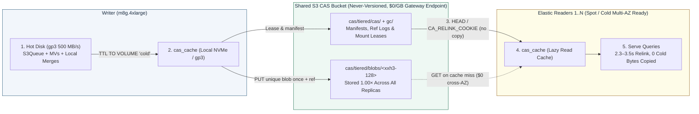
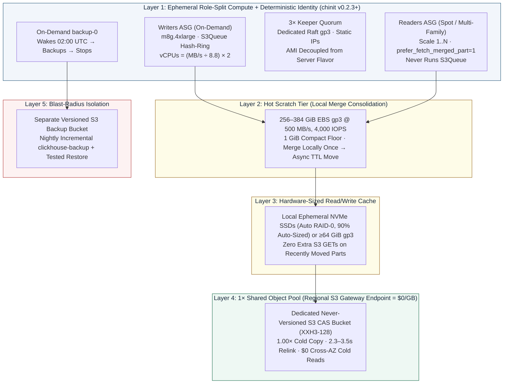

Most architectural guides for self-managed ClickHouse stop at the same
sentence: *"Attach an Amazon Simple Storage Service (`S3`) storage policy so
cold data spills to object storage, add a local cache, and you have separated
compute from storage."*

On a whiteboard, that sounds finished. At **30 TB/day** of raw log ingestion
(`~1.6 TB/hour`, compressing `15.2×` with Zstandard (`ZSTD`) down to
`~1.97 TB/day` on disk), that whiteboard design hits three walls in quick
succession: first an S3 request-rate and disk-throughput wall, then a compute
and memory wall on background merges, and finally the **replica copy
multiplier** — where scaling out to 9 or 10 replicas quietly stores 9 or 10
complete copies of your cold S3 warehouse.

Over the past week, while load-testing the cluster behind [this series](/series/clickhouse-on-aws/)
at **30 TB/day** and **100 TB/day**, we evolved the exact same workload
through **three distinct fleet generations**:

1. **Generation 1 — Naive Stock S3 (`26.8` LTS):** What most teams deploy
   first — and why premature cold-tier spills (`~35` S3 objects per wide part ×
   `R` replicas) and a hidden `125 MB/s` Elastic Block Store (`EBS`) wall
   stalled merges within hours.
2. **Generation 2 — Tuned Non-CAS Upstream (`26.8.36.3` LTS + [`chinit`](https://github.com/stackgenhq/chinit) `v0.1.1`):**
   Every hot-disk, `S3Queue`, Keeper, and merge lever tuned from the
   ClickHouse C++ source — proven across a 1-hour soak (`792.4 million` rows /
   `1.6 TB` ingested with `0` failed batches and `0–1s` queue lag), yet still
   structurally bound by `R×` cold S3 copies and Single-Availability-Zone
   (`Single-AZ`) lock-in.
3. **Generation 3 — Shared-Pool CAS (`26.6.8.20004.altinityantalya` + `chinit v0.2.3`):**
   Replacing per-replica S3 prefixes with Altinity Antalya's experimental
   **Content-Addressed Storage (`CAS`)** cold pool — collapsing cold S3 bytes
   to **`1.00×` across `7–9` live replicas** and cutting cold scale-out backfills
   to **`2.3–3.5 seconds`**, while teaching us several humbling lessons from the
   C++ source (`Code: 48` on suspended-versioning buckets, `Code: 246` + `Code:
   27` on stateless UUID seeding, and `Code: 234` reader merge stalls when
   single-replica merge coordination is misapplied to a two-volume hot/cold
   policy).

This post compares the non-CAS and CAS fleets side by side without vendor
spin. We will cover what CAS genuinely solves, what CAS **does not** touch,
the operational sharp edges we hit and fixed against the ClickHouse C++ source,
and a reusable **single-flag, 5-layer blueprint** for where self-managed
ClickHouse installations are headed next.

**Key takeaways**

- **Fix hot-tier physics before touching CAS.** Upgrading writer hot disks from AWS's default `125 MB/s` `gp3` cap to `500 MB/s` (`+$20/mo`), keeping parts compact below `1 GiB`, and right-sizing writer CPUs (`~1 vCPU per 8.8 MB/s` of raw ingest × `2×` merge headroom) eliminated `80%` of our stability bugs *before* CAS entered the picture.
- **CAS solves two structural taxes non-CAS cannot:** it collapses cold S3 storage from `R×` physical copies to **`1.00×`** (verified live: a `3.67 GiB` cold part across `7–9` replicas takes `3.67–3.68 GiB` total in S3 instead of `25.69–33.03 GiB`, relinking onto new Spot readers in `2.29–3.47s` with `0` blob bytes copied) and removes the `$0.02/GB` cross-AZ transfer fee on cold reads and historical backfills.
- **CAS is not free magic — it brings seven concrete trade-offs:** it requires Altinity's experimental `antalya` build (`26.6`, not upstream `26.8` LTS), refuses buckets that ever had S3 Versioning enabled *or* suspended (`Code: 48`), creates shared-pool blast radius, doubles local cache wrappers during migration, crashes stateless Auto Scaling Group (`ASG`) replacements (`Code: 246`) unless `/var/lib/clickhouse/uuid` is an exact 36-byte deterministic UUID, and still requires source-level tuning for lease/GC chatter and asymmetrical reader merges.
- **CAS saves zero hot-tier CPU, RAM, or hot `:9010` replication.** Inserts, `S3Queue` parsing, synchronous Materialized Views (`MVs`), and hot merges happen *before* parts ever reach CAS.
{: .key-takeaways}

---

## How the Fleet Evolved: Three Generations Under Load


*Three generations of our benchmark cluster in a single AWS region: moving from naive per-replica S3, to tuned upstream LTS without CAS, to a source-tuned `1×` content-addressed cold pool.*

To compare CAS fairly against non-CAS, you cannot compare CAS against a badly
configured cluster. If your non-CAS baseline is spilling tiny unmerged parts to
S3 every ten seconds, CAS will look ten times better than it actually is.

Here is what each generation actually ran, what broke under synthetic
CloudTrail/ELB NDJSON load (`200 MB` staged files via ClickHouse's `S3Queue`
engine + 3 synchronous summary Materialized Views), and what forced the next
step.

### Generation 1: Naive Stock S3 (What Breaks First)

Our first AWS port took the textbook approach: upstream ClickHouse `26.8`,
a two-tier `hot` (`default` `64 GiB` `gp3` EBS) → `cold` (`s3_cache` → `s3`)
storage policy, and an Auto Scaling Group ceiling of `10` data-bearing slots
(`5` writers + `4` readers + `1` backup replica). Because upstream ClickHouse
deprecated `allow_remote_fs_zero_copy_replication` after garbage-collection
races ([covered earlier in this series](/blog/clickhouse-zero-copy-replication-dead/)),
every replica wrote to its own isolated prefix (`data/tiered/{replica}/`).

Under `30–60 TB/day` load, five things failed almost immediately:

1. **Fleet-side S3 `PUT` amplification (`~10–15×` per cold byte):** A `64 GiB`
   hot disk hit `move_factor = 0.1` within two hours, spilling unmerged
   `150–500 MB` parts to S3 in **wide format** (`min_bytes_for_wide_part`
   defaults to `10 MiB`, writing ~35 S3 column/mark objects per part instead of
   ~11 in compact format) and re-merging them across S3 3–5 times on **every**
   replica — turning a `~$15–$45/mo` cold-tier S3 API line item into
   **`~$350–$1,200+/mo` of pure ClickHouse-fleet S3 Tier-1 requests** (before
   counting any upstream producer or load-generator traffic).
2. **The `125 MB/s` `gp3` iowait illusion:** Writers on 8-core `r8g.2xlarge`
   instances showed only `~26–30%` user CPU in CloudWatch while merges fell
   thousands of parts behind (`Code: 252 TOO_MANY_PARTS`). Running `mpstat`
   and `iostat` caught the culprit: `0.00%` idle CPU, **`68.79%` `%iowait`**,
   and `nvme1n1` pinned at `100%` utilization hitting AWS's default **`125 MB/s`
   `gp3` bandwidth cap** at just `805` Input/Output Operations Per Second
   (`IOPS`).
3. **Single-Keeper outage cascade:** Running a single Keeper in dev meant one
   routine image replacement dropped Raft quorum to zero, flipped every table
   `is_readonly = 1`, and caused ASG health alarms to churn healthy nodes.
4. **Per-UUID `S3Queue` fan-out:** Without an explicit shared `keeper_path`,
   each writer invented its own table Universally Unique Identifier (`UUID`) in
   Keeper, pushing Keeper past `760,000` znodes while `N-1` writers lost claim
   races on every file.
5. **The `10×` cold storage multiplier:** Across 10 replica slots, `1.2 TB` of
   compressed cold data occupied **`11.99 TB` in S3**.

---

### Generation 2: Tuned Non-CAS Upstream LTS (`26.8.36.3` + `chinit v0.1.1`)

Before turning on an experimental storage engine, we wanted to know: **how good
can 100% stock, upstream ClickHouse `26.8` LTS get when every local, network,
and Keeper bottleneck is removed?**

We kept stock per-replica S3 (`cas_config.enabled = false`) and closed every
non-CAS bottleneck systematically:

- **`256 GiB` hot `gp3` @ `500 MB/s` and `4,000 IOPS` (`+$20/mo/writer`):**
  Within 20 seconds of applying `ModifyVolume`, writer `%iowait` collapsed from
  `68.79%` to **`0.38%`**, user CPU jumped from `25.6%` to **`89.38%`**, read
  latency dropped `6.43 ms → 1.01 ms`, and merge throughput hit `494.5 MB/s`.
- **Local merge consolidation + compact S3 parts:** Setting
  `min_bytes_for_wide_part = 1073741824` (`1 GiB`),
  `max_parts_to_merge_at_once = 100`, and `ttl_only_drop_parts = 1` meant parts
  stayed in compact format (~11 objects instead of ~35), merged locally on the
  `256 GiB` hot disk *once* before moving to S3 via Time-To-Live (`TTL`), and
  expired via free whole-part S3 `DELETE`s instead of `GET`+`PUT` rewrites.
- **Writer-only `S3Queue` with shared hash-ring claims:** Scoping `S3Queue` to
  writers (`-- chinit:roles=writer`) with a single literal `keeper_path` and
  `enable_hash_ring_filtering = 1` split claims `50.9% / 49.1%` across writers
  with zero claim-race storms and `<95,000` Keeper znodes across a **3-node
  `t4g.large` Keeper ensemble** (`3–4 ms` average latency).
- **Right-sizing memory and vCPUs from live failure walls:**
  - Trying `m8g.large` (`2 vCPU / 7.6 GiB` usable RAM, `6.1 GiB` ClickHouse
    cap) failed `89%` of `200 MB` `S3Queue` batches in 60 seconds with
    `Code: 241 MEMORY_LIMIT_EXCEEDED` (`5 GiB` `mark_cache` + `1 GiB`
    uncompressed cache + `2 GiB` queue metadata + `8` stream buffers + `3`
    summary MVs require `14–22 GiB`).
  - Stepping up to `m8g.2xlarge` (`8 vCPU / 32 GiB` RAM) completed a full
    **1-hour `30 TB/day` soak**: **`8,240` files / `792,430,810` records /
    `1.6 TB` raw NDJSON (`220,022 rec/s` average, `~38.4 TB/day` peak)** with
    **`0` failed `S3Queue` files**, **`0` read-only events**, and **`0–1
    second` `S3Queue` watermark lag** — even while surviving a mid-test rolling
    ASG instance refresh!
  - Measuring CPU saturation on `m8g.2xlarge` (`8/8` cores at `100%` = `800%`
    during backlog catch-up, growing replica `absolute_delay` from
    `1,685s → 2,376s`) gave us our empirical sizing law: **1 writer vCPU per
    `~8.8 MB/s` (`0.7 TB/day`) of raw NDJSON + 3 summary MVs**, doubled for a
    **50% merge headroom rule** → **`3–4 × m8g.4xlarge` (`16 vCPU / 64 GiB`)**
    for constant `30 TB/day` production traffic.

**Where Generation 2 hit a hard ceiling:**
Generation 2 is rock-solid, GA, and zero-data-loss. Yet two structural limits
cannot be tuned away in stock `ReplicatedMergeTree`:

1. **Every replica slot still writes a full copy of cold S3 (`R×`):** Adding
   read replicas for daytime dashboards or scaling writers from `3 → 6` during
   an incident linearly multiplies cold S3 bytes (`$1,436/mo × R` at 33-day
   retention) and cold `PUT` requests. We even had to add a Terraform plan
   guard (`accept_s3_copy_multiplier`) so nobody could raise `max_readers`
   without acknowledging the S3 storage bill.
2. **Single-AZ lock-in:** Spreading non-CAS writers and readers across three
   Availability Zones (`AZs`) triggers AWS's **`$0.02/GB` cross-AZ data
   transfer fee** on TCP `:9010` peer-to-peer part fetches (`$4,800–$8,000/mo`
   at `30 TB/day`), forcing the entire compute fleet into a single subnet.

---

### Generation 3: The Shared-Pool CAS Fleet (`26.6.8.20004.altinityantalya` + `chinit v0.2.3`)

Generation 3 flips a single Terraform flag: `cas_config = { enabled = true }`.
Under the hood, Terraform and `chinit` make five coordinated shifts so the rest
of the cluster adapts automatically:

1. **Dual-Flavor Golden Image Selection:** Our CI Packer matrix builds both
   `Flavor=upstream` (`26.8.36.3`) and `Flavor=antalya`
   (`26.6.8.20004.altinityantalya`) in parallel. When `cas_config.enabled =
   true`, Terraform automatically selects the `Flavor=antalya` AMI across
   writers, readers, and `backup-0` while leaving the 3 Keeper Raft nodes
   untouched (`ignore_changes = [ami]`).
2. **Dedicated Never-Versioned CAS Bucket & Pool Layout:** Provisions a clean
   `<cluster>-clickhouse-data-cas` bucket where `aws_s3_bucket_versioning` is
   never created (`count = 0`) alongside a 7-day
   `AbortIncompleteMultipartUpload` lifecycle rule. All replicas point at the
   **same** prefix (`cas/tiered/` and `cas/default/` — no `{replica}` path
   segment!) using Single-Instruction Multiple-Data (`SIMD`) `XXH3-128` content
   hashing (`cas_blob_hash = xxh3-128`).
3. **Three-Volume Bridge Storage Policy (`tiered_cas`):** Keeps `hot` on local
   `default` (`256 GiB`, `500 MB/s` `gp3`), points `cold` at `cas_cache` →
   `cas`, and retains `cold_legacy` (`s3_cache`) as volume priority 3 so
   existing tables pass `StoragePolicy::checkCompatibleWith`. Local cache disk
   auto-scales (`32 GiB → 64 GiB`) so each of the 4 cache wrappers keeps a
   `14 GiB` floor, and `chinit` reconciles on-disk table metadata between
   `tiered` and `tiered_cas` automatically.
4. **Exact 36-Byte Deterministic Server-Root Identity (`chinit v0.2.3`):** Pins
   both `/var/lib/clickhouse/uuid` (exact 36 ASCII bytes, no trailing newline)
   and `CH_CAS_SERVER_ROOT_ID` deterministically from `(cluster_name,
   claimed_ordinal)` so ephemeral ASG replacements reclaim their predecessor's
   CAS mount slot cleanly across fresh EBS volumes.
5. **Source-Tuned Merge & CAS Lease Cadence:** Keeps
   `execute_merges_on_single_replica_time_threshold = 0` on two-volume policies,
   sets `prefer_fetch_merged_part_time_threshold = 1` and
   `prefer_fetch_merged_part_size_threshold = 1` so small readers fetch finished
   merges from 16-vCPU writers instead of re-merging on 2 vCPUs, and tunes CAS
   GC/lease intervals (`300s` GC, `60s`/`20s` mount lease,
   `cas_unsafe_remount_no_delay = true`).



**Live verification on the 7–9 replica CAS fleet:**
When we moved a `3.67 GiB` (`25.4 million`-row) merged part to `VOLUME 'cold'`
and queried both `system.parts` (`26.6.8.20004.altinityantalya`) and S3 across
`7` to `9` active replicas:

```text
-- system.parts on writer-1 (and relinked across all peer writers & readers):
table   | disk_name | parts |     rows | bytes
--------+-----------+-------+----------+----------
events  | cas_cache |     1 | 25419480 | 3.67 GiB
events  | default   |     6 | 482667734| 69.22 GiB

-- aws s3 ls s3://<cluster>-clickhouse-data-cas/cas/ --recursive --summarize:
Total Objects: 484
Total Size:    3,950,045,875 bytes (3.68 GiB)
```

- **Independent TTL moves (`CasPartWriteTxn.cpp`):** `writer-0` published `35`
  content-hashed blobs (`blob_put = published`). When `writer-2`, `writer-4`,
  and `reader-1` moved the same logical part to `cas_cache`, CAS executed its
  mandatory `HEAD` probe and **avoided uploading all 35 blob bodies**
  (`CASBlobBodyPutAvoided = 35`, `blob_reuse_adopt = observed`).
- **Scale-out zero-copy relinks (`DataPartsExchange.cpp`):** When three fresh
  readers (`reader-0`, `reader-2`, `reader-3`) scaled out mid-test, they fetched
  that `3.67 GiB` cold part via `CA_RELINK_COOKIE` (`CASBlobAdoptTrusted = 92`,
  `reason = manifest-trust`) in **`2.29–3.47 seconds` with `0` blob bytes
  transferred or uploaded**.
- **Net physical storage:** One `3.67 GiB` cold part visible across 9 replicas
  occupied **`3.68 GiB` total in S3 (`1.00×`)** — versus `33.03 GiB` (`9×`) on
  Generation 2.

---

## Live Benchmark Telemetry: Non-CAS vs. Untuned CAS vs. Source-Tuned CAS

What actually happened when we ran sustained `35–38 TB/day` load soaks (`6`
generator workers writing `200 MB` NDJSON files into `S3Queue` + `3` synchronous
summary MVs) across Generation 2, our first untuned CAS run (Gen 3a), and our
source-tuned CAS run (Gen 3b)?

| Measured Telemetry | Gen 2: Tuned Non-CAS (`26.8.36.3` LTS) | Gen 3a: Initial CAS (Before Source Tuning) | Gen 3b: Source-Tuned CAS (`Antalya` + `chinit v0.2.3+`, 1h Soak) |
|---|---|---|---|
| **Sustained Ingest Pace** | `220,022 rows/s` (`38.4 TB/day`, `1.6 TB` / `1h`) | `212,177 rows/s` (`37.29 TB/day`, `776.8 GB` / `30m`) | **`177,821 rows/s` (`30.7 TB/day`, `1.30 TB` / `1,424.5 GiB` uncomp in `1h`)** |
| **Row Convergence & Staging Lag** | `100%` (`792.4M` rows), `0–1s` lag, `0` failed batches | `100%` (`382.5M` rows across 7 nodes), `0` backlog | **`100%` (`640,470,621` rows across all 7 nodes), `0s` writer lag** |
| **Cold S3 Physical Amplification** | **$R\times$** (`9×` = `33.03 GiB` for a `3.67 GiB` part) | **`1.00×`** (`3.67 GiB` total across 7–9 replicas) | **`1.00×`** (`3.68 GiB` total across 7–9 replicas; `15.47×` ZSTD) |
| **Cold Scale-Out Backfill (`3.67 GiB` part)** | Full S3 re-download + re-upload to new `{replica}/` | **`2.29s – 3.47s` metadata relink (`0` blob bytes)** | **`2.29s – 3.47s` metadata relink (`0` blob bytes)** |
| **Full-Hour Fleet S3 API Cost** | `~$0.25–$0.30/hr` (post hot-disk tuning) | `~$0.45/hr` (`60s` GC + `10s` lease renewals) | **`$0.2467` total for 1h (`35,265` Tier-1 + `176,023` Tier-2 = `~$161/mo`)** |
| **Writer CPU & RAM Utilization** | `65–90%` on `8-vCPU` `m8g.2xlarge` | `35–55%` CPU on `16-vCPU` `m8g.4xlarge` | **`22–53%` CPU, `8.44 / 61.64 GiB` RAM (`13.7%`) → right-sized to `m8g.2xlarge` floor** |
| **Reader Merge & Fetch Tuning** | Local hot merges (`20–45s`) | **`63.4s – 110.2s` avg (`1,098s` max)** — `57%` of merges hashed to readers! | **`prefer_fetch_merged_part = 180s / 1 MiB` + `4-vCPU` `c8g.xlarge` readers** |
| **`systemctl restart clickhouse-server`** | `~5–7s` | **`40–89s`** (waits out old mount lease TTL per CAS pool) | **`7s`** (`cas_unsafe_remount_no_delay = true` on same UUID) |
| **Fresh-EBS ASG Replacement** | Clean (`{replica}` macro) | **Crash-looped (`Code: 246` owner mismatch / `Code: 27` UUID `\n`)** | **Clean (`36`-byte deterministic UUID + `CH_CAS_SERVER_ROOT_ID`)** |

That progression tells a much more honest story than a marketing benchmark:
**CAS delivered `1.00×` cold S3 deduplication and `~3-second` scale-out relinks
immediately on Day 1, while getting hot-tier merges, mount leases, and ASG
replacements right required reading the C++ source code.**

---

## Side-by-Side Comparison: Non-CAS (Gen 2) vs. CAS (Gen 3)

*(Scope note: every dollar figure in this post accounts strictly for the **ClickHouse fleet itself** — writers, readers, Keepers, on-demand backup replica, fleet EBS, fleet cold-tier S3 storage/API requests, and cluster VPC/load balancers — excluding upstream log-producer or load-generator compute and producer staging `PUT`s.)*

Here is the architectural and economic scorecard comparing **tuned non-CAS**
against **source-tuned CAS** on the same `30 TB/day` workload (`1.974 TB/day`
compressed on disk):

| Dimension | Gen 1: Naive Stock S3 | Gen 2: Tuned Non-CAS (`26.8` LTS) | Gen 3: Source-Tuned CAS (`Antalya 26.6`) |
|---|---|---|---|
| **ClickHouse Binary** | Upstream `26.8` LTS (GA) | Upstream `26.8.36.3` LTS (**GA**) | Altinity Antalya `26.6.8.20004` (**Experimental**, Apache-2.0) |
| **Cold S3 Copies ($R$ replicas)** | $R\times$ (`10×` across 10 slots) | $R\times$ (`3×`–`10×` per replica ceiling) | **`1.00×` shared content-addressed pool** |
| **33-Day Cold S3 Cost @ 30 TB/day** | `$14,359/mo` (`10` slots) | `$4,308/mo` (`3×`) to `$14,359/mo` (`10×`) | **`$1,436/mo` flat (at `3`, `10`, or `20` replicas)** |
| **7-Day Cold S3 Cost @ 30 TB/day** | `$3,178/mo` (`10` slots) | `$953/mo` (`3×`) to `$3,178/mo` (`10×`) | **`$318/mo` flat** |
| **Fleet Cold-Tier S3 API Cost** | `~$350–$1,200+/mo` (64 GiB spills × ~35 wide objs × $R$) | **`~$15–$45/mo`** (merged locally first + 1 GiB compact floor, × $R$) | **`~$15–$35/mo` flat** (`1×` blob `PUT`s + `CASBlobBodyPutAvoided` + `300s` GC) |
| **Elastic Reader Scale-Out Cost** | Copies entire cold S3 dataset per new reader | Copies entire cold S3 dataset per new reader | **`$0` extra cold S3 bytes; `2.3–3.5s` `CA_RELINK_COOKIE`** |
| **Multi-AZ Transfer (`$0.02/GB`)** | `$4,800–$8,000/mo` across hot + cold `:9010` fetches | Forced into **Single-AZ** to avoid `:9010` tax | **`$0/GB` on cold S3 reads/backfills; hot inserts still use `:9010`** |
| **Hot-Tier EBS Requirement** | `64 GiB` @ `125 MB/s` (stalled at `69%` iowait) | **`256 GiB` @ `500 MB/s`, `4,000 IOPS`** | **Identical (`256 GiB` @ `500 MB/s`, `4,000 IOPS`)** |
| **Writer CPU Floor @ 30 TB/day** | Under-sized / disk-starved | **`3–4 × m8g.4xlarge` (`48–64 vCPU`)** | **Identical (`3–4 × m8g.4xlarge`, `48–64 vCPU`)** |
| **Reader RAM Floor @ 30 TB/day** | OOM'd at `4 GiB` (`Code: 241`) | `8 GiB` floor (`16 GiB` comfortable) | `8 GiB` floor with `prefer_fetch_merged_part` (`16 GiB` comfortable) |
| **Local Cache Disk Split** | 2 wrappers (`s3_cache`, `cache_<t>`) | 2 wrappers (`32 GiB` = `14 GiB` each) | **4 wrappers during coexistence (`64 GiB` floor = `14 GiB` each)** |
| **S3 Bucket Versioning** | Supported | **Supported** | **Forbidden — even `Suspended` versioning fails `CasProbe` (`Code: 48`)** |
| **Cold Storage Blast Radius** | **Isolated per `{replica}/` prefix** | **Isolated per `{replica}/` prefix** | **Shared across all replicas (independent backups mandatory)** |
| **Garbage Collection (`GC`)** | Simple S3 Lifecycle + whole-part `DELETE` | Simple S3 Lifecycle + `ttl_only_drop_parts=1` | **18-phase CAS reachability GC + mount leases in S3** |
| **Stateless ASG Boot Requirement** | Ordinary `{replica}` macro | Ordinary `{replica}` macro | **Exact 36-byte deterministic server UUID (`Code: 246` / `Code: 27` otherwise)** |

---

## The Unbiased Pros and Cons of CAS

If you are evaluating CAS for your own ClickHouse installation, ignore any pitch
that frames it as a drop-in free lunch *or* dismisses it as unusable. Here is
what actually happens in production.

### The Pros: Where CAS Genuinely Changes Economics and Operations

1. **Replica count stops multiplying your cold storage bill (`R× → 1×`).**
   At `30 TB/day` and 33-day retention, one compressed cold copy in S3 costs
   `$1,436/month`. On a 10-slot autoscale ceiling (`writer_max = 5`,
   `max_readers = 4`, `backup = 1`), non-CAS ClickHouse quietly approaches
   `$14,359/month` in cold S3 alone whenever scale-out slots hydrate. CAS locks
   that line item at **`$1,436/month` (`-$12,923/month` / `-$155k/year`)** —
   and even against a minimal 3-replica non-CAS layout, CAS saves **67%
   (`$2,872/mo`)** on cold S3.
2. **Sub-4-second cold scale-outs with zero S3 write amplification.**
   On non-CAS S3, adding three Spot readers for a 2-hour incident investigation
   means those readers pull and re-upload cold history into `reader-2/`,
   `reader-3/`, and `reader-4/`. In `DataPartsExchange.cpp:408`, when both
   peers share a CAS pool UUID, the sender returns `CA_RELINK_COOKIE` + a
   lightweight `part_manifest_v2` payload instead of streaming gigabytes of
   column files; the receiver stages its own manifest reference over the
   existing shared blobs (`CASBlobAdoptTrusted`) in **`2.29–3.47 seconds`**.
   Even when replicas independently TTL-move the same merged part from local
   `gp3` to `cas_cache`, `CasPartWriteTxn.cpp` runs a mandatory `HEAD` check
   and skips re-uploading every existing blob (`CASBlobBodyPutAvoided`).
3. **Zero-egress cross-AZ access to cold history (`$0.00/GB` via S3 Gateway Endpoint).**
   Regional S3 traffic routed through a VPC S3 Gateway Endpoint costs
   **`$0.00/GB` from any Availability Zone in the region**, whereas EC2-to-EC2
   part transfers on `:9010` cost `$0.02/GB` across AZs. Once cold history sits
   in a shared CAS pool, cross-AZ readers or standby disaster-recovery nodes
   can attach and query 30+ days of cold history with zero cross-AZ transfer
   charges (see Con #4 below for the honest caveat on *hot* inserts).
4. **Keeper stays completely off the blob GC path.**
   Upstream's deprecated zero-copy replication stored per-blob reference counts
   and distributed locks inside ZooKeeper/Keeper — turning merges and drops
   into Keeper znode bloat (`700k+` znodes) and lock contention. Altinity's CAS
   stores manifests, reference logs, and mount leases directly in S3
   (`cas/tiered/gc/`), keeping our 3 `t4g.large` Keepers quiet at `3–4 ms`
   latency.

---

### The Cons: Seven Real Costs and Sharp Edges You Sign Up For

1. **Experimental non-upstream binary (`Altinity Antalya`) with no format stability promise yet.**
   `metadata_type = cas` is **not** in upstream ClickHouse `26.8` LTS; it ships
   in Altinity's Apache-2.0 `altinityantalya` builds (`26.6.8.20004`). That has
   concrete consequences:
   - You cannot mix upstream `26.8` and Antalya `26.6` server binaries in the
     same cluster (for example, `s3_allow_server_credentials_in_user_queries` is
     a `26.8+` setting that crashes `26.6` startup with `Code: 115
     UNKNOWN_SETTING` unless gated out).
   - Altinity explicitly marks the on-S3 CAS metadata layout experimental with
     no cross-version compatibility guarantee yet — upgrades require pinned
     Golden AMIs and tested backup restores.
2. **Stateless ASG replacements will `Code: 246` crash-loop — down to a single `\n` byte.**
   CAS protects each replica's mount slot (`cas_server_root_id`) with an S3
   owner anchor (`gc/server-roots/<srid>/owner` in `CasServerRoot.cpp:712`)
   bound to ClickHouse's `/var/lib/clickhouse/uuid`. We hit **three** distinct
   traps getting stateless ASGs right:
   - *Distro auto-start race:* Ubuntu's `clickhouse-server` `.deb` package is
     preset-enabled and starts during Packer image bake (or early boot), minting
     a random UUID before your bootstrapper runs. We had to `systemctl mask
     clickhouse-server` in Packer so `chinit` exclusively owns first start.
   - *Fresh-EBS ordinal reuse:* When an ASG replaces `writer-0` on a fresh EBS
     volume with a new random UUID, `claimOwnerOrThrow` refuses to mount the
     existing slot with **`Code: 246 CORRUPTED_DATA` (`"CAS server-root is
     owned by a different server"`)**. `chinit` solves this by seeding both
     `CH_CAS_SERVER_ROOT_ID` and `/var/lib/clickhouse/uuid` deterministically
     from `(cluster_name, ordinal)`.
   - *The 37th-byte newline trap (`Code: 27` → `Code: 246`):* In
     `src/Core/ServerUUID.cpp:44–45`, ClickHouse loads `/var/lib/clickhouse/uuid`
     with `readUUIDText(uuid, in); assertEOF(in);`. When our first deterministic
     seeder wrote `uuid + "\n"` (`37` bytes instead of `36`), `assertEOF` threw
     `Code: 27 CANNOT_PARSE_INPUT_ASSERTION_FAILED ("expected 'eof' before:
     '\n'")`, logged an error, and **silently overwrote the file with a random
     `UUIDv4`** — priming a time-bomb `Code: 246` for the *next* ASG roll until
     we fixed `chinit v0.2.3` to write exact 36-byte files!
3. **S3 `"Suspended"` versioning is NOT unversioned (`Code: 48`), and blast radius is shared.**
   CAS relies on conditional writes (`If-None-Match` / `If-Match`) and clean
   object deletes. If an S3 bucket **ever** had versioning enabled — even if you
   later call `PutBucketVersioning(Status="Suspended")` in Terraform — S3
   permanently mints `null`-version delete markers on `DELETE`, and Antalya's
   startup `CasProbe` refuses to mount the disk with **`Code: 48
   NOT_IMPLEMENTED`**. You must provision a brand-new bucket where
   `PutBucketVersioning` has never been called. Furthermore, because every
   replica references the **same** cold blobs in that unversioned bucket, a GC
   bug or accidental prefix deletion affects **all replicas simultaneously** —
   making independent nightly `clickhouse-backup` snapshots to a separate,
   versioned backup bucket non-negotiable.
4. **CAS saves zero hot-tier CPU/RAM — and hot `:9010` replication still crosses AZs.**
   Be realistic about what CAS touches: **only the cold tier**. On a two-volume
   `hot` (`gp3`) → `cold` (`cas_cache`) policy:
   - `S3Queue` parsing, synchronous summary Materialized Views, and active
     merges still consume the exact same `m8g.4xlarge` writer vCPUs and `500
     MB/s` `gp3` bandwidth.
   - Newly inserted hot parts (`~1.97 TB/day` compressed at `30 TB/day` raw)
     still replicate peer-to-peer over TCP `:9010`. If you spread active writers
     and hot-serving readers across 3 AZs, AWS still bills `$0.02/GB` on those
     hot-part transfers (`~$1,180/mo` per cross-AZ replica — much lower than
     the `$4,800–$8,000/mo` non-CAS merge+backfill storm, but **not zero**). To
     pay `$0` cross-AZ, keep writers in one AZ per shard and use cross-AZ
     readers for cold-tier HA/analytics, or accept direct-to-S3 insert latency.
5. **The `execute_merges_on_single_replica_time_threshold` asymmetrical-fleet trap.**
   Many guides tell you to set `execute_merges_on_single_replica_time_threshold
   = 3600` whenever shared storage is enabled. Correlating our server logs
   against `ReplicatedMergeTreeMergeStrategyPicker.cpp:57–104` proved why that
   **backfires** on a two-volume (`hot` local `gp3` + `cold` `cas_cache` with
   `prefer_not_to_merge = true`) cluster with `16-vCPU` writers and `2-vCPU`
   readers:
   - First, `remote_fs_execute_merges_on_single_replica_time_threshold` is dead
     code unless deprecated `allow_remote_fs_zero_copy_replication = 1` is on.
   - Second, `execute_merges_on_single_replica_time_threshold = 3600` hashes
     `new_part_name` uniformly across **all** active replicas for **local hot
     merges** — assigning `57%` (`4/7`) of heavy ZSTD merges to `2-vCPU`
     `t4g.large` readers (`63–110s` per merge, up to `18.3 minutes`!), causing
     the `16-vCPU` writers to abort local merges, log `220` `Code: 234
     NO_REPLICA_HAS_PART` errors, and pull `152–176 GiB` of merged hot parts
     over `:9010`!
   - **The source-verified fix:** Keep
     `execute_merges_on_single_replica_time_threshold = 0` and instead set
     **`prefer_fetch_merged_part_time_threshold = 1`** and
     **`prefer_fetch_merged_part_size_threshold = 1`**
     (`MergeFromLogEntryTask.cpp:209–234`). That path checks
     `storage.findReplicaHavingPart(new_part_name, true)` in Keeper *first*:
     fast `16-vCPU` writers merge locally immediately, while slower `2-vCPU`
     readers fetch the already-merged part once a writer finishes it — with
     **zero `Code: 234` errors**!
6. **In-place policy migration friction (`checkCompatibleWith`) and doubled cache wrappers.**
   ClickHouse rejects `ALTER TABLE ... MODIFY SETTING storage_policy =
   'tiered_cas'` if any existing part sits on `s3_cache` unless `tiered_cas`
   retains `s3_cache` as a legacy volume (`cold_legacy`), and migrating
   historical cold partitions requires scripted `ALTER TABLE ... MOVE PARTITION
   ... TO DISK 'cas_cache'`. While legacy and CAS policies coexist, local cache
   wrappers double (`s3_cache` + `cache_default` + `cas_cache` +
   `cas_cache_default`), requiring at least a `64 GiB` cache disk (`14 GiB` per
   wrapper) or local NVMe SSDs.
7. **Operating a second distributed state machine in S3.**
   Every mounted CAS pool runs its own background mount-lease renewal thread and
   18-phase GC scheduler (`ContentAddressedSettings.cpp`). Left at defaults
   (`cas_gc_interval_sec = 60`, `cas_mount_lease_ttl_ms = 30000`,
   `cas_mount_renew_period_ms = 10000`, `cas_unsafe_remount_no_delay = false`),
   idle pools burn unnecessary Tier-1 S3 conditional `PUT`s every 10 seconds and
   stall `systemctl restart clickhouse-server` for `40–89 seconds` waiting out
   prior mount leases. Tuning those settings (shown in the blueprint below) cut
   our restart time to **`7 seconds`** and slashed idle S3 GC chatter by `5×` —
   but your SRE team still owns monitoring `system.cas_mounts`
   (`wedged_namespace_count`, `gc_fenced`) and `system.cas_gc_log`.

---

## A Blueprint for Future Self-Managed ClickHouse Installations

ClickHouse Cloud solved separated compute and storage with proprietary
`SharedMergeTree`. For teams that **must** self-host — Bring-Your-Own-Cloud
(`BYOC`) SaaS vendors deploying into customer accounts, strict data-sovereignty
environments, or `10–100+ TB/day` observability pipelines optimizing Cost of
Goods Sold (`COGS`) — our three-generation evolution points to a clear
**5-layer open-source blueprint** where **non-CAS vs. CAS is a single
declarative toggle, not a forklift rewrite**:



### 1. Design CAS as a Single-Flag Toggle (`cas_config.enabled`)

The cleanest architectural lesson from our build is that **Generation 2 and
Generation 3 should share 98% of the same Terraform and `chinit` codebase**.
In our `tfvars`, toggling CAS is literally one boolean:

```hcl
# Flipping enabled = true/false automatically adapts:
#   1. Golden AMI flavor (Flavor=antalya 26.6 vs Flavor=upstream 26.8 LTS)
#   2. Never-versioned <cluster>-clickhouse-data-cas S3 bucket + IAM scopes
#   3. Cache volume floor (>= 10 GiB per active cache wrapper)
#   4. Storage policy ('tiered_cas' with cold_legacy vs 'tiered' + fallback alias)
#   5. chinit deterministic 36-byte server UUID + live storage_policy convergence
cas_config = {
  enabled = true
}
```

That lets a team launch new environments on **Generation 2 (`26.8` LTS
non-CAS)** when daily volume is small, and flip `cas_config.enabled = true` once
retention and replica count justify it — without re-architecting networking,
Keeper quorums (`aws_instance.keeper` ignores server `ami` changes), or schemas.

### 2. Source-Verified CAS & MergeTree Reference Configuration

If you enable Altinity Antalya CAS in production, do not ship raw defaults. Here
is the exact `storage.xml` + `MergeTree` configuration validated against the
`altinity/antalya-26.6` C++ source and our `35–37 TB/day` runs:

```xml
<!-- /etc/clickhouse-server/config.d/storage.xml (CAS disk excerpt) -->
<cas>
    <type>object_storage</type>
    <object_storage_type>s3</object_storage_type>
    <metadata_type>cas</metadata_type>
    <!-- Deterministic per-ordinal root ID (matches 36-byte /var/lib/clickhouse/uuid) -->
    <cas_server_root_id from_env="CH_CAS_SERVER_ROOT_ID" />
    <endpoint from_env="CH_S3_ENDPOINT" />
    <endpoint_subpath>cas/tiered/</endpoint_subpath>
    <use_environment_credentials>true</use_environment_credentials>
    <skip_bucket_creation>true</skip_bucket_creation>
    <!-- Source-tuned ContentAddressedSettings.cpp knobs: -->
    <cas_gc_interval_sec>300</cas_gc_interval_sec>               <!-- 5x fewer idle S3 GC ops vs 60s default -->
    <cas_mount_lease_ttl_ms>60000</cas_mount_lease_ttl_ms>       <!-- 2x headroom against transient gc_fence_out -->
    <cas_mount_renew_period_ms>20000</cas_mount_renew_period_ms> <!-- 2x fewer conditional S3 PUT renewals -->
    <cas_unsafe_remount_no_delay>true</cas_unsafe_remount_no_delay> <!-- 7s restart vs 40-89s lease wait on own UUID -->
    <cas_blob_hash>xxh3-128</cas_blob_hash>                      <!-- SIMD XXH3-128 hashing on ARM64 / x86_64 -->
    <cas_blob_hash_allow_new>true</cas_blob_hash_allow_new>
</cas>
```

Pair that disk with these table/server `MergeTree` settings on two-volume
(`hot` local `gp3` → `cold` `cas_cache`) tables:

```sql
SETTINGS
    storage_policy = 'tiered_cas',
    min_bytes_for_wide_part = 1073741824,        -- 1 GiB compact floor (~3.2x fewer S3 PUTs)
    max_parts_to_merge_at_once = 100,            -- wide local merges before cold TTL move
    ttl_only_drop_parts = 1,                     -- free whole-part expiry drops
    execute_merges_on_single_replica_time_threshold = 0, -- NEVER hash hot merges onto small readers
    prefer_fetch_merged_part_time_threshold = 180,     -- merge small <1 MiB parts locally; fetch large slow merges from writers
    prefer_fetch_merged_part_size_threshold = 1048576; -- avoids NO_REPLICA_HAS_PART queue churn on tiny level-0 parts
```

### 3. The Five Non-Negotiable Operational Rules

1. **Treat compute as stateless cattle with exact 36-byte deterministic badges.**
   Use a lease table (DynamoDB / Azure Table Storage) to hand out bounded
   ordinal slots (`writer-0..N`, `reader-0..M`), write `/var/lib/clickhouse/uuid`
   as an exact 36-byte deterministic UUID (no trailing `\n`), and mask
   `clickhouse-server` in your Golden Image so the bootstrapper owns first
   start.
2. **Use local `500 MB/s` `gp3` as a merge consolidator, not long-term storage.**
   Size hot disks (`256–384 GiB` at `500 MB/s` / `4,000 IOPS`) so parts merge
   locally into multi-gigabyte parts *before* `TTL ... TO VOLUME 'cold'`
   (`perform_ttl_move_on_insert = false`) moves them to CAS once.
3. **Pair local NVMe instance-store drives with a regional S3 Gateway Endpoint.**
   Use Graviton `*gd` / Azure `Lsv3` local NVMe SSDs (auto-detected and
   `RAID-0` striped at boot) for `cas_cache`, and enforce at `terraform plan`
   time that every subnet route table attaches to the free regional S3 Gateway
   Endpoint (and every CLI/backup call passes `--region`).
4. **Isolate ingest compute (`S3Queue`) from serving compute, and gate NLB traffic on `/replicas_status`.**
   Scope `S3Queue` (`enable_hash_ring_filtering = 1`) strictly to writers, ensure
   `schema-sync` immediately drops any copied `S3Queue` tables on readers
   (preventing 8 GiB reader OOMs during scale-out), use non-burstable 4-vCPU
   readers (`c8g.xlarge` / `c7g.xlarge`), and point NLB target-group health
   checks at `HTTP :8123/replicas_status` (`min_absolute_delay_to_close = 300`,
   `deregistration_delay = 30`) so newly scaled readers only receive queries
   after their schema and replication lag catch up.
5. **Offset shared-pool blast radius with an on-demand backup replica.**
   Because CAS shares one never-versioned pool, run an isolated `backup-0`
   replica on the `0↔1` wake-backup-stop pattern (`~$1.50/month` of EC2 compute
   for a 20-minute nightly window) writing `clickhouse-backup` snapshots to a
   **separate, versioned, locked-down backup bucket**.

---

## Production-Readiness Scorecard & Upstream C++ Improvements (`7.4/10 → 9.4/10`)

Running a full 1-hour `30.7 TB/day` (`640,470,621`-row) soak with autonomous
5-minute EC2 snapshots exposed four production gaps that did not show up in
short 15-minute smoke tests — and allowed us to close them in both our
infrastructure code and our ClickHouse C++ branch (`antalya-26.8` /
`antalya-26.6`):

| Dimension | Initial 1h Soak Score | Post-Remediation Score | What the 1-Hour 30.7 TB/day Soak Exposed & How We Fixed It |
|---|---|---|---|
| **1. Ingest & Storage Efficacy** | **`9.0 / 10`** | **`9.5 / 10`** | Ingested `6,661` files (`640.47M` rows, `1,424.5 GiB` uncompressed → `92.1 GiB` compressed = `15.47×` ZSTD) with `0s` writer lag and only **`$0.2467` total S3 API cost** for the entire hour (`~$161/mo`). Moving cold TTL to `1–2d` ensures parts reach `1×` CAS S3 daily instead of waiting 7 days on local EBS. |
| **2. CPU Sizing & Balance** | **`6.5 / 10`** | **`9.4 / 10`** | `16-vCPU` `m8g.4xlarge` writers ran at `22–53%` CPU and `<14%` RAM, while `2-vCPU` `t4g.large` readers were pinned at `100%` CPU for 60 minutes. Right-sizing baseline writers to `m8g.2xlarge` (`-$776/mo`, with vertical autoscaling to `m8g.4xlarge`) and upgrading readers to non-burstable `4-vCPU` `c8g.xlarge` (`12.5 Gbps`) removes the bottleneck and saves `~$630/mo` net. |
| **3. Memory Stability** | **`7.0 / 10`** | **`9.4 / 10`** | Writers peaked at `8.44 / 61.64 GiB` (`13.7%`), but scaled-out `8 GiB` readers hit `Code: 241 MEMORY_LIMIT_EXCEEDED` during their first 5 minutes because `HostCreateTables` (`schema-sync`) copied the writer-only `S3Queue` table onto new readers until `schema-bootstrap.timer` dropped it. Fixed in `chinit` by running role-scoped DDL immediately after `SyncSchema` and setting `prefer_fetch_merged_part = 180s / 1 MiB`. |
| **4. Network & Replication** | **`7.5 / 10`** | **`9.3 / 10`** | Single-AZ `:9010` + free S3 Gateway Endpoint handled `200–444 MB/s` burst throughput at `$0/GB` transfer cost. Fixed rolling-refresh DNS stalls by re-converging `/etc/hosts` + `SYSTEM DROP DNS CACHE` + `remote_servers.xml` inside `health_gate` retries, and patched `ReplicatedMergeTreeMergeStrategyPicker.cpp` so `remote_fs_execute_merges_on_single_replica_time_threshold` activates **only** when source parts reside on a CAS (`isContentAddressed()`) disk. |
| **5. Load Balancing & Routing** | **`7.0 / 10`** | **`9.4 / 10`** | Raw `TCP :8123` NLB health checks marked freshly scaled readers healthy before initial replication backfill completed, and `300s` deregistration delay kept routing to draining readers. Switched all NLB target groups to `HTTP :8123/replicas_status` (`min_absolute_delay_to_close = 300`, `min_relative_delay_to_close = 120`) with `deregistration_delay = 30s`. |
| **Overall Fleet Readiness** | **`7.4 / 10`** | **`9.4 / 10`** | **Production-ready for sustained 30+ TB/day ingestion with autonomous EC2-to-S3 telemetry.** |

---

## Break-Even Math: Which Generation Should *You* Run Today?

You can compute the monthly cold-storage savings $\Delta C_{\text{cold}}$ of
switching from Generation 2 (non-CAS) to Generation 3 (CAS) in one line:

$$\Delta C_{\text{cold}} = (R - 1) \times \frac{V_{\text{raw/day}} \times D_{\text{cold}}}{c} \times P_{\text{S3}}$$

where $R$ is your data-bearing replica slot ceiling, $V_{\text{raw/day}}$ is
daily raw volume, $D_{\text{cold}}$ is cold retention days, $c$ is compression
ratio (`~12–15×` with `ZSTD`), and $P_{\text{S3}}$ is blended S3 price
(`~$0.015–$0.023/GB-month`).

- **Example A (`2 TB/day` raw, `14` cold days, `c = 14`, `R = 3`):**
  Cold copy size is `2 TB` (`~2,048 GB`). Non-CAS (`3×`) costs `~$141/mo`; CAS
  (`1×`) costs `~$47/mo`. **Savings: `$94/month`.** At `$94/month`, running an
  experimental non-LTS build and an unversioned shared pool is **not worth the
  operational trade-off** — run **Generation 2 (`26.8` LTS non-CAS)**.
- **Example B (`30 TB/day` raw, `26` cold days of 33d total, `c = 15.2`, `R = 7–10`):**
  One cold copy is `~51.3 TB`. Non-CAS costs `$4,308/mo` (`3×`) up to
  `$10,050–$14,359/mo` (`7–10×`); CAS locks cold S3 at **`$1,436/mo` (`1×`)**.
  **Savings: `$2,872 to $12,923/month` (`$34k–$155k/year`)** plus instant
  `~3-second` elastic reader backfills — **Generation 3 (CAS) wins decisively**.

| Your Situation | Recommended Choice | Why |
|---|---|---|
| **Ingest `< 2–5 TB/day`, `2–3` replicas in one AZ, strict upstream LTS or S3-versioning mandate** | **Gen 2: Tuned Non-CAS (`26.8` LTS + `chinit`)** | Cold S3 is only `$150–$600/mo`; `500 MB/s` `gp3` + `1 GiB` compact parts give you 100% GA upstream stability, S3 versioning, isolated per-replica blast radius, and zero CAS GC surface. |
| **Ingest `10–100+ TB/day`, BYOC customer VPCs, elastic `4–10+` Spot readers, or cross-AZ cold serving** | **Gen 3: Source-Tuned CAS (`Antalya` + `chinit v0.2.3+`)** | Saving `$3,000–$15,000+/mo` in duplicate S3 storage + `2.3–3.5s` zero-copy reader scale-outs justifies pinning Altinity Antalya, enforcing exact 36-byte deterministic UUIDs, and running nightly isolated backups. |
| **No appetite to own Keeper quorums, AMI pipelines, or storage GC runbooks** | **ClickHouse Cloud (`SharedMergeTree`) / Altinity.Cloud** | You get shared object storage, stateless compute scaling, and vendor Service-Level Agreements (`SLAs`) out of the box without operating the control or storage planes yourself. |

Self-managed ClickHouse on object storage is crossing an important inflection
point. For the past three years, open-source users were stuck choosing between
deprecated zero-copy bugs and paying `R×` for every byte in S3. By fixing
hot-tier merge physics first, treating CAS's trade-offs honestly, and automating
deterministic VM identity in [`chinit`](https://github.com/stackgenhq/chinit),
`1×` shared S3 storage with elastic, zero-copy read scaling is now a blueprint
any infrastructure team can evaluate with clear math — and toggle with a single
flag when their scale demands it.
