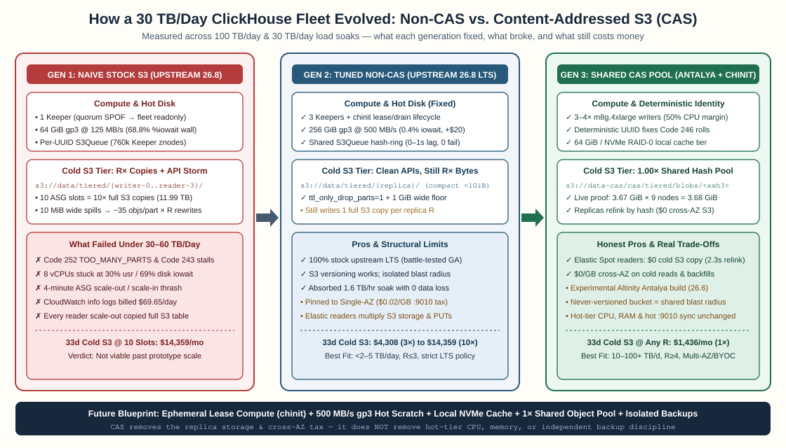
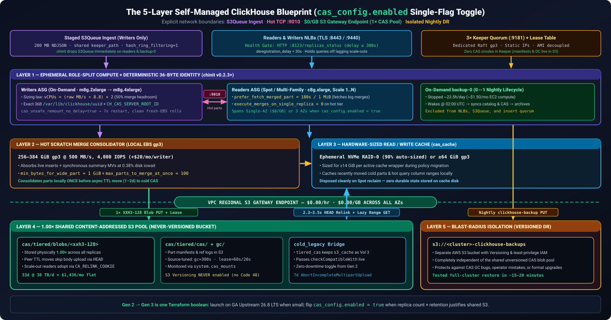

Most architectural guides for self-managed ClickHouse stop at the same
sentence: *"Attach an Amazon Simple Storage Service (`S3`) storage policy so
cold data spills to object storage, add a local cache, and you have separated
compute from storage."*

On a whiteboard, that sounds finished. At **30 TB/day** of raw log ingestion
(`~1.6 TB/hour`, compressing `15.2×` with Zstandard (`ZSTD`) down to
`~1.97 TB/day` on disk), that whiteboard design hits three walls in quick
succession: first an S3 request-rate and disk-throughput wall, then a compute
and memory wall on background merges, and finally the **replica copy
multiplier** — where scaling out to 9 or 10 replicas quietly stores 9 or 10
complete copies of your cold S3 warehouse.

Over the past week, while load-testing the cluster behind [this series](/series/clickhouse-on-aws/)
at **30 TB/day** and **100 TB/day**, we evolved the exact same workload
through **three distinct fleet generations**:

1. **Generation 1 — Naive Stock S3 (`26.8` LTS):** Premature cold-tier spills
   (`~35` wide S3 objects per part × `R` replicas) and a hidden `125 MB/s`
   Elastic Block Store (`EBS`) cap stalled merges within hours.
2. **Generation 2 — Tuned Non-CAS Upstream (`26.8.36.3` LTS + [`chinit`](https://github.com/stackgenhq/chinit) `v0.1.1`):**
   Hot-disk, `S3Queue`, Keeper, and merge knobs tuned from ClickHouse C++ source
   — proven across a 1-hour soak (`792.4M` rows / `1.6 TB`, `0` failed batches,
   `0–1s` lag), yet structurally capped by `R×` cold S3 copies and
   Single-Availability-Zone (`Single-AZ`) lock-in.
3. **Generation 3 — Shared-Pool CAS (`26.6.8.20004.altinityantalya` + `chinit v0.2.3+`):**
   Altinity Antalya's experimental **Content-Addressed Storage (`CAS`)** cold
   pool — collapsing cold S3 storage to **`1.00×`** and cold reader backfills to
   **`2.3–3.5 seconds`**, while exposing seven real operational trade-offs we
   had to diagnose directly in the C++ source.

<aside class="pn-context-callout" aria-label="Context on chinit">
  <p><strong>New to this series?</strong> Throughout this post you will see references to <a href="https://github.com/stackgenhq/chinit"><code>chinit</code></a> — our open-source single-binary VM bootstrapper and config reconciler that gives ephemeral Auto Scaling Group (<code>ASG</code>) instances stable numbered identities (<code>writer-0..N</code>, <code>reader-0..M</code>), renders ClickHouse XML/DDL, and manages graceful scale-in drains without Kubernetes. Read <a href="/blog/announcing-chinit-clickhouse-vms-vs-operator/">Meet chinit: Running ClickHouse on Plain Cloud VMs Without Missing Kubernetes</a> for the background.</p>
</aside>

This post compares the non-CAS and CAS fleets side by side without vendor spin:
what CAS genuinely solves, what CAS **does not** touch, the seven sharp edges
you sign up for in production, and a **single-flag, 5-layer blueprint** (plus an
[interactive break-even calculator](#interactive-non-cas-vs-cas-cold-storage-calculator))
to decide which generation fits your cluster.

**Key takeaways**

- **Fix hot-tier physics before touching CAS.** Lifting writer hot disks from AWS's `125 MB/s` `gp3` default to `500 MB/s` (`+$20/mo`), keeping parts compact below `1 GiB`, and sizing writer CPUs at `~1 vCPU per 8.8 MB/s` of raw ingest × `2×` merge headroom eliminated `80%` of our stability issues *before* CAS entered the picture.
- **CAS eliminates two structural taxes non-CAS cannot:** it collapses cold S3 storage from `R×` copies to **`1.00×`** (verified live: one `3.67 GiB` cold part across `9` replicas occupied `3.68 GiB` total in S3 instead of `33.03 GiB`, relinking onto new Spot readers in `2.29–3.47s` with `0` blob bytes copied) and zeroes out `$0.02/GB` cross-AZ transfer fees on cold reads via a regional S3 Gateway Endpoint.
- **CAS is an engineering trade-off, not a free lunch:** it requires an experimental non-LTS build (`Altinity Antalya 26.6`), a brand-new never-versioned S3 bucket with shared blast radius, exact 36-byte deterministic server UUIDs on ASG replacements, `2×` local cache wrappers during migration, and careful hot/cold merge separation.
- **CAS saves zero hot-tier CPU, RAM, or hot `:9010` bandwidth.** Live `S3Queue` parsing, synchronous Materialized Views (`MVs`), local `gp3` merges, and hot-part replication all execute *before* parts ever reach CAS.
{: .key-takeaways}

---

## How the Fleet Evolved: Three Generations Under Load



*Follow the cold-part path across all three generations: TCP `:9010` peer transfers vs. `$0/GB` S3 Gateway Endpoint writes and zero-copy hash relinks.*

You cannot evaluate CAS fairly against a misconfigured baseline. Each generation
below ran the same synthetic CloudTrail/ELB NDJSON workload (`200 MB` staged
files via `S3Queue` + 3 synchronous summary Materialized Views).

### Generation 1: Naive Stock S3 (What Breaks First)

Our initial port deployed stock ClickHouse `26.8` with a `64 GiB` `gp3` hot disk
spilling to per-replica S3 prefixes (`data/tiered/{replica}/`) across a 10-slot
ASG ceiling (`5` writers + `4` readers + `1` backup). Because upstream
deprecated `allow_remote_fs_zero_copy_replication` after garbage-collection
races ([covered earlier in this series](/blog/clickhouse-zero-copy-replication-dead/)),
every replica owned a private S3 tree.

Under `30–60 TB/day` load, five bottlenecks collided within two hours:

1. **Fleet S3 `PUT` amplification (`~10–15×` per cold byte):** The `64 GiB` hot
   disk hit `move_factor = 0.1` early, spilling unmerged `150–500 MB` parts to
   S3 in **wide format** (`min_bytes_for_wide_part = 10 MiB` default → `~35` S3
   objects/part) where background merges rewrote them 3–5 times on **every**
   replica (`~$350–$1,200+/mo` in ClickHouse-fleet Tier-1 S3 requests alone).
2. **The `125 MB/s` `gp3` iowait wall:** 8-core `r8g.2xlarge` writers showed
   `~28%` user CPU in CloudWatch while hitting `Code: 252 TOO_MANY_PARTS`;
   `iostat` exposed **`68.79%` `%iowait`** pinned against AWS's default
   `125 MB/s` `gp3` cap.
3. **Single-Keeper outage cascade:** Replacing the lone dev Keeper dropped Raft
   quorum to zero and flipped every table `is_readonly = 1`.
4. **Per-UUID `S3Queue` fan-out:** Omitting a shared literal `keeper_path`
   created `760,000+` Keeper znodes and `N-1` lost claim races per file.
5. **`10×` cold storage:** `1.2 TB` of cold data consumed **`11.99 TB` in S3**
   across 10 replica slots.

---

### Generation 2: Tuned Non-CAS Upstream LTS (`26.8.36.3` + `chinit v0.1.1`)

Before adopting an experimental storage layer, we pushed 100% stock upstream
ClickHouse `26.8` LTS (`cas_config.enabled = false`) to its physical ceiling:

- **`256 GiB` hot `gp3` @ `500 MB/s`, `4,000 IOPS` (`+$20/mo/writer`):** Writer
  `%iowait` dropped `68.79% → 0.38%` in 20 seconds, user CPU rose to `89.4%`,
  and local merge throughput reached `494.5 MB/s`.
- **Consolidate locally once in compact format:** Setting
  `min_bytes_for_wide_part = 1073741824` (`1 GiB`),
  `max_parts_to_merge_at_once = 100`, and `ttl_only_drop_parts = 1` kept parts
  compact (`~11` objects vs. `~35`), merged them locally on `gp3` *before*
  Time-To-Live (`TTL`) cold moves, and dropped expired parts via free whole-part
  `DELETE`s — cutting fleet cold-tier S3 API cost to **`~$15–$45/mo`**.
- **Writer-only `S3Queue` + 3-Keeper Raft:** Scoping `S3Queue` to writers with a
  shared `keeper_path` and `enable_hash_ring_filtering = 1` balanced claims
  `50.9% / 49.1%` at `<95k` znodes (`3–4 ms` Keeper latency across 3 `t4g.large`
  nodes).
- **Empirical CPU & RAM sizing:** After `m8g.large` (`8 GiB`) OOM'd in 60s
  (`Code: 241`), `m8g.2xlarge` (`8 vCPU / 32 GiB`) completed a **1-hour
  `30 TB/day` soak** (`8,240` files / `792.4M` rows / `1.6 TB` raw at
  `220,022 rec/s`, `0` failed batches, `0–1s` lag) through a live ASG rolling
  refresh. Measuring core saturation gave our sizing rule: **`1` writer vCPU per
  `8.8 MB/s` (`0.7 TB/day`) of raw NDJSON + 3 MVs × `2×` merge headroom**.

**Where Generation 2 hits a hard structural wall:**
Stock `ReplicatedMergeTree` still writes **`R×` physical cold S3 copies**
(`$4,308/mo` at `3×` up to `$14,359/mo` at `10×` for 33-day retention) and pins
compute to a **Single-AZ** to avoid `$4,800–$8,000/mo` in `$0.02/GB` TCP `:9010`
cross-AZ part-fetch charges.

---

### Generation 3: The Shared-Pool CAS Fleet (`26.6.8.20004.altinityantalya` + `chinit v0.2.3+`)

Generation 3 flips one Terraform variable: `cas_config = { enabled = true }`.
Terraform and `chinit` coordinate five automatic changes:

1. **Dual-Flavor AMI Selection:** Switches writers, readers, and `backup-0` from
   `Flavor=upstream` (`26.8.36.3`) to `Flavor=antalya`
   (`26.6.8.20004.altinityantalya`), leaving the 3 Keepers untouched.
2. **Dedicated Never-Versioned CAS Bucket:** Creates
   `<cluster>-clickhouse-data-cas` with versioning omitted (`count = 0`), a
   7-day `AbortIncompleteMultipartUpload` rule, and a shared `cas/tiered/`
   prefix using `XXH3-128` content hashing (`no {replica}` segment).
3. **Three-Volume `tiered_cas` Bridge Policy:** Pairs `hot` (`256 GiB` `gp3`),
   `cold` (`cas_cache` → `cas`), and `cold_legacy` (`s3_cache` for zero-downtime
   in-place migration), while doubling the cache disk floor (`32 → 64 GiB`).
4. **Deterministic 36-Byte Server Identity:** `chinit v0.2.3+` derives an exact
   36-byte `/var/lib/clickhouse/uuid` and `CH_CAS_SERVER_ROOT_ID` from
   `(cluster_name, claimed_ordinal)` so fresh-EBS ASG replacements reclaim their
   CAS slot cleanly.
5. **Source-Tuned Merge & Lease Settings:** Separates hot vs. cold merge
   strategy across asymmetric writers/readers and relaxes CAS GC/lease timers
   (`300s` GC, `60s/20s` lease, `cas_unsafe_remount_no_delay = true`).

**Live proof across 9 replicas:** Moving a `3.67 GiB` (`25.4M`-row) part to
`VOLUME 'cold'` confirmed physical `1.00×` deduplication in S3:

```text
-- system.parts (visible on writer-1 and relinked across all 9 active replicas):
table   | disk_name | parts |     rows | bytes
--------+-----------+-------+----------+----------
events  | cas_cache |     1 | 25419480 | 3.67 GiB

-- aws s3 ls s3://<cluster>-clickhouse-data-cas/cas/ --recursive --summarize:
Total Objects: 484
Total Size:    3,950,045,875 bytes (3.68 GiB)
```

`writer-0` published `35` blobs once (`blob_put = published`); peers executing
independent TTL moves skipped all `35` body uploads via mandatory `HEAD` checks
(`CASBlobBodyPutAvoided = 35`), and fresh Spot readers adopted the `3.67 GiB`
part via `CA_RELINK_COOKIE` in **`2.29–3.47 seconds` with `0` blob bytes
copied**.

---

## Live Benchmark Telemetry: Non-CAS vs. Untuned CAS vs. Source-Tuned CAS

Here is how Generation 2, our initial untuned CAS deployment (Gen 3a), and our
source-tuned CAS deployment (Gen 3b) performed under sustained `30–38 TB/day`
`S3Queue` + 3-MV load:

| Measured Telemetry | Gen 2: Tuned Non-CAS (`26.8.36.3` LTS) | Gen 3a: Initial CAS (Untuned Defaults) | Gen 3b: Source-Tuned CAS (`Antalya` + `chinit v0.2.3+`, 1h Soak) |
|---|---|---|---|
| **Sustained Ingest Pace** | `220,022 rows/s` (`38.4 TB/day`, `1.6 TB` / `1h`) | `212,177 rows/s` (`37.3 TB/day`, `777 GB` / `30m`) | **`177,821 rows/s` (`30.7 TB/day`, `1,424.5 GiB` uncomp in `1h`)** |
| **Convergence & Staging Lag** | `100%` (`792.4M` rows), `0–1s` lag, `0` failures | `100%` (`382.5M` rows, 7 nodes), `0` backlog | **`100%` (`640,470,621` rows across 7 nodes), `0s` writer lag** |
| **Cold S3 Physical Copies** | **R×** (`9×` = `33.03 GiB` for one `3.67 GiB` part) | **`1.00×`** (`3.67 GiB` total across 7–9 nodes) | **`1.00×`** (`3.68 GiB` total across 7–9 nodes; `15.47×` ZSTD) |
| **Cold Scale-Out Backfill** | Full S3 download + re-upload to new `{replica}/` | **`2.29s – 3.47s` metadata relink (`0` bytes)** | **`2.29s – 3.47s` metadata relink (`0` bytes)** |
| **Full-Hour Fleet S3 API Cost** | `~$0.25–$0.30/hr` (post hot-disk tuning) | `~$0.45/hr` (`60s` GC + `10s` lease renewals) | **`$0.2467` total for 1h (`35,265` Tier-1 + `176,023` Tier-2 = `~$161/mo`)** |
| **Writer CPU & RAM Usage** | `65–90%` on `8-vCPU` `m8g.2xlarge` | `35–55%` CPU on `16-vCPU` `m8g.4xlarge` | **`22–53%` CPU, `8.44 / 61.64 GiB` RAM (`13.7%`) → `m8g.2xlarge` floor** |
| **Reader Merge Behavior** | Local hot merges (`20–45s`) | **`63–110s` avg (`1,098s` max)** — `57%` hashed to readers | **`prefer_fetch_merged_part = 180s / 1 MiB` + `4-vCPU` `c8g.xlarge`** |
| **`systemctl restart` Time** | `~5–7s` | **`40–89s`** (waits out prior mount lease TTL) | **`7s`** (`cas_unsafe_remount_no_delay = true` on own UUID) |
| **Fresh-EBS ASG Roll** | Clean (`{replica}` macro) | **Crash-looped (`Code: 246` / `Code: 27`)** | **Clean (`36`-byte deterministic UUID + `CH_CAS_SERVER_ROOT_ID`)** |

**Takeaway:** CAS delivered `1.00×` cold deduplication and `~3s` scale-out
relinks out of the box; getting merges, restarts, and stateless ASG replacements
production-clean required reading the C++ source.

---

## Side-by-Side Comparison: Non-CAS (Gen 2) vs. CAS (Gen 3)

*(Scope note: every dollar figure accounts strictly for the **ClickHouse fleet
itself** — excluding upstream log-producer or load-generator compute and
producer staging `PUT`s.)*

| Dimension | Gen 1: Naive Stock S3 | Gen 2: Tuned Non-CAS (`26.8` LTS) | Gen 3: Source-Tuned CAS (`Antalya 26.6`) |
|---|---|---|---|
| **ClickHouse Binary** | Upstream `26.8` LTS (GA) | Upstream `26.8.36.3` LTS (**GA**) | Altinity Antalya `26.6.8.20004` (**Experimental**, Apache-2.0) |
| **Cold S3 Copies (`R` replicas)** | `R×` (`10×` across 10 slots) | `R×` (`3×–10×` per replica ceiling) | **`1.00×` shared content-addressed pool** |
| **33-Day Cold S3 @ 30 TB/day** | `$14,359/mo` (`10` slots) | `$4,308/mo` (`3×`) to `$14,359/mo` (`10×`) | **`$1,436/mo` flat (at `3`, `10`, or `20` replicas)** |
| **7-Day Cold S3 @ 30 TB/day** | `$3,178/mo` (`10` slots) | `$953/mo` (`3×`) to `$3,178/mo` (`10×`) | **`$318/mo` flat** |
| **Fleet Cold-Tier S3 API Cost** | `~$350–$1,200+/mo` (wide spills × `R`) | **`~$15–$45/mo`** (compact local merge × `R`) | **`~$15–$35/mo` flat** (`1×` `PUT`s + `300s` GC) |
| **Elastic Reader Scale-Out** | Copies entire cold S3 table per reader | Copies entire cold S3 table per reader | **`$0` extra cold S3 bytes; `2.3–3.5s` relink** |
| **Multi-AZ Transfer (`$0.02/GB`)** | `$4,800–$8,000/mo` on hot + cold `:9010` | Pinned to **Single-AZ** to avoid `:9010` fee | **`$0/GB` on cold S3 reads; hot inserts still use `:9010`** |
| **Hot-Tier EBS & Writer CPU** | `64G @ 125 MB/s` (stalled) | **`256G @ 500 MB/s`; `48–64` writer vCPUs** | **Identical (`256G @ 500 MB/s`; `48–64` writer vCPUs)** |
| **Local Cache Disk Split** | 2 wrappers | 2 wrappers (`32 GiB` = `14 GiB` each) | **4 wrappers during migration (`64 GiB` = `14 GiB` each)** |
| **S3 Versioning & Blast Radius** | Supported; isolated per `{replica}/` | **Supported; isolated per `{replica}/`** | **Forbidden (`Code: 48`); shared pool (nightly DR mandatory)** |
| **Garbage Collection & ASG ID** | S3 Lifecycle + `{replica}` macro | `ttl_only_drop_parts=1` + `{replica}` | **18-phase S3 GC + exact 36-byte deterministic UUID** |

---

## The Unbiased Pros and Cons of CAS

### The Pros: Where CAS Changes Cluster Economics

1. **Replica count stops multiplying your cold storage bill (`R× → 1×`).**
   At `30 TB/day` (`1.974 TB/day` compressed) and 33-day retention, one cold S3
   copy costs `$1,436/month`. Non-CAS scales linearly from `$4,308/mo` (`3×`) to
   `$14,359/mo` (`10×`); CAS locks cold S3 at **`$1,436/mo` flat (`-$34k` to
   `-$155k/year`)** regardless of how many Spot readers you add.
2. **Sub-4-second cold scale-outs (`DataPartsExchange.cpp:408`).**
   When peers share a CAS pool UUID, the sender returns `CA_RELINK_COOKIE` +
   `part_manifest_v2` instead of streaming column files, and the receiver stages
   a manifest reference (`CASBlobAdoptTrusted`) in `2.29–3.47s`. Even when
   replicas independently TTL-move the same hot part, `CasPartWriteTxn.cpp` runs
   a `HEAD` check and skips duplicate uploads (`CASBlobBodyPutAvoided`).
3. **`$0.00/GB` cross-AZ cold reads via S3 Gateway Endpoint.**
   Unlike EC2-to-EC2 `:9010` transfers (`$0.02/GB` across AZs), regional S3
   Gateway Endpoint traffic is `$0.00/GB` from every AZ in the region —
   unlocking cross-AZ cold query replicas and fast cross-AZ recovery.
4. **Keeper stays completely off the blob GC path.**
   Unlike deprecated zero-copy replication (which bloated Keeper with per-blob
   znodes and locks), CAS stores manifests, reference logs, and mount leases in
   S3 (`cas/tiered/gc/`), keeping our 3 Keepers at `3–4 ms` latency.

---

### The Cons: Seven Sharp Edges Diagnosed from Source

1. **Experimental non-upstream binary (`Altinity Antalya 26.6`) with no format stability promise.**
   `metadata_type = cas` is not in upstream ClickHouse `26.8` LTS. You cannot
   mix `26.8` and `26.6` server settings (`s3_allow_server_credentials_in_user_queries`
   crashes `26.6` with `Code: 115 UNKNOWN_SETTING`), and Altinity explicitly
   notes on-S3 CAS metadata has no cross-version compatibility guarantee yet.
2. **Stateless ASG replacements `Code: 246` crash-loop — down to a trailing `\n` byte.**
   CAS binds each replica's mount slot (`gc/server-roots/<srid>/owner` in
   `CasServerRoot.cpp:712`) to `/var/lib/clickhouse/uuid`. Three failure modes
   await ASG fleets:
   - *Distro auto-start race:* Ubuntu's `.deb` package starts `clickhouse-server`
     during image bake, minting a random UUID unless masked (`systemctl mask
     clickhouse-server` in Packer).
   - *Fresh-EBS replacement:* A replacement `writer-0` with a new random UUID
     crashes on startup with **`Code: 246 CORRUPTED_DATA` (`"CAS server-root is
     owned by a different server"`)** unless both `CH_CAS_SERVER_ROOT_ID` and
     `/var/lib/clickhouse/uuid` are derived deterministically from
     `(cluster_name, ordinal)`.
   - *The 37th-byte newline trap (`ServerUUID.cpp:44–45`):* ClickHouse parses
     `/var/lib/clickhouse/uuid` via `readUUIDText(uuid, in); assertEOF(in);`.
     Writing `uuid + "\n"` (`37` bytes) throws **`Code: 27
     CANNOT_PARSE_INPUT_ASSERTION_FAILED`** and **silently overwrites the file
     with a random `UUIDv4`** — priming a delayed `Code: 246` crash on the next
     ASG roll until `chinit v0.2.3` wrote exact 36-byte files.
3. **S3 `"Suspended"` versioning still fails (`Code: 48`), and blast radius is shared.**
   If a bucket *ever* had S3 Versioning enabled — even after setting
   `Status="Suspended"` — S3 permanently creates `null` delete markers on
   `DELETE`, causing `CasProbe` to refuse startup with **`Code: 48
   NOT_IMPLEMENTED`**. You need a brand-new never-versioned bucket, and because
   all replicas share its blobs, pool corruption or accidental prefix deletion
   hits every replica at once.
4. **Zero hot-tier compute savings — and hot `:9010` replication still pays cross-AZ fees.**
   `S3Queue` parsing, synchronous MVs, and local `gp3` merges consume identical
   CPU and RAM, and newly inserted hot parts (`~1.97 TB/day` compressed) still
   replicate over `:9010` (`~$1,180/mo` per cross-AZ hot replica at `$0.02/GB`
   unless writers stay in one AZ per shard).
5. **The `execute_merges_on_single_replica_time_threshold` asymmetrical-fleet trap.**
   In `ReplicatedMergeTreeMergeStrategyPicker.cpp:57–104`, setting
   `execute_merges_on_single_replica_time_threshold = 3600` on a two-volume
   policy hashes **hot local merges** across all replicas — assigning `57%`
   (`4/7`) of heavy ZSTD merges to `2-vCPU` readers (`63–110s` avg, `18.3m` max)
   while `16-vCPU` writers logged `220` `Code: 234 NO_REPLICA_HAS_PART` errors.
   Keep `execute_merges_on_single_replica_time_threshold = 0` on hot tiers, set
   `prefer_fetch_merged_part_time_threshold = 180` / `size_threshold = 1 MiB` so
   readers merge tiny parts locally and fetch large merges from writers, and
   gate `remote_fs_execute_merges_on_single_replica_time_threshold` strictly on
   `isContentAddressed()` cold disks.
6. **Live policy migration (`checkCompatibleWith`) doubles cache wrappers.**
   Switching live tables from `tiered` to `tiered_cas` requires keeping
   `s3_cache` as `cold_legacy`, doubling active cache wrappers from `2 → 4` and
   requiring at least a `64 GiB` cache disk (`14 GiB` per wrapper) or local NVMe.
7. **S3 mount-lease and 18-phase GC state machine overhead.**
   Default CAS timers (`60s` GC, `30s/10s` lease, `cas_unsafe_remount_no_delay =
   false`) burn idle Tier-1 `PUT`s and stall `systemctl restart` for `40–89s`.
   Tuning them cut restarts to `7s` and idle GC ops by `5×`, while adding
   `system.cas_mounts` (`wedged_namespace_count`, `gc_fenced`) to SRE monitoring.

---

## A Blueprint for Future Self-Managed ClickHouse Installations

For Bring-Your-Own-Cloud (`BYOC`) SaaS vendors, strict data-sovereignty
deployments, or `10–100+ TB/day` observability fleets optimizing Cost of Goods
Sold (`COGS`), our three-generation evolution distills into a **5-layer
architecture** where **non-CAS vs. CAS is one declarative toggle**:



### 1. Design CAS as a Single-Flag Toggle (`cas_config.enabled`)

Generation 2 and Generation 3 share `98%` of our Terraform and `chinit` code:

```hcl
# Flipping enabled = true/false automatically adapts:
#   1. Golden AMI flavor (Flavor=antalya 26.6 vs Flavor=upstream 26.8 LTS)
#   2. Never-versioned <cluster>-clickhouse-data-cas S3 bucket + IAM scopes
#   3. Cache volume floor (>= 14 GiB per active cache wrapper)
#   4. Storage policy ('tiered_cas' with cold_legacy vs 'tiered')
#   5. chinit 36-byte deterministic UUID + live storage_policy convergence
cas_config = {
  enabled = true
}
```

Launch small clusters on **Generation 2 (`26.8` LTS non-CAS)** and flip
`cas_config.enabled = true` once retention and replica count justify shared S3.

### 2. Source-Verified CAS & MergeTree Reference Configuration

Every snippet below is pure XML and SQL ready to copy into test environments:

```xml
<!-- /etc/clickhouse-server/config.d/storage.xml (CAS disk excerpt) -->
<cas>
    <type>object_storage</type>
    <object_storage_type>s3</object_storage_type>
    <metadata_type>cas</metadata_type>
    <cas_server_root_id from_env="CH_CAS_SERVER_ROOT_ID" />
    <endpoint from_env="CH_S3_ENDPOINT" />
    <endpoint_subpath>cas/tiered/</endpoint_subpath>
    <use_environment_credentials>true</use_environment_credentials>
    <skip_bucket_creation>true</skip_bucket_creation>
    <cas_gc_interval_sec>300</cas_gc_interval_sec>
    <cas_mount_lease_ttl_ms>60000</cas_mount_lease_ttl_ms>
    <cas_mount_renew_period_ms>20000</cas_mount_renew_period_ms>
    <cas_unsafe_remount_no_delay>true</cas_unsafe_remount_no_delay>
    <cas_blob_hash>xxh3-128</cas_blob_hash>
    <cas_blob_hash_allow_new>true</cas_blob_hash_allow_new>
</cas>
```

Pair that disk with these `MergeTree` settings on two-volume (`hot` local `gp3`
→ `cold` `cas_cache`) tables:

```sql
SETTINGS
    storage_policy = 'tiered_cas',
    min_bytes_for_wide_part = 1073741824,
    max_parts_to_merge_at_once = 100,
    ttl_only_drop_parts = 1,
    execute_merges_on_single_replica_time_threshold = 0,
    prefer_fetch_merged_part_time_threshold = 180,
    prefer_fetch_merged_part_size_threshold = 1048576;
```

### 3. The Five Non-Negotiable Operational Rules

1. **Deterministic 36-byte cattle identity:** Lease bounded ordinals
   (`writer-0..N`, `reader-0..M`), mask `clickhouse-server` in Packer, and seed
   an exact 36-byte deterministic UUID before first start (see Con #2).
2. **Merge locally on `500 MB/s` `gp3` before cold TTL:** Consolidate inserts
   into `≥1 GiB` compact parts on `256–384 GiB` `gp3` before async `1–2d` TTL
   moves write them to CAS once (`perform_ttl_move_on_insert = false`).
3. **Disposable NVMe cache + enforced S3 Gateway Endpoint:** Auto-stripe local
   `*gd` NVMe SSDs (or `≥64 GiB` `gp3`) for `cas_cache`, and verify at plan time
   that every subnet route table attaches to the regional S3 Gateway Endpoint.
4. **Strict writer/reader isolation + `/replicas_status` NLB gate:** Drop
   `S3Queue` immediately after `SyncSchema` on non-writers, run non-burstable
   `4-vCPU` `c8g.xlarge` readers, and check `HTTP :8123/replicas_status`
   (`delay ≤ 300s`, `deregistration_delay = 30s`) on NLB target groups.
5. **Nightly blast-radius isolation:** Wake an off-quorum `backup-0` replica
   nightly (`~$1.50/mo` compute) to archive `clickhouse-backup` snapshots into a
   separate, versioned S3 bucket before stopping itself.

---

## Production-Readiness Scorecard (`7.4/10 → 9.4/10`)

Our 1-hour `30.7 TB/day` (`640.47M`-row) soak with 5-minute EC2-to-S3 snapshots
surfaced four subtle bottlenecks that short smoke tests miss — all closed in
`chinit` and our ClickHouse C++ branch:

| Dimension | Initial Score | Remediated | What the 1-Hour 30.7 TB/day Soak Exposed & Fixed |
|---|---|---|---|
| **1. Ingest & Storage Efficacy** | `9.0 / 10` | **`9.5 / 10`** | `6,661` files / `640.47M` rows (`1,424.5 GiB` → `92.1 GiB` = `15.47×` ZSTD) at `0s` lag and **`$0.2467` total S3 API cost/hr** (`~$161/mo`); shortened cold TTL to `1–2d`. |
| **2. CPU Sizing & Balance** | `6.5 / 10` | **`9.4 / 10`** | `m8g.4xlarge` writers ran at `22–53%` CPU while `2-vCPU` `t4g.large` readers hit `100%`; right-sized baseline writers to `m8g.2xlarge` and readers to `4-vCPU` `c8g.xlarge` (`-$630/mo` net). |
| **3. Memory Stability** | `7.0 / 10` | **`9.4 / 10`** | Writers peaked at `13.7%` RAM (`8.44 GiB`), while new `8 GiB` readers hit `Code: 241` before `S3Queue` drop; fixed `chinit` to run role-scoped DDL immediately after `SyncSchema`. |
| **4. Network & Replication** | `7.5 / 10` | **`9.3 / 10`** | `200–444 MB/s` burst over `:9010` + free S3 Gateway Endpoint; added DNS/hosts refresh inside `health_gate` and guarded `remote_fs_execute_merges...` on `isContentAddressed()`. |
| **5. Load Balancing & Routing** | `7.0 / 10` | **`9.4 / 10`** | Switched NLB target groups from `TCP :8123` to `HTTP :8123/replicas_status` (`300s / 120s` lag thresholds) and cut `deregistration_delay` `300s → 30s`. |
| **Overall Fleet Readiness** | **`7.4 / 10`** | **`9.4 / 10`** | **Production-ready for sustained 30+ TB/day ingestion.** |

---

## Break-Even Math & Interactive Calculator: Which Generation Should *You* Run?

Monthly cold-storage savings (`ΔC_cold`) when switching from Generation 2
(non-CAS, `R×` copies) to Generation 3 (CAS, `1×` shared pool) follow one
equation:

<div class="pn-formula-card" role="math" aria-label="Monthly cold storage savings equals R minus 1 times raw daily volume times cold retention days divided by compression ratio times S3 price per GB-month">
  <div class="pn-formula-eq">
    <span>ΔC<sub>cold</sub></span>
    <span>=</span>
    <span>(R − 1)</span>
    <span>×</span>
    <span class="pn-frac">
      <span class="pn-frac__num">V<sub>raw/day</sub> × D<sub>cold</sub></span>
      <span class="pn-frac__den">c</span>
    </span>
    <span>×</span>
    <span>P<sub>S3</sub></span>
  </div>
  <p class="pn-formula-legend">
    <strong>R</strong> = data-bearing replica slot ceiling · <strong>V<sub>raw/day</sub></strong> = daily raw ingest (GB) · <strong>D<sub>cold</sub></strong> = cold retention days · <strong>c</strong> = ZSTD compression ratio (<code>~12–15×</code>) · <strong>P<sub>S3</sub></strong> = blended S3 price (<code>~$0.022–$0.023/GB-mo</code>)
  </p>
</div>

### Interactive Non-CAS vs. CAS Cold-Storage Calculator

Plug in your own cluster numbers below (or share a direct permalink to any scenario):

<div class="pn-calc" id="cas-breakeven-calc">
  <div class="pn-calc__header">
    <p class="pn-calc__title"><a class="pn-calc__permalink" href="#interactive-non-cas-vs-cas-cold-storage-calculator">#</a> Cold-Storage Cost Estimator</p>
    <div class="pn-calc__presets">
      <button type="button" class="pn-calc__preset" data-tb="2" data-days="14" data-rep="3" data-comp="14">Small Fleet (2 TB/d, R=3)</button>
      <button type="button" class="pn-calc__preset" data-tb="30" data-days="26" data-rep="9" data-comp="15.2">Our Benchmark (30 TB/d, R=9)</button>
      <button type="button" class="pn-calc__preset" data-tb="80" data-days="30" data-rep="10" data-comp="15">Scale Fleet (80 TB/d, R=10)</button>
      <button type="button" class="pn-calc__preset pn-calc__preset--copy" id="calc-copy-link" aria-label="Copy permalink to this calculator scenario">Copy Permalink</button>
    </div>
  </div>
  <div class="pn-calc__controls">
    <div class="pn-calc__field">
      <label for="calc-tb"><span>Daily Raw Ingest (<code>V_raw/day</code>)</span><span class="pn-calc__val" id="calc-tb-val">30 TB/day</span></label>
      <input type="range" id="calc-tb" min="1" max="100" step="1" value="30">
    </div>
    <div class="pn-calc__field">
      <label for="calc-days"><span>Cold S3 Retention (<code>D_cold</code>)</span><span class="pn-calc__val" id="calc-days-val">26 days</span></label>
      <input type="range" id="calc-days" min="5" max="90" step="1" value="26">
    </div>
    <div class="pn-calc__field">
      <label for="calc-rep"><span>Replica Slot Ceiling (<code>R</code>)</span><span class="pn-calc__val" id="calc-rep-val">9 replicas</span></label>
      <input type="range" id="calc-rep" min="2" max="12" step="1" value="9">
    </div>
    <div class="pn-calc__field">
      <label for="calc-comp"><span>ZSTD Compression Ratio (<code>c</code>)</span><span class="pn-calc__val" id="calc-comp-val">15.2×</span></label>
      <input type="range" id="calc-comp" min="8" max="20" step="0.2" value="15.2">
    </div>
  </div>
  <div class="pn-calc__results" aria-live="polite">
    <div class="pn-calc__stat">
      <span class="pn-calc__stat-label">1× Compressed Cold Pool</span>
      <span class="pn-calc__stat-num" id="calc-pool-out">51.3 TB</span>
    </div>
    <div class="pn-calc__stat">
      <span class="pn-calc__stat-label">Gen 2 Non-CAS (R× S3)</span>
      <span class="pn-calc__stat-num" id="calc-gen2-out">$12,923/mo</span>
    </div>
    <div class="pn-calc__stat">
      <span class="pn-calc__stat-label">Gen 3 Shared CAS (1× S3)</span>
      <span class="pn-calc__stat-num" id="calc-gen3-out">$1,436/mo</span>
    </div>
    <div class="pn-calc__stat pn-calc__stat--savings">
      <span class="pn-calc__stat-label">Monthly / Annual Savings</span>
      <span class="pn-calc__stat-num" id="calc-save-out">$11,487/mo</span>
    </div>
  </div>
  <div class="pn-calc__verdict" id="calc-verdict">
    <strong>Recommended: Gen 3 (Source-Tuned CAS).</strong> Saving <strong>$137,846/year</strong> in duplicate cold S3 plus ~3-second zero-copy reader scale-outs decisively outweighs running Altinity Antalya + nightly isolated backups.
  </div>
</div>

<script defer src="/assets/js/cas-calculator.js"></script>

| Your Situation | Recommended Choice | Why |
|---|---|---|
| **Ingest `< 2–5 TB/day`, `2–3` replicas in one AZ, strict LTS or S3-versioning mandate** | **Gen 2: Tuned Non-CAS (`26.8` LTS + `chinit`)** | Cold S3 is only `$150–$600/mo`; `500 MB/s` `gp3` + `1 GiB` compact parts deliver GA stability, S3 versioning, and isolated per-replica blast radius. |
| **Ingest `10–100+ TB/day`, BYOC VPCs, elastic `4–10+` Spot readers, or cross-AZ cold serving** | **Gen 3: Source-Tuned CAS (`Antalya` + `chinit v0.2.3+`)** | Saving `$3,000–$15,000+/mo` in duplicate S3 storage + `2.3–3.5s` zero-copy reader scale-outs justifies pinning Altinity Antalya and running nightly isolated backups. |
| **No appetite to own Keeper quorums, AMI pipelines, or storage GC runbooks** | **ClickHouse Cloud (`SharedMergeTree`) / Altinity.Cloud** | Shared object storage, stateless compute scaling, and vendor Service-Level Agreements (`SLAs`) out of the box without operating the control or storage planes yourself. |

Self-managed ClickHouse on object storage is crossing an important inflection
point. By fixing hot-tier merge physics first, treating CAS's trade-offs
honestly, and automating deterministic VM identity in
[`chinit`](https://github.com/stackgenhq/chinit), `1×` shared S3 storage with
elastic, zero-copy read scaling is now a blueprint any infrastructure team can
evaluate with clear math — and toggle with a single flag when scale demands it.
