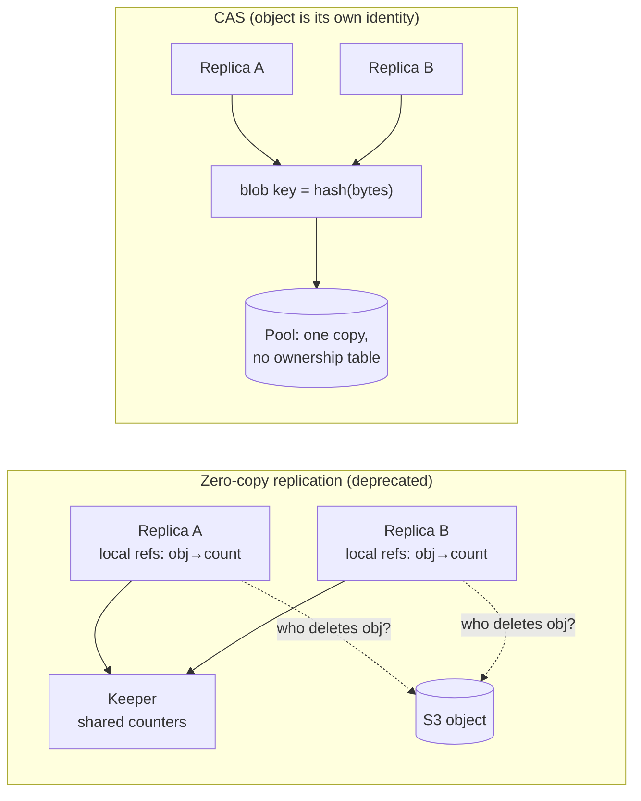

Every team that runs ClickHouse on S3 eventually hits the same wall. Replication works. The bill does not. Three replicas mean three copies of every part, three times the PUT requests, and a cache-warming exercise after every resize. The obvious answer — "just let the replicas share the objects" — was tried, shipped, and then removed. This post is the post-mortem, and the reason the next four posts exist.

**Key takeaways**

- Upstream ClickHouse deprecated zero-copy replication; PR [#82250](https://github.com/ClickHouse/ClickHouse/pull/82250) removed its tests, and the setting is not one to plan around.
- The failure was a distributed-reference-counting problem. Ownership was tracked per replica, not with the object, so GC could not prove an object was safe to delete.
- Today, every replica of a `ReplicatedMergeTree` table physically copies parts. Storage cost scales linearly with replica count.
- The successor designs split along a line: **who owns the reference?** CAS makes the content hash the owner; SharedMergeTree makes the metadata service the owner.
{: .key-takeaways}

---

## What zero-copy actually promised

`allow_remote_fs_zero_copy_replication` let ReplicatedMergeTree skip the byte copy when a part already existed on shared object storage. Replica A wrote part `all_1000_1000_1` to `s3://bucket/prefix/…`. Replica B, seeing the same part in its replication queue, would record a reference to A's objects instead of downloading and re-uploading them. Three replicas, one physical copy. It looked exactly like what everyone wanted.

The mechanics hid the hard part. An object in S3 has no idea how many replicas reference it. So ClickHouse tracked reference counts in ZooKeeper, with each replica keeping local state about which remote objects it used. The invariant — "this object may be deleted only when count reaches zero" — had to hold across crashes, retries, merge rewrites, TTL moves, and detached parts.

## How it actually broke

The failure mode was never "corruption on write". Writes went through fine. The failure was in **reclamation**:

1. Replica A and B both referenced object `X`. A's local count said 2, B's said 2.
2. B re-fetched or re-created its metadata, or a merge rewrote the part, or a TTL move re-homed the part. The counts drifted — one said 1, the other said 2. There was no single place that could reconcile them.
3. A merge on A deleted "its" copy of the shared objects, because A's bookkeeping said nobody else needed them.
4. B held a dangling reference. The next read of that part returned NoSuchKey. The part was, from B's point of view, gone from storage but present in the parts catalog.

Recovery meant finding every part whose backing objects were gone and re-fetching or re-creating them — often impossible if the originating replica had also moved on. Support threads and the [issue tracker](https://github.com/ClickHouse/ClickHouse/issues/98475) filled with exactly this shape of corruption report.

The upstream response was decisive: deprecate the feature, delete the tests in [#82250](https://github.com/ClickHouse/ClickHouse/pull/82250), and stop describing it as production-viable. That is not a bug fix waiting to land; it is a design retreat.

## Why the naive fix does not work either

"Just add a refcount in Keeper" is the first proposal everyone makes. It does not close the hole: refcount updates are not transactional with S3 operations. You can make the refcount perfect and still delete an object in the gap between one replica reading the refcount and another incrementing it — or you can hold a lock so long that merges serialize on it. The problem is not the counter. The problem is that *ownership lives outside the object*.

That observation is the hinge for everything that follows in this series. Any design that tracks sharing as separate mutable state — local files, Keeper znodes, refcount tables — has the same failure shape. The designs that survive move the answer into the object itself.

## What this costs you in practice

On a self-managed cluster, the practical consequences are:

- **Storage:** cold data is multiplied by replica count. My own dev cluster shows this clearly — the writer and reader each hold full copies of the shared `events` table (hundreds of millions of rows), and a third replica would triple it again.
- **Network:** every replica fetches parts independently after every merge.
- **Headroom for scale-out:** adding a reader is not free capacity; it is a full data copy and a cache warm-up.
- **Backups:** every replica is a separate copy to back up, or you back up once from one replica and accept that restore semantics differ from the others.

None of these are reasons to avoid replication. They are reasons to look hard at whether your cold tier can avoid the multiplier.

## What to do on Monday

1. **Do not enable `allow_remote_fs_zero_copy_replication`** on anything you care about, regardless of what an old blog post or config comment says. Mine once said exactly that, and it was wrong (I wrote about it in [The S3 Path Bug Nobody Sees](/blog/clickhouse-s3-key-prefix-silent-config-bug/)).
2. **Give each replica its own prefix** (`data/<tenant>/{replica}/`) so merges cannot delete across replicas. This is mandatory, not an optimization.
3. **Treat cold-tier cost as a capacity-planning input**, not an afterthought. Model replica × bytes.
4. If the multiplier hurts, evaluate CAS (next post) or [ClickHouse Cloud](/blog/clickhouse-whats-next-cas-iceberg/) rather than reaching for the deprecated flag.

The rest of this series is what replacing zero-copy actually looks like: the [object model](/blog/clickhouse-cas-object-model/), [a hands-on AWS walkthrough](/blog/clickhouse-cas-on-aws-walkthrough/), [the failure modes](/blog/clickhouse-cas-failure-modes/), and [how to decide](/blog/clickhouse-cas-vs-shared-mergetree-decision/).

## References

- ClickHouse PR [#82250](https://github.com/ClickHouse/ClickHouse/pull/82250) — removal of zero-copy replication tests
- [Issue #98475](https://github.com/ClickHouse/ClickHouse/issues/98475) — zero-copy corruption reports
- Altinity Antalya CAS overview: <https://altinity.com/blog/introducing-cas-drop-in-compute-storage-separation-for-clickhouse-mergetree-tables>
- Altinity Antalya docs, CAS section: <https://docs.altinity.com/altinityantalya/>
