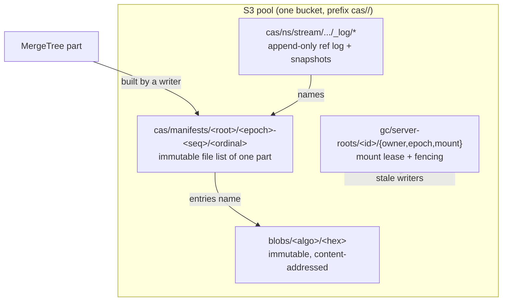

The last post ended with a claim: the designs that survive move identity into the object. This one opens the object. CAS — content-addressed storage, shipped in Altinity's Antalya builds — is small enough to hold in your head in one sitting, and understanding it is the difference between evaluating it and cargo-culting it.

Everything below is from the open-source Antalya sources and docs (Apache-2.0): `src/Disks/DiskObjectStorage/MetadataStorages/ContentAddressed/` and `docs/en/antalya/cas/`. File and class names are stable enough to grep.

**Key takeaways**

- A CAS pool is four object kinds: blobs (bytes), manifests (what a part contains), refs (which manifest a part name points at), and a mount lease per server. There is no separate metadata service.
- Blobs are keyed by the hash of their bytes. Identical content lands at the same key, so dedup is free and no ownership table exists.
- Reachability replaces reference counts. GC folds an append-only ref log into an in-degree map and deletes only what no ref names — and it refuses to run without a live mount lease.
- Keeper is untouched. Replicas still agree on the part set through the normal replication log; CAS only changes how the bytes underneath are stored and shared.
{: .key-takeaways}

---

## The Git analogy, made precise

CAS is easiest to load into memory through Git. A part file is a **blob** keyed by content hash. A **manifest** is the tree — the immutable list of files that make up one MergeTree part. A **ref** is a branch head — a mutable pointer from `part name → manifest`. GC is `git gc`: keep what refs can reach, drop the rest.

| Git | CAS |
|---|---|
| blob | one part file's bytes, key = content hash |
| tree | part manifest (sorted entries: path, hash, size) |
| ref | `part name → manifest id`, the only mutable state |
| `git gc` | 18-phase reachability fold over the ref log |

Where the analogy breaks: Git has one writer and a local disk. A CAS pool is multi-writer over S3 with no transactions across objects, so the design has to name every ambiguity and fail closed on it. That is what most of the code is doing.

## The four object kinds

1. **Blob** — one file's bytes (`blobs/<algo>/<hex[0:2]>/<hex>`). Hash algorithm is per-pool (`cityhash128` default, `xxh3`, or `sha256`), fixed at pool creation and stored in `_pool_meta`. Blobs are write-once; there is no in-place update.
2. **Manifest** — the file list of one part. Manifest ids are `{writer_epoch, build_sequence, ordinal}`, not hashes. Immutable after write; rewriting a part writes a new manifest and moves the ref.
3. **Ref log** — the only mutable state. Append-only records (`+1` / `-1` on blob in-degree, plus namespace transitions) folded into in-degree increments/decrements. Snapshots checkpoint the fold.
4. **Mount lease** (`gc/server-roots/<root>/mount`) — a renewable lease with a fencing token (`epoch`). No lease, no GC authority; a stale writer is fenced rather than trusted.

Every object is text with a versioned envelope (`{"type":"cas_...","v":N}`), zstd-compressed where it is large. That is deliberate: you can `aws s3 cp` a manifest and read it with `jq`, and an unreadable version fails loudly with `UNKNOWN_FORMAT_VERSION` rather than being half-parsed.

## Mounting: what `cas_server_root_id` really is

Every CAS disk needs a `cas_server_root_id` — e.g. the `{replica}` macro. It is not a display name:

- It namespaces the server's manifests, staging area, owner record, and GC authority.
- It must be unique per server sharing the pool. Two servers with the same id, or one server whose id was recycled after a wipe, corrupt each other's view.
- It is deliberately **not** derived from the server UUID, because a wiped local directory can regenerate a UUID but must not silently inherit ownership of someone else's pool subtree. A mismatch is `CORRUPTED_DATA`, not a silent takeover.
- On mount, the server claims (or re-confirms) an owner record and renews a lease. Peers fence it by epoch when it goes stale.

In practice this is where most "CAS won't start" incidents come from: an id that moved, a reused volume, or a config rendered with the wrong macro.

## Fetching a part without moving bytes

When a replica needs a part the pool already holds, it does not copy it:

1. Receiver advertises the pool UUIDs it can see and protocol version 11.
2. Sender resolves the part **once** (manifest + confirm token from the same view) and answers with the manifest bytes plus a token.
3. Receiver stages the manifest locally (`precommitAdd`) — a +1 edge that makes the blobs un-deletable before anyone is told they are referenced.
4. Receiver confirms the token with the sender (`cas_confirm`). Only a literal `yes` authorizes promotion.
5. Receiver promotes: the ref is published, the +1 folds into the in-degree, and the part is live without a single byte crossing the network.

If step 4 cannot get a clean `yes` — stale cache, unfenced mount, network flake — the fetch falls back to downloading bytes, which content-addresses and dedups on arrival anyway. Relink failure never corrupts; it just costs bandwidth.

## GC: why zero-copy died and this does not

Zero-copy kept a number per object. CAS keeps a **log** and a **fold**:

- Reachability is computed from ref logs and manifests, never from a stored count.
- Each round is an 18-phase pipeline: establish or renew the GC lease, fold the log into in-degree deltas, condemn blobs that reach zero, then delete them only after a full extra round confirms they stayed at zero.
- Deletes use exact tokens, never "delete whatever is at this key". A blob that was recreated in between is never touched.
- If anything is ambiguous — an incomplete listing, a missing lease, a corrupt manifest — the round aborts or skips the item. It never "best effort" deletes.

So the invariant is simple to state: **the pool never deletes an object that a live ref transitively names, and it never deletes anything when it cannot tell.** That is a stronger guarantee than zero-copy ever had, and it is the reason CAS is plausible for production.

## What you can and cannot conclude from this

You can conclude: the design has no per-object mutable refcount, no external coordinator, and a fail-closed delete path. You cannot conclude: that it is production-hardened for your workload, that your S3 backend satisfies the conditional-write contract CAS requires, or that your ops team is ready to read `system.cas_gc_log`. Those are the next posts.

## References

- Altinity Antalya CAS docs: <https://docs.altinity.com/altinityantalya/> (`cas/architecture/*`)
- CAS source: `src/Disks/DiskObjectStorage/MetadataStorages/ContentAddressed/` in [Altinity/ClickHouse](https://github.com/Altinity/ClickHouse), branch `antalya-26.6`
- [Quick start and config reference](https://docs.altinity.com/altinityantalya/cas/quick-start)
