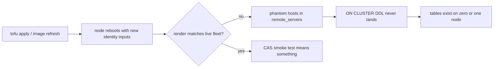

Every storage engine is sold on its happy path. This post is the unhappy one. It is written from a dev cluster where we attempted a writer→reader verification and hit a wall that had nothing to do with CAS — which is itself the lesson: **the failure modes that will actually get you are usually one layer below the feature you are evaluating.**

**Key takeaways**

- CAS fails closed. Mount refusal, ambiguous GC, lost leases: all stop work rather than proceed unsafely. That is good design and it still means an outage if you ignore the signals.
- Most real failures are identity, config render, or bucket misconfiguration — not the CAS algorithm.
- Your replication layer is a prerequisite, not a beneficiary. Broken `ON CLUSTER` DDL stays broken with CAS.
- Alert on `cas_mounts` and `cas_gc_log` before you need them.
{: .key-takeaways}

---

## Failure 0: the cluster underneath is already broken

Before any CAS semantics matter, the cluster has to replicate. On our dev cluster the pre-CAS smoke test failed for boring reasons that CAS cannot fix and will not hide:

```text
system.distributed_ddl_queue — every task Inactive on all 12 listed hosts
reason: hosts chi-ch-int-dev-ch-int-dev-01-2 … -01-11 resolve to nothing
```

The config render produced a static list of CR-style hostnames that have no DNS entries. DDL is dispatched to the full list, every unreachable host holds its slot, the task never completes, and nothing is applied anywhere — not on the writer, not on the reader. Symptoms that followed:

- `CREATE TABLE ... ON CLUSTER` never materialises the table on either node.
- The reader's `replication_queue` drained once `/etc/hosts` on the reader pinned `writer-0` to the live IP (`10.0.1.162` was the pre-refresh writer; the replacement is `10.0.1.254`).
- Writer replacement by the ASG left `writer-1`-era state behind: stale Route53 records, a stale Kubernetes-style CR name in the remote servers list, and a Keeper `replicas` znode for `writer-1` that nothing cleaned up.

None of this is CAS. All of it must be fixed first. If your `ON CLUSTER` DDL does not complete reliably today, adding a shared storage pool will only make the resulting confusion more expensive.



## Failure 1: the mount refuses to come up

CAS probes the bucket at open time. Expect refusal when:

| Symptom | Cause | Fix |
|---|---|---|
| Mount fails, log mentions versioning | bucket versioning enabled | suspend it; re-mount |
| Mount fails, `If-None-Match` not honored | store or gateway strips conditional headers | use a supporting store or stop |
| `CORRUPTED_DATA` on mount | `cas_server_root_id` reused, or orphaned owner record | pick a fresh id, or decommission the old member properly |
| Server boots, disk missing from `system.disks` | config not rendered into the node (refresher didn't fire) | check the config refresher / SSM document, not ClickHouse |

The pattern: **the refusal is the feature**. A CAS that mounted anyway on an untrusted bucket would eventually delete the wrong object with total confidence.

## Failure 2: identity drift across ASG replacements

The writer in our cluster was replaced by an instance refresh. The old DNS record lingered, the reader resolved the dead IP, replication stalled with `No route to host`, and the parts queue grew to ~1000 entries before anyone noticed. For CAS this is worse, because the *pool identity* (`cas_server_root_id`) and the *network identity* (DNS, leases) are separate things that can each go stale independently.

Controls:

- derive `cas_server_root_id` from the same ordinal/lease mechanism as the rest of the node's identity;
- TTL the DNS records aggressively; never pin cluster peers in `/etc/hosts`
- alarm on `replication_queue` depth and on `system.replicas` `absolute_delay`;
- on replacement, verify the old node's lease is actually released before the new one claims the slot.

## Failure 3: GC distress

CAS GC is not a cron `rm`. A round is 18 phases over ref logs and manifests; it loses leadership politely, defers when the fold is expensive, and aborts rather than guess. What you will see in practice:

```sql
SELECT outcome, count() FROM system.cas_gc_log
WHERE event_type='Finish' GROUP BY outcome;
```

| Outcome | Meaning | Action |
|---|---|---|
| `Success` | round completed | none |
| `NotALeader` | another replica holds the GC lease | none — by design |
| `Deferred` | not enough change to fold | none |
| `Aborted` | interrupted; retried next round | watch the streak |
| `Error` | round failed | investigate now; sustained = stop writing to the pool |

A rising `wedged_namespace_count` in `system.cas_mounts` means a ref-append lane is stuck; `pending_reclaim` climbing without bound means GC is not keeping up with ingest. Both are capacity/tuning signals, not corruption — but treat them as pages, not graphs.

## Failure 4: the mixed fleet

Antalya 26.6 and upstream 26.8 do not share a storage format on disk. If a pool contains objects written by a build whose manifest version the reader does not understand, you get `UNKNOWN_FORMAT_VERSION` — loud, not silent, but hard to recover without the matching binary. Never let two different CAS builds write to one pool.

## Failure 5: the blast radius is the pool, not the node

With per-replica prefixes, one broken replica costs you its copy. With CAS, one pool holds everyone's bytes. That is the point of dedup and also the risk:

- a corrupt bucket policy that revokes `s3:GetObject` on `cas/*` takes out every reader at once;
- `aws s3 rm s3://bucket/cas/ --recursive` executed by a tired human deletes the deduped 60% and leaves some parts unreadable everywhere;
- lifecycle rules that expire "old" objects without knowing they are referenced will do the same, slower.

Mitigations: separate prefix + explicit IAM allow (not wildcard), no lifecycle expiry on the pool, object-lock *disabled* (required) compensated by out-of-band backups, and a tested restore.

## Failure 6: the verification gap

The most expensive failure is declaring success because the server started. Minimum bar before calling CAS healthy:

```sql
-- every pool member live
SELECT countIf(state <> 'live') FROM system.cas_mounts WHERE disk LIKE 'cas%';   -- 0
-- GC closing rounds cleanly
SELECT countIf(outcome = 'Error') FROM system.cas_gc_log WHERE event_type='Finish';  -- 0
-- data actually co-located
SELECT disk_name, count() FROM system.parts WHERE active GROUP BY disk_name;
-- and the bucket agrees
-- aws s3 ls s3://bucket/cas/default/ --recursive | wc -l
```

Plus: create a table on the writer, see it on the reader, restart a node, confirm it rejoins the pool, and restore from backup at least once.

## The short list

CAS does not remove the need for the boring work. It removes the duplicated bytes. Everything else — DNS, Keeper, IAM, backups, honest smoke tests — still decides whether you sleep.

## References

- Altinity Antalya CAS docs: <https://docs.altinity.com/altinityantalya/> — `operations/monitoring`, `operations/troubleshooting`, `architecture/garbage-collection`
- CAS source: `src/Disks/DiskObjectStorage/MetadataStorages/ContentAddressed/`
